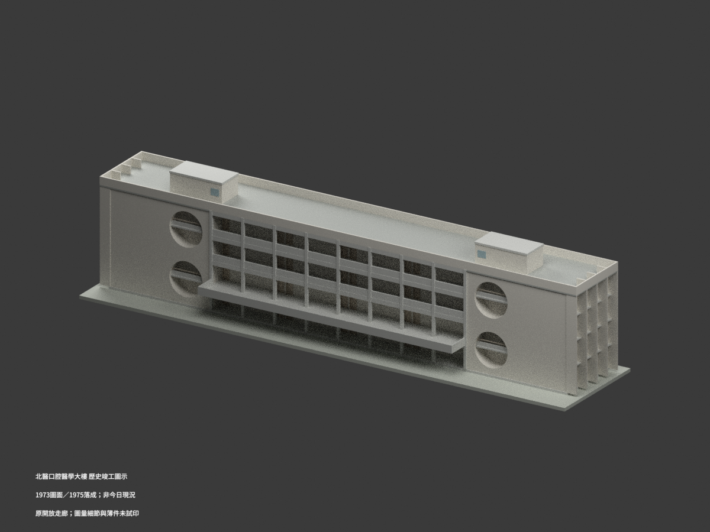
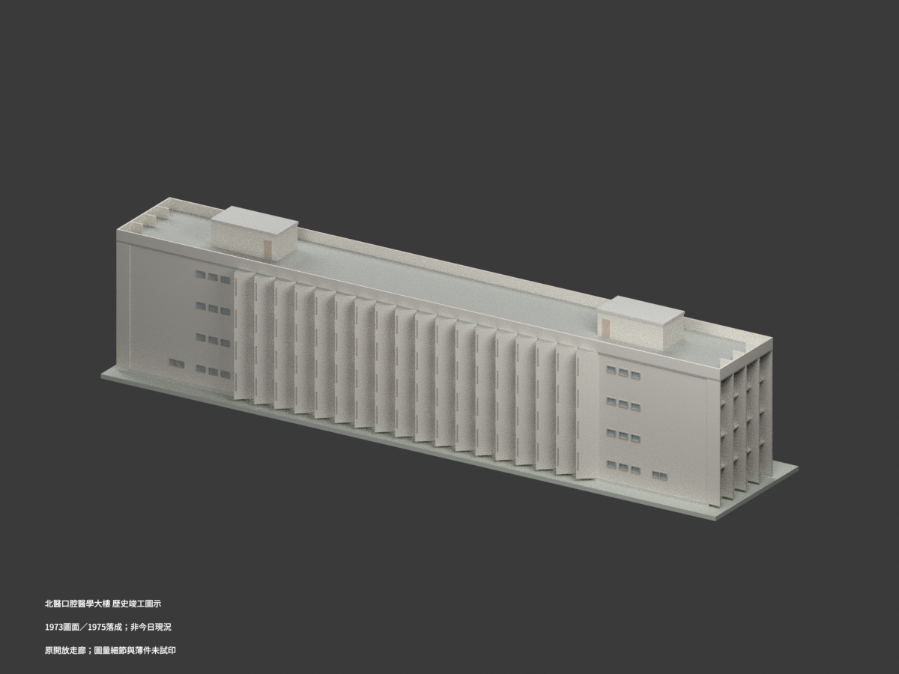
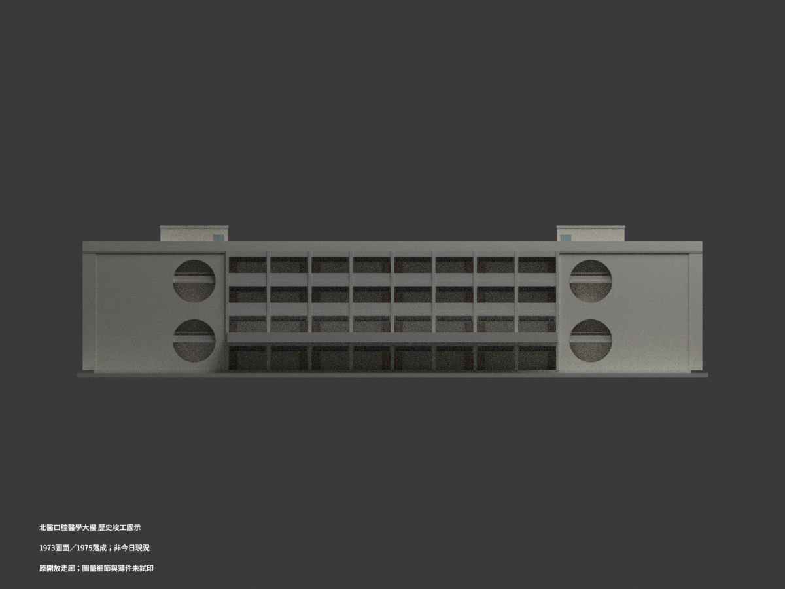
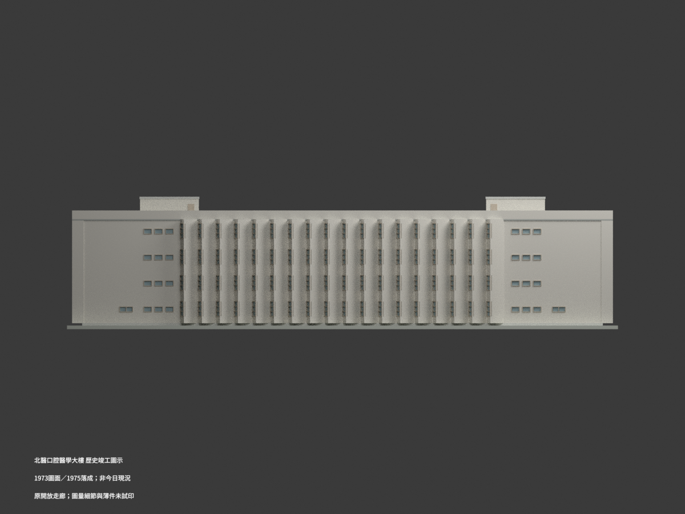
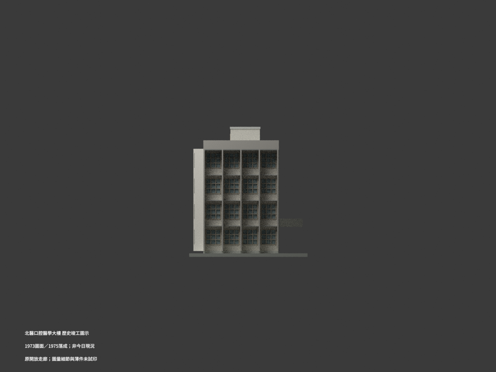
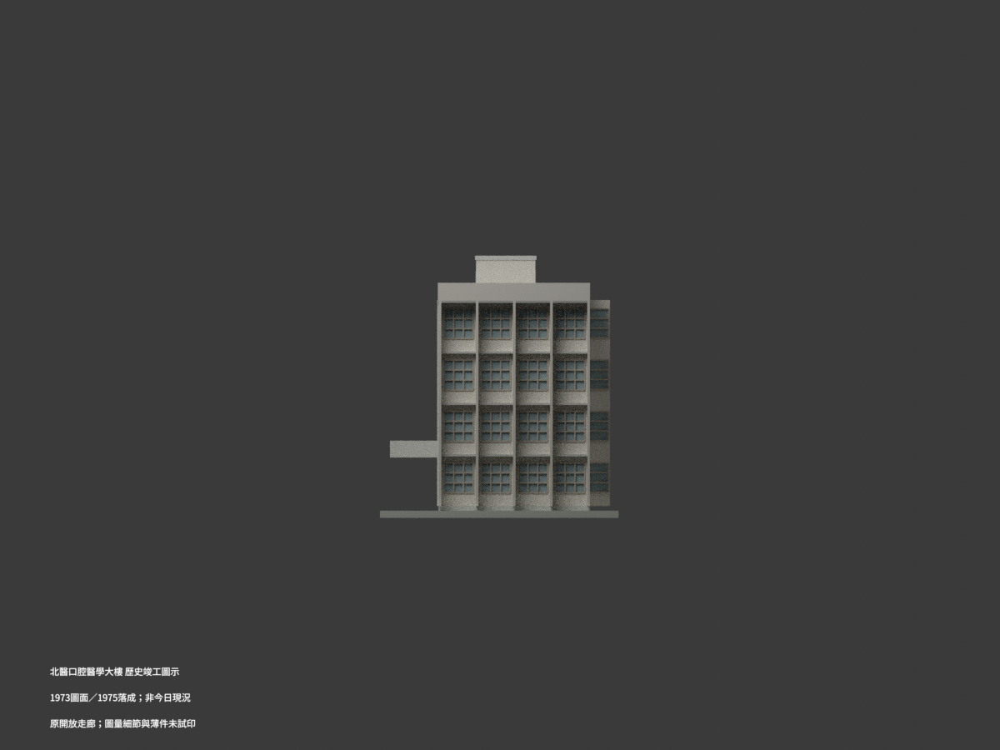
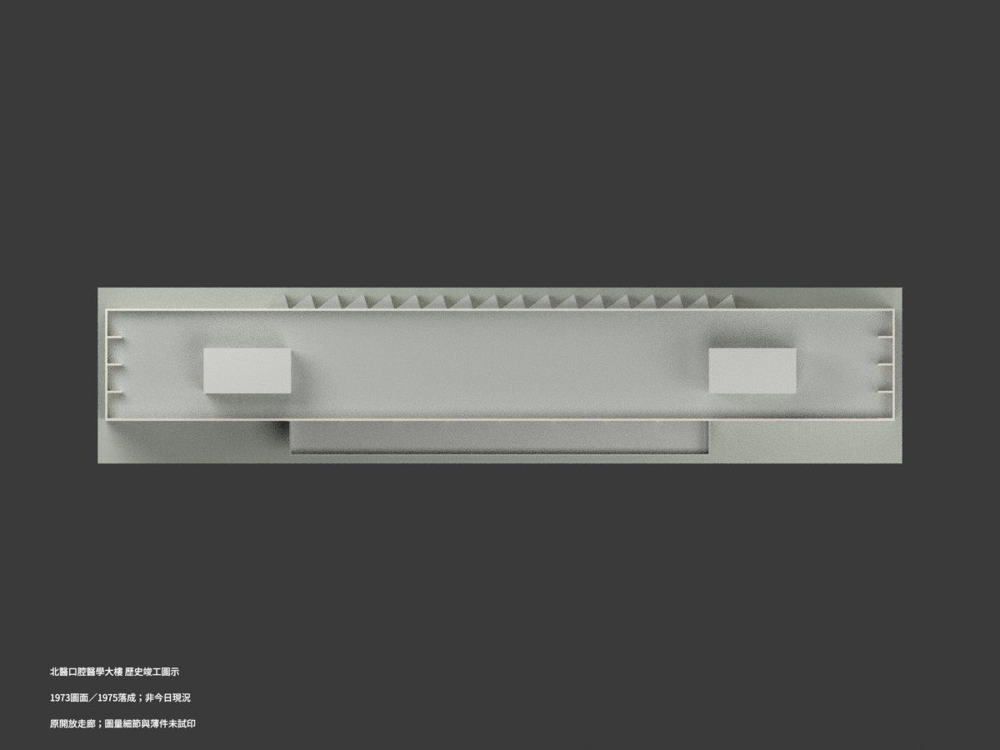
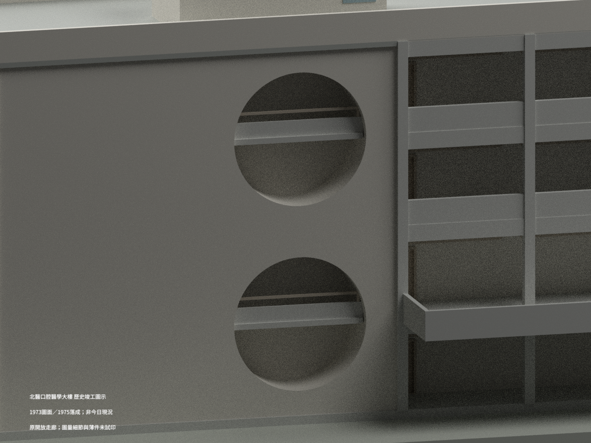
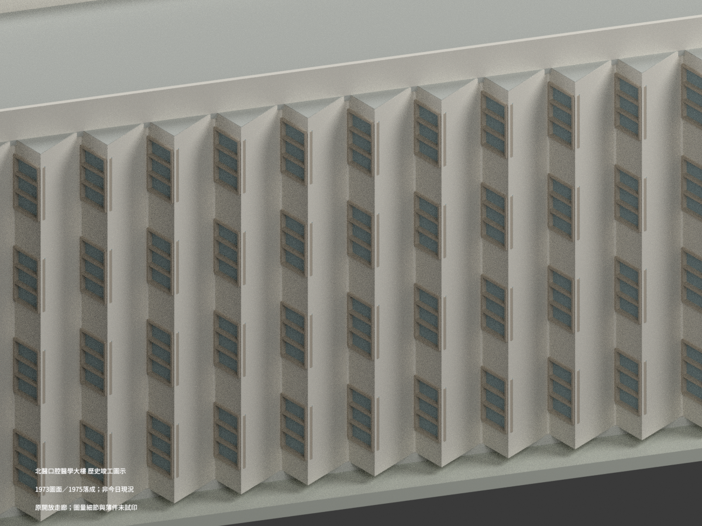
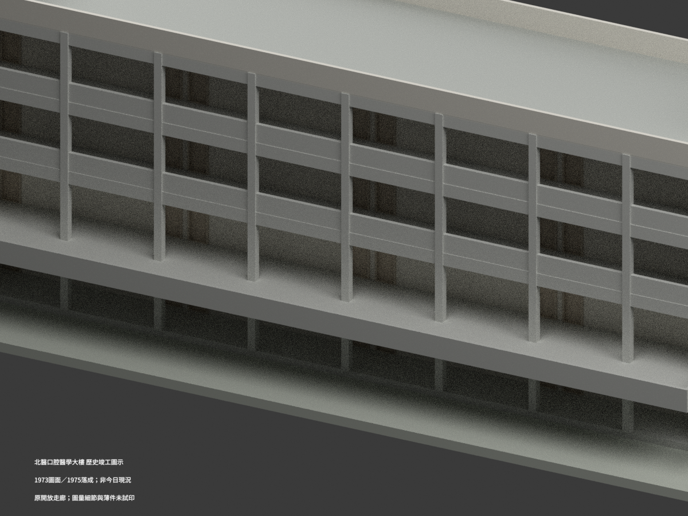

# 北醫口腔醫學大樓｜1973圖面／1975落成之歷史竣工圖示

## 1. 模型實際渲染

**重建原「私立台北醫學院普通教室新建工程」的歷史外觀，不是今日現況，未實際列印。** 圖紙題「竣工圖」並載1973年繪圖日期；官方沿革記1975年6月落成，不能將圖面日期當成實際竣工年。保留原開放前廊與四個透空圓洞，不加入1999玻璃幕牆或2006–2007電梯／整修。

| 視圖 | 視圖 | 視圖 |
| --- | --- | --- |
|  |  |  |
|  |  |  |
|  |  |  |
|  |  |  |

## 2. 檔案與重建

[STL](model.stl)／[材質3MF](model.3mf)／[Blender場景](scene.blend)，單位mm，比例 **1:250**。輸入程式為 `build_model.py`、`geometry_helpers.py`；安裝 `requirements.txt` 後：

```bash
python build_model.py
python export_3mf.py
python validate_model.py
blender -b --python render_model.py
```

Blender4.3.2／Cycles64；實際模型渲染，非來源原圖或生成式概念圖。數位水密、單連通及格式檢查不是可列印保證；薄框／管欄名義10cm在此比例約0.40mm，挑出陽台、圓洞及長走廊需要支撐與列印設定評估。展示底座厚0.50m只是模型支座，不是測量地形。

## 3. 主要來源控制

| 項目 | 控制與解讀 |
| --- | --- |
| 軸網 | 長72m＝8＋8＋10＋10＋10＋10＋8＋8；深10.40m＝4×2.60；側翼牆各外挑1.50、背折牆及前陽台另突出，72×10.4不是最外bbox |
| 樓層 | GL0／1FL0.35／2FL3.95／3FL7.55／4FL11.15／RF14.75m；四層均3.60m |
| 屋頂 | 女兒牆RF＋1.20＝15.95；雙梯屋8×4m軸尺度、牆15cm，頂為RF＋2.80＋0.30＝17.85；立面3.10總鏈交證，不採17.55 |
| 屋面 | 原1/100排水與表層做法不等於每個完成面點均RF；本包用名義屋面、未虛構逐角實測找坡及隱蔽排水 |
| 前廊 | 中央x16–56m、深2.60m為開放廊；窗在後退教室牆，不是前皮玻璃幕；後牆主要為實體，僅名義FL+2.30至3.00m高窗及各10m教室兩端門，每層中央共8門（圖量位置約±0.15m）。3/4F外緣實欄95cm，梁下65＋淨空200＋欄95＝360cm |
| 陽台 | 只有2F中央40m，外挑3.50m；A2左右半合畫2F與3/4F，不建半段陽台，也不複製到每層 |
| 圓洞 | 雙端各兩個，直徑5.20m，兩圓淨距2.00；上洞頂在RF下1.05，推圓心GL11.10／3.90m。保留透空深度、後退平台及欄牆，非整圓玻璃 |
| 圓洞5cm差 | A5上下鏈105＋520＋200＋520＋135＝1480cm，與主GL→RF1475差5cm。採RF上錨；平台採主樓面3.95／11.15，欄牆相對平台0.60、管頂0.95以維持局部絕對頂線；原詳65＋35與此協調差明記，未宣稱已消除來源差 |
| 背面 | 約18折跨x13.5–58.5，每模2.50＝2.00＋0.50，長斜段為18cm實牆、短斜段為窗，非全玻璃。外伸1.50為軸至圖示折點，不冒充含牆厚全部外bbox；端片按輪廓作有界簡化 |
| 端面 | 4個2.60m窗跨，外翼牆150cm並非加建封閉房間；窗框與小窗位置按圖量重建，約±0.10–0.20m非實測精度 |

## 4. 範圍、簡化及限制

- 官方沿革可對應本棟原普通教室／口腔醫學大樓；不混1963吳明修教學樓、1983杏春樓或其他同名第二教學大樓。本包為同一棟歷史外觀，不多別名分包。
- 主體有實牆、透空前廊、折牆／窗、圓洞及雙屋梯；室內房間、完整內樓梯、地下室、設備及周圍既有擋土牆／道路不重建。圓洞後僅保留外觀可見的平台及矮欄，陰影內壁是有界外觀模型，不是完整室內調查。
- 原A6前廊95cm實欄與A5圓洞65cm矮欄＋35cm管是不同部位，不能混用。窗格、門片、梯屋小開口、陽台邊緣等未逐項直標者按圖量，框格等距近似；管欄與細框為列印比例增厚，顏色／玻璃不透明呈現僅示意。
- 端翼牆、折牆末端與屋皮接點按原線條重建並作數位接合；屋皮內部實體退2cm作隱藏交疊，避免同面材質三角斑，不改可見RF高度；不把18折端片全稱精確同構。未精復刻原材料表面、室內細部、屋面泛水或每根窗框原寸。
- 圖示左右端與渲染檔名west/east只是模型座標，未當成獨立測量方位證明。歷史圖紙不保證今日仍同樣存在或使用。

## 5. 來源、署名與權利

設計署名：**高而潘建築師事務所（E. P. Kao Associates）**；工號6243。典藏：國立臺灣博物館臺灣現代建築圖說，CGEP23527001–03、23523005–08，共七張。

原圖影像標示 **CC BY-NC**（署名、非商業），詮釋資料 **CC BY** 分開處理。原圖、放大裁圖及私有核圖資料不放公開包；使用原圖或其衍生素材須遵守相應署名及非商業條件。本包另含新寫數值幾何與程式，沒有把原圖授權自動擴張為全部新模型的統一授權，也不保證建築設計或模型可無限制商用。詳見 [來源登錄](SOURCE_REGISTER.md)。

[北醫官方口腔醫學大樓沿革](https://history.tmu.edu.tw/portfolio-item/口腔醫學大樓/)用於身份、1975年6月落成及後期改建區分；不是把今日外觀混入原竣工圖示。
