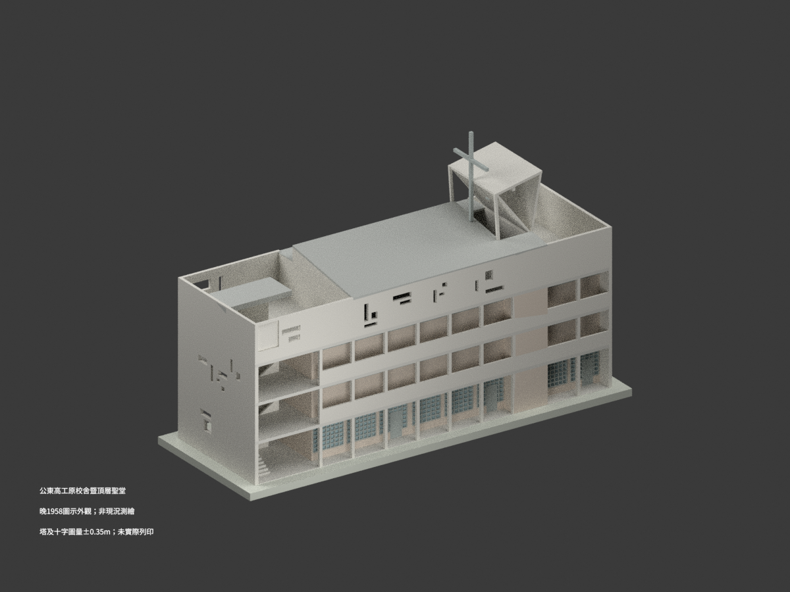
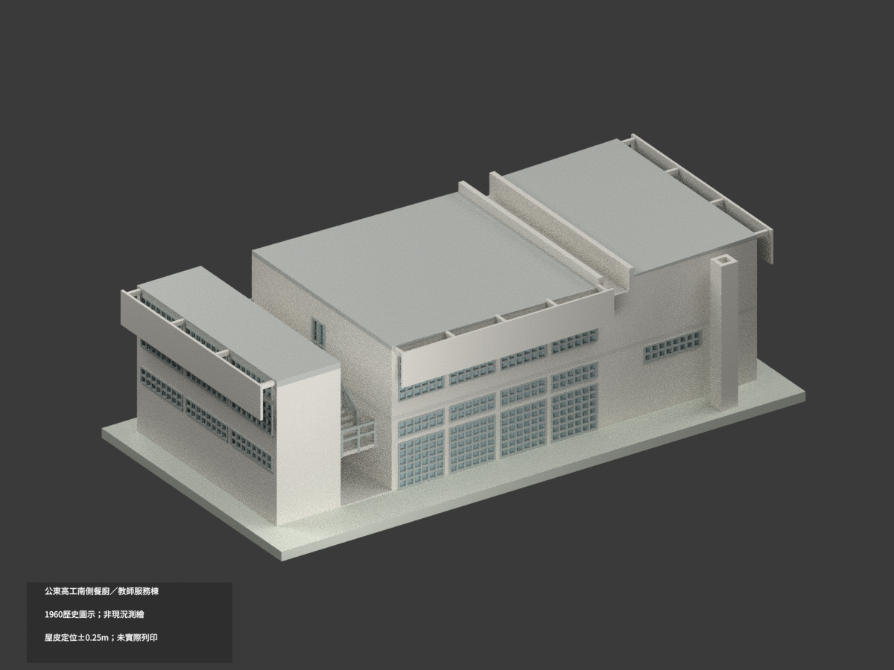

# 臺東縣私立公東高級工業職業學校建築設計模型

## 模型圖鑑

| 建築模型 | 建築模型 | 建築模型 |
| :---: | :---: | :---: |
|  **[原校舍暨頂層聖堂｜晚1958歷史設計](校本部/buildings/kungtung-original-school-chapel-1958-design/README.md)** [STL](校本部/buildings/kungtung-original-school-chapel-1958-design/model.stl) · [彩色3MF](校本部/buildings/kungtung-original-school-chapel-1958-design/model.3mf) · [Blender](校本部/buildings/kungtung-original-school-chapel-1958-design/scene.blend) |  **[南側原行政／餐廚教師服務棟｜1960歷史設計](校本部/buildings/kungtung-south-service-block-1960-design/README.md)** [STL](校本部/buildings/kungtung-south-service-block-1960-design/model.stl) · [彩色3MF](校本部/buildings/kungtung-south-service-block-1960-design/model.3mf) · [Blender](校本部/buildings/kungtung-south-service-block-1960-design/scene.blend) |  |

現行收錄 **2 套模型包**；不是全校建築數或全校完成。

## 收錄範圍

同一四層原校舍暨頂層聖堂一模型包，不拆為另一棟或另一套。採晚1958圖面；官方1960落成沿革不代表模型逐項實建證明，非今日現況。晚屋皮12.89±.05／14.11±.10m，塔17.85／十字20.85±.35m圖量；樓板分鏈31.42與總31.47m差5cm，依可閉合晚屋頂鏈定位。外梯窄罩與主屋面分開，早版屋頂排除。開口、鐘體、細框有界簡化；1:200，168.35×60.95×107.5mm，未實際列印，底座不是地形。

[校方網站](https://www.ktus.ttct.edu.tw/home)使用校名臺東縣私立公東高級工業職業學校，簡稱公東高工；[校史](https://www.ktus.ttct.edu.tw/home?cid=474)另載歷史議定校名含天主教前綴，非另校。此目錄歸高中職分類；同一原校舍暨頂層聖堂，不拆棟計套。

保留設計者與官方文件來源連結；館藏原圖CC BY-NC、元資料CC BY分開，原圖、裁圖和私人參考包不公開，不保證商用或無限制再利用。

[校本部圖鑑](校本部/README.md) · [回總目錄](../README.md)

## 南側服務棟歷史設計

同一南側原行政／餐廚教師服務樓，1960年2月外觀圖主控、4月結構草圖輔核，非聖堂原校舍或Trakt II，不稱精確竣工或現況。屋皮邊6.77m與2%坡向有底槽為透明協調，整體±0.25m；槽口7m。8cm薄屏加厚至12cm，窗格與門位有界圖量，隱蔽地下室及內部設備未建。1:150，175×90×50mm，未實際列印，展示底座非地形；原圖CC BY-NC私存，不保證商用權利。
