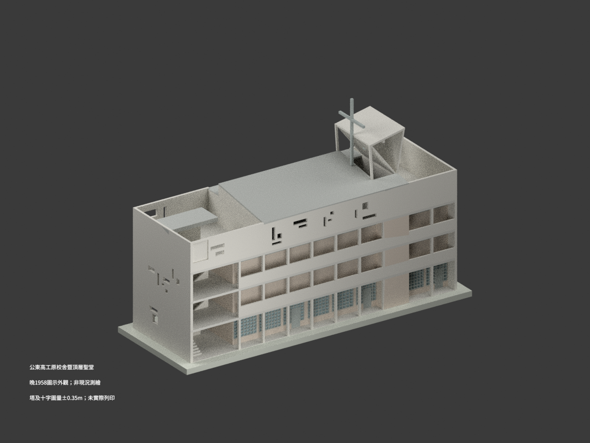
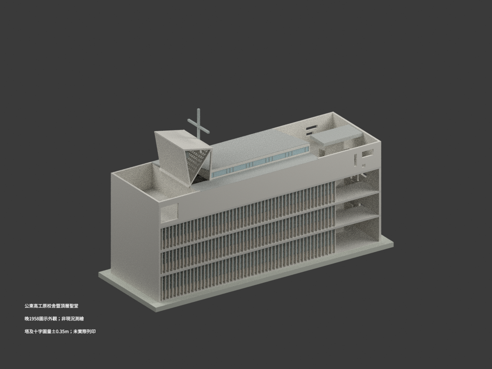
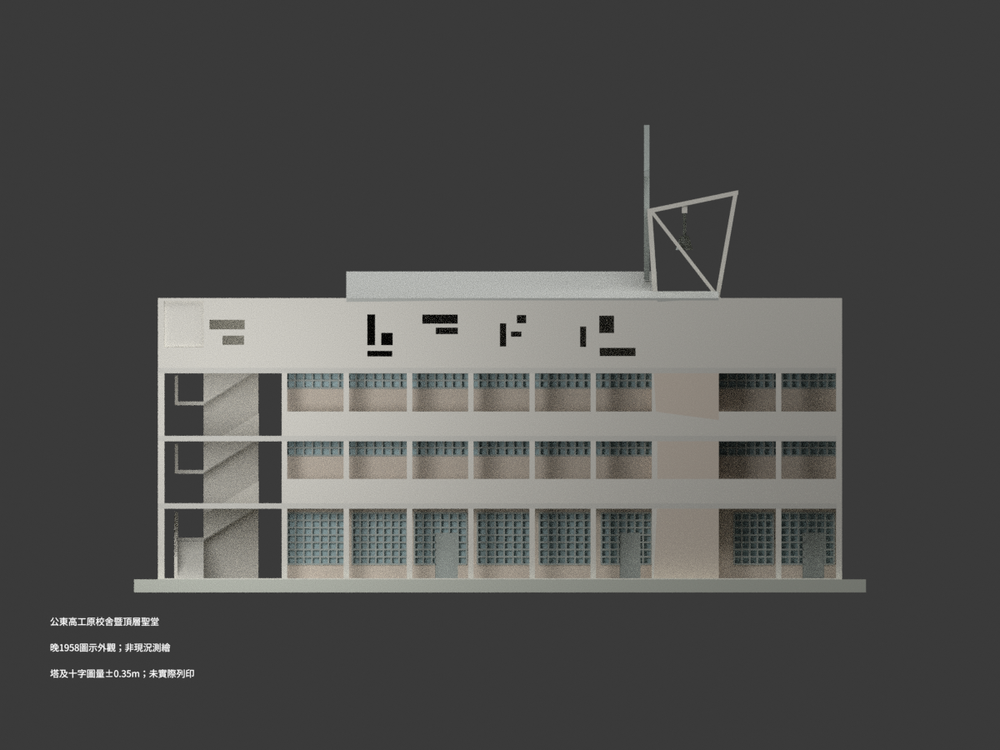
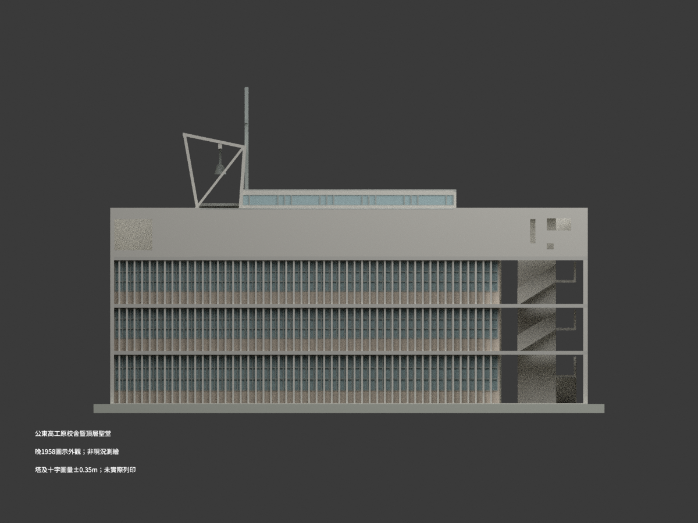
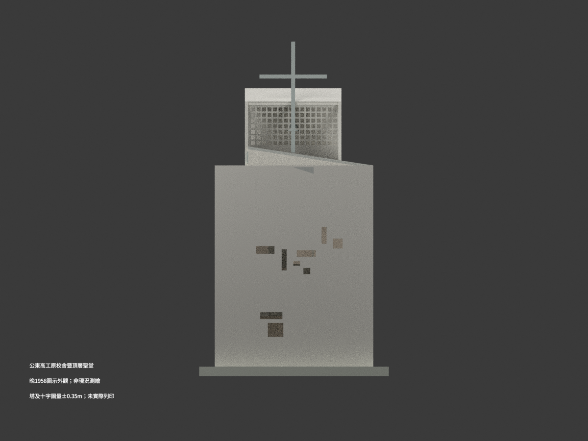
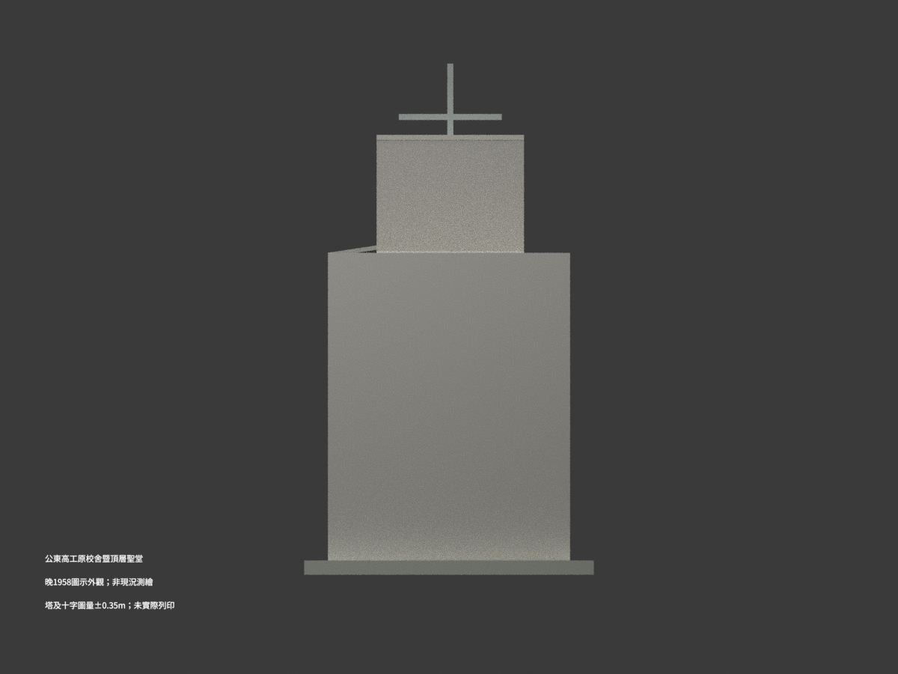
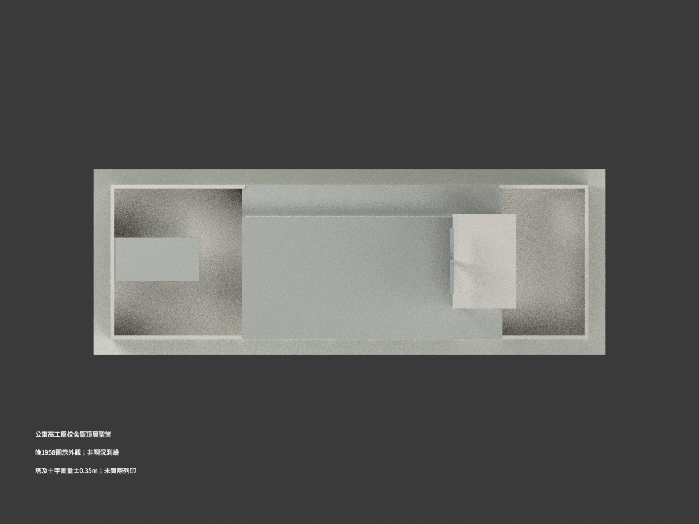
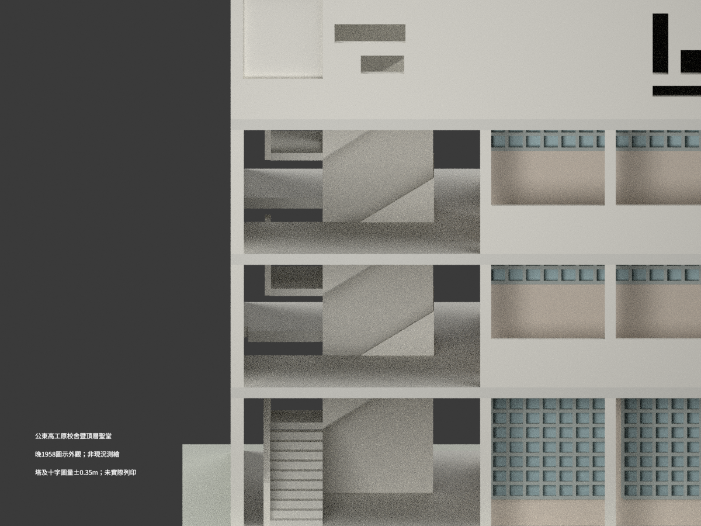
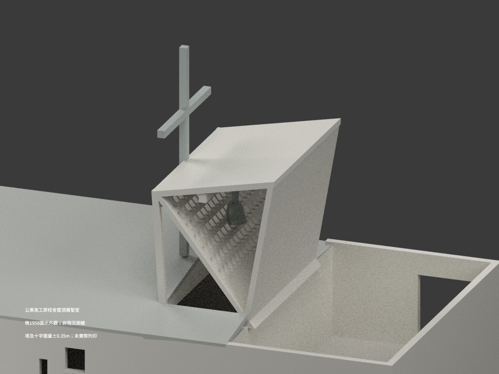
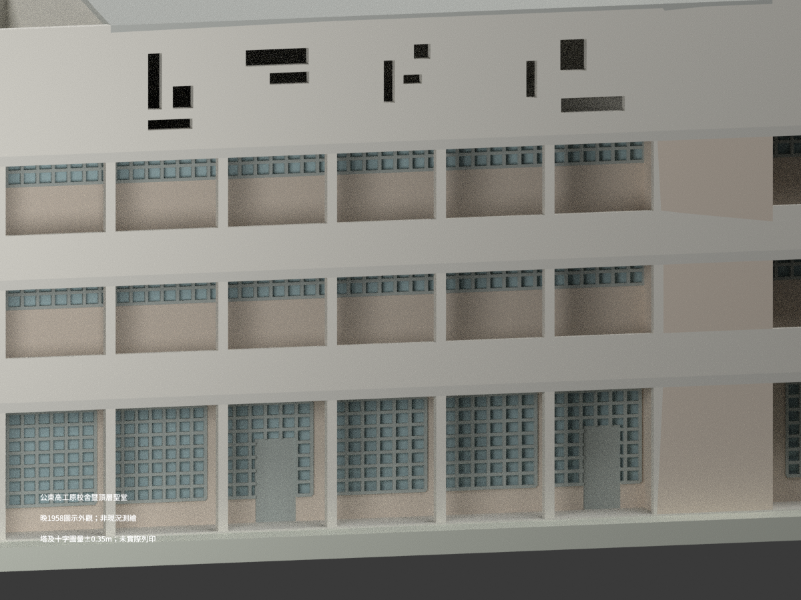

# 公東高工原校舍暨頂層聖堂｜晚 1958 歷史設計圖示

## 模型實際渲染與範圍

**同一四層原校舍的歷史外觀重建，不拆聖堂另計一棟。不是現況測繪或逐項實建證明；未實際列印。** 官方記載 1960 落成；模型選用晚 1958 圖面組，不把 1961 創校典禮當落成年份。下列均為本模型實際渲染，不是來源照片。

| 西側透視 | 東側透視 | 西長面 |
|---|---|---|
|  |  |  |
|  |  |  |
|  |  |  |
|  | 三張細景刻意局部取景 | 原圖與私人審核裁圖不隨包公開 |

## 比例、檔案與重建

- **1:200**；STL、3MF 單位 mm，Blender 場景與同一三角網格相符。模型含作者展示支座，**不是歷史地形或實測地坪**。
- 主樓外控制長 31.47m、寬 10.19m，並非把全部範圍擠出成實心盒：保留外廊退縮、兩端頂露台、外梯空間、東側遮陽片與斜塔透空格。
- 以 `1FL=0`，上層 +3.45/+6.55/+9.68m。來源局部地面 −0.81/−0.84m 不擴充為全場地高程。展示底座頂 −0.05m、底 −0.65m；它只用來連接列印模型。
- `build_model.py` 與 `geometry_helpers.py` 是完整幾何輸入；Python 需 numpy、trimesh、manifold3d。執行 `python build_model.py`、`python export_3mf.py`、`python validate_model.py`。Blender：`blender -b --python render_model.py`；重開測試 `blender -b --python-exit-code 1 --python verify_scene.py`。
- `mesh.npz` 保存共用三角網格/材質索引；`components.json` 是作者元件清單，元件名稱或個數本身不等於來源審核通過。

## 版本與數值限制（重要）

1. 採 October 1958 註記長立面、兩短端、屋頂結構及 A-A 3/1、B-B 3/2。明註 **Überholt** 的舊西立面只作歷史比對。早 7 月屋面 13.53/14.88m 與塔 18.53m 整組不採，不混入晚外觀。
2. 主低屋皮名義 **12.89±0.05m**，高屋皮 **14.11±0.10m**。高側 1.23m 引線已到外皮基準，不能再整套加 11cm。局部碎石、收邊及手繪輪廓含於解讀容許，不是測量精度。低祭台帶採晚圖 1.90m 參考，不沿早剖 2.12m；其微斜另按 A-A 外皮線圖量內端12.88→外端12.80m（高差0.08±0.04m、絕對±0.05m），不是直接坡註或主低屋12.89的整片平板。
3. 外梯有自己的窄罩：名義頂 **12.78±0.05m**、下皮約 12.35m，不套主屋面。只蓋中央梯帶，不蓋滿前露台。首跑轉 90°；20/18/18 落階與外廊 −2cm、首梯 −4cm、頂露台 +5cm 完成基準分開協調。中央 25cm 支承片接罩底，兩側梯下仍留空。罩上原註約 1.5% 找坡，模型採名義外皮與厚度的有界簡化，未復刻微小排水層；局部護壁與平台邊界依圖量協調。
4. 塔高側名義 **17.85m**、低側 17.00m、十字頂 **20.85m**，皆為兩向晚立面校尺圖量，整體 **±0.35m** 重建解讀範圍，不是直標高程。斜外框、斜格孔面和十字按晚輪廓；16×7 透空格不填玻璃。鐘體只呈示意外輪廓，不復原鐘機構。
5. 樓板分鏈原字 **552**，先期讀作 557 已撤。30+552+852.5+845+862.5=**31.42m**，與直接總長 **31.47m** 差 5cm。晚屋頂完整鏈另能閉合 31.47m，因此依晚屋頂鏈定位，不拉伸樓板或篡改分項湊和。
6. 兩短端原圖的 Ost/West 字樣與長面命名不一致，按梯端／實牆端／散孔梯端及平面對位，不按文字盲鏡射。西面下層背窗退於外廊後；東側 50 支遮陽片後的窗不是西門窗鏡射。頂層西散孔、東高窗、遠端露台大孔分別對位；短端散孔在 x0 梯端（從此端同見塔格網與十字），遠端實牆。先期短端錯置已撤回。
7. 開口位置與分格多為圖量 **±0.15m**；遮陽片位置約 ±0.05m。10cm 片寬為列印加厚至 12cm（模型 0.60mm），細框約模型 0.4mm。密窗格、鐘體及材料色為外觀簡化，不稱實物顏色或工藝精刻。西端像龕保留，藝術立像細節未造。隱蔽內隔、家具、完整地形及後建校舍不在本包。
8. 1959-10-19 室內完成層手註不被當作全面調高外觀的依據；不承諾精確室內門檻。

## 來源、作者及權利

建築師 **Justus Dahinden（達興登）**，結構工程師 **E. Schubiger**。來源為國立臺灣博物館建築圖資館藏 CDJ-101 系列；逐張角色及連結見 `SOURCE-REGISTER.json`。

- [官方文化資產身分與沿革](https://tcmb.culture.tw/zh-tw/detail?id=263794&indexCode=Culture_Object)
- [晚西立面](https://collections.culture.tw/docomomo_collectionsweb/Collection?GID=MSMG0ZMB)
- [晚屋頂結構](https://collections.culture.tw/docomomo_collectionsweb/Collection?GID=M6MG0ZMB)
- [A-A 詳剖](https://collections.culture.tw/docomomo_collectionsweb/Collection?GID=M2MG0ZMB)
- [外梯詳圖](https://collections.culture.tw/docomomo_collectionsweb/Collection?GID=MAMB0ZMB)

原圖影像標示 **CC BY-NC**，資料庫元資料另為 CC BY；兩者不混用。原圖、裁圖及私人恢復包不在公開交付清單。公開內容為本次重建程式、幾何、渲染與檢查紀錄；來源署名及非商業限制不得被抹去，亦不因程式或倉庫授權而保證模型、建築設計或任何衍生成果均可商用。使用者須自行核對適用權利。

## 檢查與製作限制

最終檢查紀錄會綁定實際網格 hash：三格式一致性、閉合單體/正體積、隔離重建、Blender 重開、10 圖解碼與取景，另有人工來源與視覺覆核。**未實際列印，不保證免支撐、薄件耐用或任何設備/材料的一次成型率。** 外梯、懸挑、細格與十字須由製作者依列印方式評估支撐與方向。
