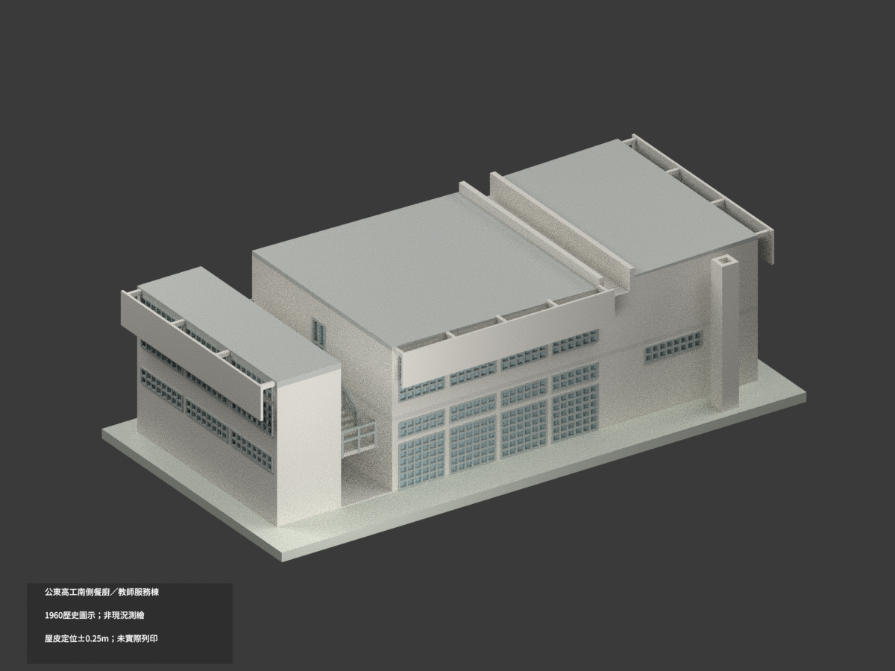
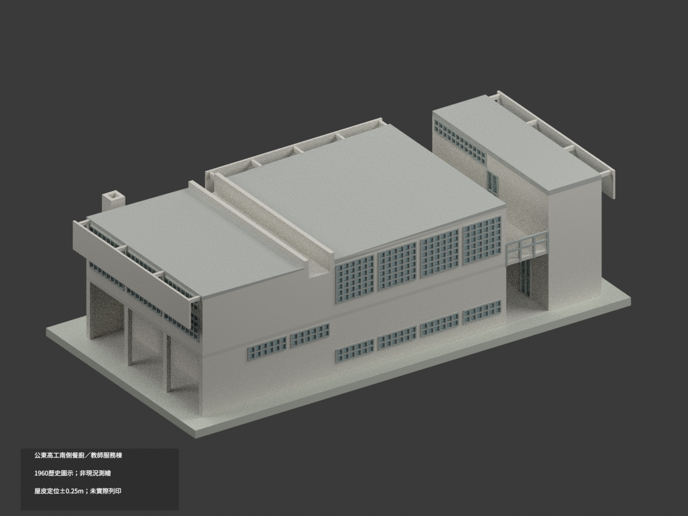
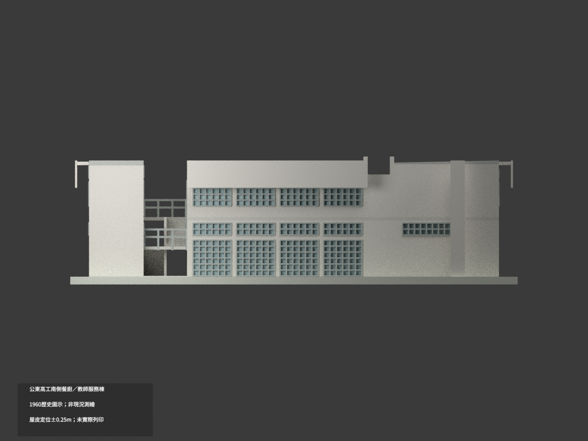
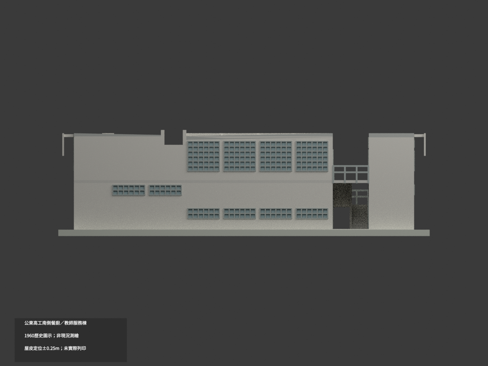
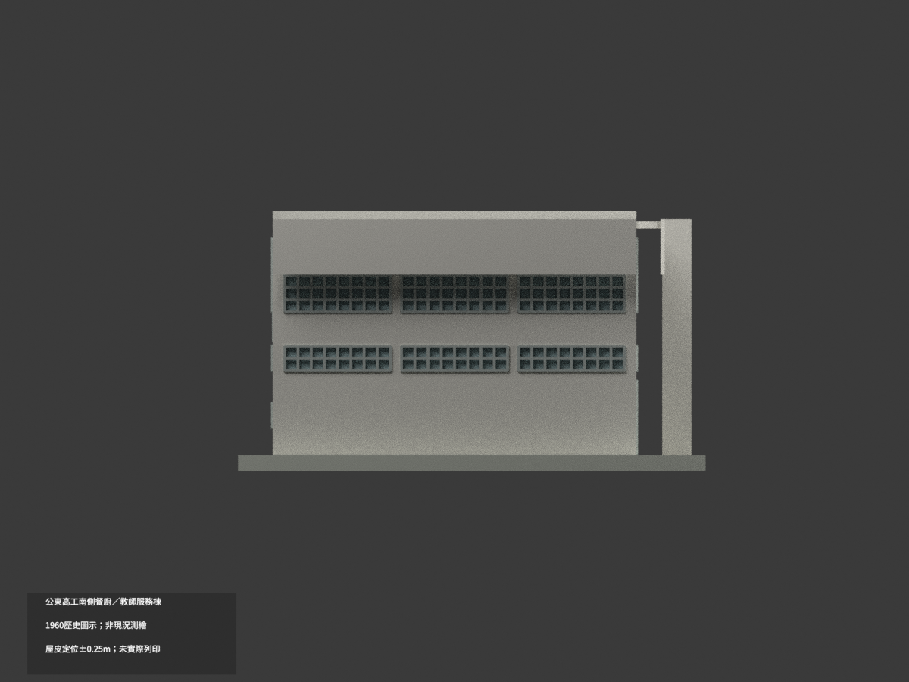
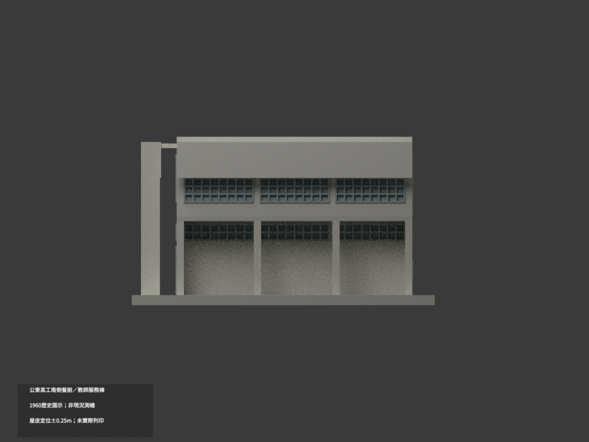
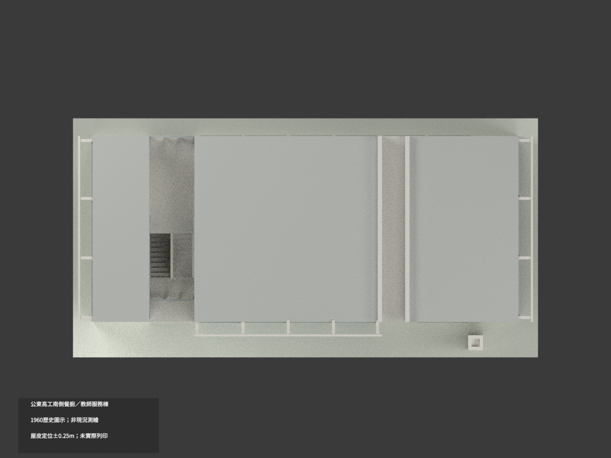
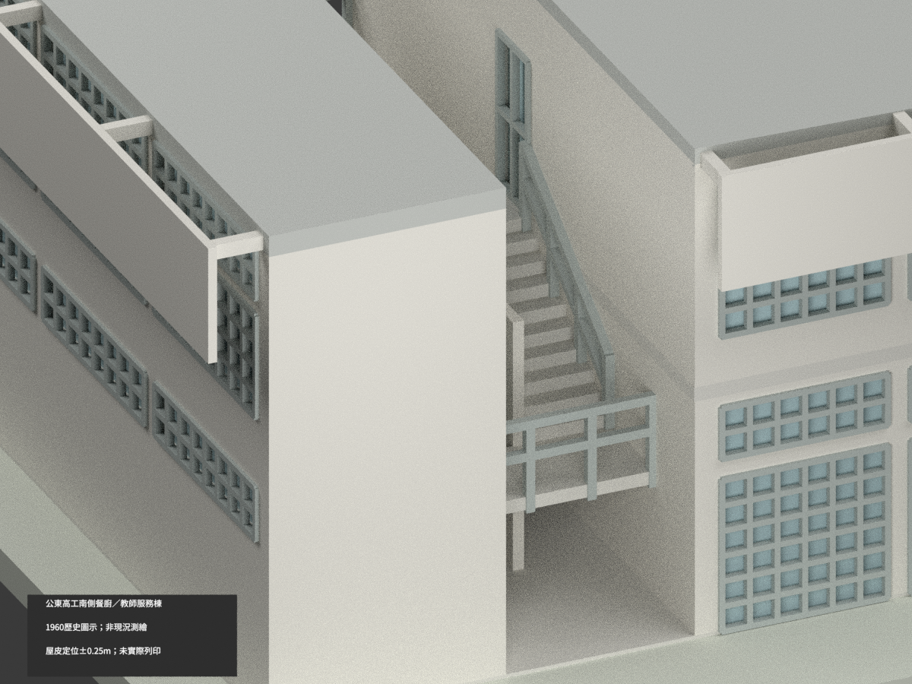
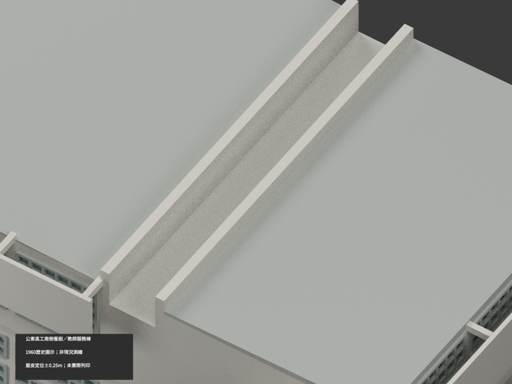
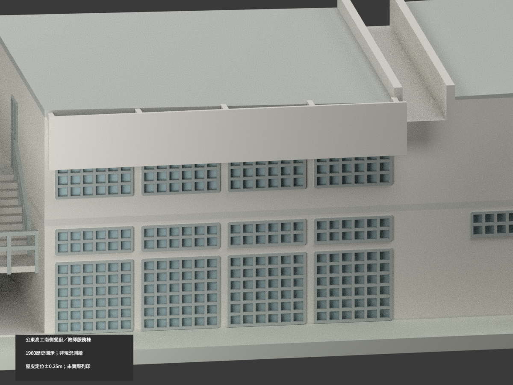

# 公東高工南側原行政／餐廚教師服務棟｜1960歷史圖示

## 模型圖片與範圍

**歷史外觀重建，非精確竣工或現況測繪；尚未實際列印。** 原建築師 Justus Dahinden。此包是一棟南側服務樓，不含聖堂校舍或 Trakt II；不重建隱蔽地下室、內部設備。屋皮垂直定位保留 ±0.25 m 來源解讀不確定性。

| 圖片 | 圖片 | 圖片 |
|---|---|---|
|  |  |  |
|  |  |  |
|  |  |  |
|  |  |  |

## 原圖控制與有界重建

- 主體24.05 × 10.50 m，首層0、二層3.45 m；西側2.55 m梯區上方露天。20落階為兩跑各10落階／9個28 cm踏面，北側平台不是窄橋；木欄保透空，桿件／間距為圖量與列印加厚。東外帶局部地坪依 F−4 cm，未延伸為全場地高程。
- 首層東端2 m為有頂外帶，南北兩端保25 cm返牆、東柱間開放，不填成封閉房間；四面窗不鏡射。端面上層為1.40 m窗＋25 cm實梁＋70 cm高窗；主南北四組依各自立面連續窗帶圖量，不把端剖誤套。北廚房局部分鏈與總長約差5 cm，保留而不拉伸湊合。
- 外屋緣6.77 m由剖圖板底6.55、板厚12 cm與4+2+4 cm表層推導。2%向槽坡形採單一透明定位協調，整體±0.25 m；不宣稱隱板仍全域水平或各點為原圖精確EL。4月東翼16 cm配筋資料不自動加高外皮。
- 中央1.80 m寬採光排水槽有底：底面5.95、唇頂7.00 m（±0.05 m），不是貫穿建築的院落。煙囪84 cm方，頂約6.77±0.10 m圖量，非全棟最高；頂孔45±10 cm為平面比例圖量，淺凹25 cm僅為列印外觀表達，非真煙道深度。
- 混凝土遮陽薄屏厚原8 cm、離牆70 cm；為展示／試印候選加厚至12 cm。窗框簡化、顏色為示意，未聲稱原色；開口位置與細部保留圖量誤差。

## 比例、重建與檢查

比例 **1:150**；模型格式以mm輸出，展示支座厚0.50 m為作者添加，不是實測地形。細薄框件與跨空屏、梯仍可能需要支撐／加厚；未實際列印，不保證直接可印。

完整幾何輸入為 `build_model.py` 與 `geometry_helpers.py`，使用Python/numpy/trimesh/manifold3d。先執行build，再執行export_3mf.py與validate_model.py；Blender執行render_model.py，verify_scene.py重開檢查。STL、3MF、mesh.npz與scene.blend由同一網格導出。QA紀錄在各JSON；圖片包含7張全景及3張刻意局部細景。

## 來源、版本與權利

1960年2月七組採用圖中的建築平立剖為主；4月配筋草圖僅輔證屋面拓樸，不把副本不同柱距混入。詳見 SOURCE-REGISTER.json、SOURCE-CONTROLS.json。

館藏原圖各別標示 **CC BY-NC**（未標版本）。原圖、裁圖及私人研究檔不隨模型公開；館藏metadata與圖像權利分開。原作者為 Justus Dahinden，收藏欄不代替建築作者。模型與程式不轉授原圖權利；來源衍生素材應遵守實際署名／非商業限制，**不保證商用**。本包不以任何repository通用授權覆蓋原建築／原圖權利。

- [north elevation75/30,29Feb1960](https://collections.culture.tw/docomomo_collectionsweb/Collection?GID=MIMKMYM6MLM2)
- [south elevation75/30,26Feb1960](https://collections.culture.tw/docomomo_collectionsweb/Collection?GID=MFMKMYM6MLM2)
- [west/east elevation84/30,29Feb1960](https://collections.culture.tw/docomomo_collectionsweb/Collection?GID=MGMKMYM6MLM2)
- [section63/40,26Feb1960](https://collections.culture.tw/docomomo_collectionsweb/Collection?GID=MAMKMYM6MLM2)
- [ground plan63/40,23Feb1960](https://collections.culture.tw/docomomo_collectionsweb/Collection?GID=MBMKMYM6MLM2)
- [upper plan63/40,24Feb1960](https://collections.culture.tw/docomomo_collectionsweb/Collection?GID=M6MKMYM6MLM2)
- [roof reinforcement513-13,11Apr1960,topology crosscheck only; not wholesale architectural override](https://collections.culture.tw/docomomo_collectionsweb/Collection?GID=MZMPMYM6MLM2)
