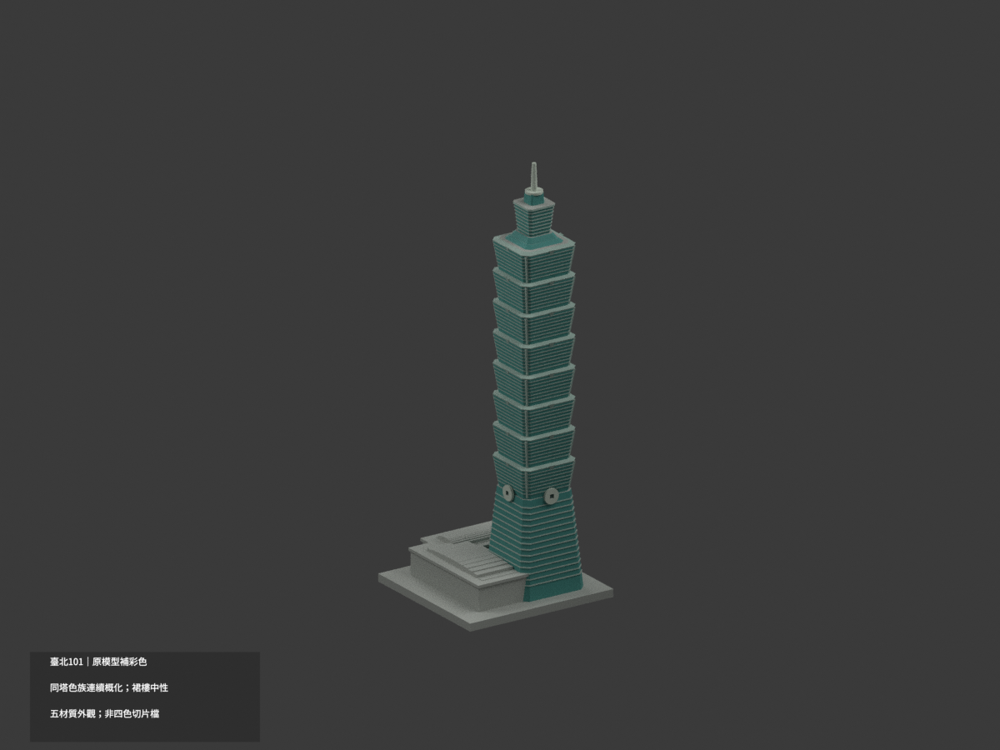
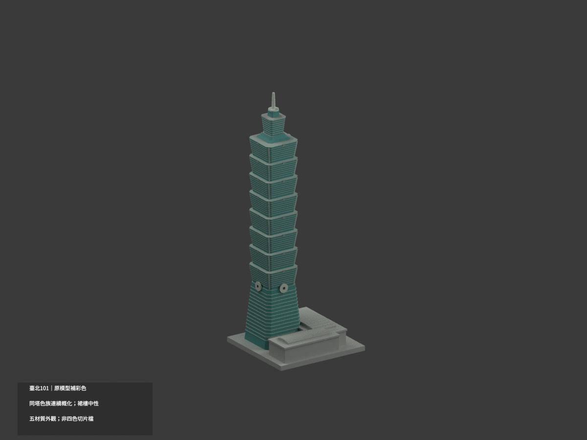
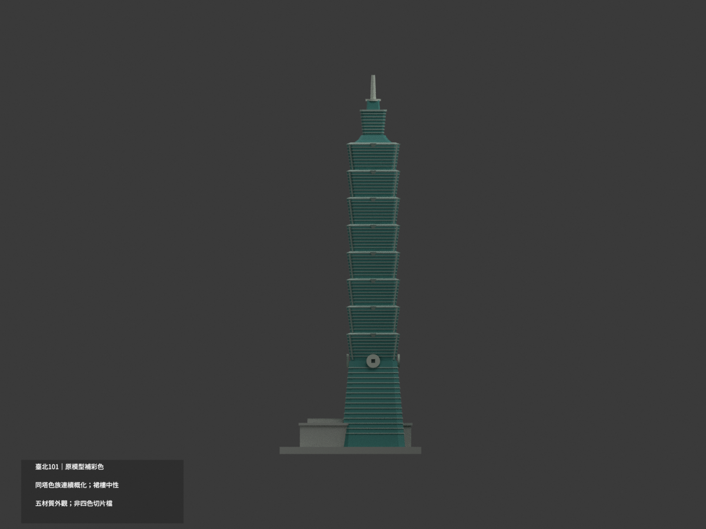
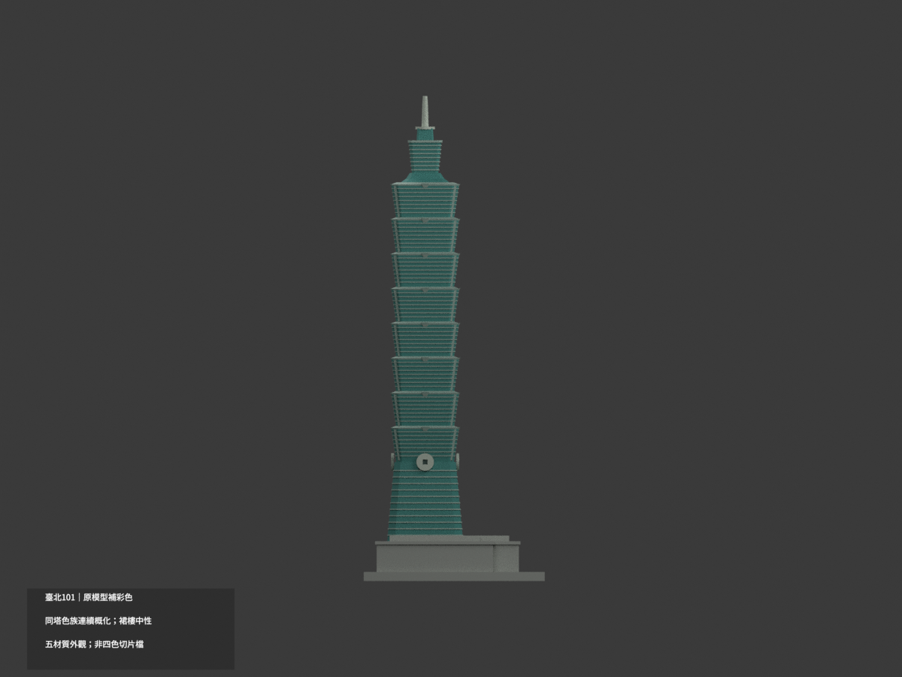
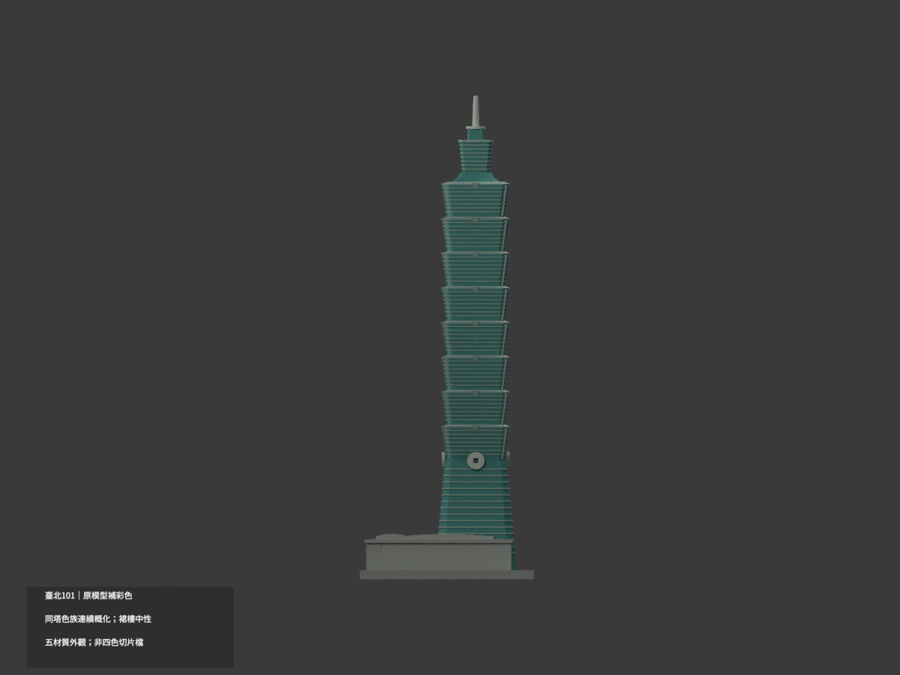
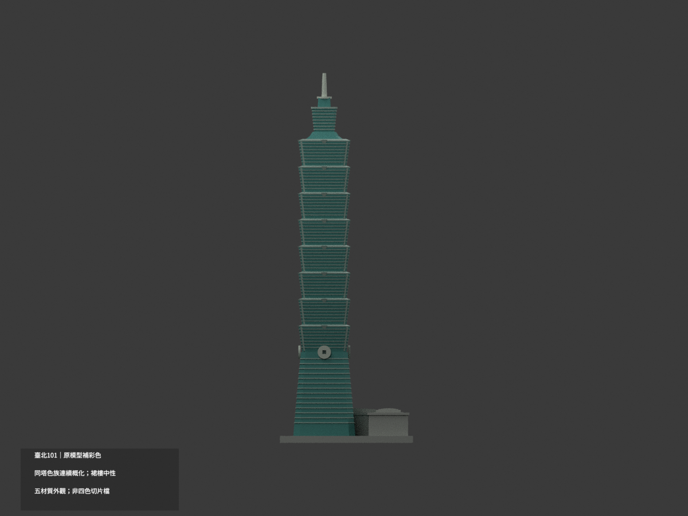
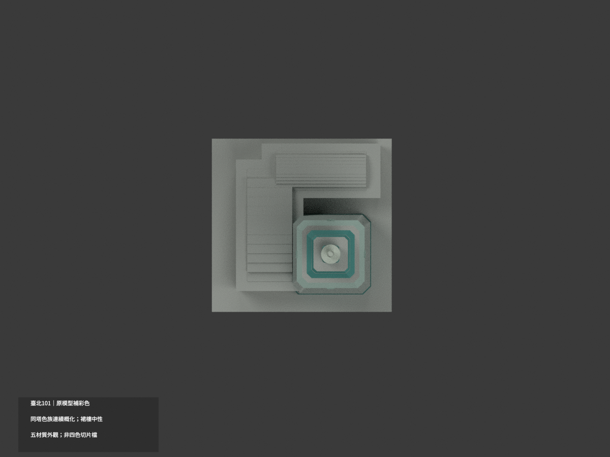
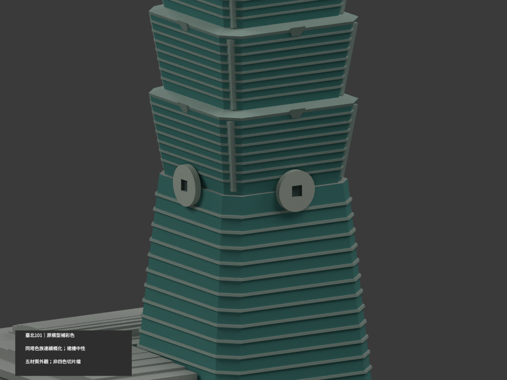
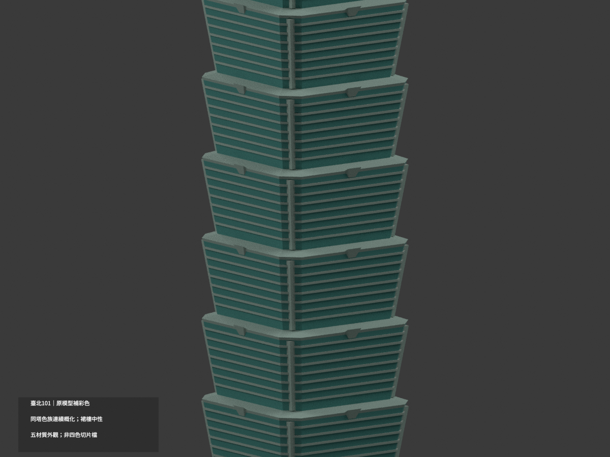
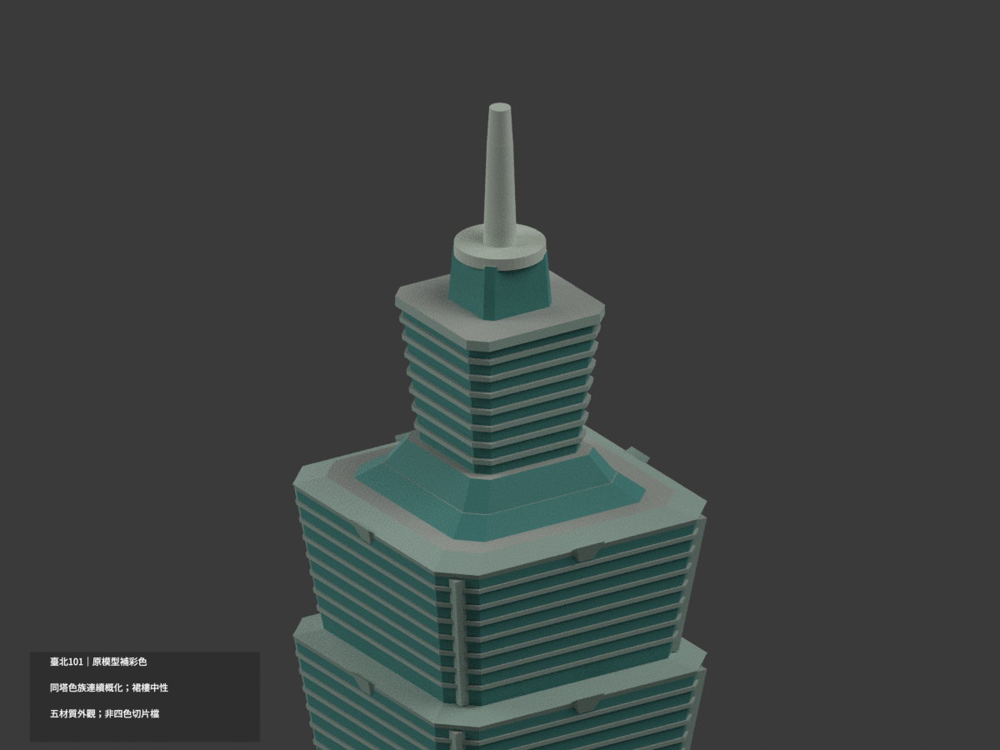

# 臺北101｜原150 mm模型材色更新

| 彩色預覽 | 彩色預覽 | 彩色預覽 |
|---|---|---|
|  |  |  |
|  |  |  |
|  |  |  |
|  | | |

## 材色範圍
同一既有項目補彩（count_delta 0），保留原12444三角面、頂點、STL與build_model.py；不新畫樓層線、不切分三角、不加文字或紋理。尺寸仍為原獨立150 mm模型，不是與其他建築共同比例。

- 主塔玻璃色族採低飽和青灰／灰綠；**四向一致是同一塔幕牆材料連續的有界概化，不是四向照片逐一測繪。** 原實心塔壁並非透明玻璃復刻。
- 只有原有凸橫帶、角柱、如意簡化帽採淺灰金屬色；古錢圓飾與尖桿銀灰，原凹心一般暗色。未添加更精密的窗格、鐘面或雕刻。
- L形裙樓與桶狀屋面被白日照片遮擋，保中性；夜景僅辨位置，不把黃燈或夜藍塗成日間材色。未證水平冠塔台面亦中性。
- 原有樓層節奏、角柱、裙樓仍是粗化近似，新增色彩不為原幾何準確度背書。色票非校準色值，圖片拍攝年月未確認，非某年精確竣工／現況外觀。
- 五材質外觀標籤並非四色或多色切片作業；**未實際列印**，未證免支撐或可直接多料輸出。STL格式本身不保存材色。

## 檔案與重建
[彩色3MF](appearance.3mf) · [彩色Blender](scene.blend) · [保留原STL](model.stl)

build_model.py產原幾何；colorize_model.py只指派既有三角面材質；export_appearance.py寫3MF基本材料；render_color.py產十圖/場景。validate_color.py驗原STL、完整三角座標、3MF、保留的隔離重建；verify_color_scene.py重開實際Blender shader與面索引。既有Python環境numpy/trimesh/manifold3d/Pillow；Blender4.3.2。

## 來源與權利
熊谷組公開臺北101工程頁的白日照片支持主塔青灰、淺灰金屬與銀灰圓飾。另一張白日照多遮擋；夜景不當日間校色。照片與網頁註all rights reserved，未確認CC或可商用再授權；來源照片僅私人保存，不公開、不貼圖。詳COLOR-SOURCE-REGISTER.json。

## QA與保留歷程
COLOR-FORMAT-GEOMETRY-QA.json、SCENE-QA.json、FRAMING-QA.json、DELIVERY-QA.json及INDEPENDENT-COLOR-VISUAL-QA.json為本次材色QA。原單色previews和ORIGINAL-MONOCHROME-README.md保留，舊validation/layer檢查不代表新增材色已印驗。上方十圖與scene.blend為新版入口；沒有刪檔，舊原包另私人保存。
