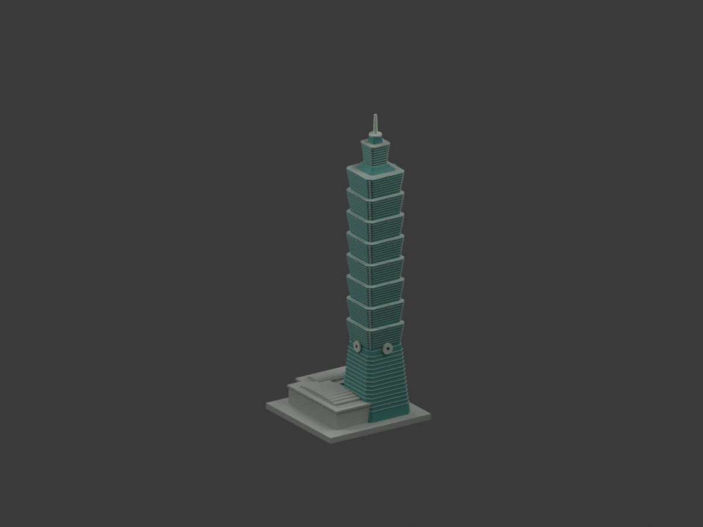
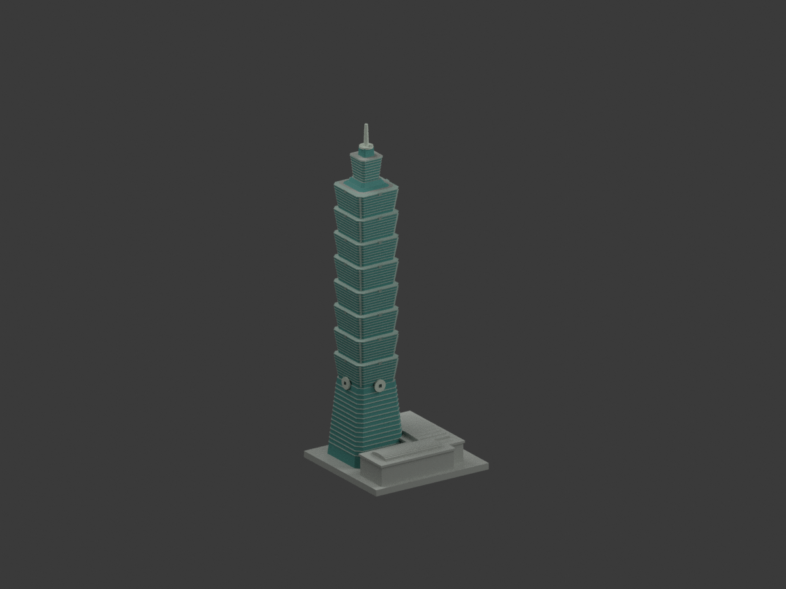
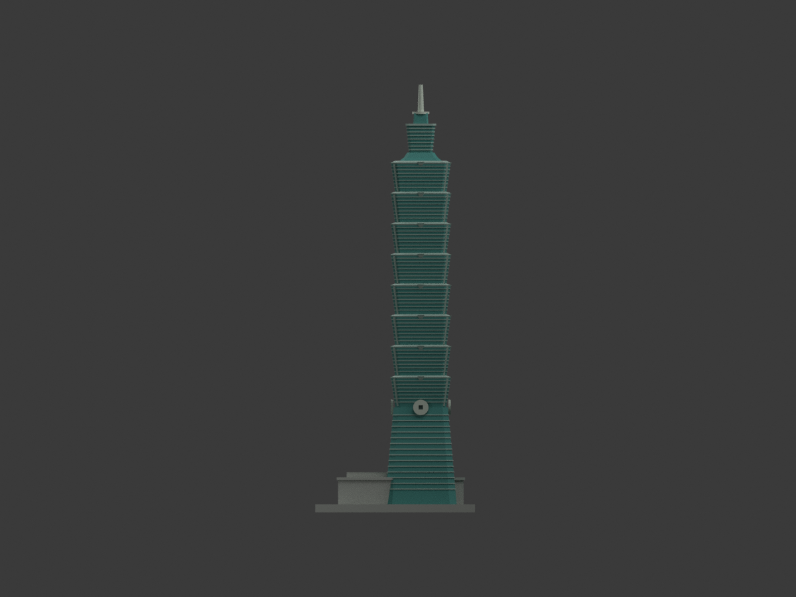
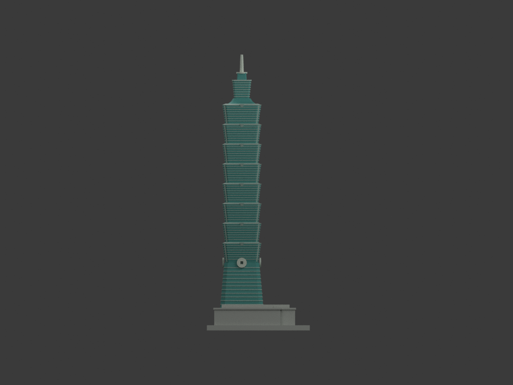
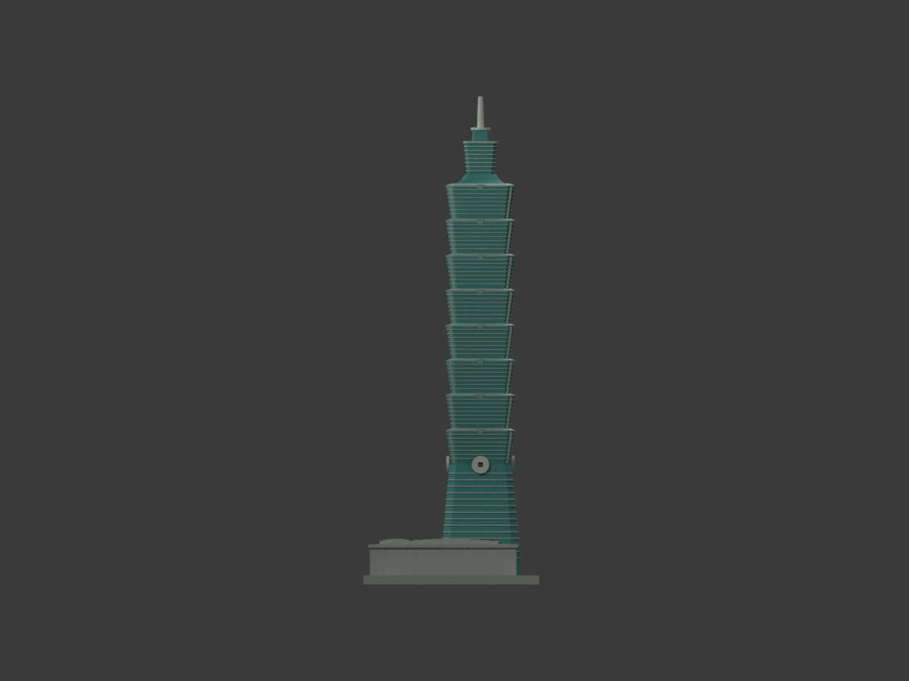
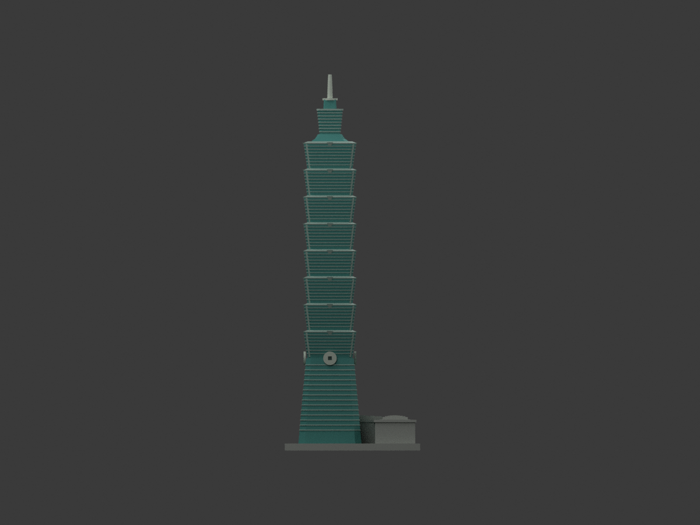
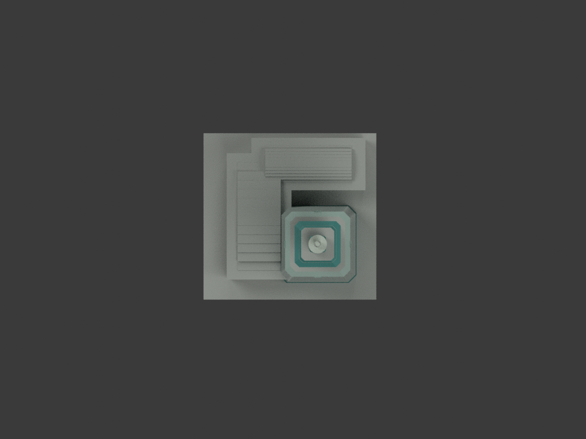
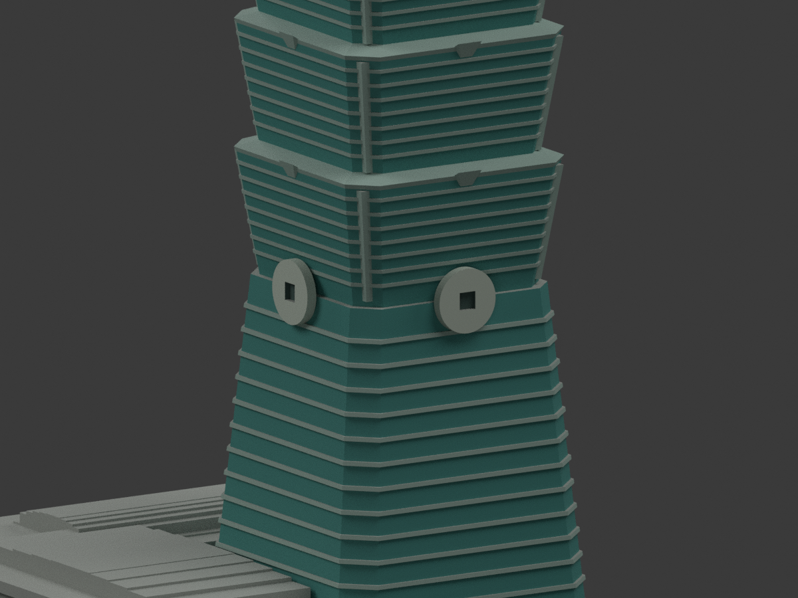
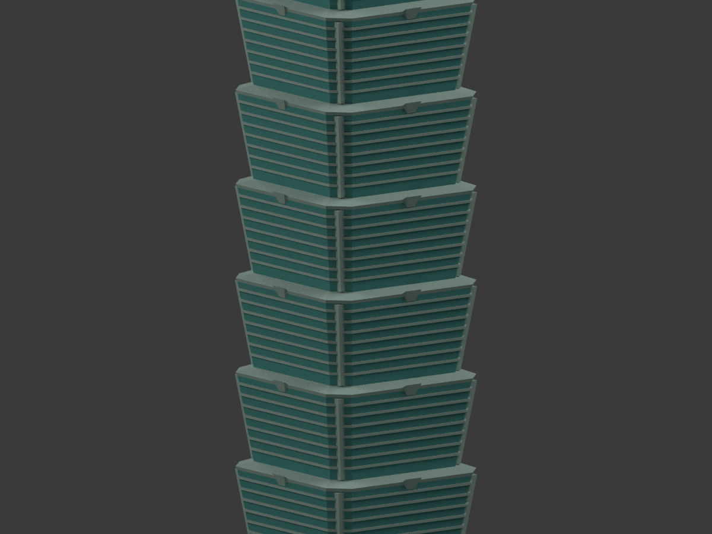
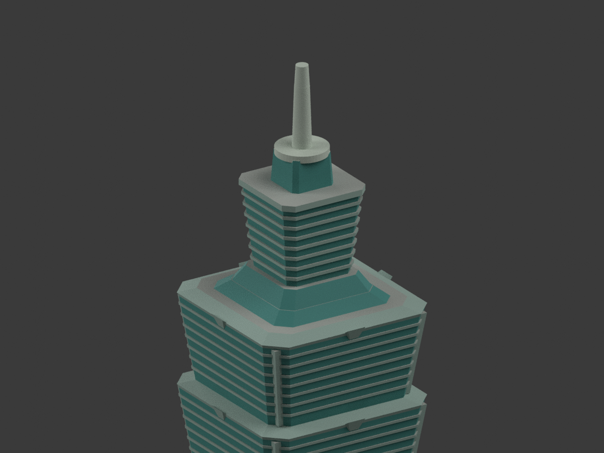

# 臺北 101｜150 mm 彩色外觀模型

## 模型預覽

| 正面斜視 | 背面斜視 | 正面 |
| :---: | :---: | :---: |
|  |  |  |
|  |  |  |
|  |  |  |
|  | | |

[彩色 3MF](appearance.3mf) · [可編輯 Blender](scene.blend) · [STL（不含色）](model.stl) · [十個視角與渲染驗證](render-proof.json) · [校驗範圍](CHECKSUM-SCOPE.md)

## 材色範圍

同一既有項目補彩（count_delta 0），保留原12444三角面、頂點、STL與build_model.py；不新畫樓層線、不切分三角、不加文字或紋理。尺寸仍為原獨立150 mm模型，不是與其他建築共同比例。

- 主塔玻璃色族採低飽和青灰／灰綠；**四向一致是同一塔幕牆材料連續的有界概化，不是四向照片逐一測繪。** 原實心塔壁並非透明玻璃復刻。
- 只有原有凸橫帶、角柱、如意簡化帽採淺灰金屬色；古錢圓飾與尖桿銀灰，原凹心一般暗色。未添加更精密的窗格、鐘面或雕刻。
- L形裙樓與桶狀屋面被白日照片遮擋，保中性；夜景僅辨位置，不把黃燈或夜藍塗成日間材色。未證水平冠塔台面亦中性。
- 原有樓層節奏、角柱、裙樓仍是粗化近似，新增色彩不為原幾何準確度背書。色票非校準色值，圖片拍攝年月未確認，非某年精確竣工／現況外觀。
- 五材質外觀標籤並非四色或多色切片作業；**未實際列印**，未證免支撐或可直接多料輸出。STL格式本身不保存材色。

## 工程與重建

幾何、彩色面索引與可編輯場景維持原版。十張無字 WebP 已從此 Blender 場景重新渲染，保留原視角。[幾何與材色驗證](COLOR-FORMAT-GEOMETRY-QA.json) · [原 STL 幾何檢核](validation.json) · [原切層抽樣](layer_check.json)。數位檢查不等於切片或試印。

若需重建，先複製檔案到另一工作目錄。build_model.py 產生同一 STL，colorize_model.py 對原面分材，export_appearance.py 產 3MF。render_color.py 用 Blender 4.3.2 重建場景；render_current_views.py 從保存場景重渲指定角度但不改場景。暫用 PNG 不列為現行展示檔。

## 來源與權利

熊谷組公開臺北101工程頁的白日照片支持主塔青灰、淺灰金屬與銀灰圓飾。另一張白日照多遮擋；夜景不當日間校色。照片與網頁註all rights reserved，未確認CC或可商用再授權；來源照片僅私人保存，不公開、不貼圖。詳[來源紀錄](COLOR-SOURCE-REGISTER.json)。
