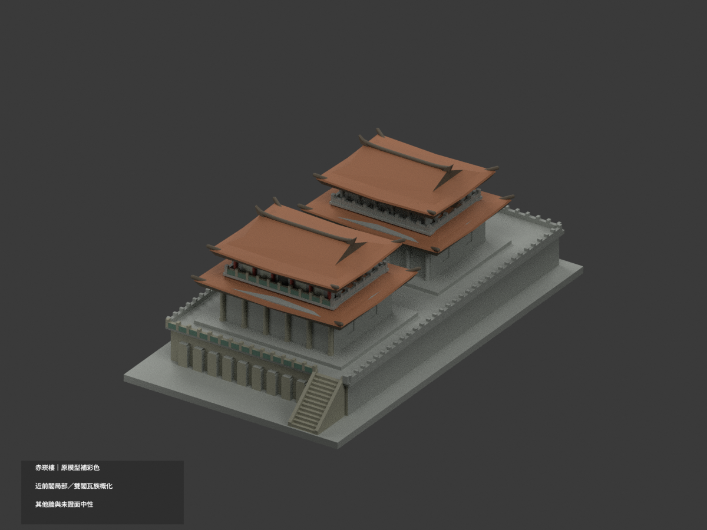
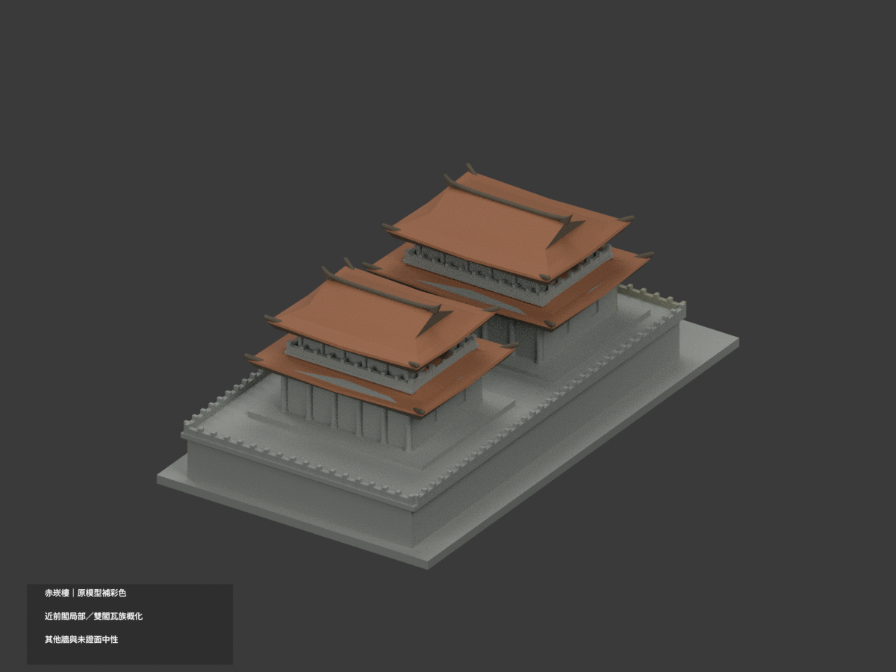
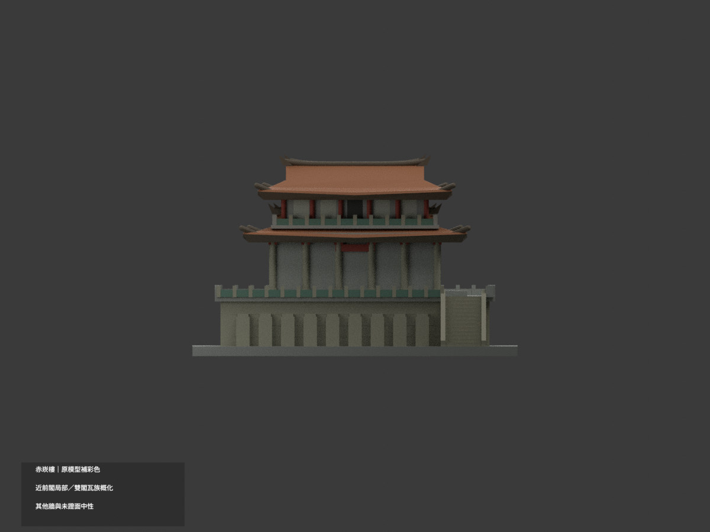
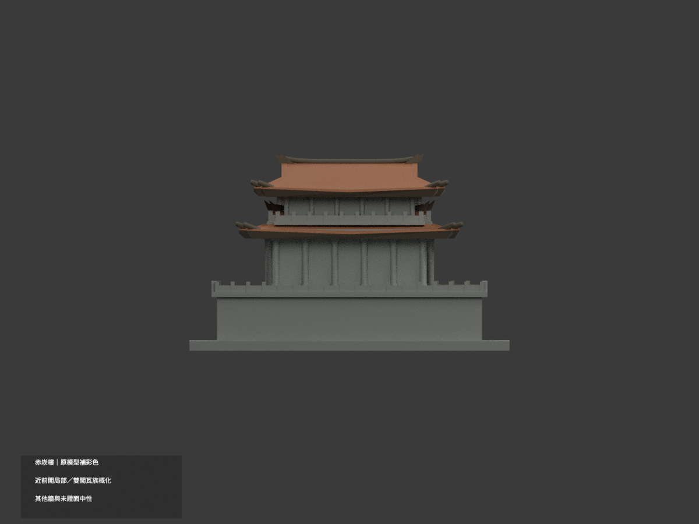
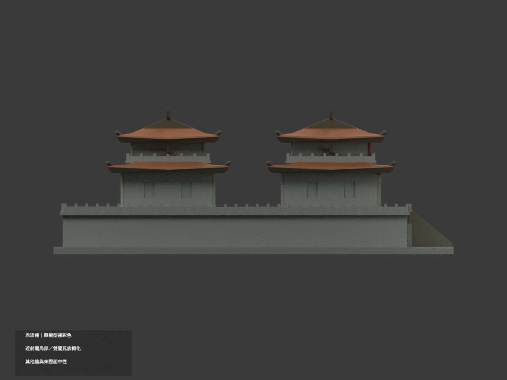
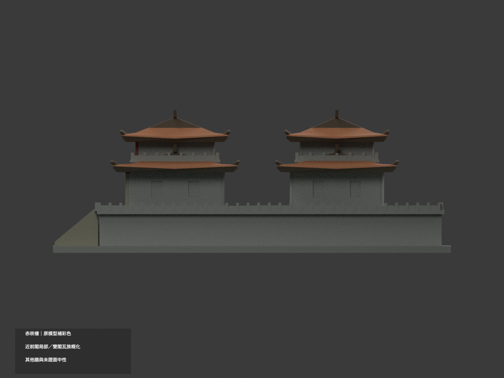
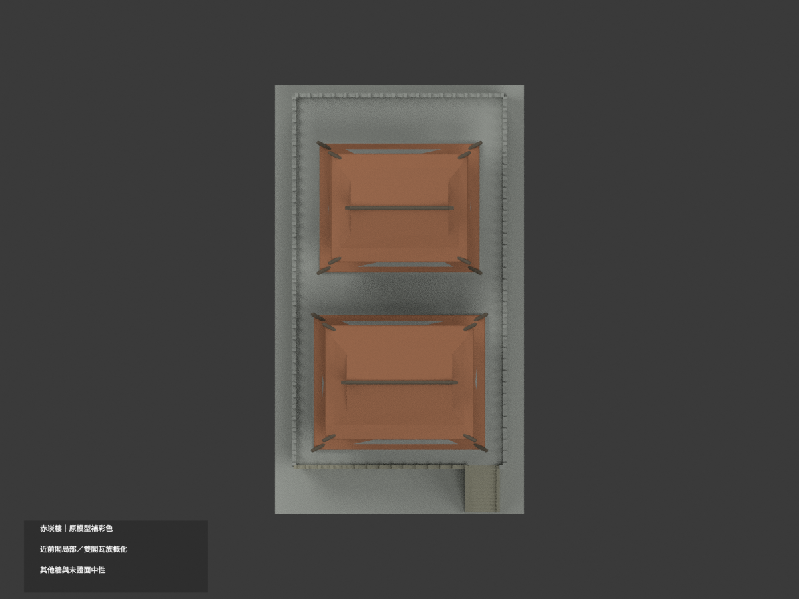
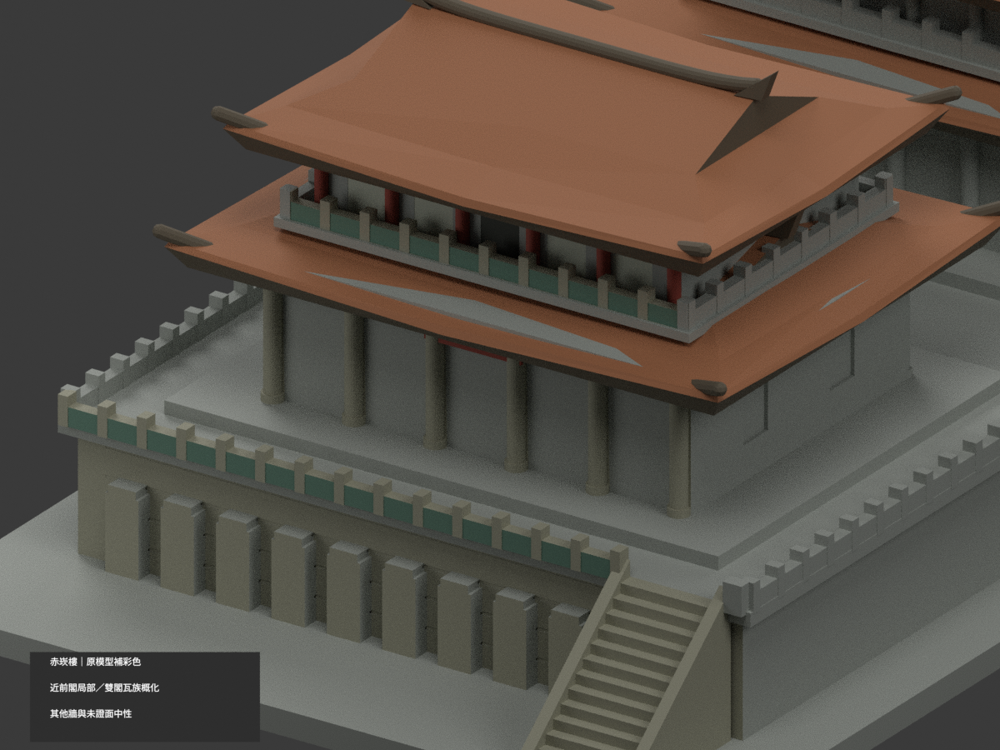
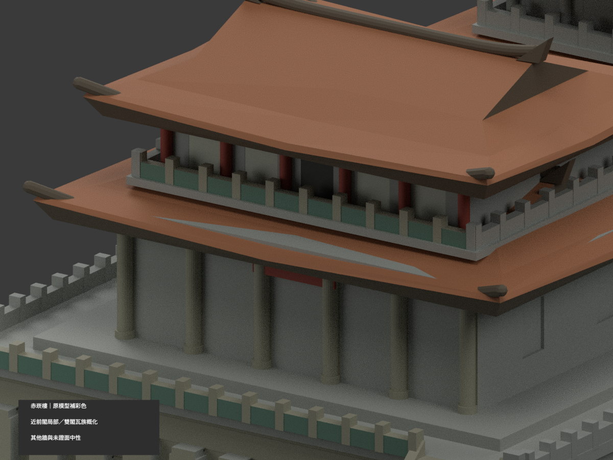
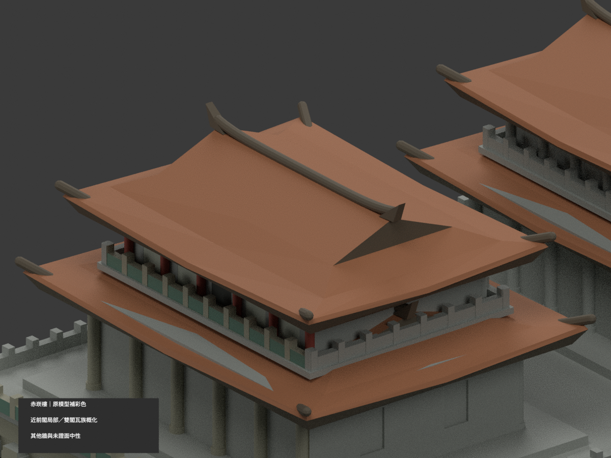

# 臺灣地標｜赤崁樓：原幾何補彩色

## 彩色模型預覽

**同一項目材色更新（count_delta = 0），保留原雙閣及連續高臺，不代表全園區。僅近前右階相連前閣的可對位既有材域補色；雙閣屋瓦同色族是明示概化，不是每一坡都有實照。其他牆、遠閣與未證面維持中性。**

| 正面斜視 | 背面斜視 | 正面 |
|---|---|---|
|  |  |  |
|  |  |  |
|  |  |  |
|  |  |  |

## 材質範圍與限制

原 19150 三角面、頂點及尺度完全保留，不新增門扇、欄杆孔洞、細瓦紋、雕飾、題字或貼圖。原比例及遮蔽部位是近似，不因補彩改稱精確測繪。

- 四片既有屋殼以低飽和橘褐瓦族連續概化；原可分屋脊及檐底深褐。這不是逐坡照片確認，也不把屋面染綠。
- 原屋面分色僅以未改原碼的屋殼 primitive 表面作材域辨識，不把臨時計算構件加進輸出。**下層屋面附近的灰色長三角是原 z33 水平檐盒穿出斜屋皮的既有面，保中性；不是新增幾何或在同斜面畫色楔。**
- 近前閣下層原窗 cut 未切入主牆，不能把整大牆染白冒充照片門扇。大平牆保中性；只既有小額板／柱頭紅色，上層獨立柱紅、實有淺凹門窗背淡灰，中央深凹孔用通用陰影。
- 近前下柱照片白底與紅上段在原柱面沒有相應分界，整柱保守石灰中性色，不按重心造斜條。未精確呈現全部柱身雙色。
- 前高臺立面、原碑面、近前外階及可分欄柱石灰；僅前欄／近閣前陽臺原可獨立板面灰綠。粗實欄板不是照片細透空綠格，不新增洞孔或雕花。
- 遠照裸磚牆未能唯一對位到原模型哪閣哪面，不能套到後閣。遠閣牆、側後、未證欄與臺面中性，並非真實現場全部塗灰。
- 照片日期未確證，URL數字不是拍攝年；色值是展示近似而非測色，也不宣稱最新現況。

## 格式與重建

原 `model.stl`、`build_model.py` bytes不變；原包沒有OBJ。原單材 `scene.blend` 完整保留在私人 original-remote 稽核副本，公開同名 scene 更新為實際shader彩材。STL不含彩色；新 `appearance.3mf` 有八種逐面基本材質，`color-mesh.npz` 保原三角座標。八色外觀不是已驗證四色／多耗材切片專案；未實際列印、未執行切片器驗證。

```sh
python build_model.py
python colorize_model.py
python export_appearance.py
python validate_color.py
blender -b -t 3 --python render_color.py
blender -b --python-exit-code 1 --python verify_color_scene.py
```

沿原requirements與Blender4.3.2，材域表面辨識另需 rtree。隔離重建保留不刪。新QA見 COLOR-FORMAT-GEOMETRY-QA、SCENE-QA、DELIVERY-QA、SOURCE-VISUAL-QA；七全景檢查完整邊界，三細景刻意局部構圖。原 validation、rebuild_validation、blend_validation、previews 及原渲染／驗證程式保留歷程，不當本次彩色重建入口。

## 來源與權利

- [臺南市觀光旅遊局近前閣官方照片](https://www.twtainan.net/content/images/attractions/17463/1024x768_Filedata635593457626796798.jpg)
- [交通部觀光署官方遠照](https://www.taiwan.net.tw/att/1/big_scenic_spots/pic_10889_20.jpg)

來源hash及適用面域見 COLOR-SOURCE-REGISTER.json。公開官圖不等於 CC 或商用再授權；原照私人保存、不隨模型公開、不貼圖，也不以儲存庫license再授權。模型不保證商用權利已清。本次僅建築外觀，不涉及室內、人物或保安細節。

## 原始模型說明與限制

原文保留如下，材色及重建入口以新段落優先；舊單材圖不是本次彩色成果。

# 赤崁樓：海神廟、文昌閣與高臺

## 模型預覽

| 模型預覽 | 模型預覽 | 模型預覽 |
| :---: | :---: | :---: |
| 正面<br> | 背面<br> |  |

## 模型範圍

兩座南北接續的雙層樓閣、重簷歇山頂、上翹屋脊與飛簷、實心高臺、前側九塊簡化碑面、官方外觀照中可見的前右側外階。

- 尺寸：87 × 150 × 53.9 mm，模型單位為毫米，底面 Z=0。
- 正面方向：模型 -Y；這是展示座標，不是測量用方位。
- 單一連通、封閉、布林合併的可列印實體；不含室內、地下或安全設施。
- 每棟獨立以底座長邊 150 mm 設計，不代表所有模型採同一真實比例尺。

## 已知限制與推定

兩棟樓閣之間距、平面深度、所有細部尺寸、階梯的 13 級與坡度、背面窗列、欄杆節奏及碑面比例均依照片合理推定。臺基只保留雙樓閣所在的連續部分，沒有還原完整歷史城址或蓬壺書院。階梯位置依台南旅遊網照片 17463；實際階數未核實。

小型欄杆、窗格、瓦紋、人物與字樣不按真實尺度逐件複製。省略樹木、周邊城市、臨時設施及完整園區配置。預覽中的顏色僅用於看清形狀，STL 本身沒有材質。

## FDM 建議

底座厚 2.6 mm。主要柱徑約 1.3–2.2 mm，欄杆採 1.05–1.3 mm 實心浮雕；最小飛簷裝飾採約 1.3 mm 粗短根部。屋簷有懸挑，建議在切片器檢查並局部加支撐。窗扉、碑文與瓦片未逐字逐片複製。

建議先用 0.4 mm 噴嘴、0.16–0.20 mm 層高、3 道外牆、約 12–18% 填充在切片器檢查；平底朝下。這些是起始設定，不是已驗證機台參數。縮小會使細節更脆弱。未進行實體試印、完整支撐生成、耗材或列印時間實測。

## 檔案

- model.stl：最終列印幾何
- scene.blend：毫米設定的可編輯網格、相機及預覽場景
- build_model.py：原始參數化建模程式；優先在此調整尺寸/細節後重建
- render_preview.py：直接匯入 model.stl 產生前、後與正面立視圖，沒有另外加上假立面
- previews/front.png、rear.png：實際 STL 的前後視角渲染（程式重跑另產生 elevation.png）
- validate_model.py、verify_rebuild.py、verify_blend.py：檢查程式
- validation.json、rebuild_validation.json、blend_validation.json：最終檢查報告
- requirements.txt：Python 依賴版本
- sources.md：官方來源與判讀方式
- SHA256SUMS.txt：交付檔案校驗值

Blender 場景的「Printable building」是唯一列印物件；Studio floor、Camera 與燈光均不是模型。STL 為三角網格；.blend 可編輯頂點，而 build_model.py 保留較方便的參數化來源。

## 重建方式

已使用 Python 3.12、Blender 4.3.2。安裝 requirements.txt 指定套件後，在本資料夾依序執行：

```sh
python build_model.py
python validate_model.py model.stl --output validation.json
python verify_rebuild.py
blender -b -t 4 -P render_preview.py
blender -b scene.blend -P verify_blend.py
```

預覽使用 Workbench 實體網格光照，沒有紋理貼圖或非列印的建築裝飾。

## 數位驗證涵蓋範圍

最終報告檢查：封閉網格、一個連通元件、每邊恰接兩面、每個頂點連結為單一循環、法線與繞序一致、無退化面、正體積、平底、150 mm 長邊、重建 SHA-256 完全一致、原始 STL 法線、單一閉合邊界且沒有獨立的負體積內腔殼，以及每 0.2 mm 取樣層皆有截面。欄杆、柱間及外部溝槽可形成穿通空隙，因此不要求球面拓樸。Blender 的模型三角形已與 STL 逐面對照至 0.00001 mm。

以上為數位檢查，不是獨立的全面三角形自交證明，也不取代切片預覽與試印。

## 來源

見 sources.md。原始官方照片不隨 ZIP 散布。
