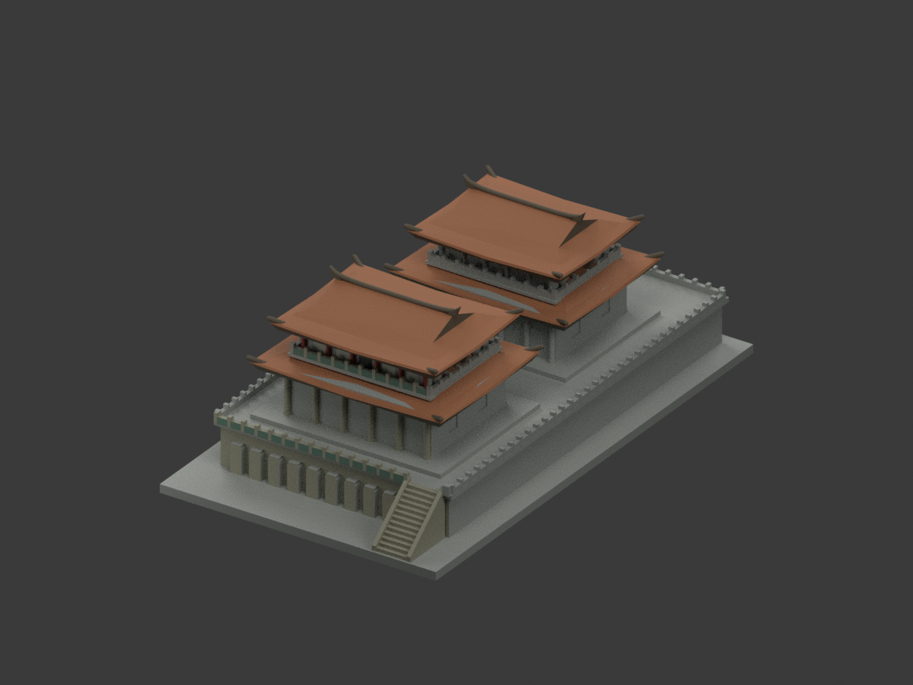
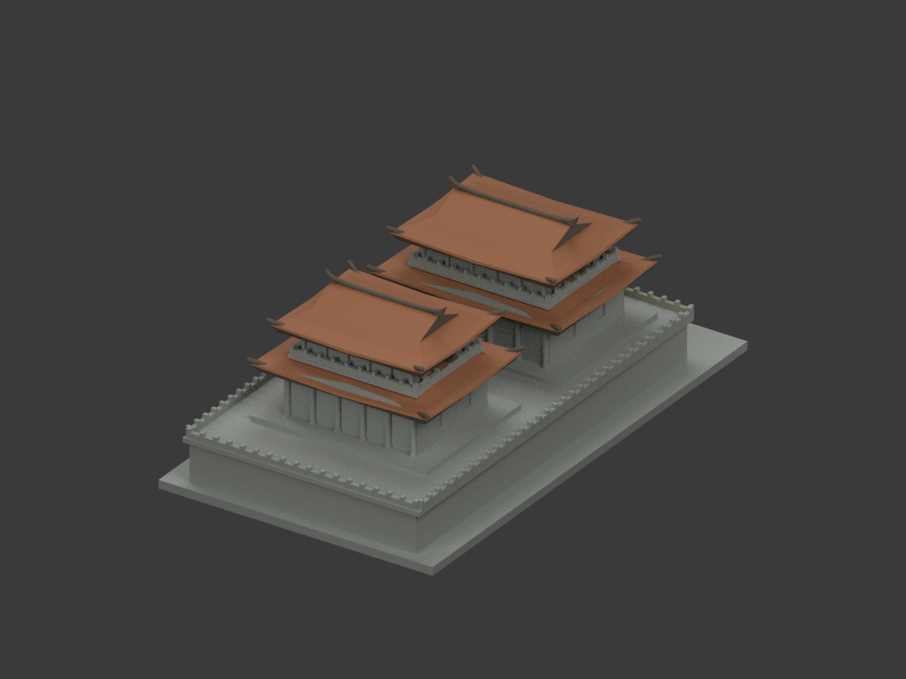
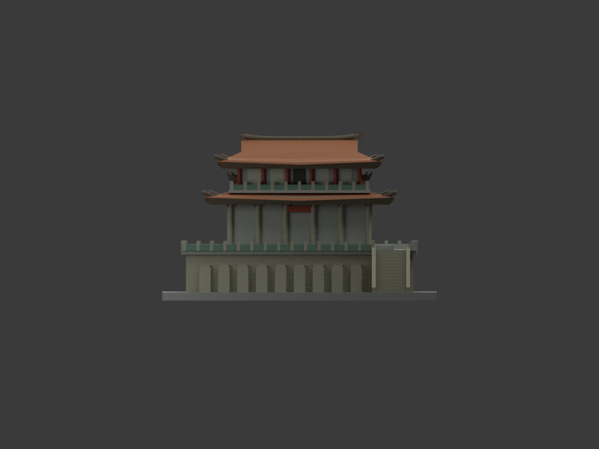
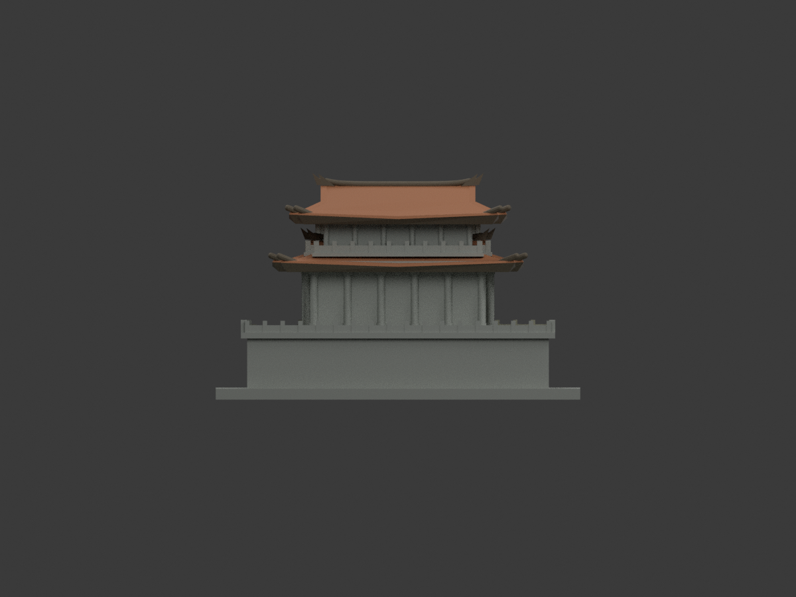
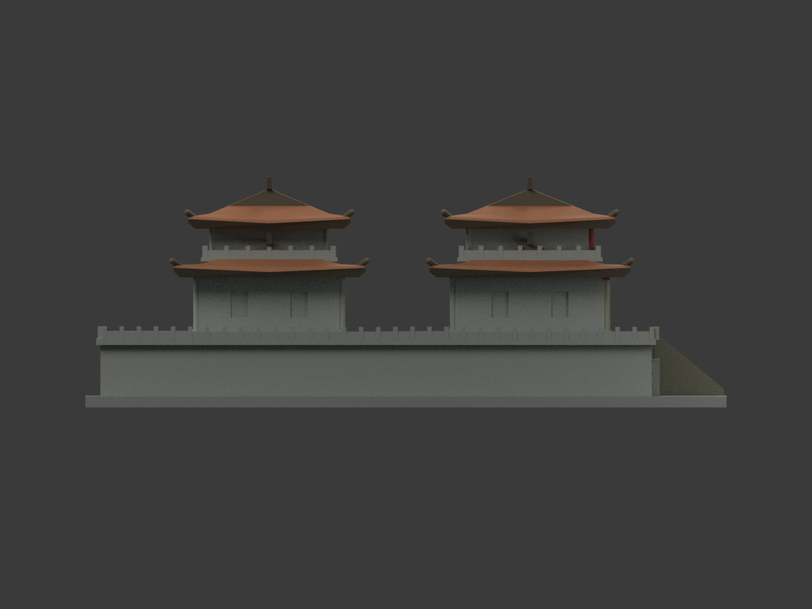
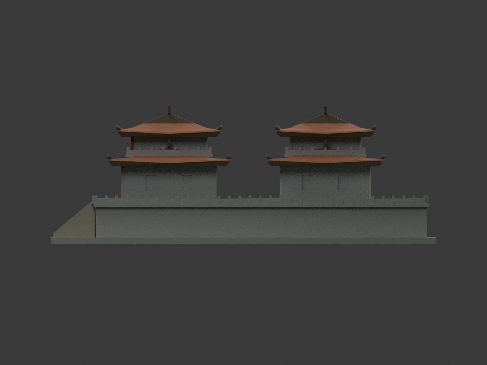
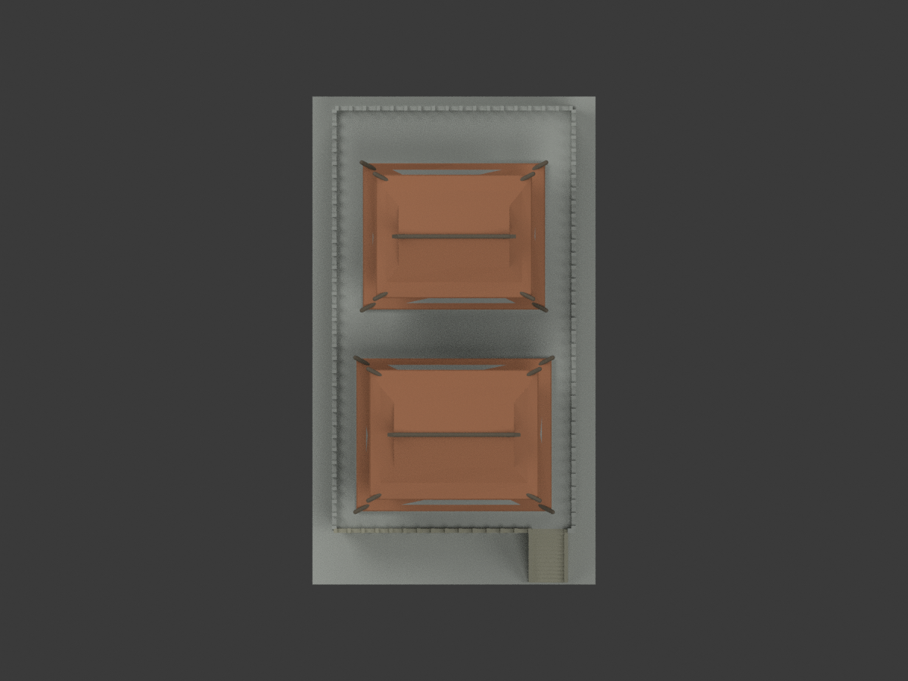
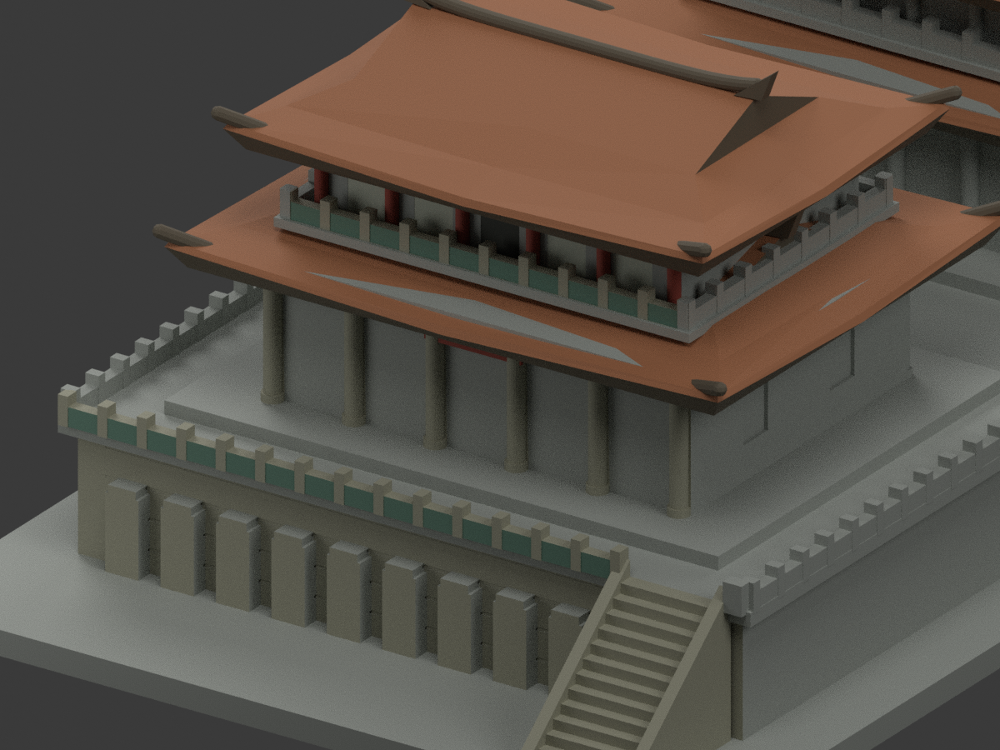
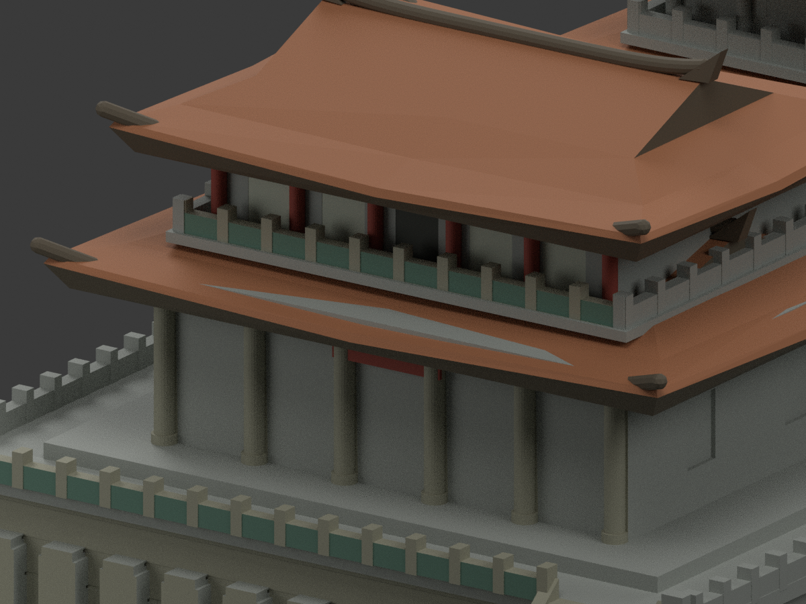
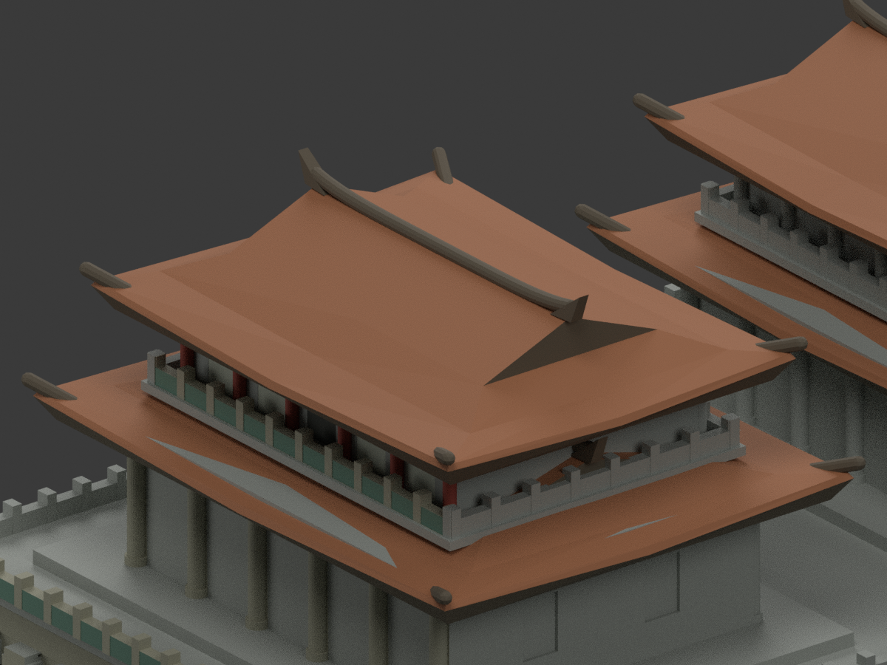

# 赤崁樓｜150 mm 彩色外觀模型

## 模型預覽

| 正面斜視 | 背面斜視 | 正面 |
| :---: | :---: | :---: |
|  |  |  |
|  |  |  |
|  |  |  |
|  | | |

[彩色 3MF](appearance.3mf) · [可編輯 Blender](scene.blend) · [STL（不含色）](model.stl) · [十個視角與渲染驗證](render-proof.json) · [校驗範圍](CHECKSUM-SCOPE.md)

## 材色範圍

只含海神廟、文昌閣與相連高臺，不代表全園區。整體約 87 × 150 × 53.9 mm；模型正面方向不代表地理方位。

原 19150 三角面、頂點及尺度完全保留，不新增門扇、欄杆孔洞、細瓦紋、雕飾、題字或貼圖。原比例及遮蔽部位是近似，不因補彩改稱精確測繪。

- 四片既有屋殼以低飽和橘褐瓦族連續概化；原可分屋脊及檐底深褐。這不是逐坡照片確認，也不把屋面染綠。
- 原屋面分色僅以未改原碼的屋殼 primitive 表面作材域辨識，不把臨時計算構件加進輸出。**下層屋面附近的灰色長三角是原 z33 水平檐盒穿出斜屋皮的既有面，保中性；不是新增幾何或在同斜面畫色楔。**
- 近前閣下層原窗 cut 未切入主牆，不能把整大牆染白冒充照片門扇。大平牆保中性；只既有小額板／柱頭紅色，上層獨立柱紅、實有淺凹門窗背淡灰，中央深凹孔用通用陰影。
- 近前下柱照片白底與紅上段在原柱面沒有相應分界，整柱保守石灰中性色，不按重心造斜條。未精確呈現全部柱身雙色。
- 前高臺立面、原碑面、近前外階及可分欄柱石灰；僅前欄／近閣前陽臺原可獨立板面灰綠。粗實欄板不是照片細透空綠格，不新增洞孔或雕花。
- 遠照裸磚牆未能唯一對位到原模型哪閣哪面，不能套到後閣。遠閣牆、側後、未證欄與臺面中性，並非真實現場全部塗灰。
- 照片日期未確證，URL數字不是拍攝年；色值是展示近似而非測色，也不宣稱最新現況。

## 工程與重建

幾何、彩色面索引與可編輯場景維持原版。十張無字 WebP 已從此 Blender 場景重新渲染，保留原視角。[幾何與材色驗證](COLOR-FORMAT-GEOMETRY-QA.json) · [原 STL 幾何檢核](validation.json) · [原幾何重建核對](rebuild_validation.json)。數位檢查不等於切片或試印。

若需重建，先複製檔案到另一工作目錄。build_model.py 產生同一 STL，colorize_model.py 對原面分材，export_appearance.py 產 3MF。render_color.py 用 Blender 4.3.2 重建場景；render_current_views.py 從保存場景重渲指定角度但不改場景。暫用 PNG 不列為現行展示檔。

## 來源與權利

- [臺南市觀光旅遊局近前閣官方照片](https://www.twtainan.net/content/images/attractions/17463/1024x768_Filedata635593457626796798.jpg)
- [交通部觀光署官方遠照](https://www.taiwan.net.tw/att/1/big_scenic_spots/pic_10889_20.jpg)

來源hash及適用面域見[來源紀錄](COLOR-SOURCE-REGISTER.json)。公開官圖不等於 CC 或商用再授權；原照私人保存、不隨模型公開、不貼圖，也不以儲存庫license再授權。模型不保證商用權利已清。本次僅建築外觀，不涉及室內、人物或保安細節。
