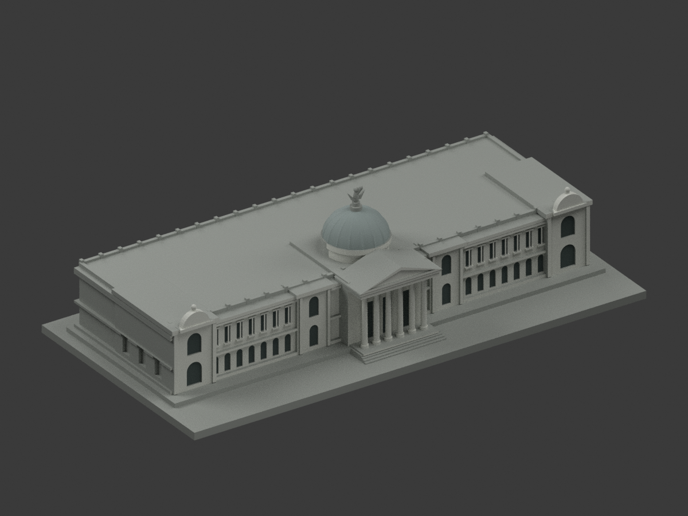
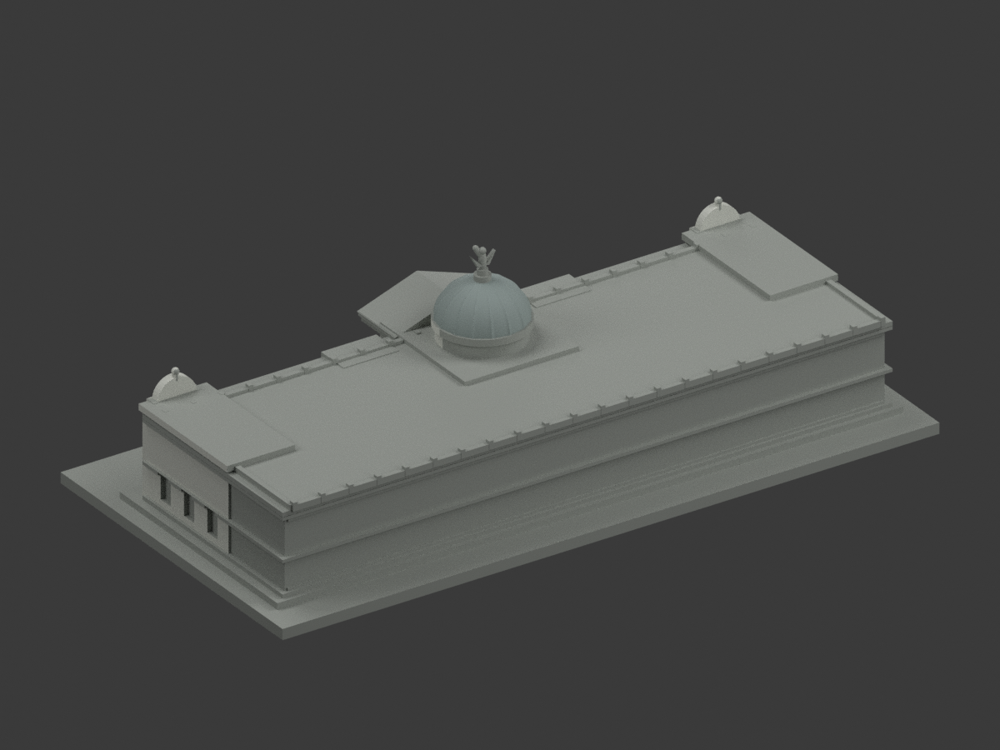
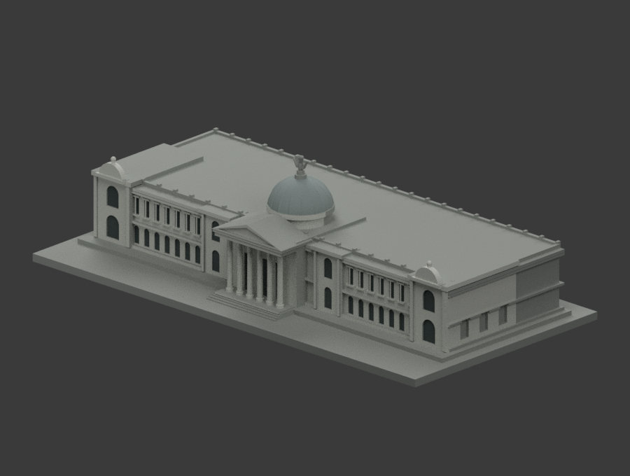

# 奇美博物館｜彩色外觀模型

## 模型預覽

| 模型預覽 | 模型預覽 | 模型預覽 |
| :---: | :---: | :---: |
| [](front-current.webp)<br>正面斜視代表圖 | [](rear-current.webp)<br>背面斜視 | [](pavilion-flank.webp)<br>右端亭外牆與檐帶 |

[彩色 3MF](appearance.3mf) · [可編輯 Blender](scene.blend) · [STL（不含色）](model.stl) · [逐面驗證](verification.json) · [渲染來源與視角](render-proof.json) · [校驗版本](CHECKSUM-SCOPE.md)

## 最新補色範圍

由主入口正面看，僅補右端亭外側（模型 +X）原有兩個完整連通共面域。30 個牆面三角面（含正面角柱與側牆同平面相接的窄返面）及 2 個檐帶外緣三角面沿用正面淺灰白石色（#D8DAD2）。側面凹口和內壁、其他石帶、兩側屋面、背面、底座、雕像與原圓頂補色均保持原狀。不補造欄杆、窗格或照片貼圖。

[攝影者的日照斜前空拍](https://mir-s3-cdn-cf.behance.net/project_modules/1400/f9ae18119286793.609a804a46eef.jpg) 可依中央山牆門廊、正面長翼及靠右端小冠的位置辨認轉角，右端亭淺色外牆與檐帶在轉角可見。[另一地面側視紀錄](https://skypig7.blogspot.com/2016/04/blog-post_7.html) 支持館體側牆及檐帶的淺色族，不當作同一端亭的逐面認證。兩處面域使用相鄰、連續石色的有界推估；空拍受暖光與影像後製影響，HEX 沿用原模型示意，非測色，也不代表目前外觀。參考照片不隨包公開。

同一模型只改原有 32 個三角面中的材質指定。其餘 17,928 面、原四種材質、幾何、STL 不變，原有 40 個混材共面域保留，未新增。頂飾、水平屋面、其他牆窗及展示底座維持原狀。原圓頂背面 3,929 個淡灰面為同穹頂連續色族的有界推定，非逐面實證。模型不含室內、園區、噴泉、橋及人物，並非精密測繪。彩色標籤不是已驗證耗材切片檔，未實體試印；[原幾何檢核](validation.json)僅供數位幾何參考。

## 基準來源與權利

臺南旅遊網公開官方正面實景作有限色族參考；網址與雜湊見[基準色版來源紀錄](https://github.com/hplin50643/taiwan-buildings-3d/blob/18152471f2b30834279245b6ae605921cecf757b/%E8%87%BA%E7%81%A3%E5%9C%B0%E6%A8%99/chimei-museum/COLOR-SOURCE-REGISTER.json)。公開可讀不等於 CC 或照片自由再授權；原照片只私人備存、不公開、不作紋理，不保證商用。未取得逐向照片的屋背／端面不自動延伸色證。先前圓頂配色使用館方官方空拍《看見奇美》公開分鏡約 47–49 秒背側視角，僅支持穹頂大範圍淡灰族連續；每格只有 160×90，不能辨認肋脊個別材差或校準 HEX，逐面返側仍明示推定，不當直接逐面實證。影片 2017 刊登不是拍攝日，也不是 2026 現況。夜景不作材色證據。


## 固定基準與重現

上方模型可直接使用。若要重建，將[歷史基準 Blender](https://github.com/hplin50643/taiwan-buildings-3d/blob/18152471f2b30834279245b6ae605921cecf757b/%E8%87%BA%E7%81%A3%E5%9C%B0%E6%A8%99/chimei-museum/scene.blend)和[歷史基準 3MF](https://github.com/hplin50643/taiwan-buildings-3d/blob/18152471f2b30834279245b6ae605921cecf757b/%E8%87%BA%E7%81%A3%E5%9C%B0%E6%A8%99/chimei-museum/appearance.3mf)下載到另一個資料夾；腳本會核對兩件原始輸入的 SHA-256。使用 Blender 4.3.2，並替換實際路徑：

```sh
blender -b /path/to/baseline/scene.blend --disable-autoexec -t 4 --python-exit-code 1   -P build_pavilion_flank.py -- /path/to/baseline/appearance.3mf /tmp/chimei-current
```

請使用[當前校驗表](SHA256SUMS)。[前次外觀與原幾何說明](https://github.com/hplin50643/taiwan-buildings-3d/blob/18152471f2b30834279245b6ae605921cecf757b/%E8%87%BA%E7%81%A3%E5%9C%B0%E6%A8%99/chimei-museum/README.md)只供歷史比對。
