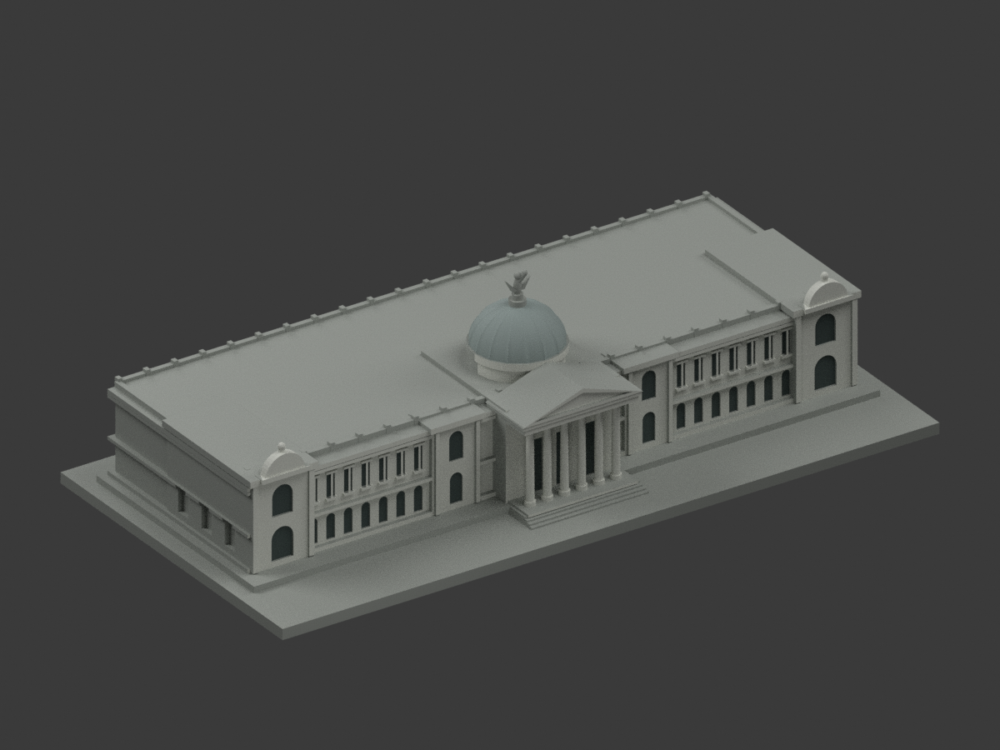
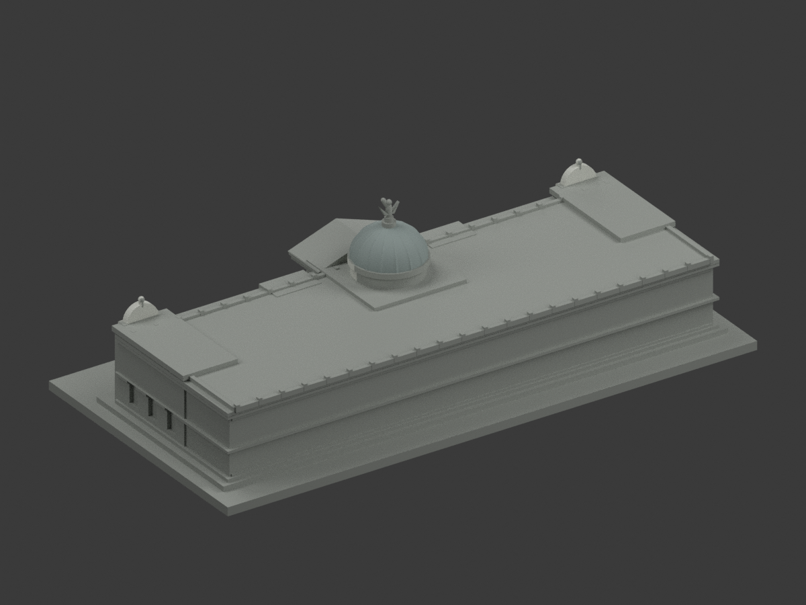
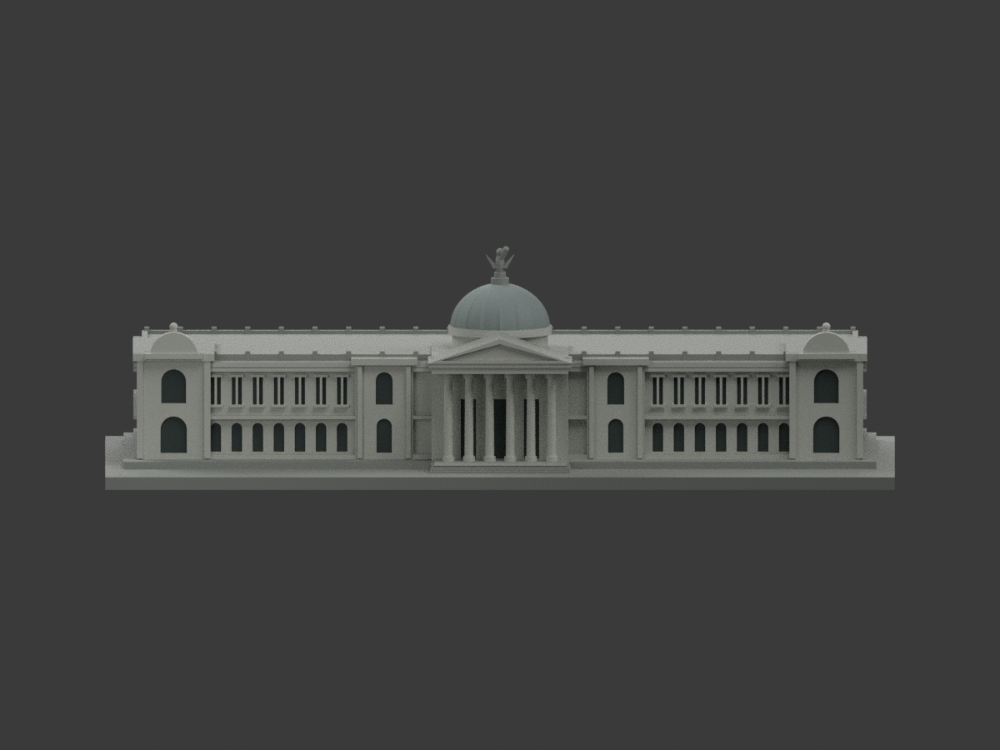
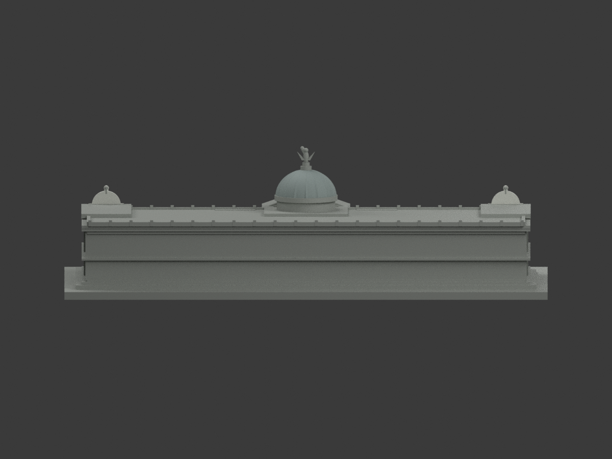
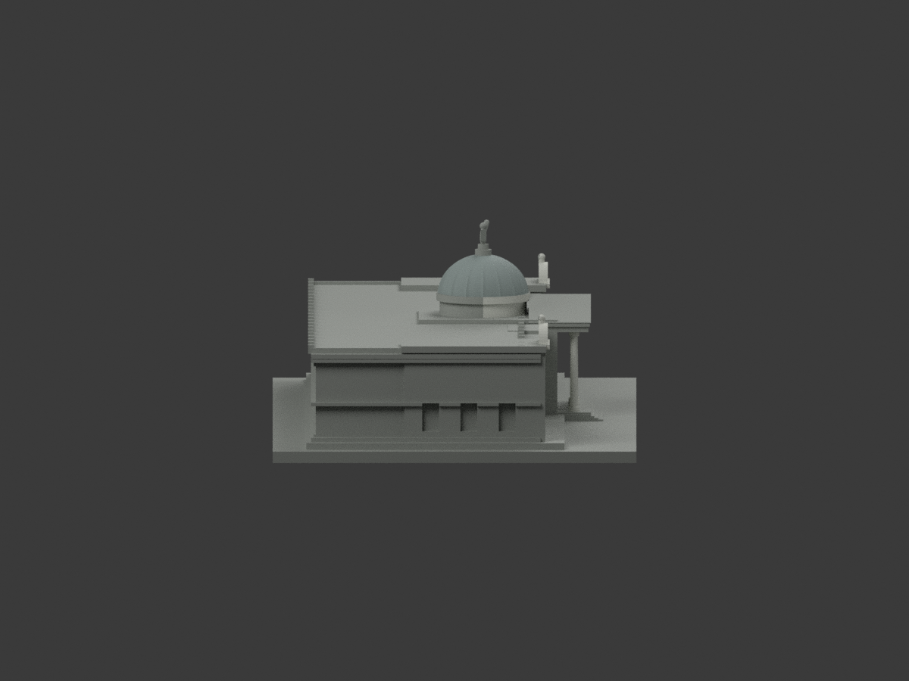
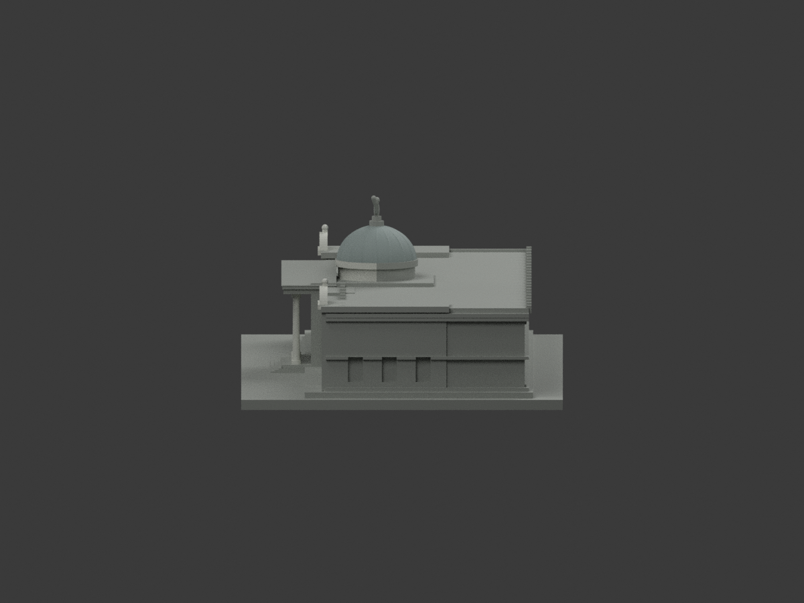
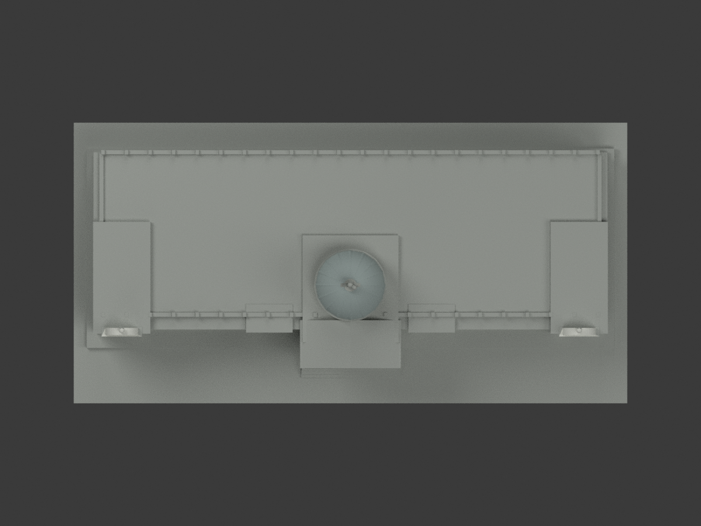
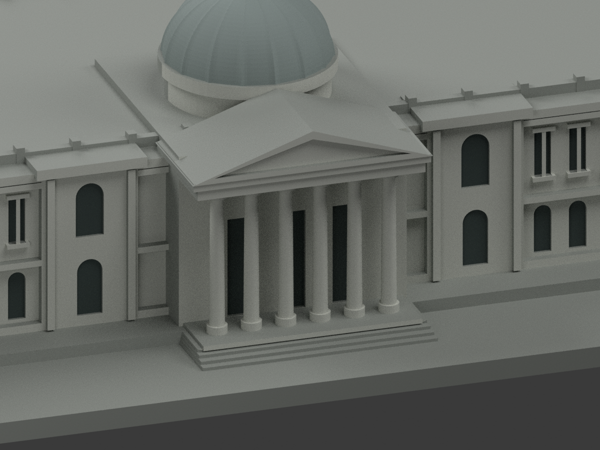
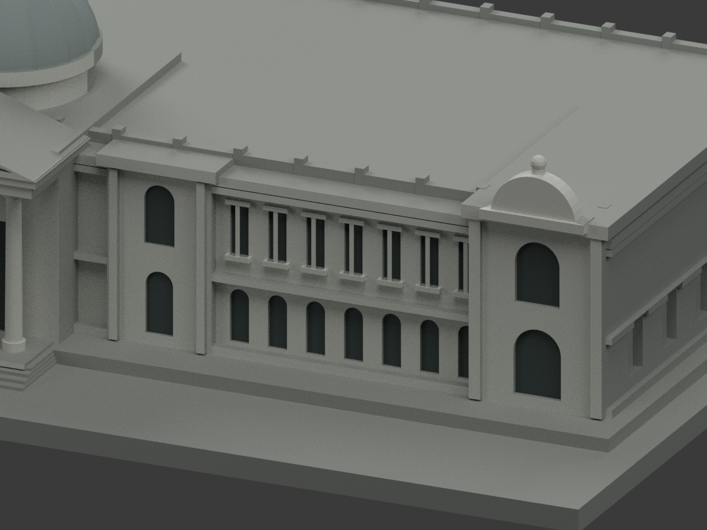
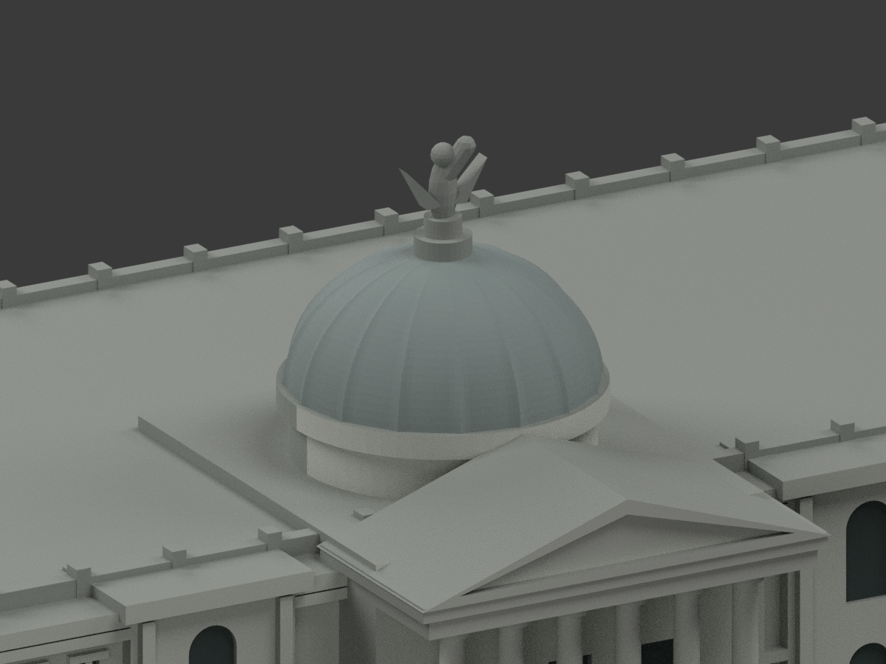

# 奇美博物館｜有限穹頂背側連續灰色推定

| 彩色預覽 | 彩色預覽 | 彩色預覽 |
|---|---|---|
|  |  |  |
|  |  |  |
|  |  |  |
|  | | |

## 材色範圍
同一奇美主館既有模型補彩（count_delta 0）。原 17960 三角面、頂點、STL 與 build_model.py 完全保留，不加雕塑細節、庭園、噴泉、橋、人物或室內。原兩翼深度、端部和背面比例仍是舊模型概化，不因補色成為新測繪或精確現況。

- 官方逆光正面實景支持**前石質表面的白灰色族**：前立面、原可辨窗框和六柱門廊；深灰只用於既有前凹口底面，不把整面作玻璃，不新增梃線或修改洞口。
- 原肋狀圓頂保留前半 3,935 個灰面；新增 3,929 個原背側面採同穹頂灰族連續推定，共 7,864 個灰面。頂部整個原簡化天使／頂飾未納本次材色對位審核，保持原中性。新影片雖有金色頂飾線索，不等於已完成此簡化幾何的對位或色證審核，不順帶放行。
- 鼓座配色不變；水平大屋頂、側後牆窗及展示底座中性。圓頂與前後材色截止是來源可見域／未知域界線，**不是實景換漆線**。所有材質只指定完整原面；若一面跨界，寧保中性，不切新面拼色。
- 照片逆光、未確證拍攝日，HEX 只是展示近似色族，非校準色票或某年復原。另館網 banner 是室內照，排除於外觀材色。
- 四個外觀材質標籤**不是已驗證四色耗材切片檔**；未實際列印，不保證免支撐。STL 本身不存顏色，本次不修改原尺寸及列印幾何。

## 檔案與重建
[彩色 3MF](appearance.3mf) · [彩色 Blender](scene.blend) · [原 STL](model.stl)

build_model.py 重建保留原幾何；colorize_model.py 只指定原面材料；export_appearance.py 輸出 3MF 基本材料；render_color.py 輸出十圖及場景。validate_color.py 驗三角座標、原檔、3MF 與隔離重建，verify_color_scene.py 重開實際 shader／面索引／構圖。使用既有 numpy／trimesh／manifold3d／Pillow 與 Blender 4.3.2；隔離重建目錄私人保留、不刪除。

## 來源與權利
臺南旅遊網公開官方正面實景作有限色族參考；網址與雜湊見 COLOR-SOURCE-REGISTER.json。公開可讀不等於 CC 或照片自由再授權；原照片只私人備存、不公開、不作紋理，不保證商用。未取得逐向照片的屋背／端面不自動延伸色證。這次新增館方官方空拍《看見奇美》公開分鏡約 47–49 秒背側視角，僅支持穹頂大範圍淡灰族連續；每格只有 160×90，不能辨認肋脊個別材差或校準 HEX，逐面返側仍明示推定，不當直接逐面實證。影片 2017 刊登不是拍攝日，也不是 2026 現況。夜景不作材色證據。

## QA 與原件歷程
本次 COLOR-FORMAT-GEOMETRY-QA、SCENE-QA、FRAMING-QA、DELIVERY-QA 與獨立視覺審核綁定新色版。舊 previews、舊驗證報告及 ORIGINAL-MONOCHROME-README.md 原樣保留，非本次色版入口；以上十圖與 scene.blend 為新色版。原檔不刪除，補色不增加建築套數。

## 本次限定變更與繼承問題
- 17,960 原三角及 STL/build 不變；前石 4,533 面、凹口 408 面及所有原已配色面完全保留，中性由 9,084 降為 5,155 面。同項目、不增套數。
- 全頂點受原穹頂半徑與高程限制、排除頂飾範圍，7,872 候選中排除 8 個與穹頂外共面域相接的新面。僅將原未知面改作灰色，不切面、不增加幾何。
- **原版已有 40 個混材共面連通域，其中 1 個接穹頂。本次 40 個域及其既有材界完全不變；沒有新增混域，但不是全模型零接縫，也不聲稱已修復原接縫。**
- 新來源、配色、格式及場景 QA 使用 `DOME-RETURN` 範圍。舊程式、文件與 QA 保存在 `qa/dome-return-previous/`。其他舊獨立審核與 FREEZE 只對應歷史版，不作本次放行。新十圖及獨立審核完成後才凍結，尚未發布。

## English scope
Only 3,929 original unknown rear-dome faces receive bounded same-dome pale-gray continuity inference, retaining all original assignments. Official museum aerial storyboards at approximately 47–49 seconds show the rear broad color family; each frame is only 160×90 and cannot certify individual ribs, trim or calibrated colors. This is inference, not individual-facet direct observation. Eight mixed-domain candidates excluded. All 40 inherited mixed-material coplanar domains remain exactly unchanged; no new mixed domain, not a claim of zero seams or whole-model repair. Original 17,960 triangles and STL/build bytes unchanged. Angel/finial, drum, roofs, rear/side walls and plinth unchanged. Capture dates unknown, not 2026 condition. Reference imagery private, not redistributed. Not physically printed or validated filament slicing.
