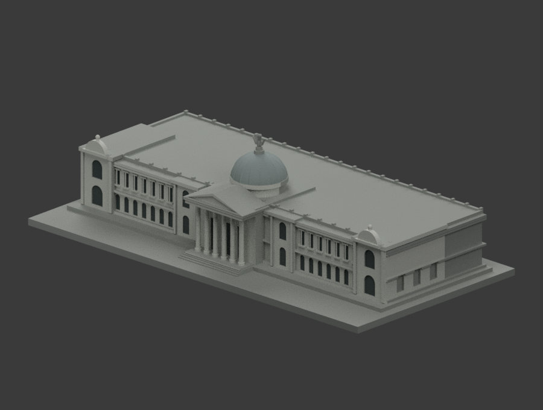

# 奇美博物館｜右端亭側牆及檐帶補色



[下載彩色 3MF](pavilion-flank.3mf) · [Blender 場景](pavilion-flank.blend) · [原模型與代表圖](../README.md) · [逐面核對](verification.json) · [檔案校驗碼](SHA256SUMS)

由主入口正面看，僅補右端亭外側（模型 +X）原有兩個完整連通共面域。30 個牆面三角面（含正面角柱與側牆同平面相接的窄返面）及 2 個檐帶外緣三角面沿用正面淺灰白石色（#D8DAD2）。側面凹口和內壁、其他石帶、兩側屋面、背面、底座、雕像與原圓頂補色均保持原狀。不補造欄杆、窗格或照片貼圖。

[攝影者的日照斜前空拍](https://mir-s3-cdn-cf.behance.net/project_modules/1400/f9ae18119286793.609a804a46eef.jpg) 可依中央山牆門廊、正面長翼及靠右端小冠的位置辨認轉角，右端亭淺色外牆與檐帶在轉角可見。[另一地面側視紀錄](https://skypig7.blogspot.com/2016/04/blog-post_7.html) 支持館體側牆及檐帶的淺色族，不當作同一端亭的逐面認證。兩處面域使用相鄰、連續石色的有界推估；空拍受暖光與影像後製影響，HEX 沿用原模型示意，非測色，也不代表目前外觀。參考照片不隨包公開。

其餘 17,928 個原有三角面的配色、原四種材質、全體幾何、原 STL、冊錄套件數與原代表圖均不變。原有的 40 個混材共面域仍未修正；本次沒有新增任何混材共面域。不是新增建物、全館復色或測繪。未實體試印或作切片驗證。

重建（Blender 4.3.2；上層為兩個原始輸入，請另用獨立輸出目錄）：

```sh
blender -b ../scene.blend -t 4 --python-exit-code 1 \
  -P build_pavilion_flank.py -- ../appearance.3mf ./build-output
```

程式輸出模型、逐面核對與兩張暫用 PNG。公開預覽由 `_render_qa/candidate.png` 以 Pillow `lossless=True, method=6, exact=True` 轉成無失真 WebP；不發布暫用檔。
