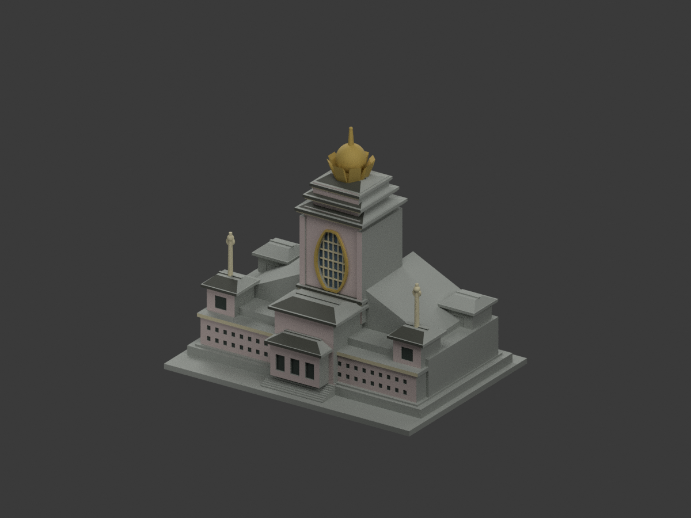
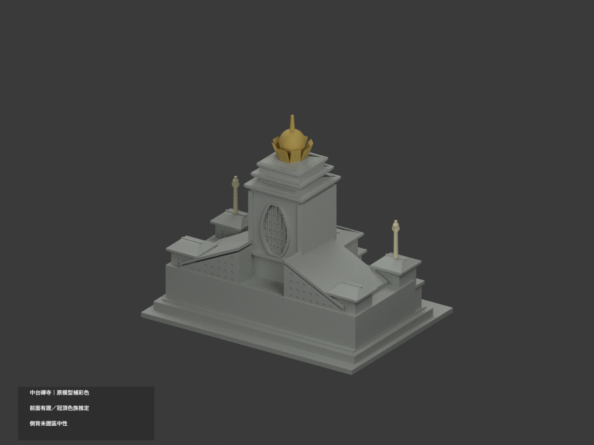
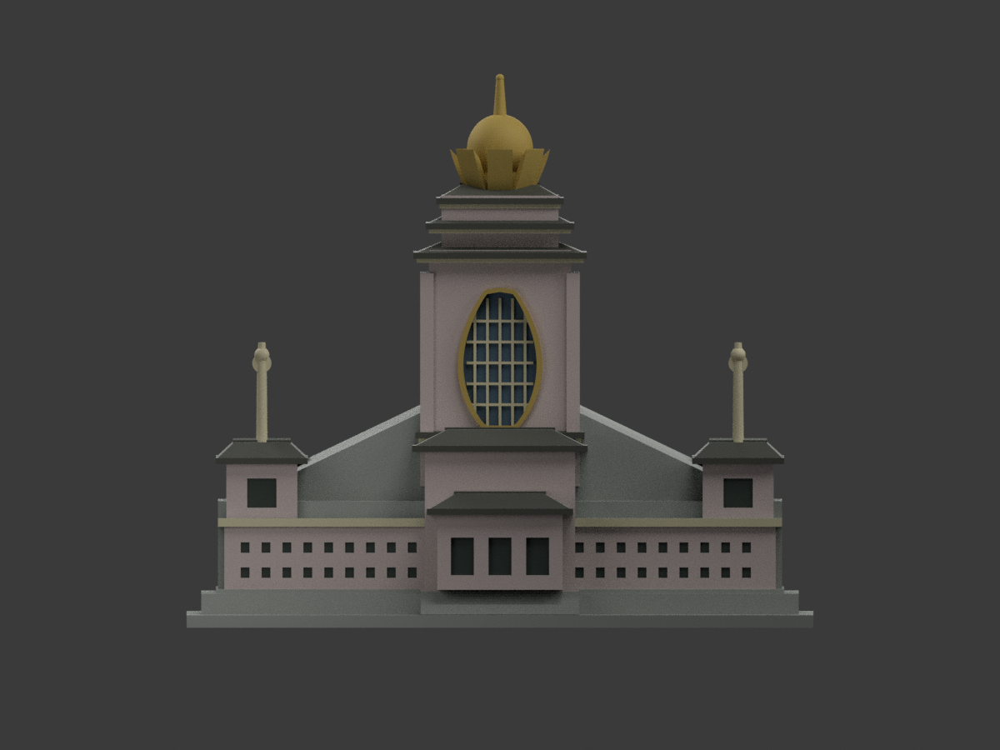
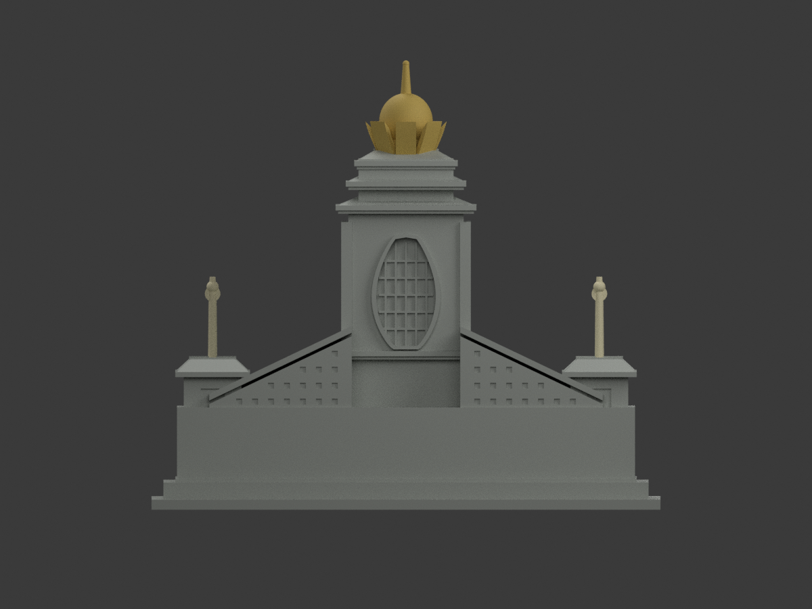
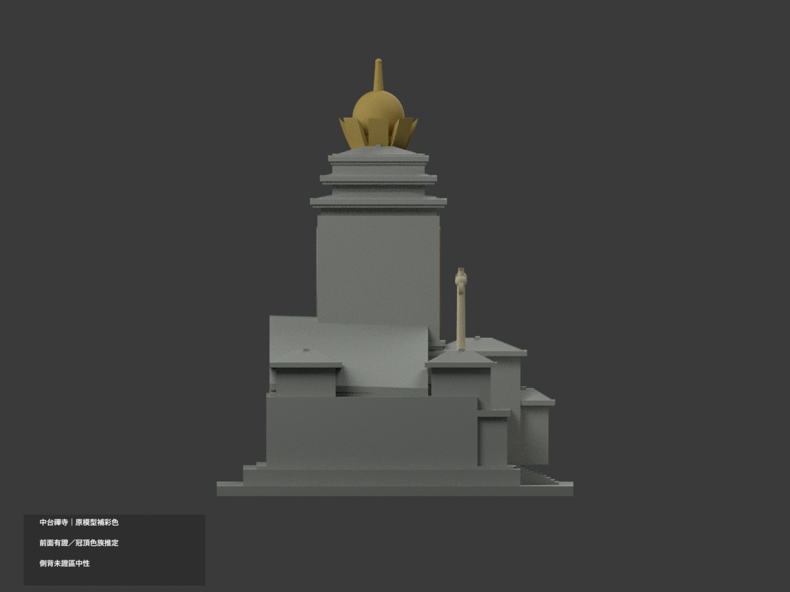
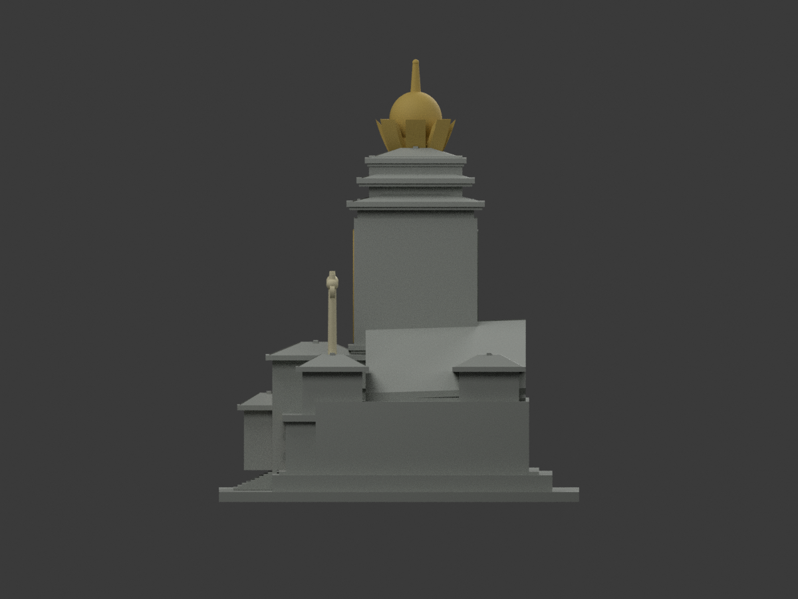
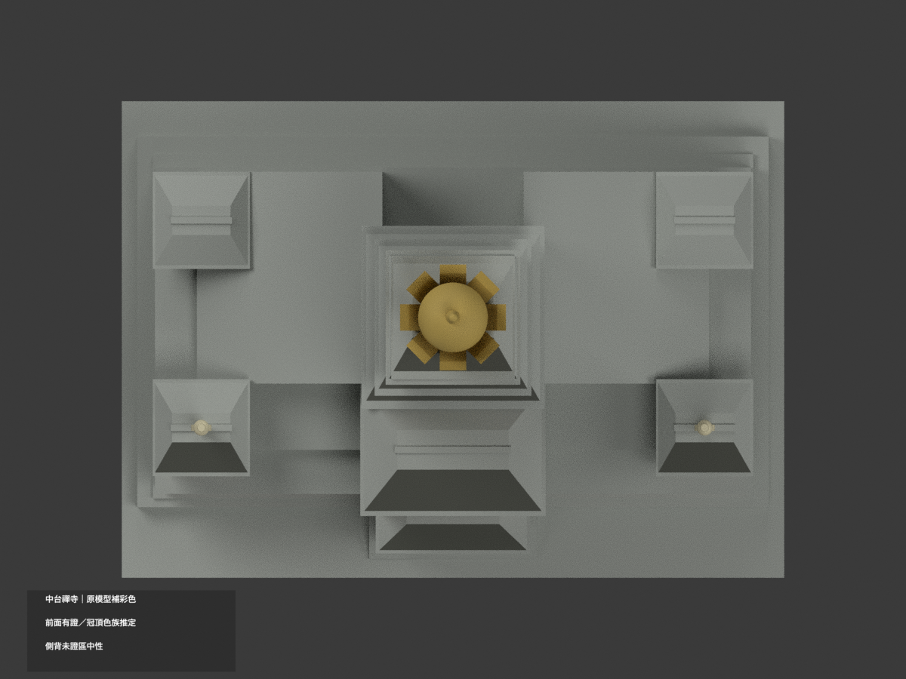
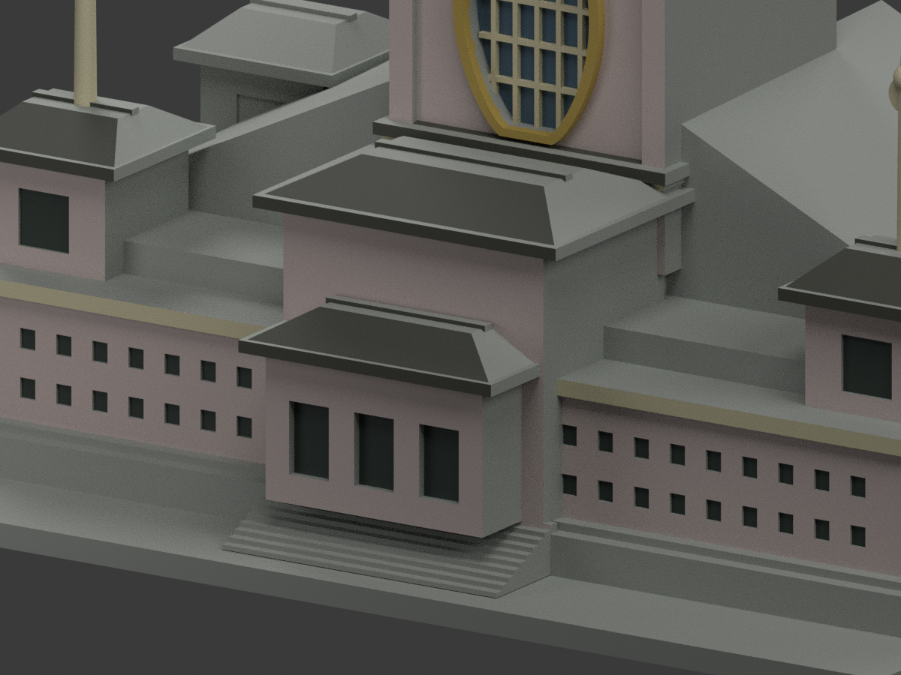
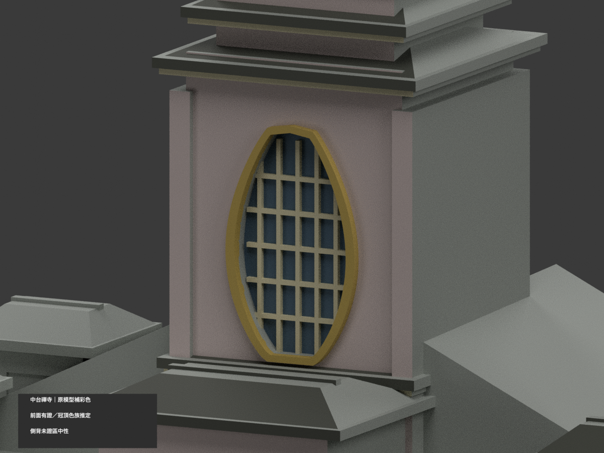
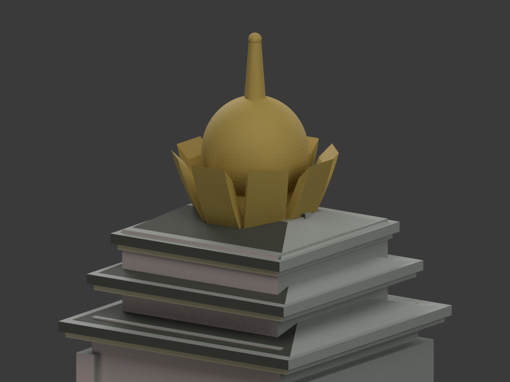

# 臺灣地標｜中台禪寺：原幾何補彩色

## 彩色模型預覽

**同項目材色更新（count_delta = 0）：有證前向石牆、蓮窗與前檐補色，冠頂同一構件金族連續為明示推定；未證側背、後蓮窗與斜肩中性。**

| 正面斜視 | 背面斜視 | 正面 |
|---|---|---|
|  |  |  |
|  |  |  |
|  |  |  |
|  |  |  |

## 材質範圍與限制

原 13668 三角面、全部頂點與原比例不變，不新增細石縫、神像、符號、玻璃分格、透空或屋頂環飾。原近似造型不因補色成為實測模型。

- 有證前向牆面用低飽和粉灰石族；不沿同色任意延伸整座側背。原前窗／入口凹底只用通用暗影，不能把原凹槽當已復原玻璃或門扇。
- 中央前蓮窗原封閉背面灰藍、既有梃淡色、原外框低飽和金族；無真透明室內或細金紋。背面同形蓮窗保持中性；舊程式提及的後夜照，不是本次取得的背面色證。
- 既有前向斜屋皮與檐帶深灰、部分原水平冠帶前垂面淡色；不把所有屋頂染黑。來源不能唯一對位的側、後和水平屋面中性。
- 八瓣冠頂、寶珠與尖端以同一完整構件金族延續，包含不可見背面，屬明示推定而非背面色票確認。前方兩支原粗化法器採整件淡色族，不新增環或細符號。
- 以完整原面法線及全頂點匹配原 primitive 表面，非重心劃色。0.012 mm 辨識容差只對應原 simplify(.005)，不是建築實際精度。彩色／中性交界表示證據範圍，不一定是現場換材縫。
- 官照拍攝日期未確證；HEX是展示近似、未校準色票。未證域中性不是現場真漆。

## 格式與重建

原 `model.stl`、`build_model.py` bytes 保留，原包沒有 OBJ。原單色 `scene.blend` 私人稽核副本保留；公開同名 scene 為本次實際 shader。STL本身無彩色；`appearance.3mf` 含七種逐面材質，`color-mesh.npz` 保原三角座標。七色外觀不是已驗證四色／多耗材切片專案；未實際列印、未執行切片器驗證。

```sh
python -m pip install -r color-requirements.txt
python build_model.py
python colorize_model.py
python export_appearance.py
python validate_color.py
blender -b -t 3 --python render_color.py
blender -b --python-exit-code 1 --python verify_color_scene.py
```

沿原 requirements，表面辨識另需 rtree，Blender 4.3.2。臨時 primitive 只辨識原表面，從未加入輸出幾何。隔離重建目錄保留不刪。新QA見 COLOR-FORMAT-GEOMETRY-QA、SCENE-QA、DELIVERY-QA、SOURCE-VISUAL-QA；七全景完整邊界、三細景刻意局部構圖。舊 validation、scene_check、rebuild_check、previews 和程式保留歷程，不當本次彩色重建入口。

## 來源與權利

[交通部觀光署官方正面照](https://www.taiwan.net.tw/att/1/big_scenic_spots/pic_R32_2.jpg)。來源 hash／角色與限制見 COLOR-SOURCE-REGISTER.json。公開照片未證 CC 或商用再授權，原照僅私人保存、不隨模型發布、不貼圖；不以儲存庫 license 再授權原照，不保證商用權利已清。本次僅建築外觀。

## 原始模型說明與限制

原文保留如下，新材色與重建段落優先；舊背照描述不當本次已取得證據，舊單色圖不當新成果。

# 中台禪寺｜150 mm 外觀列印模型

依建築師事務所與觀光署的正、背面照片重建的桌上外觀詮釋，非實測複製。單一連通封閉實體、無室內空腔；不含寺內佛像、院內其他建築及植栽。

歷史單色 STL 預覽（下載）：[正面](previews/front.png) · [背面](previews/rear.png)

## 模型
- 整體 150 × 108 × 132 mm，含 3 mm 平底底座；毫米制 STL。
- 保留中軸高塔、前後大型蓮瓣狀窗框、四角菩薩殿、左右斜升的大天梯量體、重簷、頂部八片抽象蓮瓣與摩尼珠輪廓。
- 前方兩側法杖加粗為直徑約 2.3–2.7 mm；小環改實心浮雕盤。尖頂最細處約 1.8 mm。窗格及門窗做附著於實心牆的淺浮雕／淺凹。
- 蓮瓣有實體厚度並與中央冠基正體積交疊，避免獨立漂浮薄片。

## 已檢視的參考來源
查閱日期：2026-10-11。照片未隨模型散布。
1. 中台禪寺，交通部觀光署：https://www.taiwan.net.tw/m1.aspx?id=R32&sNo=0001016
2. 正面實景照片：https://www.taiwan.net.tw/att/1/big_scenic_spots/pic_R32_2.jpg
3. 李祖原聯合建築師事務所官方作品頁：https://www.cylee.com/project/Chung-Tai-Zen-Monastery?lang=tw
4. 建築師所刊夜間另一側實景：https://www.cylee.com/uploads/default/NS_project_relates/raw/dda0f6ec1833ea336737d6c58781e14f.jpg

官方事務所列建築高 136 m，但本模型含縮略基地、局部厚化和估計尺寸，因此不宣稱統一比例尺。正面及帶三角斜翼的背面輪廓有照片支持；側牆、完整屋頂平面、塔後低層量體與樓梯配置缺少正投影資料，為低可信度估形。各窗列數量、飛簷曲度、飾件與雕刻均簡化；並非精確宗教圖像復刻。未用相近寺廟代替本建築。

## 列印建議與未驗證事項
平底向下。建議 PLA、0.4 mm 噴嘴、0.16–0.20 mm 層高、3 道壁。屋簷、蓮瓣及法杖附近可能需局部支撐；切片後檢查細杆、懸垂與支撐可拆除性。蓮瓣的設計剖面徑向厚約 2 mm、橫向厚 6 mm，但邊緣收尖，這不是完整自動最小厚度量測。兩側法杖直杆最細約 2.3 mm，末端短節約 1.7 mm；高寬比遠大於主體，搬動、剝離支撐或掉落時容易折斷。請只握底座，勿捏冠飾、法杖或尖頂，運送時保護凸出件。不要因網格通過便宣稱無支撐可印。尚未實際切片、試印、做掉落或強度測試；縮小尺寸可能使法杖脆弱、窗格消失。

## 交付及重建
model.stl 為最終列印實體；scene.blend 為匯入該 STL 的可編輯網格，展示地板與燈光不是列印件，另嵌入原始 build_model.py。

安裝 requirements.txt 後依序執行：
1. python build_model.py
2. python validate_model.py model.stl --output validation.json
3. blender -b -t 4 -P render_preview.py

previews/front.png、rear.png 都由實際 STL 算繪；重跑算繪程式可另生成 elevation.png；這些預覽並非概念圖。validation.json 檢查法向、邊雙面、點單環鏈結、體積、連通、底面及最大尺寸；rebuild_check.json 記錄重建前後 SHA-256。checksums.sha256 包含交付檔案校驗碼。使用實體布林且外殼單連通，沒有獨立封閉內殼；數位檢查不獨立證明所有自交，也不代表實物列印保證。

重建自檢可執行 python verify_rebuild.py；scene_check.json 另核對 blend 中的列印網格面數、尺寸，以及嵌入來源是否與交付程式一致。
