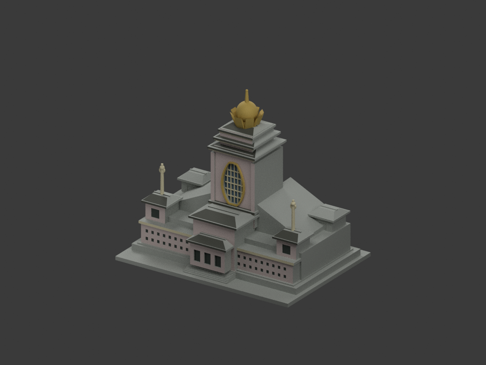
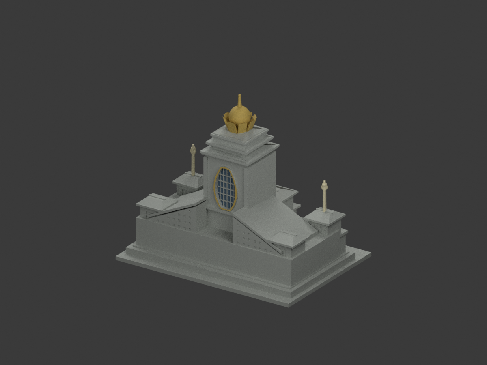
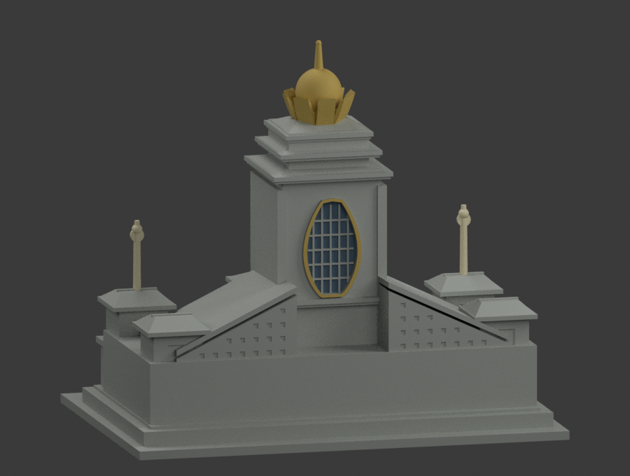

# 中台禪寺｜彩色外觀模型

## 模型預覽

| 正面斜視代表圖 | 背面斜視 | 背面蓮窗補色細節 |
| :---: | :---: | :---: |
|  |  |  |

[彩色 3MF](appearance.3mf) · [可編輯 Blender](scene.blend) · [STL（不含色）](model.stl) · [逐面驗證](verification.json) · [渲染來源與視角](render-proof.json) · [校驗版本](CHECKSUM-SCOPE.md)

## 最新補色範圍

僅補原模型中央塔背面（模型 +Y）的蓮窗。原有凹底 191 個完整三角面沿用不透明灰藍（#536A7C），原外框朝外的 256 個完整三角面沿用低飽和金色（#BEA65D）。窗格、內返面、兩側斜翼、其他外牆與屋面仍維持原狀。不新增透明玻璃、構件、貼圖或裝飾。

[寺方日景全幅](https://www.chungtai.org.tw/english-96/html/assets/images/banner03-1.jpg) 可依左右連續斜翼、窗下量體及中央冠頂與原模型背面對位，清楚顯示背窗為灰藍一族、外框為金色一族。[建築師事務所夜間照](https://www.cylee.com/uploads/default/NS_project_relates/raw/dda0f6ec1833ea336737d6c58781e14f.jpg) 僅輔助辨認同一背面，不取其人工照明色。原幾何和分格是簡化代理，不把照片亮暗、窗後圖像或反光畫進模型。拍攝日期未查明、沿用色值非校色，也不代表當前外觀。參考照片未隨包公開。

同一模型只改背面蓮窗既有 447 個三角面。原七種材質、其餘面、幾何與 STL 不變；冊錄總數不變。局部材色不是全寺復色，也不含室內、院區其他建築或實測細節。

## 其餘材質、比例與限制


原 13668 三角面、全部頂點與原比例不變，不新增細石縫、神像、符號、玻璃分格、透空或屋頂環飾。原近似造型不因補色成為實測模型。

- 有證前向牆面用低飽和粉灰石族；不沿同色任意延伸整座側背。原前窗／入口凹底只用通用暗影，不能把原凹槽當已復原玻璃或門扇。
- 中央前蓮窗原封閉背面灰藍、既有梃淡色、原外框低飽和金族；無真透明室內或細金紋。背面同形蓮窗僅限上節此次核對的兩個材色範圍。其他窗構件保持原樣。
- 既有前向斜屋皮與檐帶深灰、部分原水平冠帶前垂面淡色；不把所有屋頂染黑。來源不能唯一對位的側、後和水平屋面中性。
- 八瓣冠頂、寶珠與尖端以同一完整構件金族延續，包含不可見背面，屬明示推定而非背面色票確認。前方兩支原粗化法器採整件淡色族，不新增環或細符號。
- 以完整原面法線及全頂點匹配原 primitive 表面，非重心劃色。0.012 mm 辨識容差只對應原 simplify(.005)，不是建築實際精度。彩色／中性交界表示證據範圍，不一定是現場換材縫。
- 官照拍攝日期未確證；HEX是展示近似、未校準色票。未證域中性不是現場真漆。


整體 150 × 108 × 132 mm，含 3 mm 底座。塔冠、法杖及窗框為簡化造型，未實際列印或切片，縮小時須特別檢查尖端、細桿及支撐。原幾何檢核可見[驗證紀錄](validation.json)，不當作實物測試。

## 基準來源與權利


[交通部觀光署官方正面照](https://www.taiwan.net.tw/att/1/big_scenic_spots/pic_R32_2.jpg)。來源 hash／角色與限制見[基準色版來源紀錄](https://github.com/hplin50643/taiwan-buildings-3d/blob/4e402ff73e18ab3aeb2e5ef6f9f88ea2a7d382ee/%E8%87%BA%E7%81%A3%E5%9C%B0%E6%A8%99/chung-tai-monastery/COLOR-SOURCE-REGISTER.json)。公開照片未證 CC 或商用再授權，原照僅私人保存、不隨模型發布、不貼圖；不以儲存庫 license 再授權原照，不保證商用權利已清。本次僅建築外觀。


## 固定基準與重現

上方模型可以獨立使用。若要重建，將[歷史基準 Blender](https://github.com/hplin50643/taiwan-buildings-3d/blob/4e402ff73e18ab3aeb2e5ef6f9f88ea2a7d382ee/%E8%87%BA%E7%81%A3%E5%9C%B0%E6%A8%99/chung-tai-monastery/scene.blend)和[歷史基準 3MF](https://github.com/hplin50643/taiwan-buildings-3d/blob/4e402ff73e18ab3aeb2e5ef6f9f88ea2a7d382ee/%E8%87%BA%E7%81%A3%E5%9C%B0%E6%A8%99/chung-tai-monastery/appearance.3mf)下載到另一個資料夾；腳本會核對其精確 SHA-256。使用 Blender 4.3.2，並替換實際路徑：

```sh
blender -b --disable-autoexec /path/to/baseline/scene.blend -t 4 --python-exit-code 1 \
  -P build_rear_lotus.py -- /path/to/baseline/appearance.3mf /tmp/chung-tai-current
```

請使用[當前校驗表](SHA256SUMS)。[前次外觀與原幾何說明](https://github.com/hplin50643/taiwan-buildings-3d/blob/4e402ff73e18ab3aeb2e5ef6f9f88ea2a7d382ee/%E8%87%BA%E7%81%A3%E5%9C%B0%E6%A8%99/chung-tai-monastery/README.md)供歷史比對，不是另一套現行模型。
