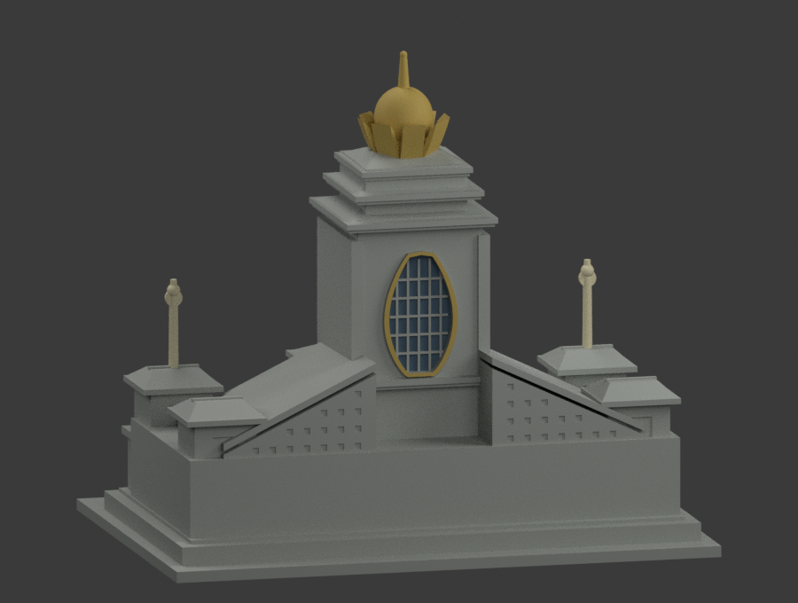

# 中台禪寺｜背面蓮窗材色補充



[下載彩色 3MF](rear-lotus.3mf) · [Blender 場景](rear-lotus.blend) · [原模型與代表圖](../README.md) · [逐面核對](verification.json) · [檔案校驗碼](SHA256SUMS)

僅補原模型中央塔背面（模型 +Y）的蓮窗。原有凹底 191 個完整三角面沿用不透明灰藍（#536A7C），原外框朝外的 256 個完整三角面沿用低飽和金色（#BEA65D）。窗格、內返面、兩側斜翼、其他外牆與屋面仍維持原狀。不新增透明玻璃、構件、貼圖或裝飾。

[寺方日景全幅](https://www.chungtai.org.tw/english-96/html/assets/images/banner03-1.jpg) 可依左右連續斜翼、窗下量體及中央冠頂與原模型背面對位，清楚顯示背窗為灰藍一族、外框為金色一族。[建築師事務所夜間照](https://www.cylee.com/uploads/default/NS_project_relates/raw/dda0f6ec1833ea336737d6c58781e14f.jpg) 僅輔助辨認同一背面，不取其人工照明色。原幾何和分格是簡化代理，不把照片亮暗、窗後圖像或反光畫進模型。拍攝日期未查明、沿用色值非校色，也不代表當前外觀。參考照片未隨包公開。

原七種材質、其他所有原有面、全體幾何、原 STL、代表圖與冊錄套件數不變。這不是全館復色或測繪；未實體試印或作切片驗證。

重建（Blender 4.3.2；上層為兩個原始輸入，請另用獨立輸出目錄）：

```sh
blender -b ../scene.blend -t 4 --python-exit-code 1 -P build_rear_lotus.py -- ../appearance.3mf ./build-output
```

程式輸出模型、逐面核對與兩張暫用 PNG。公開預覽用 Pillow 的 `lossless=True, method=6, exact=True` 轉為無失真 WebP，不發布暫用檔。
