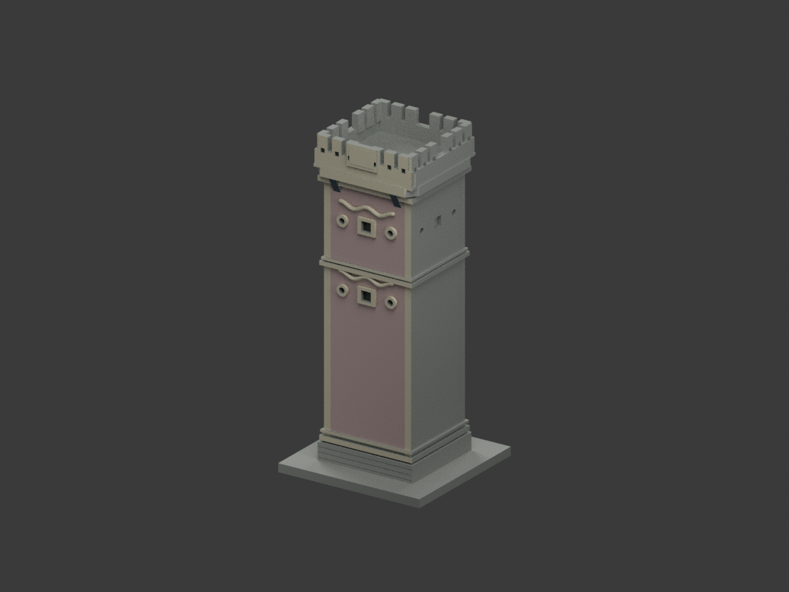
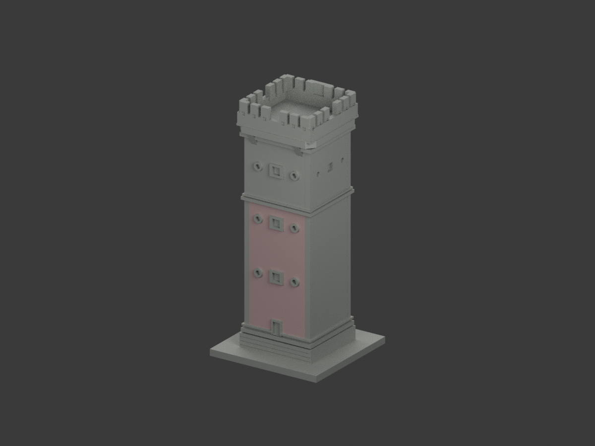
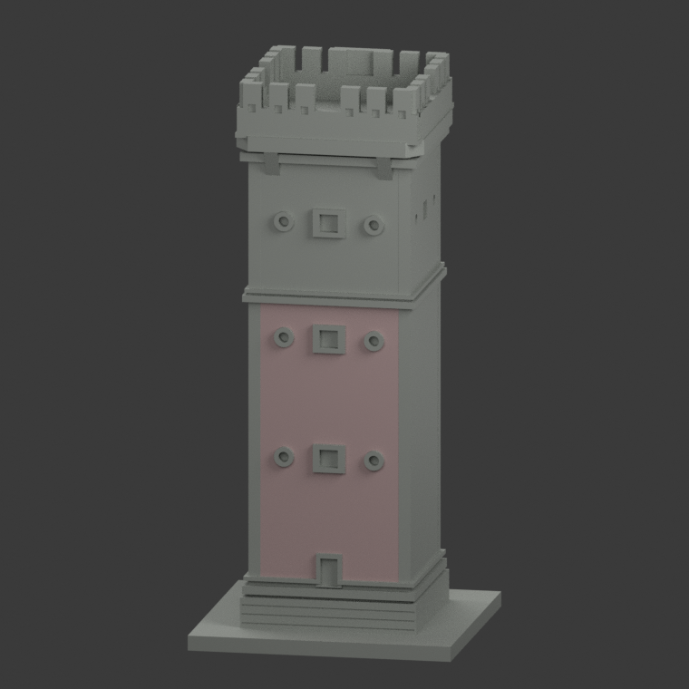

# 金門得月樓｜彩色外觀模型

## 模型預覽

| 模型預覽 | 模型預覽 | 模型預覽 |
| :---: | :---: | :---: |
| [](front-current.webp)<br>正面斜視代表圖 | [](rear-current.webp)<br>背面斜視 | [](courtyard-wall.webp)<br>塔身庭院側主牆 |

[彩色 3MF](appearance.3mf) · [可編輯 Blender](scene.blend) · [STL（不含色）](model.stl) · [逐面驗證](verification.json) · [渲染來源與視角](render-proof.json) · [校驗版本](CHECKSUM-SCOPE.md)

## 最新補色範圍

只補塔身朝庭院的背面（模型 +Y）兩道水平飾帶之間的主牆。155 個原本中性的完整三角面改為低飽和粉灰，其餘 7,039 面、頂點與三角順序、原材色槽、舊 STL、模型包數不變；頁首預覽已用此模型重新產生。轉角柱、孔洞內壁與裝飾、上段、其他立面、露臺及底座不補色。這是既有模型的材色補充，不是新的建築模型。

[金門縣觀光旅遊網現場照](https://kinmen.travel/image/10073/1024x768) 和 [旅行紀錄的庭院側照片](https://ajtravel.tw/wp-content/uploads/2024/06/20240609153752_0_8a0a4a.jpg) 都拍到門內、塔身朝庭院的一面；可用塔下門洞、兩道水平飾帶及中段兩層開口辨認。兩照都支持中段主牆的粉灰色族；保留原幾何的開口簡化及其未分色表面。第一張拍攝日不確定，第二張是 2024 年上傳目錄的影像。2025 年重開公告所附的是園前望向建築的照片，不證明庭院側修後顏色未變；本補充只反映參考照片所見，不是 2025 年整修後現況的判定，也不是校準色票。隨包只發布模型與自行渲染，不附實景照片。未試印。

原 7,194 面、3,599 頂點、尺寸與 STL 不變；補色沿用低飽和粉灰色族，以 #C3ABAA 另立材質，不代表 2025 年整修後顏色已逐面確認。原正面粉灰、淡米灰角柱與冠部、深色凹口及正面檐底暗藍灰保留；屋頂露臺、其他無色證側背面和展示底座保持中性。只含得月樓塔本體，不含洋樓、庭園或室內，不是實測或竣工圖。最長邊 150 mm，STL 不含顏色，未實際切片或試印；[原幾何檢核](validation.json)為數位檢查。

## 基準來源與權利


- [金門觀光官方2025修後報導附照](https://www.kinmen.travel/articles/45301/1024x768_articles-image-dbki0pcwy0-cw07lx49hvq.jpg)
- [國家公園官方較早遠照](https://www.taiwan.nps.gov.tw/upload/filesys/image/01_chinese/11_epaper/vol_376/park3.jpg)
- [國家公園2021期刊舊近照](https://www.taiwan.nps.gov.tw/upload/filesys/image/01_chinese/2021_Journal/02/tribe4.jpg)

來源hash及角色見[基準色版來源紀錄](https://github.com/hplin50643/taiwan-buildings-3d/blob/a9223a4c3f4880ffa6dae63b8faf06092d629b5f/%E8%87%BA%E7%81%A3%E5%9C%B0%E6%A8%99/deyue-tower/COLOR-SOURCE-REGISTER.json)。公開官圖不等於 CC 或商用再授權；原照私人保存、不隨模型公開、不貼圖，也不以儲存庫license再授權。模型不保證商用權利已清。本次僅建築外觀。


## 固定基準與重現

上方模型可直接使用。若要重建，將[歷史基準 Blender](https://github.com/hplin50643/taiwan-buildings-3d/blob/a9223a4c3f4880ffa6dae63b8faf06092d629b5f/%E8%87%BA%E7%81%A3%E5%9C%B0%E6%A8%99/deyue-tower/scene.blend)和[歷史基準 3MF](https://github.com/hplin50643/taiwan-buildings-3d/blob/a9223a4c3f4880ffa6dae63b8faf06092d629b5f/%E8%87%BA%E7%81%A3%E5%9C%B0%E6%A8%99/deyue-tower/appearance.3mf)下載到另一個資料夾；腳本會核對兩件原始輸入的 SHA-256。使用 Blender 4.3.2，並替換實際路徑：

```sh
blender -b /path/to/baseline/scene.blend --disable-autoexec -t 4 --python-exit-code 1   -P build_courtyard_wall.py -- /path/to/baseline/appearance.3mf /tmp/deyue-current
```

請使用[當前校驗表](SHA256SUMS)。[前次外觀與原幾何說明](https://github.com/hplin50643/taiwan-buildings-3d/blob/a9223a4c3f4880ffa6dae63b8faf06092d629b5f/%E8%87%BA%E7%81%A3%E5%9C%B0%E6%A8%99/deyue-tower/README.md)只供歷史比對。
