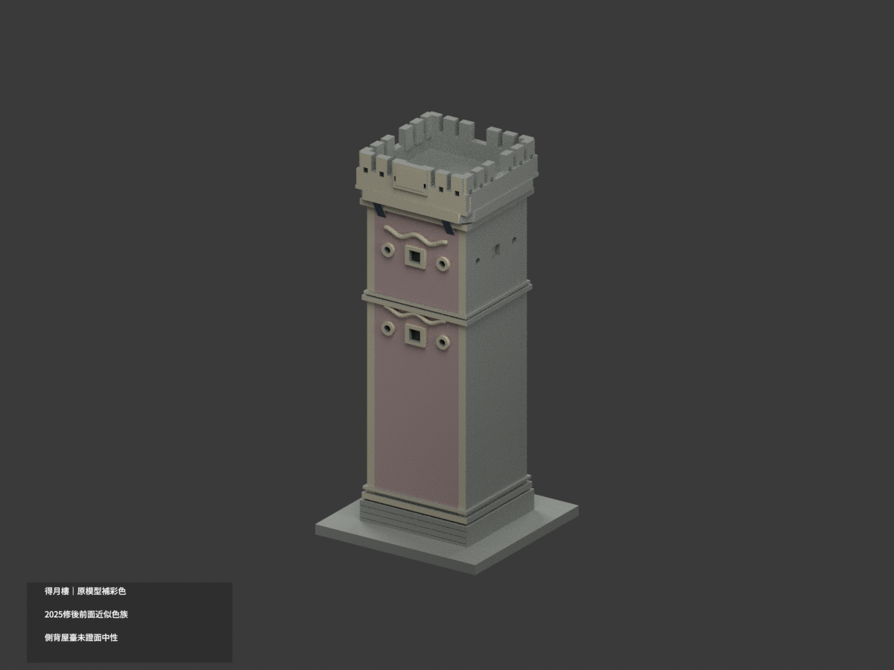
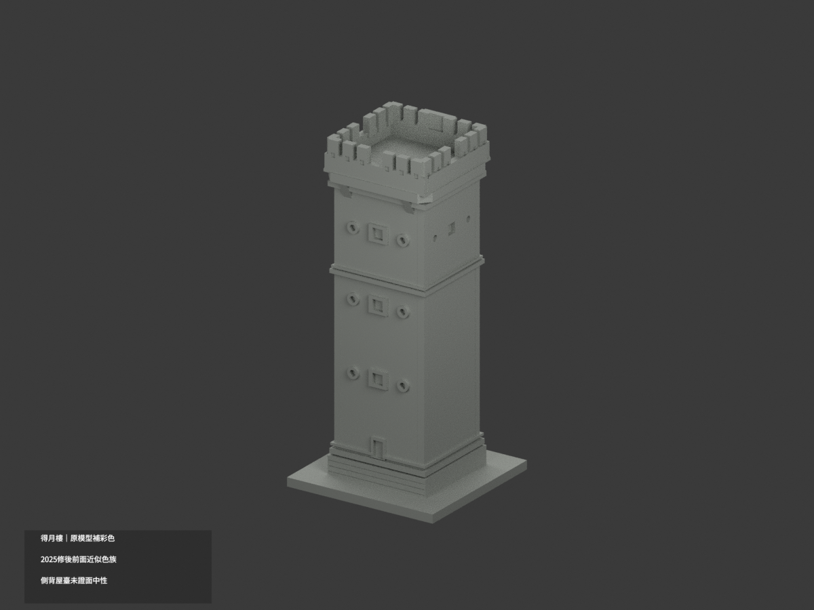
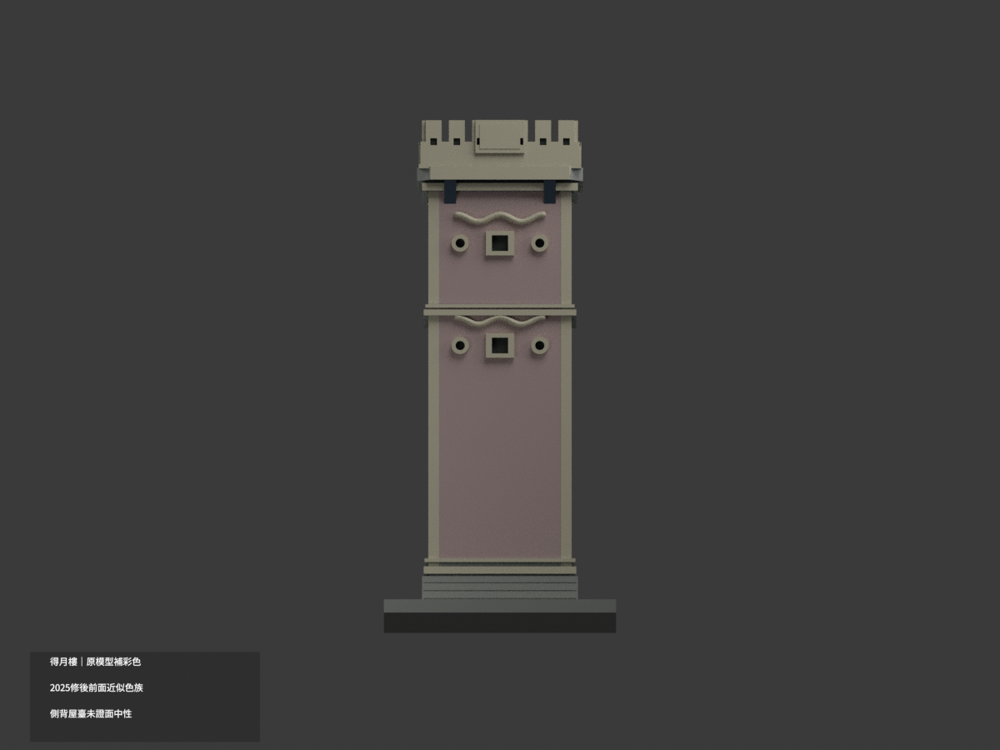
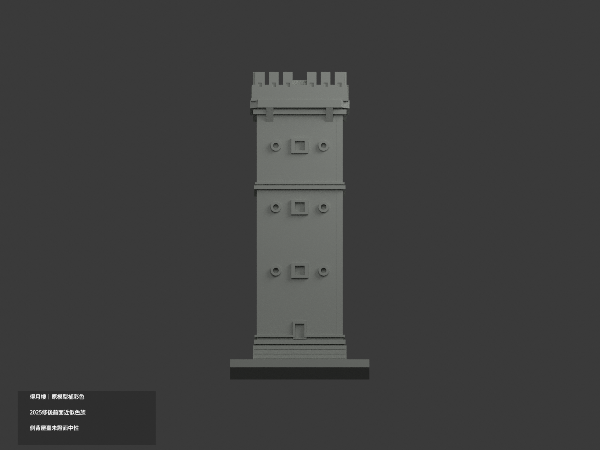
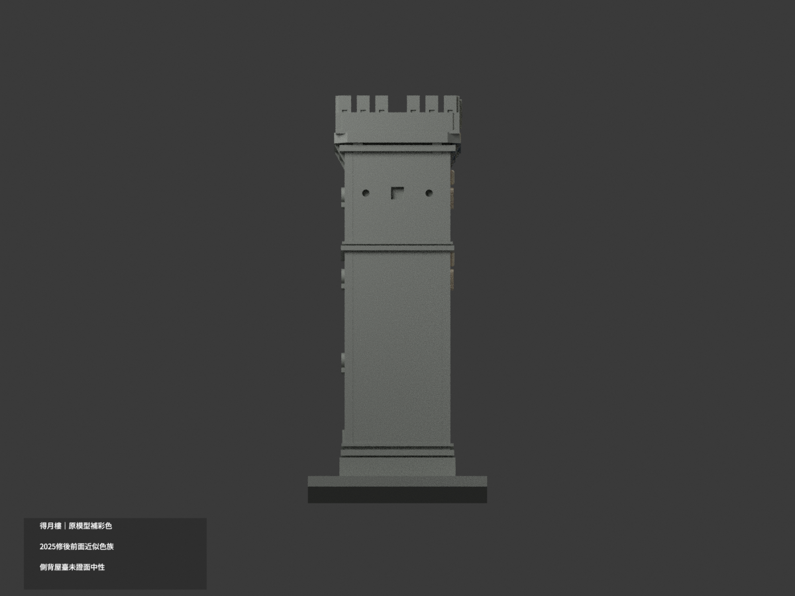
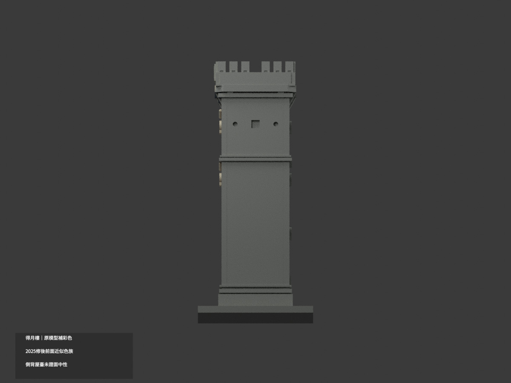
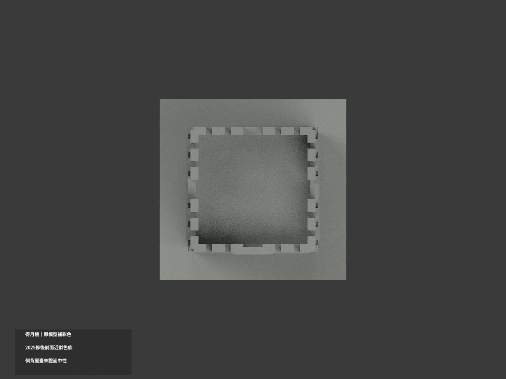
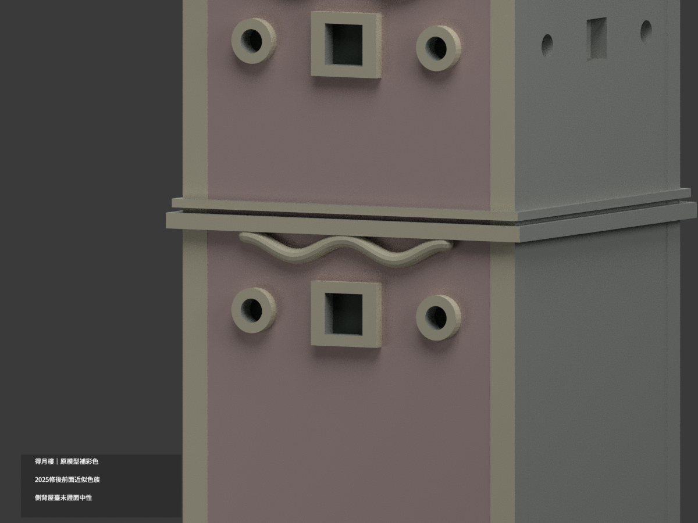
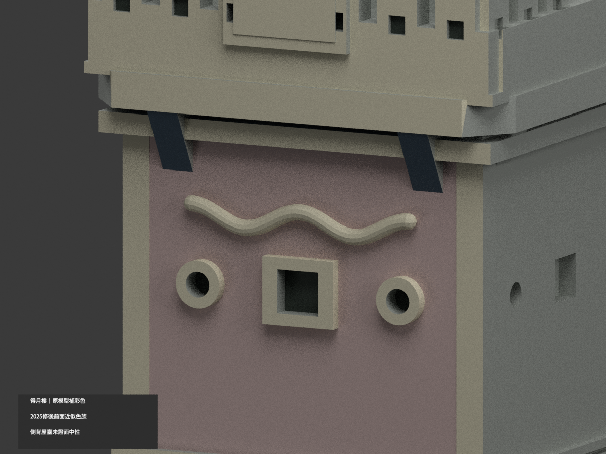
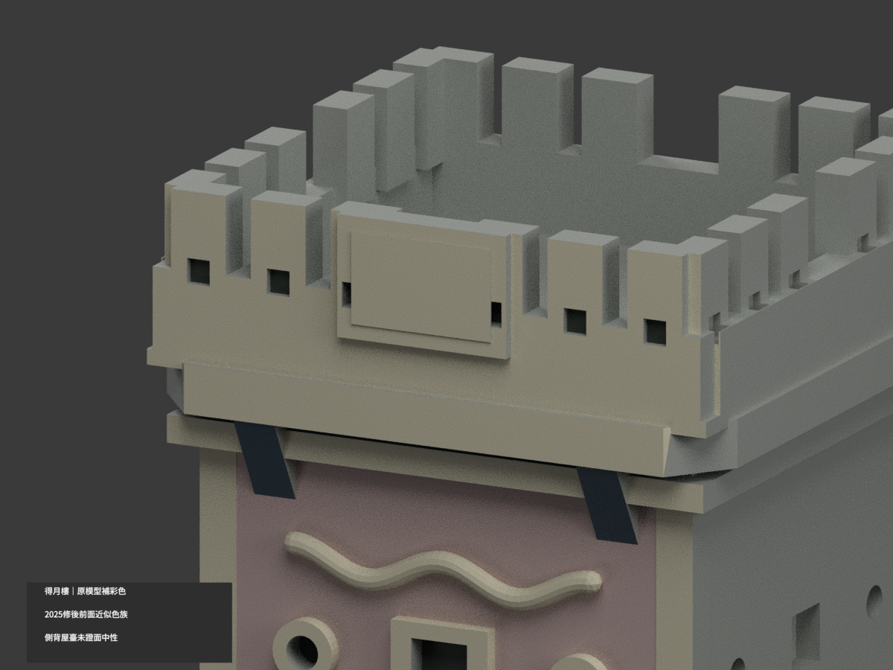

# 臺灣地標｜得月樓：原幾何補彩色

## 彩色模型預覽

**同一項目材色更新（count_delta = 0），只依2025修後時期官照補正面近似色族；側背、屋頂露臺及底座未證面中性。模型僅得月樓塔本體，不借旁邊洋樓外觀，也不是全聚落精確測繪。**

| 正面斜視 | 背面斜視 | 正面 |
|---|---|---|
|  |  |  |
|  |  |  |
|  |  |  |
|  |  |  |

## 材質範圍與限制

保留原 7194 三角面、頂點及尺度。沒有新增名字題字、花飾、孔口、格網或分割三角面；原浮雕簡化與尺寸近似仍保留，不因補彩變成修復竣工CAD。

- 正面大牆用低飽和粉灰；既有前角柱、凸帶、冠部前面及牌匾淡米灰。下段大留白不增假窗。
- 原前方形與圓形凹底深陰影，不宣稱都是玻璃；前頂小凹口亦只陰影。
- 只有正面出挑簷底與相連托座可對位下面用暗藍灰，**不是整屋頂藍色**。露臺水平地坪、背側牆與未見面保持中性，並非真正漆色。
- 原彎眉曲面可分成單一保守淡色；無法由2025小像素證明的細紅／黃裝飾分區不新增。用未改原碼曲線構件作既有面材域比對，不輸出任何新增幾何。
- 2025-10-02竣工官報附照作修後色族優先；舊2021及較早遠照只辨識部位，不套舊污斑、黃化或褪色紫。資料頁發布年不等於每張精確拍攝日，照片也不是測色色票。
- 相鄰洋樓、庭園不在此原模型；不把它們的磚紅或米黃塗到塔上。整面跨材質但無既有分界時保中性，不用面重心製斜楔。

## 格式與重建

原 `model.stl`、`build_model.py`、`editable.blend` bytes不變；原包沒有OBJ。STL不含彩色；新 `appearance.3mf` 有五種逐面基本材質，`scene.blend` 為實際shader，`color-mesh.npz` 保原三角座標。五色外觀不是已驗證四色／多耗材切片專案；未實際列印、未執行切片器驗證。

```sh
python build_model.py
python colorize_model.py
python export_appearance.py
python validate_color.py
blender -b -t 3 --python render_color.py
blender -b --python-exit-code 1 --python verify_color_scene.py
```

沿原requirements與Blender4.3.2，原曲面材域辨識另需 rtree。隔離重建保留不刪。新QA見 COLOR-FORMAT-GEOMETRY-QA、SCENE-QA、DELIVERY-QA、SOURCE-VISUAL-QA；七全景檢查完整邊界，三細景刻意局部構圖。原validation／blend_validation／previews及原程式保留歷程，不當本次彩色重建入口。

## 來源與權利

- [金門觀光官方2025修後報導附照](https://www.kinmen.travel/articles/45301/1024x768_articles-image-dbki0pcwy0-cw07lx49hvq.jpg)
- [國家公園官方較早遠照](https://www.taiwan.nps.gov.tw/upload/filesys/image/01_chinese/11_epaper/vol_376/park3.jpg)
- [國家公園2021期刊舊近照](https://www.taiwan.nps.gov.tw/upload/filesys/image/01_chinese/2021_Journal/02/tribe4.jpg)

來源hash及角色見 COLOR-SOURCE-REGISTER.json。公開官圖不等於 CC 或商用再授權；原照私人保存、不隨模型公開、不貼圖，也不以儲存庫license再授權。模型不保證商用權利已清。本次僅建築外觀。

## 原始模型說明與限制

原文保留如下，材色及重建入口以新段落優先；舊單材圖不是本次彩色成果。

# 金門得月樓｜150 mm 可列印外觀縮景

研究與建模日期：2026-10-11。

成品外廓（含底座）：70 × 68 × 150 mm。STL 單位為毫米。

## 模型預覽

| 模型預覽 | 模型預覽 | 模型預覽 |
| :---: | :---: | :---: |
| 正面<br> | 背面<br> |  |

## 建模範圍與辨識特徵
本件只製作得月樓主塔及展示底座；不包含旁邊的黃輝煌洋樓、假厝與完整聚落。依 2025 年 10 月修整竣工新聞照片確認現存塔形，並用國家公園近照核對細部：修長塔身、大面積下層素牆、轉角線腳、上層方形觀察窗及圓形銃眼、外挑頂臺、低女兒牆與垛口。

火焰形窗楣改為連體波形淺浮雕；銃眼與窗戶採淺凹，不重建內部防禦設施。匾額保留牌框，未以不可辨識的小字假造銘文。頂臺凹槽對天空開放。

## 尺寸依據與推估
官方金門國家公園頁與 2025 修整報導記樓高 11.26 公尺；另有國家公園文章記 11.6 公尺，來源存在差異。本件參考前者，146 mm 塔體高度約相當於 1:77 的視覺縮比，但塔寬、塔深、各線腳與底座均由照片推估，不是等比例測量。底座為新作展示支承，非現場地坪範圍。背側開口位置依公開說明與可見立面保守簡化。

## FDM 列印建議
底座平放，建議 0.4 mm 噴嘴、0.16–0.20 mm 層高、3 道外牆及 12–18% 填充起試。模型檔雖為實體，切片軟體仍可設定填充率。頂臺外挑及裝飾窗楣下方請檢查局部支撐；可先用「僅接觸平台」樹狀支撐評估，確認能支到外挑區。女兒牆約 3 mm 厚、前方線飾直徑約 1.8 mm；淺凹及底座線紋可能受切片線寬影響。勿從女兒牆或窗楣施力拆支撐。

## 公開來源

- https://www.kinmen.travel/zh-tw/news/details/4191
  - 2025-10-02 整修竣工資訊及金管處提供照片；採用修整後已落成的整體塔形。
- https://www.taiwan.nps.gov.tw/home/zh-tw/topic/18476.html
  - 國家公園得月樓近照；觀察窗、銃眼、外挑頂臺、窗楣和女兒牆。照片年代早於2025，僅補充仍可由竣工照核對的形制。
- https://www.kmnp.gov.tw/ch/touristInfo/recreation-sites/16
  - 官方樓高 11.26 公尺與外觀背景；未據內部說明製作內部設施。
- https://www.taiwan.nps.gov.tw/home/zh-tw/topic/18180
  - 官方整體外觀交叉核對；此文高度11.6公尺與其他官方頁有差異。

## 檔案內容
- model.stl：毫米單位的單一可列印外觀模型，底面 Z=0。
- build_model.py：原創參數化 Python 建模程式，可修改數字重建模型。
- editable.blend：由最終 STL 匯入的可編輯網格，已設定毫米單位。可列印物件名稱為「Print-ready exterior (mm)」。相機不是列印物件。
- previews/front.png、previews/rear.png：直接渲染最終 STL 的完整正面／背面斜視圖，沒有另外加上無法列印的裝飾。
- source_review.json：公開參考來源、採用特徵與推估範圍。
- validate_model.py、validation.json：非修改式幾何、原始法線與原始程式重建檢查。
- check_blend.py、blend_validation.json：檢查 Blender 網格與最終 STL 的幾何一致性。
- requirements.txt、SHA256SUMS.txt：套件版本及檔案摘要。

## 重建與編輯
需要 Python 3.12，先執行：

    python -m pip install -r requirements.txt
    python build_model.py
    python validate_model.py

需要重新製作 Blender 檔與預覽時，使用 Blender 4.3 或相容版本：

    blender -b -t 4 -P render_preview.py
    blender -b editable.blend -P check_blend.py

可用 --output 指定另存 STL，例如 python build_model.py --output revised.stl。修改後請重跑驗證。Blender 檔是可編輯網格；建築尺寸與程序性修改以 build_model.py 為主。

## 驗證與限制
數位驗證確認：單一連通外邊界、水密、面繞向一致、原始 STL 法線與頂點順序一致、每條邊恰有兩個相鄰面、各頂點的鄰接面形成單一環、無退化三角面、正體積、平整接地、最長邊 150 mm。原程式重新輸出的標準化三角形摘要相符；.blend 的可列印網格也與 STL 一致。模型沒有封閉的空腔內殼。外廊或裝飾下方若有對外通孔，不是破面或封閉空腔。

尚未實際切片或試印。數位檢查不等於實體列印保證；未另以獨立三角面交叉演算法證明所有自交情況，主體採 manifold3d 實體布林建立。請先用自己的切片軟體檢查支撐、薄壁、橋接、耗材量及列印時間。不要未檢查就縮小模型；細節會一起變薄。

此為公開外觀的桌上型建築縮景，不是測繪圖、修復工程模型或精密等比例複製品。參考照片僅供觀察，未隨包附送，也沒有使用他人 STL／3D 資產。預覽為單色材質，不代表實際建築配色。正面／背面是模型視角標示，未宣稱精確地理方位。
