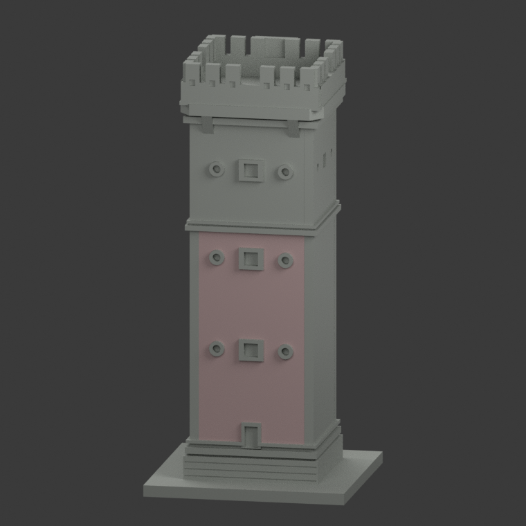

# 金門得月樓｜庭院側主牆材色補充



[下載彩色 3MF](courtyard-wall.3mf) · [Blender 場景](courtyard-wall.blend) · [原模型與原代表圖](../README.md) · [逐面核對](verification.json) · [檔案校驗碼](SHA256SUMS)

只補塔身朝庭院的背面（模型 +Y）兩道水平飾帶之間的主牆。155 個原本中性的完整三角面改為低飽和粉灰，其餘 7,039 面、頂點與三角順序、原材色槽、舊 STL、模型包數及代表圖都不變。轉角柱、孔洞內壁與裝飾、上段、其他立面、露臺及底座不補色。這是既有模型的材色補充，不是新的建築模型。

[金門縣觀光旅遊網現場照](https://kinmen.travel/image/10073/1024x768) 和 [旅行紀錄的庭院側照片](https://ajtravel.tw/wp-content/uploads/2024/06/20240609153752_0_8a0a4a.jpg) 都拍到門內、塔身朝庭院的一面；可用塔下門洞、兩道水平飾帶及中段兩層開口辨認。兩照都支持中段主牆的粉灰色族；保留原幾何的開口簡化及其未分色表面。第一張拍攝日不確定，第二張是 2024 年上傳目錄的影像。2025 年重開公告所附的是園前望向建築的照片，不證明庭院側修後顏色未變；本補充只反映參考照片所見，不是 2025 年整修後現況的判定，也不是校準色票。隨包只發布模型與自行渲染，不附實景照片。未試印。

重建（Blender 4.3.2；原始兩個輸入檔在上層；請指定獨立輸出資料夾）：

```sh
blender -b ../scene.blend -t 4 --python-exit-code 1 \\
  -P build_courtyard_wall.py -- ../appearance.3mf ./build-output
```

程式產出模型、逐面核對紀錄與兩張暫用無字 PNG。公開預覽取 `_render_qa/candidate.png` 並以 Pillow 的 `lossless=True, method=6, exact=True` 轉為無失真 WebP，不發布暫用檔。
