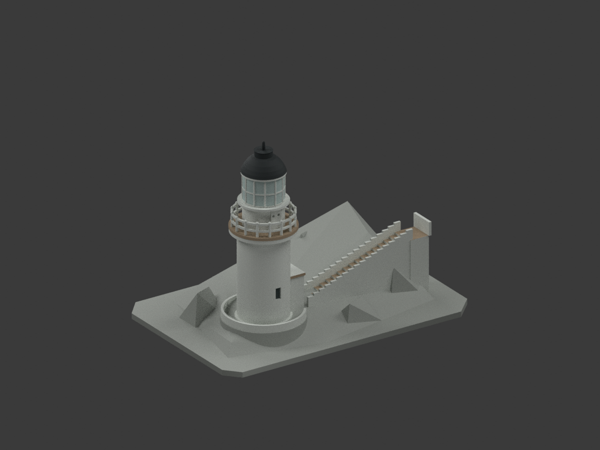
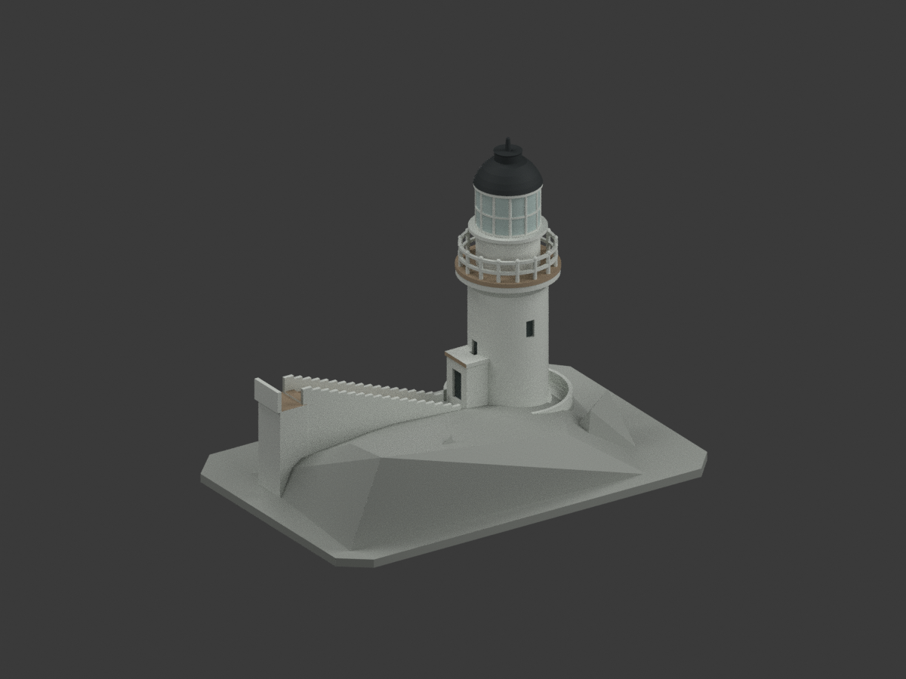
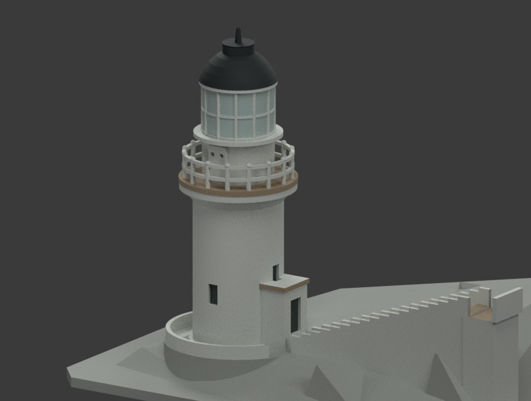

# 馬祖東湧燈塔｜彩色外觀模型

## 模型預覽

| 正面斜視代表圖 | 背面斜視 | 門廊帽板側緣 |
| :---: | :---: | :---: |
|  |  |  |

[彩色 3MF](appearance.3mf) · [可編輯 Blender](scene.blend) · [STL（不含色）](model.stl) · [逐面驗證](verification.json) · [渲染來源與視角](render-proof.json) · [校驗版本](CHECKSUM-SCOPE.md)

## 最新補色範圍

只改門廊帽板朝向下燈室雙圓窗同側的垂直長邊（模型 −Y，並非地理方位），將同一完整共面域的兩個原白色三角面改為既有棕灰石色（#A5937C）。舊版已補棕灰的入口正面保留；另一側、帽板頂面與底面、門廊牆、階梯、塔身、燈室與崖體皆不變。沒有新增門廊側窗、貼圖或其他幾何。

馬祖國家風景區管理處[實景照 49](https://www.matsu-nsa.gov.tw/api/uploads/attractions/%E6%9D%B1%E6%B9%A7%E7%87%88%E5%A1%94%28%E6%9D%B1%E5%BC%95%E5%B3%B6%E7%87%88%E5%A1%94%29_%E6%9D%B1%E5%BC%95_2025_49.jpg) 從下燈室雙圓窗一側看見帽板白色中心、棕色側緣與前端轉角；[實景照 42](https://www.matsu-nsa.gov.tw/api/uploads/attractions/%E6%9D%B1%E6%B9%A7%E7%87%88%E5%A1%94%28%E6%9D%B1%E5%BC%95%E5%B3%B6%E7%87%88%E5%A1%94%29_%E6%9D%B1%E5%BC%95_2025_42.jpg) 的稍高視角也支持此一輪廓與色族。照片中的實際棕邊寬度不在原模型的頂面分界內，本版只校正側面垂直石緣，沒有改頂面。兩照屬同一官網圖集，不宣稱不同攝影者獨立測色；檔名年份不是獨立確認的攝影日期，HEX 為原模型近似。

現行模型同時保留兩次局部改色：先把門廊帽板外前緣的 982、987 面（平面 x = −11 mm）改成棕灰石色，再補同一帽板側緣的 960、966 面（平面 y = −21.5 mm）。Blender 與 3MF 均核對四個原有面，保留兩次補色。原六種材質、11,696 個三角面、5,786 個頂點、既有 5 個混材共面域與 STL 不變。模型只含簡化的燈塔外觀，燈室非整圈玻璃；未補無證實區域、屋帽頂面或底面、崖體與展示底座。此非精密測繪，未實際試印或切片；[原幾何檢核](validation.json)為數位檢查。

## 基準來源與權利

馬祖國家風景區管理處官方相簿公開外觀照片，主要日照 41／49／46，夕照 12 不作藍黃光材色。僅建築外部材色，不重製人物、旗幟、海面照片或安全設施。官方可讀不等於 CC 或任意再授權；原照不隨模型公開、不作紋理，不保證商用。URL／雜湊及來源限制見[基準色版來源紀錄](https://github.com/hplin50643/taiwan-buildings-3d/blob/8e8512f3be4153b164c7508c26e445b233189950/%E8%87%BA%E7%81%A3%E5%9C%B0%E6%A8%99/dongyong-lighthouse/COLOR-SOURCE-REGISTER.json)。


## 固定基準與重現

上方模型可直接使用。若要重建，將[歷史基準 Blender](https://github.com/hplin50643/taiwan-buildings-3d/blob/8e8512f3be4153b164c7508c26e445b233189950/%E8%87%BA%E7%81%A3%E5%9C%B0%E6%A8%99/dongyong-lighthouse/scene.blend)和[歷史基準 3MF](https://github.com/hplin50643/taiwan-buildings-3d/blob/8e8512f3be4153b164c7508c26e445b233189950/%E8%87%BA%E7%81%A3%E5%9C%B0%E6%A8%99/dongyong-lighthouse/appearance.3mf)下載到另一個資料夾；腳本會核對兩件原始輸入的 SHA-256。使用 Blender 4.3.2，並替換實際路徑：

```sh
blender -b /path/to/baseline/scene.blend --disable-autoexec -t 4 --python-exit-code 1   -P build_cap_flank.py -- /path/to/baseline/appearance.3mf /tmp/dongyong-current
```

請使用[當前校驗表](SHA256SUMS)。[前次外觀與原幾何說明](https://github.com/hplin50643/taiwan-buildings-3d/blob/8e8512f3be4153b164c7508c26e445b233189950/%E8%87%BA%E7%81%A3%E5%9C%B0%E6%A8%99/dongyong-lighthouse/README.md)只供歷史比對。
