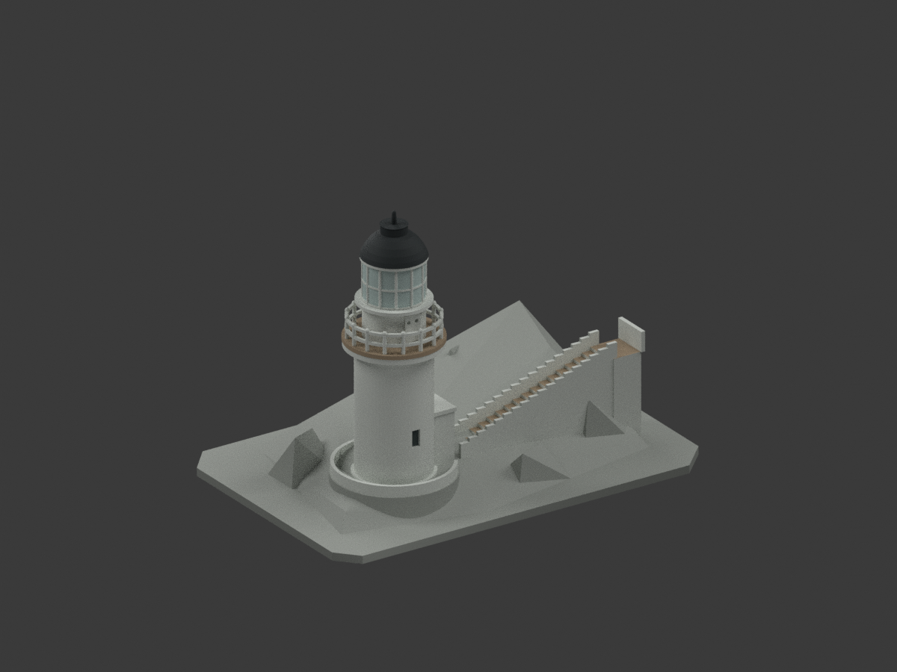
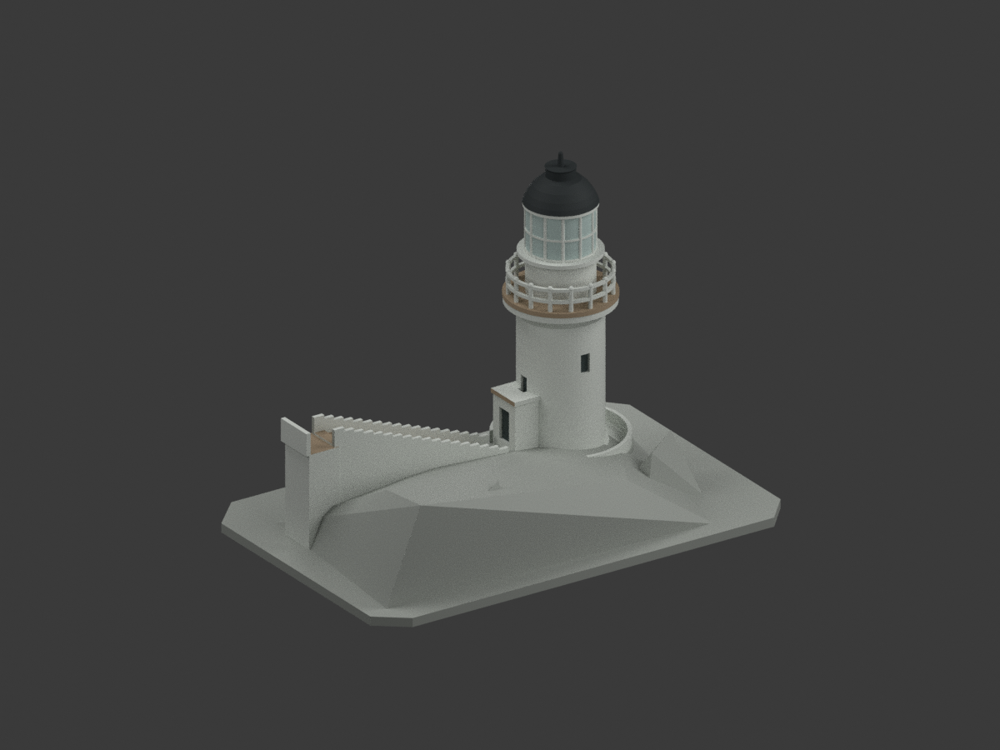
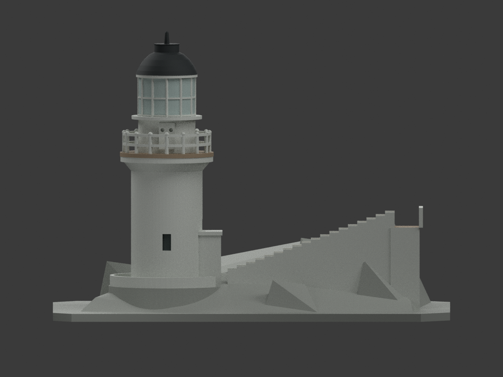
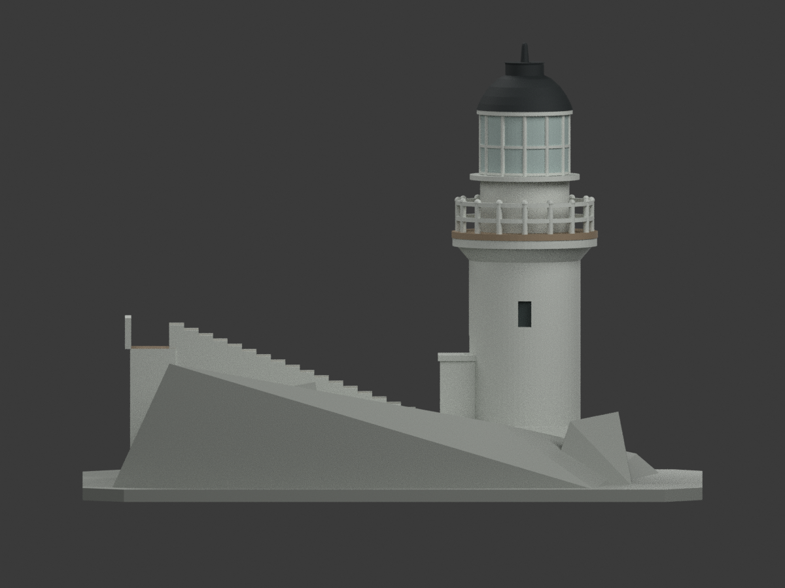
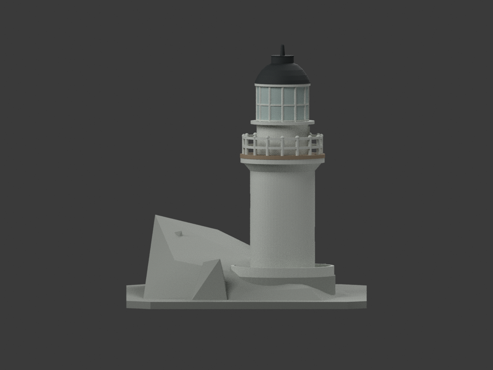
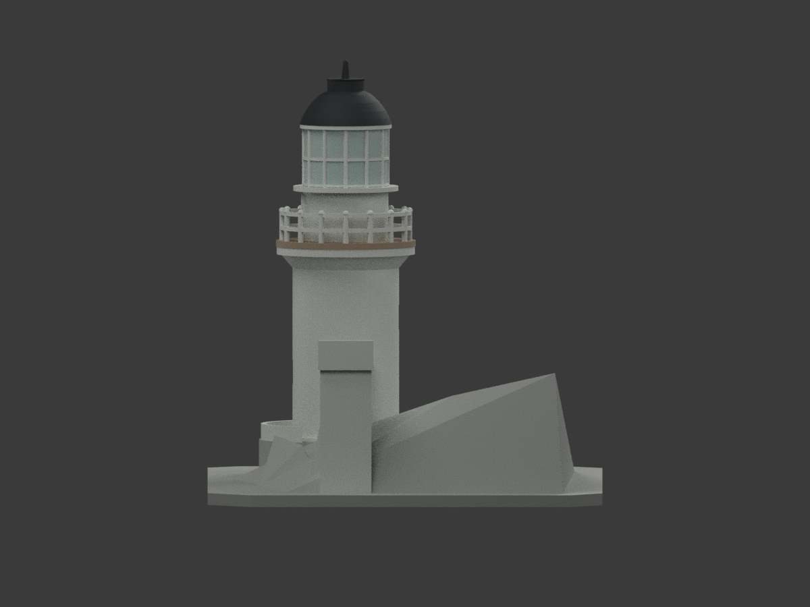
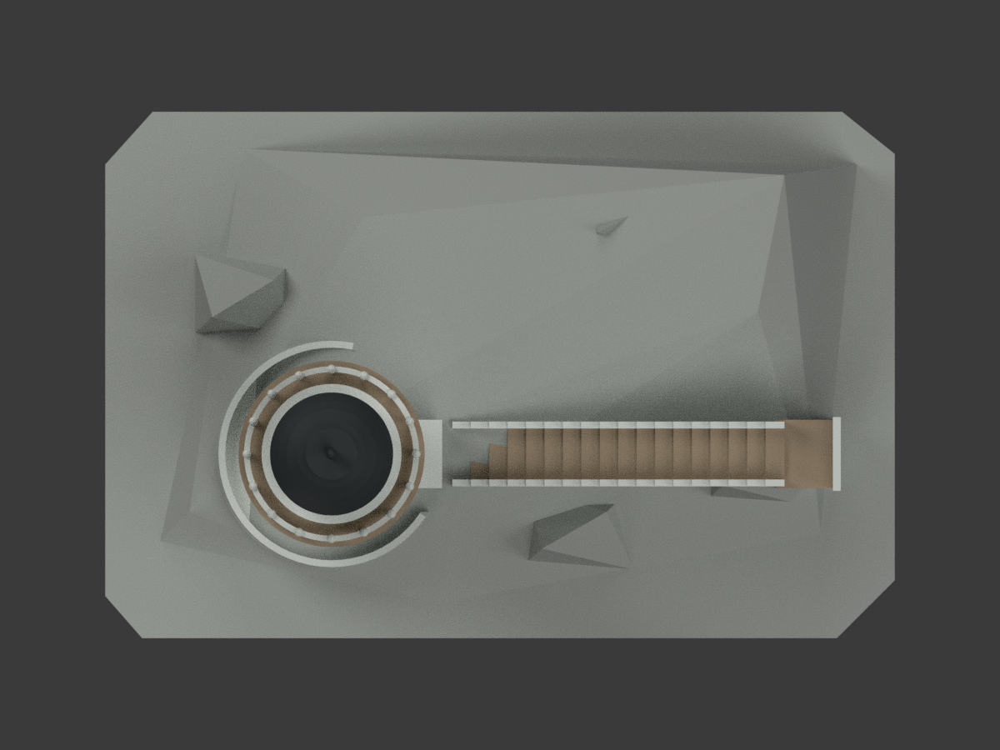
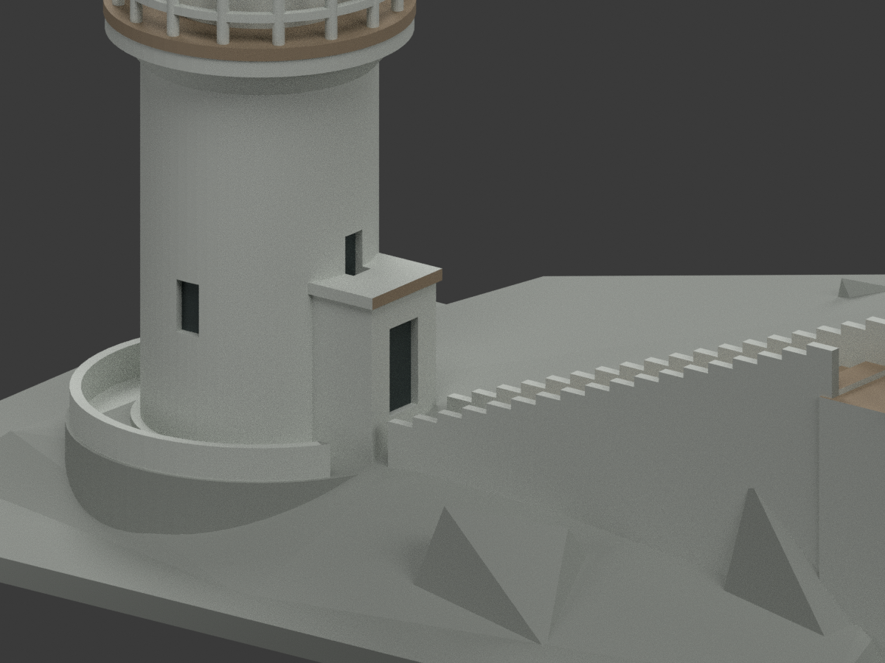
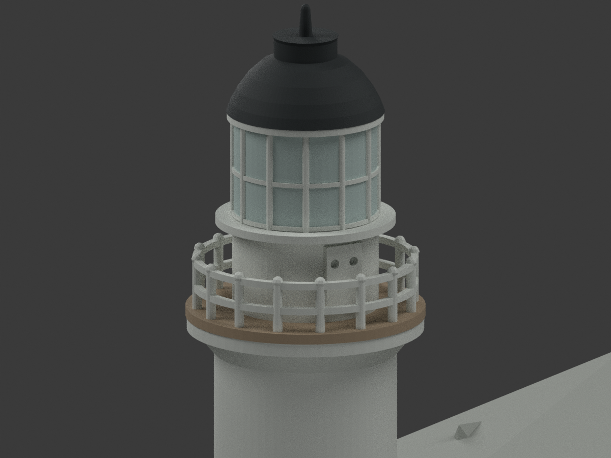
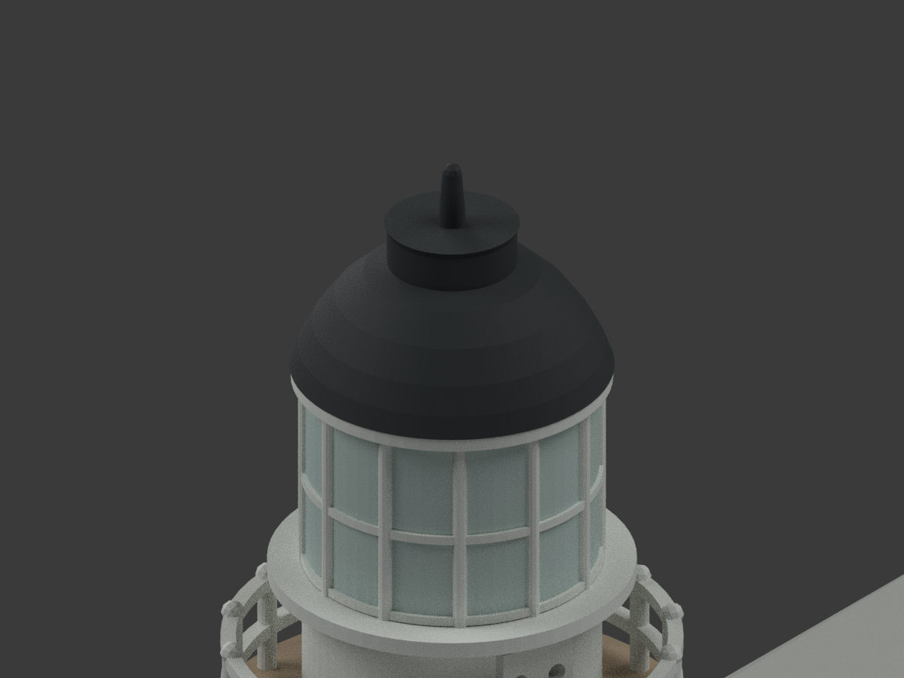

# 東湧燈塔｜門廊屋帽外前緣局部勘色

僅原門廊屋帽外前緣 x=-11、y=-21.5..-8.5、z=31.3..32.7 的 2 面（982、987）／1 完整連通共平面域，白色 index0 改既有石色 index2 #A5937C。原 11127 有色／569 中性／11696 三角保持，覆蓋增量為 0；原 6 色、STL、build 與所有其餘面索引保持，不切面、不改幾何。

原官方49照片全幅、官網新38與35照片全圖可分辨門廊白屋面中心與棕石外周，正面門上為棕石垂直邊。只對原薄屋帽的外前緣作色族代理，不宣稱石材成分、實測 HEX、精確厚度或門梯方位復原。原照片與新官網圖屬官方圖集，不能當成不同攝影者獨立測量；2025檔名不是精確拍攝日。門廊粗方盒與實物細節仍有差異。

頂部14面跨白中心及棕石周緣，原模型未有分界，全部保留白色；側面、底面、梯、燈室、地形均不延色。其餘原11125色面非此次全面重新認證。原混合淡色燈室非全玻璃，抽象崖體與展示底座仍中性；六材料不是驗證過的四色列印方案。參考照片只私人審核，不貼圖、不公開附帶。

VESTIBULE-FASCIA來源pending快照固定，最終獨審另檔。qa/vestibule-fascia-previous保留原歷史文字與審核，舊數量由本段更新，其餘限制繼續有效。

## 原版歷史說明

# 東湧燈塔（東引島燈塔）｜原模型材色更新

| 彩色預覽 | 彩色預覽 | 彩色預覽 |
|---|---|---|
|  |  |  |
|  |  |  |
|  |  |  |
|  | | |

## 材色範圍
同一既有東湧燈塔項目補彩（count_delta 0）。原 11696 三角面、頂點、STL 與 build_model.py 不變，無切面或增造風向標、光學設備、旗、人物及周邊房舍。原粗化崖體、階數、欄杆和圓塔形狀不因材色而成為精確測繪。

- 官方日照外觀支持白色圓塔／下燈室／既有欄杆／階梯側牆，以及深灰黑帽頂與原簡化頂桿。圓柱同材延續為明示概化，非所有隱蔽面逐一照片確證。
- **上燈室鼓體保持淡灰中性色族**：照片混合白遮板與淡色玻璃，原實體鼓與細梃無法精確對應每片真窗，不把十二扇整排當藍玻璃，不新增透明孔。既有凸梃／環框白色。
- 既有外露環形步道及其最外垂直石緣、階梯踏面為低飽和灰褐石色（下層白環與欄柱不染褐）；原凹口可辨底面暗影，不造室內。未證的基礎平台、崖體、岩肩與展示底座中性，不按概化地形猜草皮、海水或岩紋。
- 日景取色族，夕照僅作位置辨識；官方路徑年份不是每張照片拍攝日期，也不是現況精色。原圖只私人留存，不貼圖。
- 六種外觀材料不是四色或多耗材切片方案；**未實際列印**，不保證免支撐。STL 不存色；本次沒有改原尺寸或列印幾何。

## 檔案與重建
[彩色 3MF](appearance.3mf) · [彩色 Blender](scene.blend) · [保留原 STL](model.stl)

build_model.py 仍重建原幾何；colorize_model.py 僅對完整原面分材；export_appearance.py 產 3MF 基本材料；render_color.py 產十圖及場景。validate_color.py 驗原檔、三角座標、格式及保留隔離重建；verify_color_scene.py 重開實際 shader、索引及構圖。沿既有 numpy／trimesh／manifold3d／Pillow 與 Blender 4.3.2。

## 來源與權利
馬祖國家風景區管理處官方相簿公開外觀照片，主要日照 41／49／46，夕照 12 不作藍黃光材色。僅建築外部材色，不重製人物、旗幟、海面照片或安全設施。官方可讀不等於 CC 或任意再授權；原照不隨模型公開、不作紋理，不保證商用。URL／雜湊及來源限制見 COLOR-SOURCE-REGISTER.json。

## QA 與保留歷程
本次 COLOR-FORMAT-GEOMETRY-QA、SCENE-QA、FRAMING-QA、DELIVERY-QA 及獨立視覺審核對應新色版。舊 previews、舊報告和 ORIGINAL-MONOCHROME-README.md 保留作歷程，非本次色版入口。原包與重建目錄私人保留，不自動刪除；上方十圖和 scene.blend 為本次入口。

原 5 個混材連通共平面域的成員與材色均保持；本次只修正另一個完整單色外前緣域，不宣稱零混域。
