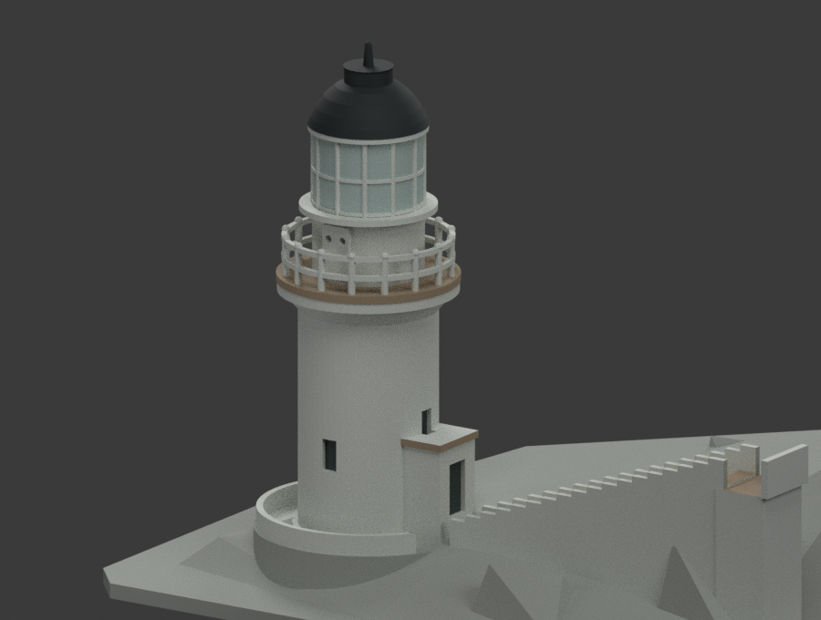

# 東湧燈塔｜門廊帽板側面石緣勘色



[下載彩色 3MF](cap-flank.3mf) · [Blender 場景](cap-flank.blend) · [原模型與代表圖](../README.md) · [逐面核對](verification.json) · [檔案校驗碼](SHA256SUMS)

只改門廊帽板朝向下燈室雙圓窗同側的垂直長邊（模型 −Y，並非地理方位），將同一完整共面域的兩個原白色三角面改為既有棕灰石色（#A5937C）。舊版已補棕灰的入口正面（模型 +X）保留；另一側、帽板頂面與底面、門廊牆、階梯、塔身、燈室與崖體皆不變。沒有新增門廊側窗、貼圖或其他幾何。

馬祖國家風景區管理處[實景照 49](https://www.matsu-nsa.gov.tw/api/uploads/attractions/%E6%9D%B1%E6%B9%A7%E7%87%88%E5%A1%94%28%E6%9D%B1%E5%BC%95%E5%B3%B6%E7%87%88%E5%A1%94%29_%E6%9D%B1%E5%BC%95_2025_49.jpg) 從下燈室雙圓窗一側看見帽板白色中心、棕色側緣與前端轉角；[實景照 42](https://www.matsu-nsa.gov.tw/api/uploads/attractions/%E6%9D%B1%E6%B9%A7%E7%87%88%E5%A1%94%28%E6%9D%B1%E5%BC%95%E5%B3%B6%E7%87%88%E5%A1%94%29_%E6%9D%B1%E5%BC%95_2025_42.jpg) 的稍高視角也支持此一輪廓與色族。照片中的實際棕邊寬度不在原模型的頂面分界內，本版只校正側面垂直石緣，沒有改頂面。兩照屬同一官網圖集，不宣稱不同攝影者獨立測色；檔名年份不是獨立確認的攝影日期，HEX 為原模型近似。

原六種材質、其他 11,694 個原有三角面、STL、原代表圖與套件數均不變，原有 5 個混材共面域亦不變。這不是全館復色、測繪或現況認證。未試印或作切片驗證；實景照片未隨包公開。

重建（Blender 4.3.2；上層為兩個原始輸入，請另用獨立輸出目錄）：

```sh
blender -b ../scene.blend -t 4 --python-exit-code 1 -P build_cap_flank.py -- ../appearance.3mf ./build-output
```

程式輸出模型、逐面核對與兩張暫用 PNG。公開預覽以 Pillow `lossless=True, method=6, exact=True` 從候選渲染轉成無失真 WebP；不發布暫用檔。
