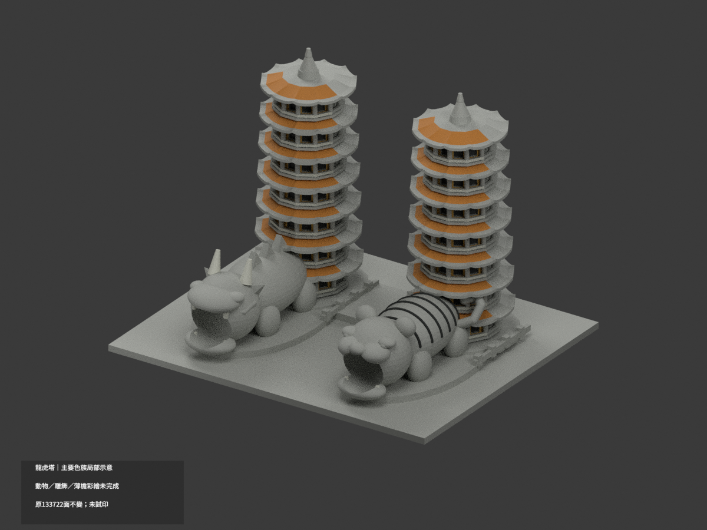
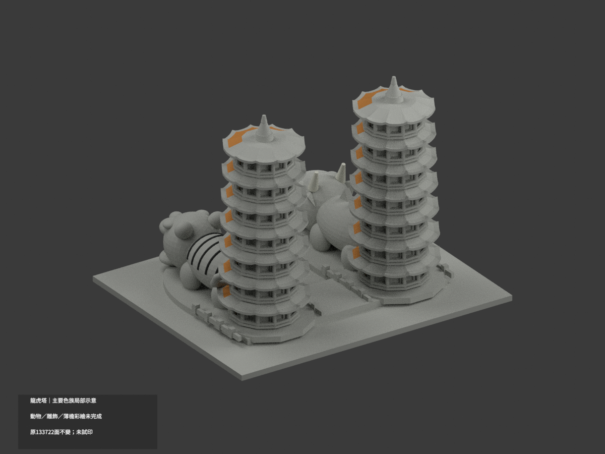
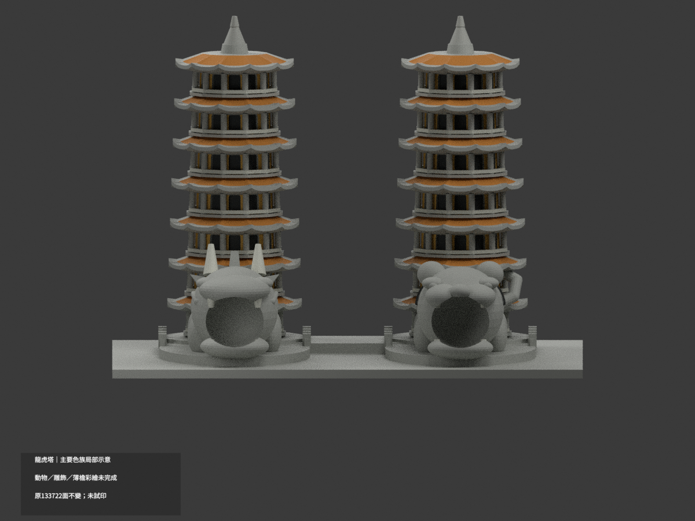
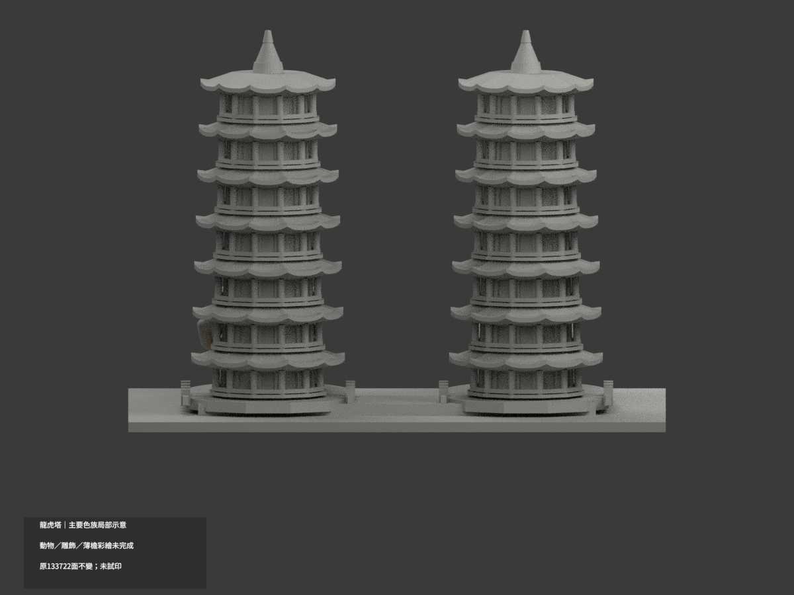
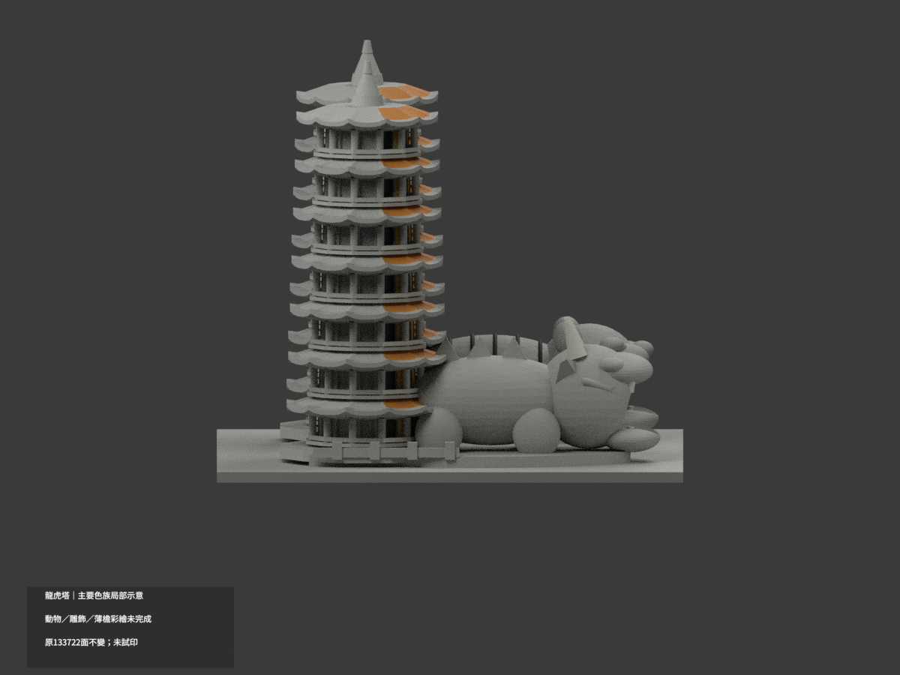
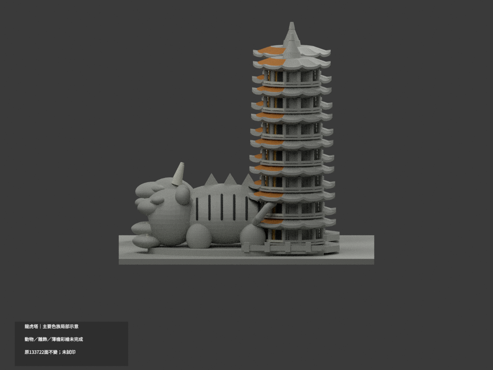
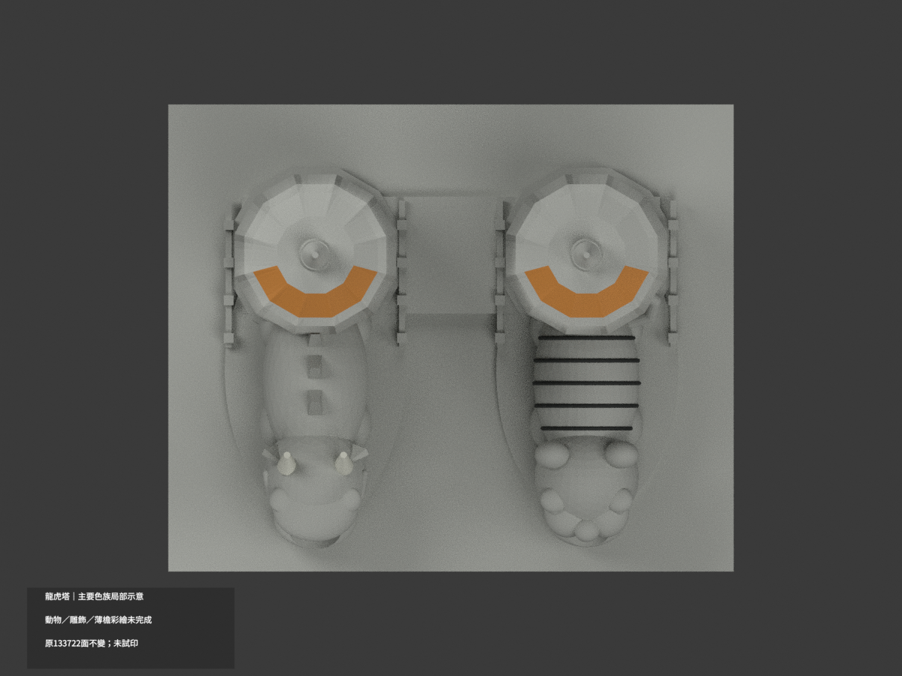
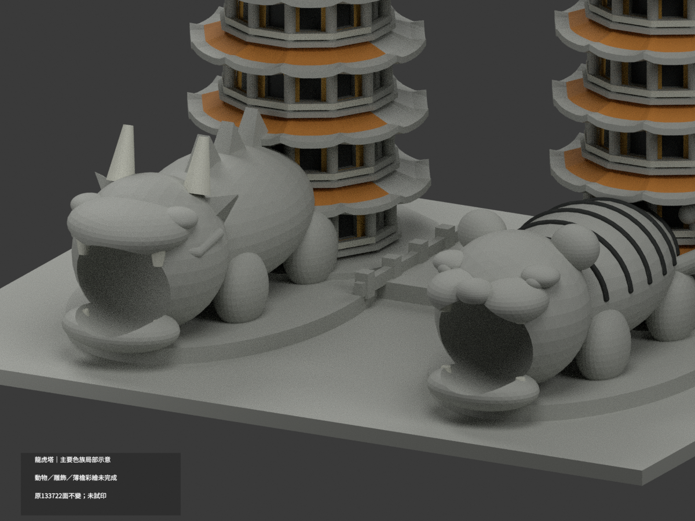
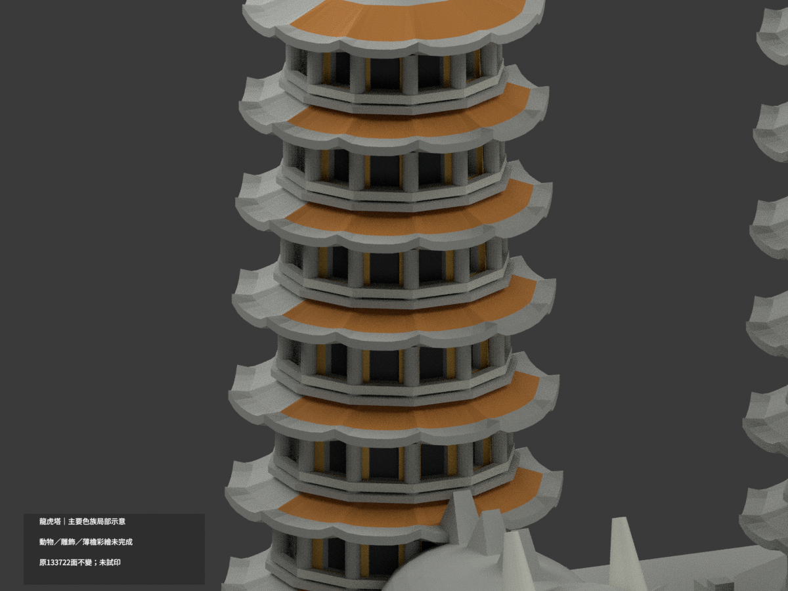
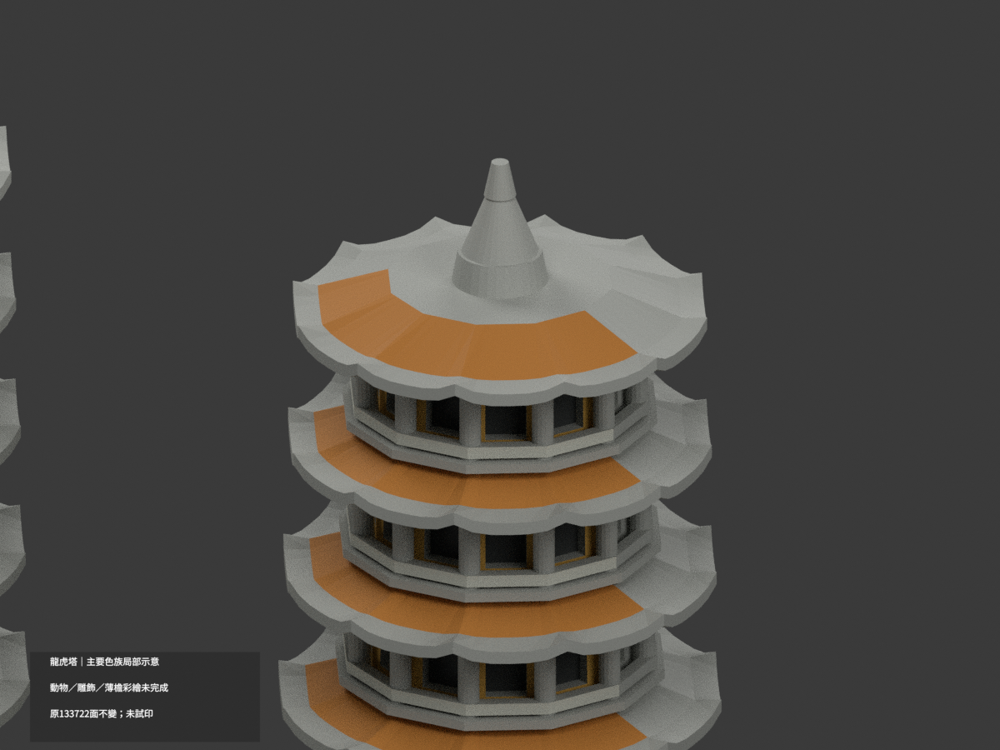

# 龍虎塔｜主要色族局部示意

| 正前 | 後方 | 正面 |
|---|---|---|
||||
||||
||||
||||

## 材色範圍

**動物／雕飾／薄檐彩繪未完成。** `partial_color_incomplete=true`、`fully_colored_exterior=false`。僅主要色族局部示意，不計作全面補色或精細修復彩繪完成。

同一 `dragon-tiger-pagodas` 原項目（same-item、count_delta=0），**133722 個原三角面、頂點、原 STL 與 build_model.py 位元組不變**。原碼無 OBJ 產物，本次不冒稱有原 OBJ。未切面、未重建龍虎雕刻或改變塔層、欄杆、底座與池景。

2025-04-13 高雄市政府 MICE 重開報導之日照（影像標示自由時報）支持前／斜前塔身金黃、寬瓦坡橘陶色、短欄白、真正拱凹暗影。文章日不是已證拍攝日，不是精確修復色票；無法取得的另一舊新聞照不作本次證據。

### 原面可對應的局部

- 前方五組原十二邊塔面金黃，真正拱凹背面暗灰。
- 每片屋頂只採最後寬坡的**完整前方五個原拓撲扇區**橘色；薄檐、翹角多色彩飾、頂尖與後坡保持中性。不是逐小三角法向截色，也不是虛構放射條紋。
- 只有原短欄外側可證面為白；7.4mm 原長柱混合不同實景部位，不能整柱塗白或全紅。
- 龍虎身體原橢球把主色、白腹及混色界線合在同一連續面，**整個軀幹與臉部保持中性**，不按 XYZ／半球硬畫綠、黃、嘴唇或腳色。
- 原已存在的虎紋凸管作粗化黑色；不是新貼圖或真實花紋復刻。可辨原牙與龍角以白色族示意，其根部無法一致匹配則中性。龍鱗、臉、鬚、眼、鰭及未知後方細彩未完成。

分色以原造型函式的參考表面比對每個原三角頂點及中心，距離允差 0.012mm、法向一致性 >0.96；此容差僅數值配對，不代表建築實測精度。未對應面整面中性，不修改幾何使其配色。

## 使用與重建

`scene.blend` 為實際多材質場景；`appearance.3mf` 使用基本材質標籤。`color-mesh.npz`、`palette.json` 與 `appearance-materials.json` 保留原面索引。STL 本身不含色。原 `previews/` 與 `ORIGINAL-MONOCHROME-README.md` 保留歷程，不是新色版 QA。

安裝 `requirements.txt` 與新增 `color-requirements.txt`，執行 `python colorize_model.py`、`python export_appearance.py`、`python validate_color.py`。分色程式只讀原建模函式定義作表面參考，不輸出新幾何。Blender：`blender -b -t 6 --python-exit-code 1 --python render_color.py`，再用 `verify_color_scene.py` 重開驗證。

**未實際列印**；六種材質不是已配置或驗證的四色列印工程。原粗化雕飾、欄柱及厚度限制不變。

## 來源與權利

來源網址／hash 及版本列於 `COLOR-SOURCE-REGISTER.json`。政府頁公開與圖片署名不等於照片授權開放；未確認 CC 或再散布授權，原照僅私人參照、不隨模型公開、不貼圖、不保證商用。模型原授權不擴張至來源照片。

原碼、ASCII STL（已實讀 release 真實位元組而非 Git LFS placeholder）與原單色場景均私人保留。來源 GO 與原圖獨審並非成品證明；本包另經原三角一致性、3MF、隔離重建、場景重開、十圖與人工視覺 QA，所有未核色面誠實保留中性。
