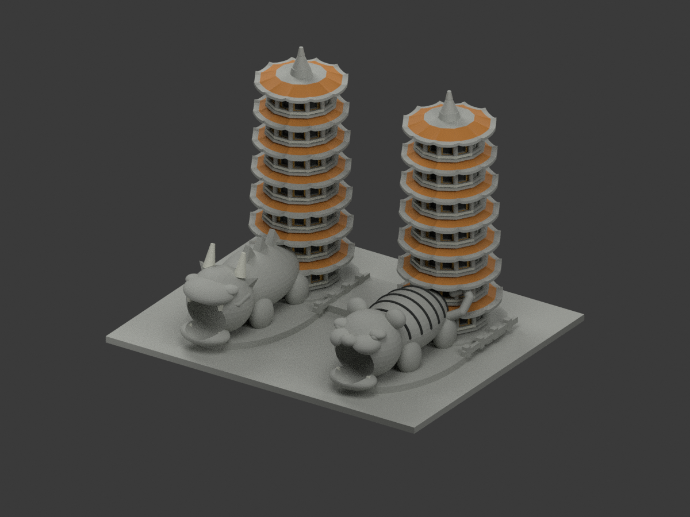
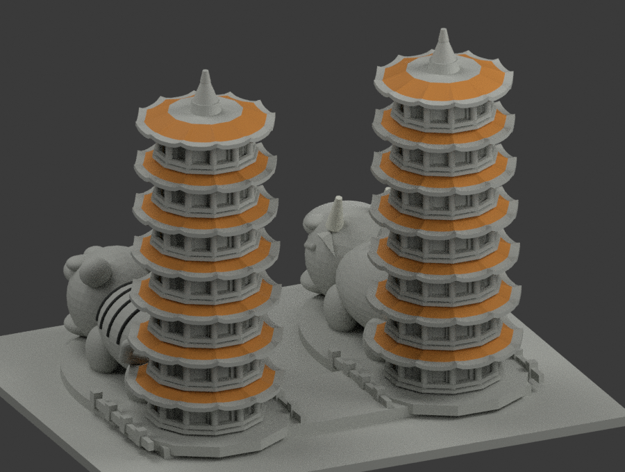

# 蓮池潭龍虎塔｜彩色外觀模型

## 模型預覽

| 正面代表視角 | 由湖面看雙塔側背主瓦坡 | |
| :---: | :---: | :---: |
|  |  | |

[彩色 3MF](appearance.3mf) · [彩色 Blender](scene.blend) · [二進位 STL（6.69 MB）](compact/model-binary.stl) · [逐面驗證](verification.json) · [正面渲染驗證](front-render-proof.json) · [現行校驗碼](SHA256SUMS)

在同一模型的雙塔七層原屋面上，僅將側背主瓦坡 1,680 個既有完整三角面由中性改為原暖橙褐瓦色 `#C98A43`。原正面同材 1,169 面、其餘材色、塔身、窄檐、彩飾、塔尖及龍虎造型均不變。不新增幾何、模型、貼圖或材質，原 STL 的幾何維持不變。

原版本已核對的前側塔身、寬瓦坡、短欄和拱凹配色保留；暗處、動物、雕飾和薄檐仍有中性未復原面。這是局部材色示意，並非完整復原或實測尺寸。原模型 133,722 個三角面未重建。STL 不含色；二進位版為未減面的 float32 格式轉換。未切片或試印。

## 參考與重建

[高雄市政府觀光局空拍（存檔）](https://commons.wikimedia.org/wiki/File:Aerial_view_of_Dragon_and_Tiger_Pagodas.jpg) 從湖面向岸取景，可見雙塔背側橙黃主瓦坡和不同色的窄外飾；[高雄旅遊網另一張側向空拍](https://khh.travel/image/37689/?r=1642753143436) 亦可見同樣的區分。[高雄旅遊網景點說明](https://khh.travel/zh-tw/attractions/detail/11/) 確認同一雙塔及其整修。七層未逐面近拍，僅依可見同一連續瓦面延伸，非逐坡色度精測或完整復原。角飾細彩、薄檐與不可對位部分不補色。來源原照未附，也不用作紋理。未實際列印。

已出版的模型直接使用上方 3MF 或 Blender，不必取回舊檔。若要重建這次原幾何補色，將固定版本的[基準 Blender](https://github.com/hplin50643/taiwan-buildings-3d/blob/88578077d19c33cb890500fa4267c937bc4668d5/%E8%87%BA%E7%81%A3%E5%9C%B0%E6%A8%99/dragon-tiger-pagodas/scene.blend)及[基準 3MF](https://github.com/hplin50643/taiwan-buildings-3d/blob/88578077d19c33cb890500fa4267c937bc4668d5/%E8%87%BA%E7%81%A3%E5%9C%B0%E6%A8%99/dragon-tiger-pagodas/appearance.3mf)存於另一個資料夾。腳本會檢查兩個基準檔的精確 SHA-256。以 Blender 4.3.2 在此目錄執行（請換成實際基準與輸出路徑）：

```sh
blender --disable-autoexec -b /path/to/baseline/scene.blend -t 2 --python-exit-code 1 \
  -P build_side_rear_roofs.py -- /path/to/baseline/appearance.3mf /tmp/dragon-tiger-side-rear-roofs
```

重建輸出在另一個目錄，供驗證的 PNG 不放在展示區。[前次版本技術說明](https://github.com/hplin50643/taiwan-buildings-3d/blob/88578077d19c33cb890500fa4267c937bc4668d5/%E8%87%BA%E7%81%A3%E5%9C%B0%E6%A8%99/dragon-tiger-pagodas/README.md)與[前次版本校驗表](https://github.com/hplin50643/taiwan-buildings-3d/blob/88578077d19c33cb890500fa4267c937bc4668d5/%E8%87%BA%E7%81%A3%E5%9C%B0%E6%A8%99/dragon-tiger-pagodas/SHA256SUMS)可在固定提交查閱；不作為本版校驗表。前版配色程式、歷史預覽與驗證資料可於[固定歷史提交](https://github.com/hplin50643/taiwan-buildings-3d/tree/8c322901224a590689401db4b72ec6878f391b9b/%E8%87%BA%E7%81%A3%E5%9C%B0%E6%A8%99/dragon-tiger-pagodas)查閱；現行 3MF 與 Blender 檔不依賴舊展示圖。主分支的唯一 STL 是上方二進位 STL。須精確比對原始 ASCII 時，請下載[固定 Release 附件](https://github.com/hplin50643/taiwan-buildings-3d/releases/download/v1.0.0/dragon_tiger_pagodas_150mm.stl)（36,412,062 bytes，SHA-256：`6e1c338abc56367db05ceb285e223071e96eb950f847d7895347387233de68b7`），或取自[固定歷史提交](https://github.com/hplin50643/taiwan-buildings-3d/blob/8c322901224a590689401db4b72ec6878f391b9b/%E8%87%BA%E7%81%A3%E5%9C%B0%E6%A8%99/dragon-tiger-pagodas/model.stl)。
