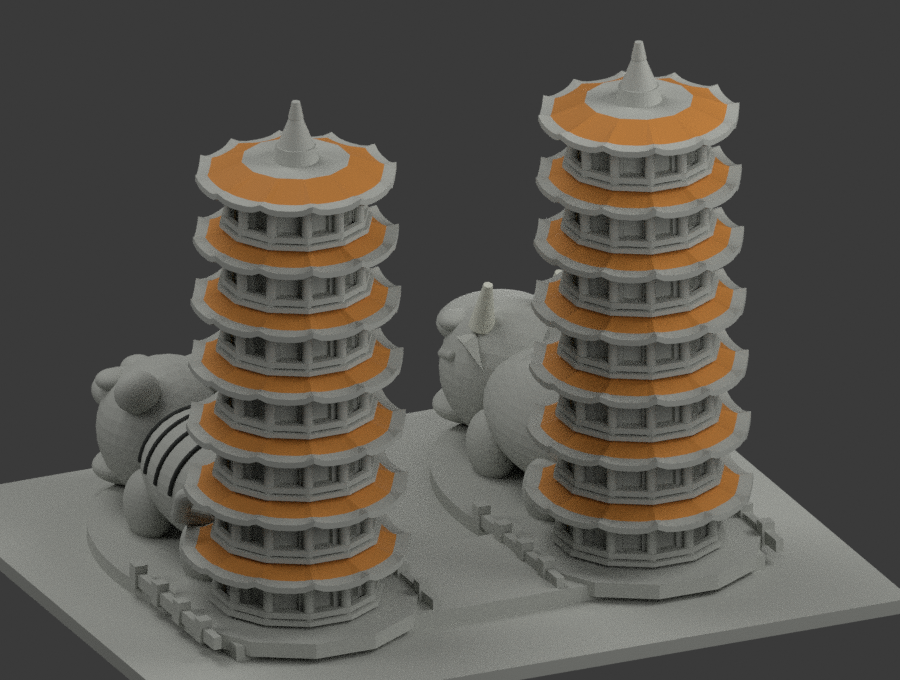

# 蓮池潭龍虎塔｜雙塔側背主瓦坡補色



[彩色 3MF](side-rear-roofs.3mf) · [彩色 Blender](side-rear-roofs.blend) · [驗證資料](verification.json) · [檔案校驗碼](SHA256SUMS)

在同一模型的雙塔七層原屋面上，僅將側背主瓦坡 1,680 個既有完整三角面由中性改為原暖橙褐瓦色 `#C98A43`。原正面同材 1,169 面、其餘材色、塔身、窄檐、彩飾、塔尖及龍虎造型均不變。不新增幾何、模型、貼圖或材質，不更換 STL、代表圖與既有預覽。

[高雄市政府觀光局空拍（存檔）](https://commons.wikimedia.org/wiki/File:Aerial_view_of_Dragon_and_Tiger_Pagodas.jpg) 從湖面向岸取景，可見雙塔背側橙黃主瓦坡和不同色的窄外飾；[高雄旅遊網另一張側向空拍](https://khh.travel/image/37689/?r=1642753143436) 亦可見同樣的區分。[高雄旅遊網景點說明](https://khh.travel/zh-tw/attractions/detail/11/) 確認同一雙塔及其整修。七層未逐面近拍，僅依可見同一連續瓦面延伸，非逐坡色度精測或完整復原。角飾細彩、薄檐與不可對位部分不補色。來源原照未附，也不用作紋理。未實際列印。

以 Blender 4.3.2 在此補充資料夾內執行：

```sh
blender -b ../scene.blend -t 2 --python-exit-code 1 -P build_side_rear_roofs.py -- ../appearance.3mf /tmp/dragon-tiger-side-rear-roofs
```

重建會生成比對用的 PNG；這份補充只公開 WebP 展示圖。
