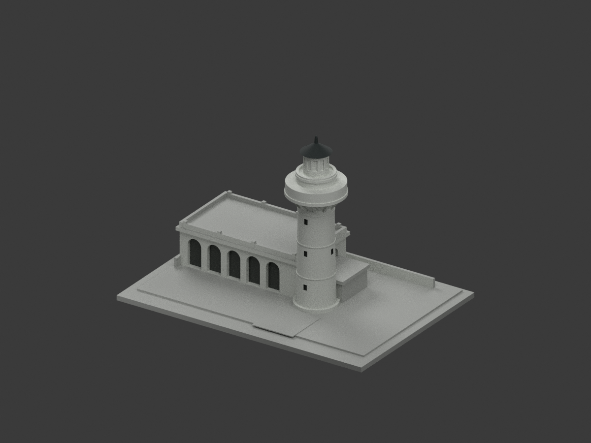
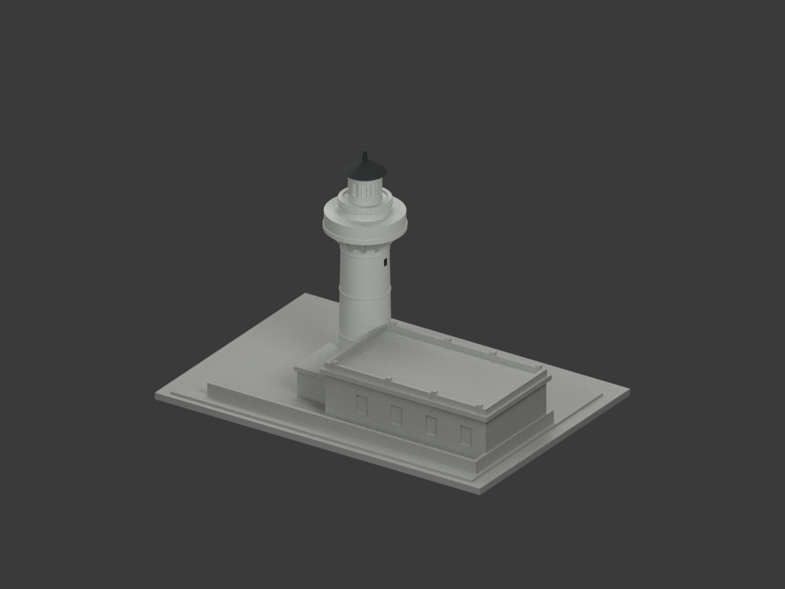
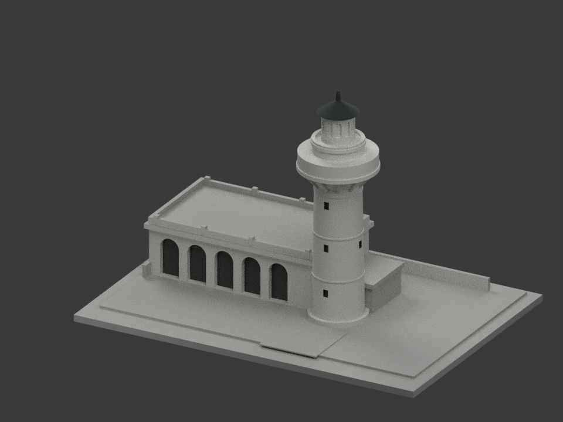

# 鵝鑾鼻燈塔｜彩色外觀模型

## 模型預覽

| 正面斜視代表圖 | 背面斜視 | 後側圍牆院內面 |
| :---: | :---: | :---: |
|  |  |  |

[彩色 3MF](appearance.3mf) · [可編輯 Blender](scene.blend) · [STL（不含色）](model.stl) · [逐面驗證](verification.json) · [渲染來源與視角](render-proof.json) · [校驗版本](CHECKSUM-SCOPE.md)

## 最新補色範圍

只將原模型後側低圍牆、面向院子的直立面補成原調色盤已有的灰白色（#D8DBD5）。原完整共平面由 2 個三角面組成，不切面，也不改牆外側、牆頂、另一段牆、主屋後牆／屋面或展示底座。原塔身與前拱廊顏色不變。此為既有簡化表面色族近似，不是校色或實測；原模型不重建實景的紅磚基座、完整圍牆或其細部。

[交通部觀光署大鵬灣國家風景區管理處「鵝鑾鼻公園」](https://www.dbnsa.gov.tw/zh-tw/attraction/AttractionPage?a=220) 的塔側庭院照片可見塔後低牆內面為白色；[旅行履行中公開空拍](https://jatraveling.tw/blog/post/31182) 顯示低圍牆內側白色與外側紅磚基座分開。依既有原面及視覺證據只延續院內灰白色，不把實景白牆或外側紅磚當成整個模型的材色。本包不附來源照片，也未轉成模型紋理。

保留原白塔、炭灰塔帽、正面及轉角拱廊的全部既有配色。這次只改後側低牆內面編號 9543、9544 的兩個原三角面；其餘 9,562 面、4,784 個頂點、四種材質、幾何與 STL 保持不變。低屋水平屋面、附屋、其餘無證側背、牆外側與展示底座維持原樣。燈室不是整圈藍玻璃；拱廊凹處暗面不是透明室內。整體約 150 mm，非精密測繪。STL 不含顏色，未切片驗證與試印；[原幾何檢核](validation.json)是數位檢查。

## 基準來源與權利


兩張[國家公園署官方外觀照之一](https://www.taiwan.nps.gov.tw/upload/cmImage/2025-04-15/512f337b-2414-46de-8bc2-63425c32f238/49_93c7d1929e136bef040caf201b28def4_comp_webp.webp)與[之二](https://www.taiwan.nps.gov.tw/upload/cmImage/2025-04-15/05721669-e550-4639-87b2-f6f308dfd50b/49_e6fa36810d2e00d2b27ad723f48a7574_comp_webp.webp)，hash／角色見[基準色版來源紀錄](https://github.com/hplin50643/taiwan-buildings-3d/blob/8e8512f3be4153b164c7508c26e445b233189950/%E8%87%BA%E7%81%A3%E5%9C%B0%E6%A8%99/eluanbi-lighthouse/COLOR-SOURCE-REGISTER.json)。官網公開不代表CC或商用再授權；原照私人保留、不公開、不貼圖、不以儲存庫license再授權，不保證商用權利已清。僅公開建築外觀。


## 固定基準與重現

上方模型可直接使用。若要重建，將[歷史基準 Blender](https://github.com/hplin50643/taiwan-buildings-3d/blob/8e8512f3be4153b164c7508c26e445b233189950/%E8%87%BA%E7%81%A3%E5%9C%B0%E6%A8%99/eluanbi-lighthouse/scene.blend)和[歷史基準 3MF](https://github.com/hplin50643/taiwan-buildings-3d/blob/8e8512f3be4153b164c7508c26e445b233189950/%E8%87%BA%E7%81%A3%E5%9C%B0%E6%A8%99/eluanbi-lighthouse/appearance.3mf)下載到另一個資料夾；請先對照[渲染與模型驗證](render-proof.json)所列基準版本。使用 Blender 4.3.2，並替換實際路徑：

```sh
blender -b /path/to/baseline/scene.blend --disable-autoexec -t 4 --python-exit-code 1   -P build_rear_wall.py -- /path/to/baseline/appearance.3mf /tmp/eluanbi-current
```

請使用[當前校驗表](SHA256SUMS)。[前次外觀與原幾何說明](https://github.com/hplin50643/taiwan-buildings-3d/blob/8e8512f3be4153b164c7508c26e445b233189950/%E8%87%BA%E7%81%A3%E5%9C%B0%E6%A8%99/eluanbi-lighthouse/README.md)只供歷史比對。
