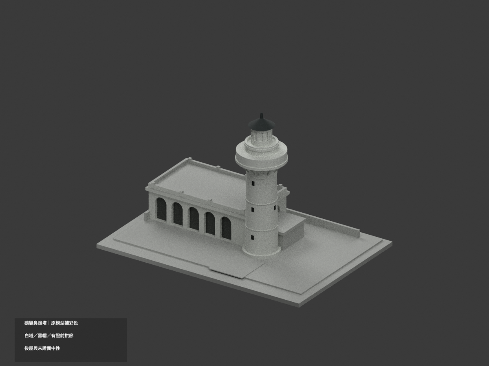
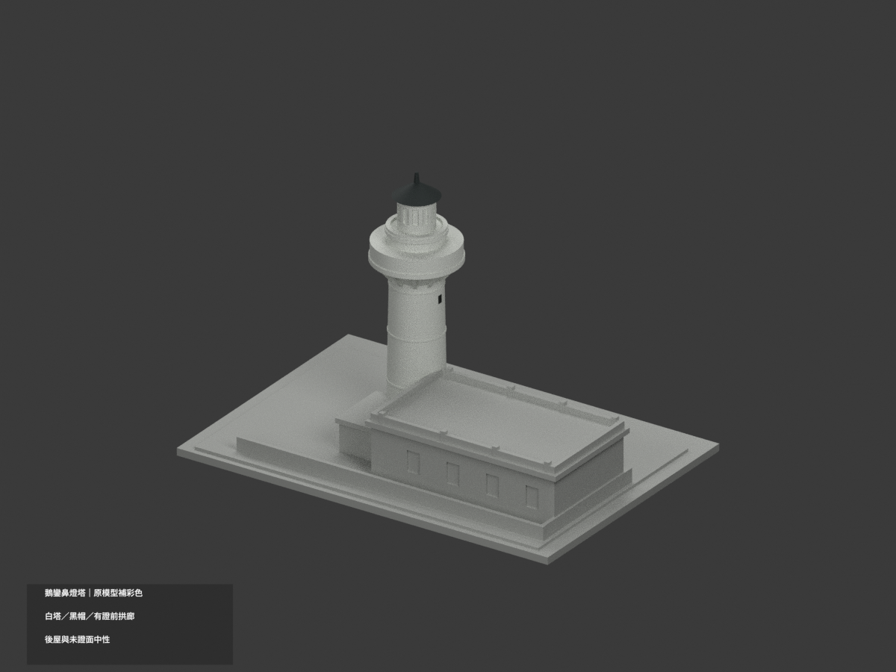
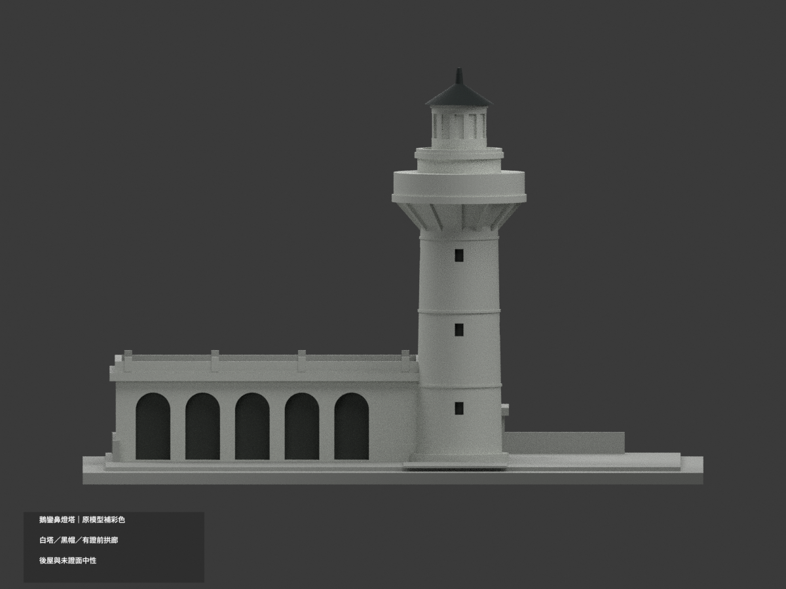
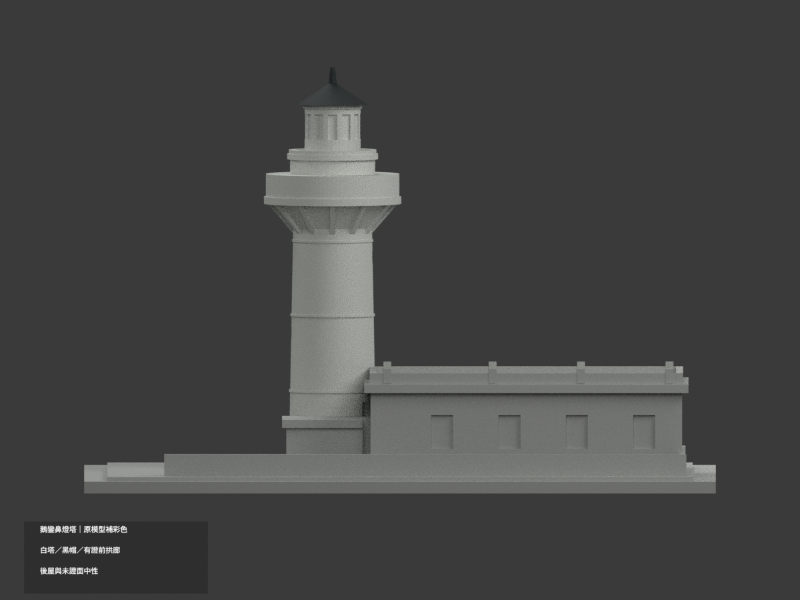
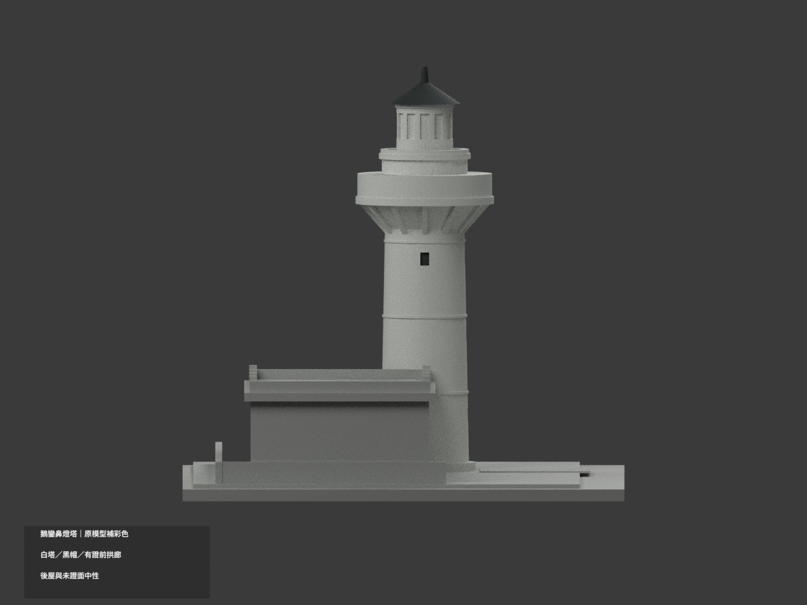
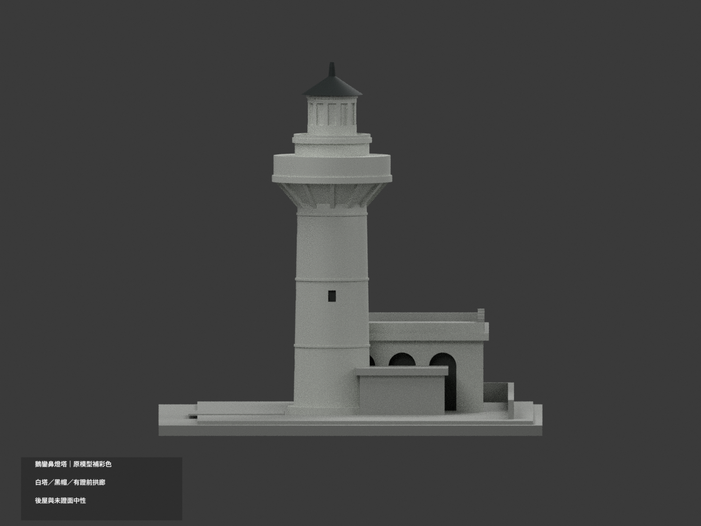
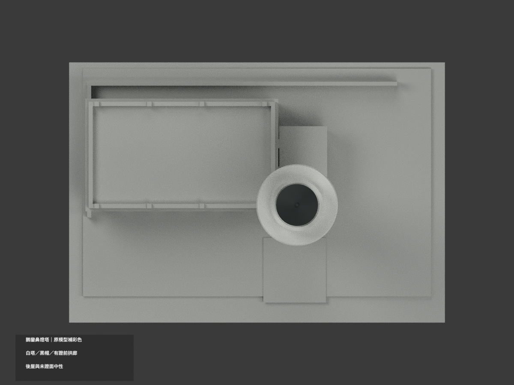
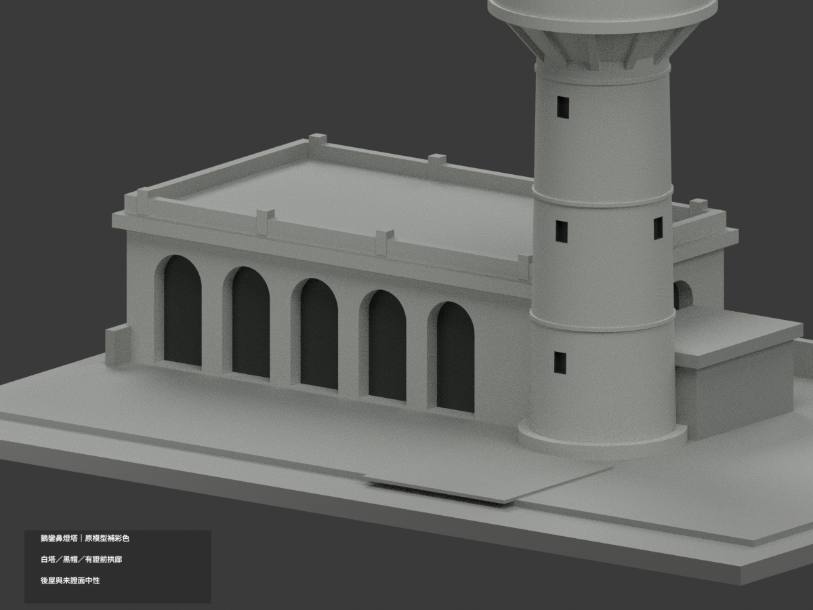
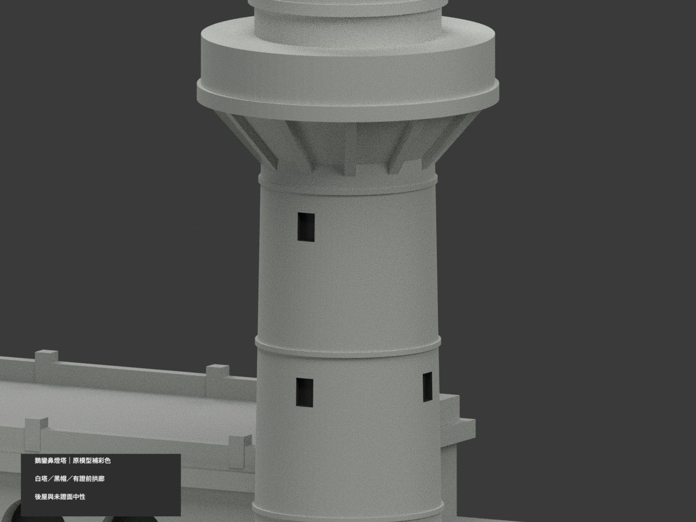
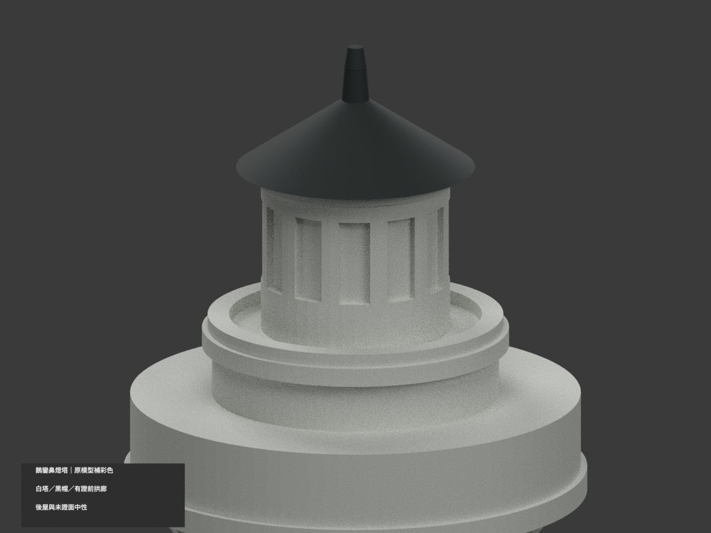

# 臺灣地標｜鵝鑾鼻燈塔：原幾何補彩色

## 彩色模型預覽

**同項目更新（count_delta = 0）：白塔、黑帽及可辨前／轉角拱廊補色。白塔以同構件連續概化；未證後屋、大平屋面、圍牆及展示地坪中性。**

| 正面斜視 | 背面斜視 | 正面 |
|---|---|---|
|  |  |  |
|  |  |  |
|  |  |  |
|  |  |  |

## 材質範圍與限制

原 9564 三角面、全部頂點、比例與單體不變，不新增斜向燈室格網、欄杆孔、室內、額外門窗或任何貼圖。原照片判讀幾何不因補色成為測繪CAD。

- 塔身、原水平圈帶、支托、平台外殼及燈室採灰白族；不可見背向塔面按同一構件連續，屬概化而非逐面照片核證。
- 燈室原封閉芯與淺刻窗仍灰白；照片有白板／框與玻璃混合，不能整個圓筒塗成藍玻璃，也不新增斜格。
- 原塔帽與尖頂炭灰，從 z90.3 起的原帽構件識別，不把深色下延至白燈室。數值是原模型mm位置，不代表實際建築標高。
- 低屋有證前五拱、垂直轉角三拱之既有外皮灰白；原盲拱返回面灰白，真正封底採通用暗影，不是透明室內或玻璃。塔身原小開口亦採陰影，不臆造門扇細部。
- 後牆與未證側、低屋大水平屋面、附屋、圍牆及鋪面維持中性；不把展示底座塗綠草或藍海。白色與中性區界只是本次證據範圍，未必是現場換漆縫。
- 原 primitive 表面辨識採完整頂點、面中心與法線，不按面重心切出假斜塊。0.004mm數值辨識容差不是實景精度；無新增或分割任何輸出面。
- 官照路徑的2025上傳日期不是已確證拍攝日期；不宣稱今日精準外觀。色值為非校準展示近似，保留光線／陰影差異的不確定性。

## 格式與重建

原 `model.stl`、`build_model.py` bytes 不變，原包沒有OBJ。原單材 `scene.blend` 私人副本保留，公開同名 scene 更新為實際shader。STL本身無色；`appearance.3mf` 含四種逐面基本材質，`color-mesh.npz` 保留原三角座標。四種外觀標籤不等於已驗證四耗材切片工程；未實際列印、未執行切片器驗證。

```sh
python -m pip install -r color-requirements.txt
python build_model.py
python colorize_model.py
python export_appearance.py
python validate_color.py
blender -b -t 3 --python render_color.py
blender -b --python-exit-code 1 --python verify_color_scene.py
```

沿原requirements，表面辨識另需rtree，Blender4.3.2。原碼的臨時primitive只供面辨識，不加入輸出。隔離重建保留不刪。新QA：COLOR-FORMAT-GEOMETRY-QA、SCENE-QA、DELIVERY-QA、SOURCE-VISUAL-QA；七全景與三刻意局部細景。原 validation/rebuild_validation/blend_validation/previews/校驗表與程式保留歷程，不當新補色QA。

## 來源與權利

兩張[國家公園署官方外觀照之一](https://www.taiwan.nps.gov.tw/upload/cmImage/2025-04-15/512f337b-2414-46de-8bc2-63425c32f238/49_93c7d1929e136bef040caf201b28def4_comp_webp.webp)與[之二](https://www.taiwan.nps.gov.tw/upload/cmImage/2025-04-15/05721669-e550-4639-87b2-f6f308dfd50b/49_e6fa36810d2e00d2b27ad723f48a7574_comp_webp.webp)，hash／角色見COLOR-SOURCE-REGISTER.json。官網公開不代表CC或商用再授權；原照私人保留、不公開、不貼圖、不以儲存庫license再授權，不保證商用權利已清。僅公開建築外觀。

## 原始模型說明與限制

原文保留如下，本次材色與重建入口以新段落優先，舊單色圖不是新成果。

# 鵝鑾鼻燈塔｜150 mm 外觀列印模型

## 模型預覽

| 模型預覽 | 模型預覽 | 模型預覽 |
| :---: | :---: | :---: |
| 正面<br> | 背面<br> |  |

## 模型內容
依國家公園署公開實景照片判讀，自行建立白色微錐圓塔、放大的環形挑臺、支托、燈室、尖頂，以及相鄰平屋頂拱廊低樓。這是桌上型建築意象模型，不是測量復原或官方模型。

- 尺寸：150 × 104 × 99.1 mm（含底座）
- STL 單位：mm；正面為 −Y；底面 Z=0
- 主體：一件連通封閉實體；燈室、室內均實心，拱廊及窗為向外開放的盲凹槽
- 原創來源：build_model.py；scene.blend 可直接編輯三角網格
- previews/front.png、rear.png 均由交付的 model.stl 匯入後渲染，沒有另加美化用建築細節

## 判讀與取捨
照片中的主要辨識點是細長圓塔、寬挑臺與肋狀支托、較窄燈室，以及鄰棟連續圓拱與平屋頂女兒牆。官方文字列燈塔高 21.4 公尺，本模型未套用測繪比例；塔身、低樓與底座採照片估算後協調的模型比例。後側未見完整測量資料，規整牆面、窗列、低樓深度與建築銜接為合理化重建。環形欄杆改作厚環和短柱，燈室玻璃改作淺凹，尖頂與接合線加粗。不製作內部、歷史武裝設施細節、旗幟、樹木及完整園區。

## 建議列印
底座平放，PLA、0.4 mm 噴嘴、0.16–0.20 mm 層高、3 道外牆、10–15% 填充可作起點。STL 是封閉外殼，填充由切片器設定。挑臺、屋簷與拱頂有懸挑，請在切片預覽檢查，必要時使用局部樹狀支撐。細小橫帶約 0.55 mm 高，末端尖頂約 1.1 mm 直徑；若縮小列印會更脆弱。不可把通過數位網格檢查視為已試印或免支撐保證。

## 重建及驗證
建議 Python 3.12；安裝 requirements.txt 所列版本後：

    python build_model.py
    python validate_model.py model.stl --output validation.json
    python verify_rebuild.py
    blender -b -t 4 -P render_preview.py
    blender -b scene.blend -t 4 -P verify_blend.py

validation.json 檢查封閉、單連通、邊均由兩面共用、頂點鄰域為單環、法線方向、正體積與 150 mm 最長邊。rebuild_validation.json 再檢查原始 STL 法線、單一閉合邊界、無負體積內殼、Euler=2、逐層連續性及原始程式重建 SHA-256 相同。blend_validation.json 核對 Blender 主體與 STL 三角形相同。這些不是耗材、機械公差、支撐或全域三角形自交的實體測試。

## 參考來源
參考與照片判讀日期：2026-10-11。實際檢視國家公園署兩張外觀照片，來源連結列於 sources.md。第三方照片未包含於交付檔案。未聲稱其影像可再散布；自行建立的幾何與程式不是官方授權產品。
