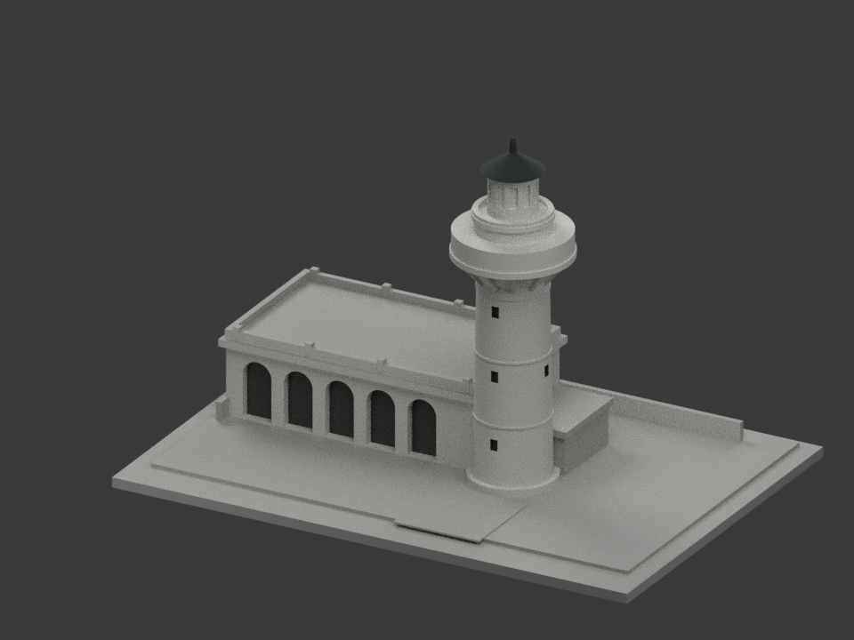

# 鵝鑾鼻燈塔｜後側圍牆內面補色

只將原模型後側低圍牆、面向院子的直立面補成原調色盤已有的灰白色（#D8DBD5）。原完整共平面由 2 個三角面組成，不切面，也不改牆外側、牆頂、另一段牆、主屋後牆／屋面或展示底座。原塔身與前拱廊顏色不變。此為既有簡化表面色族近似，不是校色或實測；原模型不重建實景的紅磚基座、完整圍牆或其細部。

| 院內斜視 |
| --- |
|  |

[彩色 3MF](rear-wall.3mf) · [Blender 場景](rear-wall.blend) · [核對結果](verification.json) · [檔案校驗碼](SHA256SUMS)

模型數量不變。原 STL、彩色基準檔、代表圖及封存均未替換。原 9,564 個三角面和全部頂點及拓撲未變；只將該 2 面由中性材質 3 改為既有材質 0。未實測切片與列印。

## 來源與重現

[交通部觀光署大鵬灣國家風景區管理處「鵝鑾鼻公園」](https://www.dbnsa.gov.tw/zh-tw/attraction/AttractionPage?a=220) 的塔側庭院照片可見塔後低牆內面為白色；[旅行履行中公開空拍](https://jatraveling.tw/blog/post/31182) 顯示低圍牆內側白色與外側紅磚基座分開。依既有原面及視覺證據只延續院內灰白色，不把實景白牆或外側紅磚當成整個模型的材色。本包不附來源照片，也未轉成模型紋理。

用 Blender 4.3 讀取原 `scene.blend` 並指向原 `appearance.3mf`（兩檔在上一層）：
```sh
blender -b ../scene.blend -t 2 --python-exit-code 1 -P build_rear_wall.py -- ../appearance.3mf ./rebuilt
```
