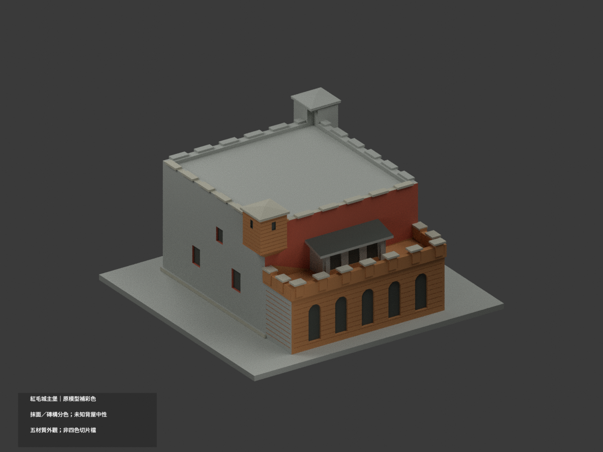
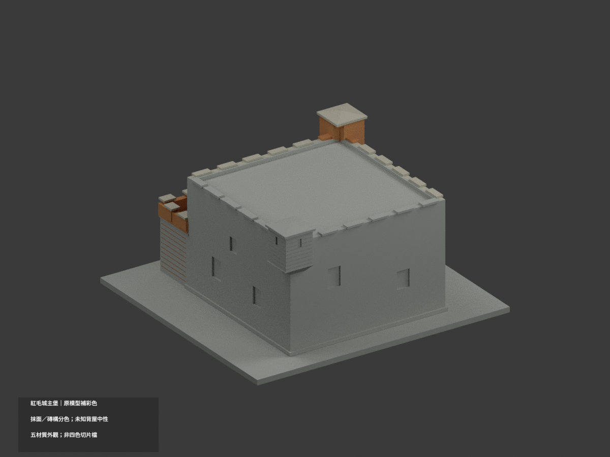
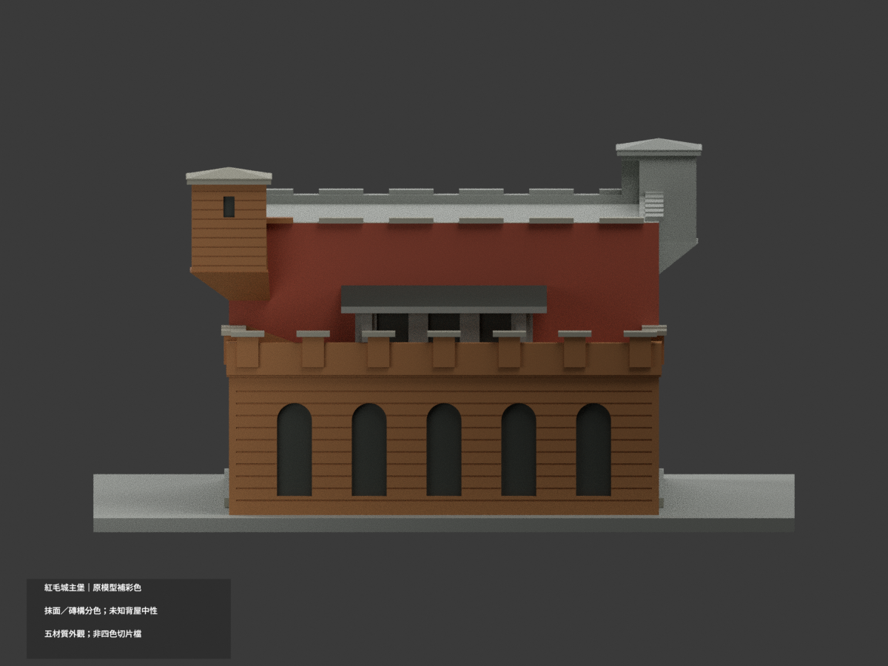
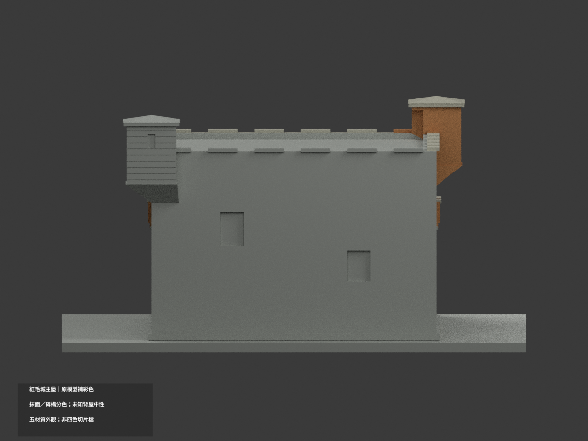
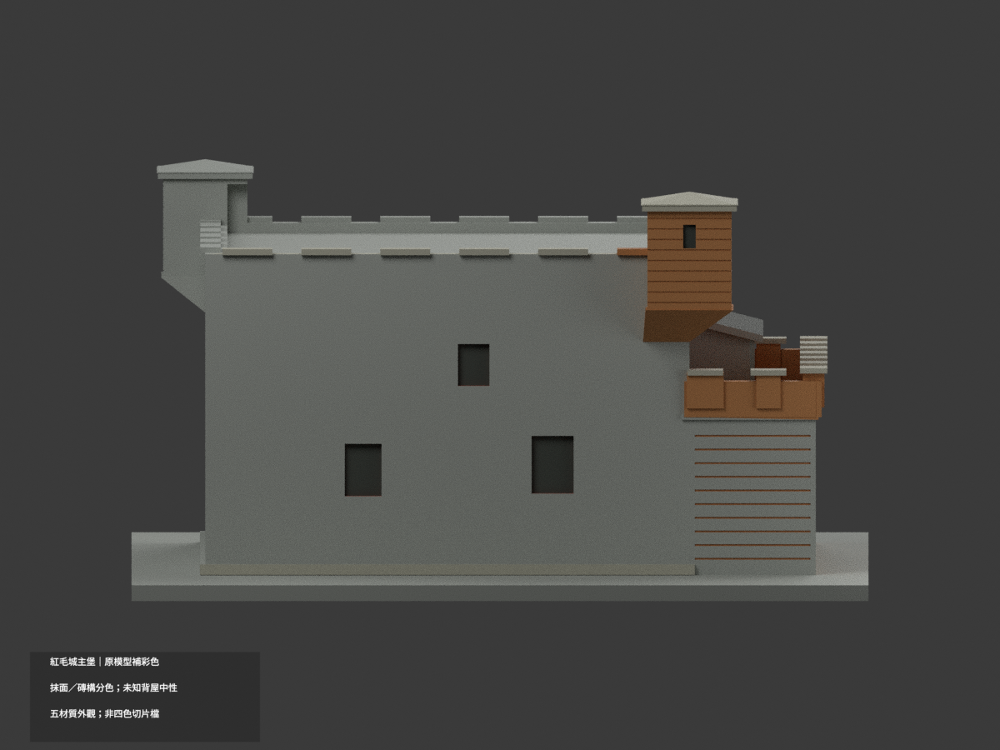
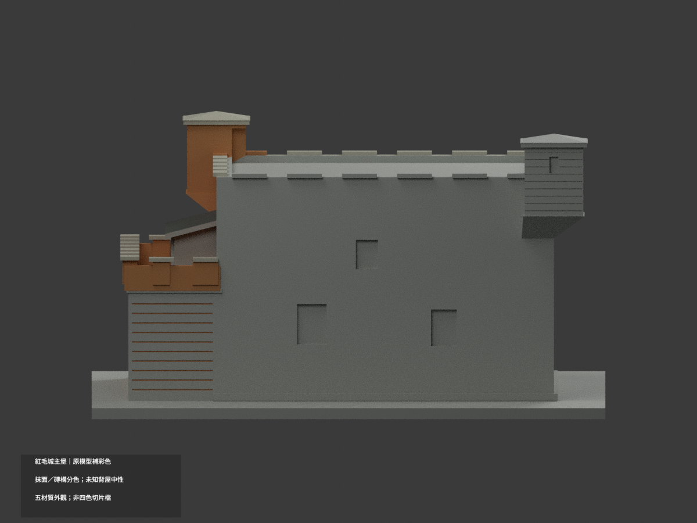
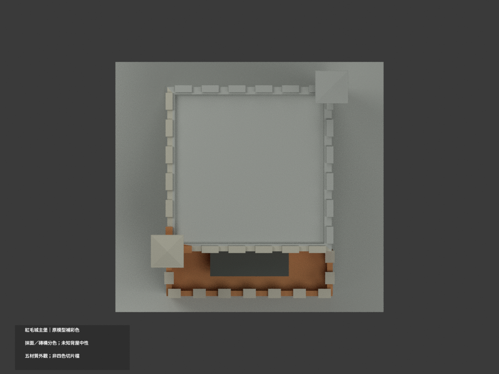
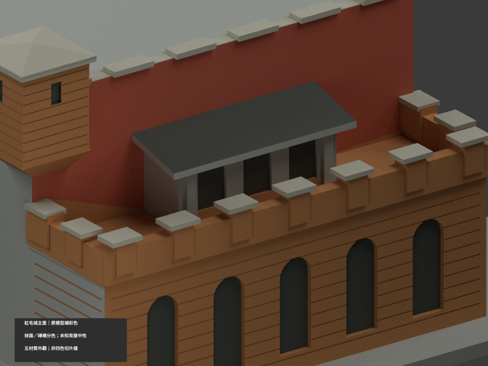
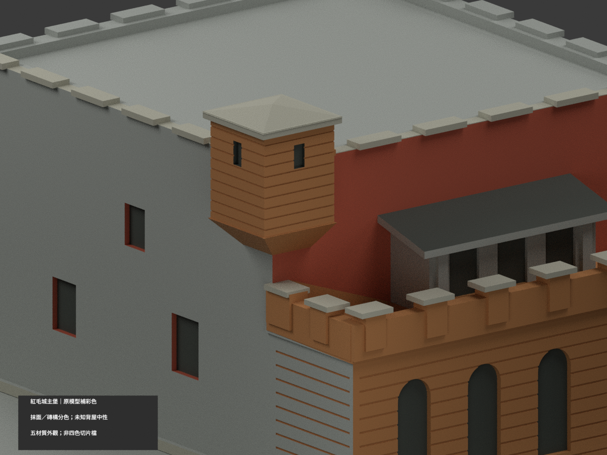
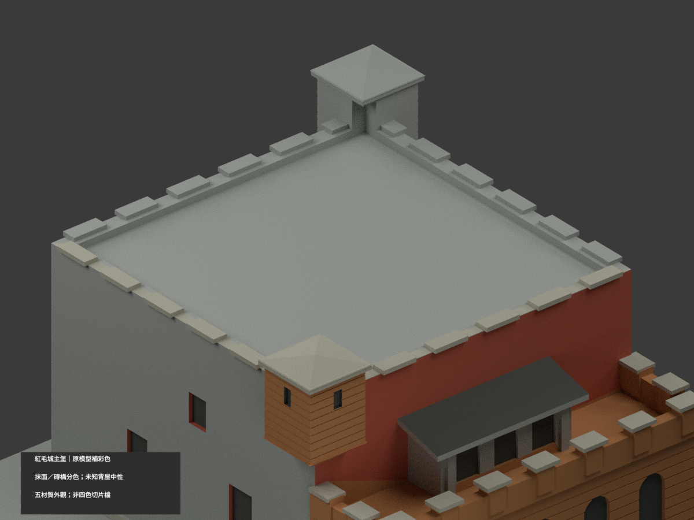

# 淡水紅毛城主堡｜原模型材色更新

| 彩色預覽 | 彩色預覽 | 彩色預覽 |
|---|---|---|
|  |  |  |
|  |  |  |
|  |  |  |
|  | | |

## 材色範圍
同一主堡項目補彩（count_delta 0），**不含獨立領事館**。原3904三角面、頂點、STL與build_model.py不變；無切分面、無新磚紋、旗、人像、室內或附屬建築。照片支持的原正面抹灰色、前磚露臺、近角樓、淺壓頂與暗凹口分色，並非全棟滿色或現況精測。

- 正面大平牆紅橘抹面，與前露臺／近角樓較暖黃褐清水磚色族分開。照片未見細部不靠想像加構件。
- **兩主側大平面 x±46 全部中性**：原融合三角面跨越主堡抹面和露臺磚域，直接套色會形成假的紅色斜楔。保留完整原三角面、不分割；可獨立分出的窗凹、磚縫內面、近角樓與壓頂仍保其有限色族。這是原拓撲限制，並非說照片未見左側。
- 未證後立面、對角後塔、屋頂大平台及展示座中性。小空照只確認形態，不當精確屋皮校色；主堡照片外的領事館長廊、綠欄杆與斜瓦不借用。
- 前小斜棚屋面用保守灰褐暗色，不假定紅瓦；原填實棚體仍是近似幾何，沒有因補色變成室內重建。
- 五材質外觀不是四色或多色耗材切片方案；**未實際列印**，不保證免支撐。STL不存色，色票未校準、照片日期未核；不宣稱特定年代精確竣工/目前外觀。

## 檔案與重建
[彩色3MF](appearance.3mf) · [彩色Blender](scene.blend) · [保留原STL](model.stl)

原build_model.py重建原幾何；colorize_model.py將材色賦予既有完整三角面；export_appearance.py產3MF基本材料；render_color.py產十圖及場景。validate_color.py驗原STL、三角座標、3MF及保留隔離重建；verify_color_scene.py重開核對實際shader與索引。使用既有numpy/trimesh/manifold3d/Pillow環境及Blender4.3.2。

## 來源與權利
新北市立淡水古蹟博物館官方摺頁：第一頁上方現代主堡照片、第二頁小露臺照與主堡空照。老黑白照片、領事館、室內、南門、地圖皆不作本次主堡色彩直接證據。官方公開不等於CC或可任意再授權；原PDF及照片只私人保留，不公開/貼圖，不保證商用。詳COLOR-SOURCE-REGISTER.json。

## QA與保留歷程
COLOR-FORMAT-GEOMETRY-QA.json、SCENE-QA.json、FRAMING-QA.json、DELIVERY-QA.json及INDEPENDENT-COLOR-VISUAL-QA.json為本次色版檢查。原單色previews/舊報告/ORIGINAL-MONOCHROME-README.md仍保留，非本次材色驗證。V1誤色、V2整側中性修正歷程與原包私人保留，沒有刪檔。上方十圖與scene.blend為本次入口。
