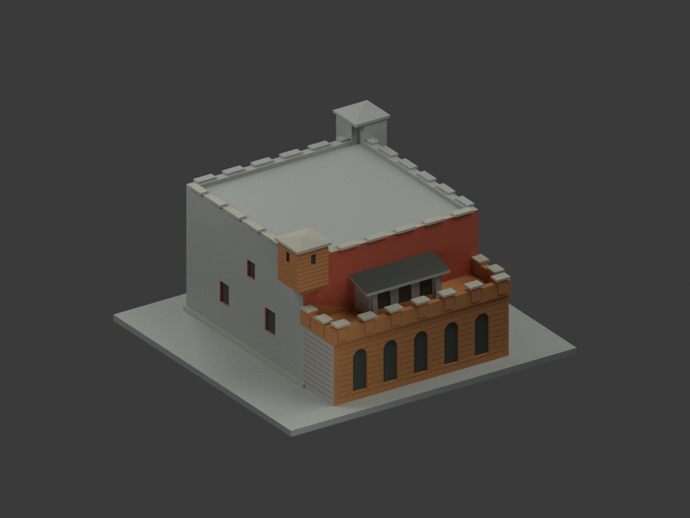
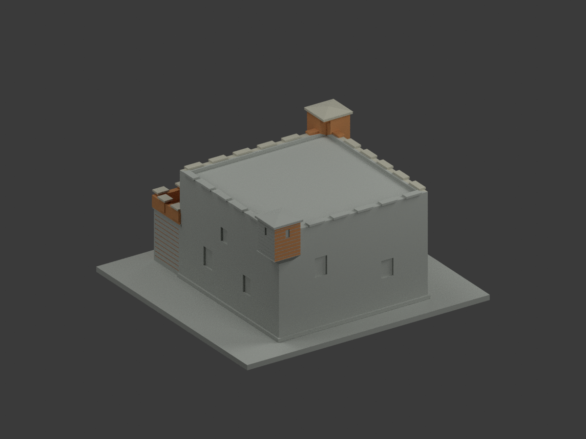
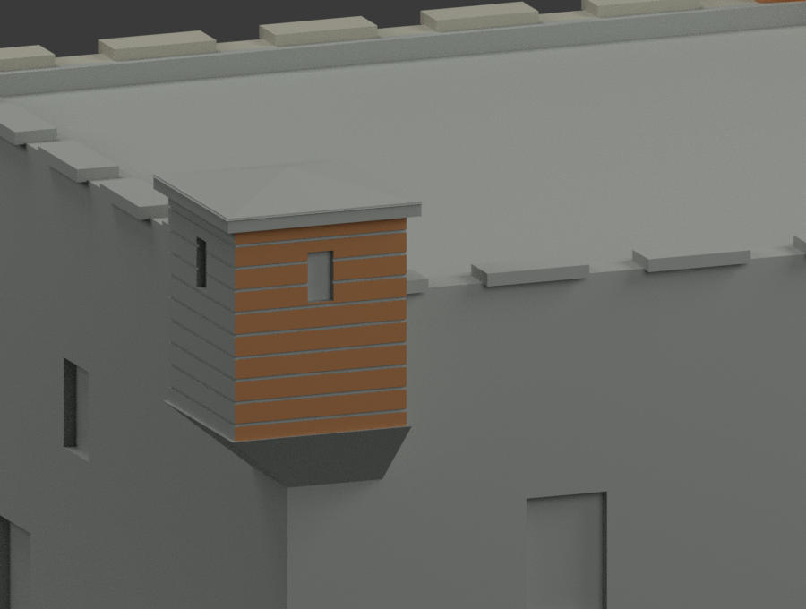

# 淡水紅毛城主堡｜彩色外觀模型

## 模型預覽

| 前斜視代表圖 | 後斜視 | 東北角樓補色細節 |
| :---: | :---: | :---: |
|  |  |  |

[彩色 3MF](appearance.3mf) · [可編輯 Blender](scene.blend) · [STL（無材色）](model.stl) · [逐面驗證](verification.json) · [渲染來源與視角](render-proof.json) · [校驗版本](CHECKSUM-SCOPE.md)

## 最新補色範圍

這是同一座主堡的單面材色補充，不是新增模型。僅把東北角樓北向 30 個既有完整外露磚面三角形由中性轉為原暖褐清水磚色族 `#B78354`。東向立面、凹入磚縫與孔洞、壓頂、石托和主堡大牆均維持原樣。原模型幾何及 STL 位元組不變；代表圖已由本版檔案重渲染。

[文化部國家文化資產網](https://view.boch.gov.tw/NationalHistorical/itemspage.aspx?id=38) 標示主堡東北與西南兩座角樓；[數位典藏的北立面照片](https://catalog.digitalarchives.tw/item/00/30/df/c9.html) 可見畫面左端（東）角樓外露暖色磚與灰色石托的區別。樹枝遮住部分磚面，補色只沿同一連續北向磚面，不延伸至轉角各面。照片是材質區分證據，色票為既有近似色，不是現況色度實測；不附參考原照或貼圖。未實際列印。

## 其餘材色與原模型界線

同一主堡項目補彩（count_delta 0），**不含獨立領事館**。原3904三角面、頂點、STL與build_model.py不變；無切分面、無新磚紋、旗、人像、室內或附屬建築。照片支持的原正面抹灰色、前磚露臺、近角樓、淺壓頂與暗凹口分色，並非全棟滿色或現況精測。

- 正面大平牆紅橘抹面，與前露臺／近角樓較暖黃褐清水磚色族分開。照片未見細部不靠想像加構件。
- **兩主側大平面 x±46 全部中性**：原融合三角面跨越主堡抹面和露臺磚域，直接套色會形成假的紅色斜楔。保留完整原三角面、不分割；可獨立分出的窗凹、磚縫內面、近角樓與壓頂仍保其有限色族。這是原拓撲限制，並非說照片未見左側。
- 未證後立面、對角後塔未涵蓋的面、屋頂大平台及展示座維持中性。小空照只確認形態，不當精確屋皮校色；主堡照片外的領事館長廊、綠欄杆與斜瓦不借用。
- 前小斜棚屋面用保守灰褐暗色，不假定紅瓦；原填實棚體仍是近似幾何，沒有因補色變成室內重建。
- 五材質外觀不是四色或多色耗材切片方案；**未實際列印**，不保證免支撐。STL不存色，色票未校準、照片日期未核；不宣稱特定年代精確竣工/目前外觀。


## 基準來源與權利

新北市立淡水古蹟博物館官方摺頁：第一頁上方現代主堡照片、第二頁小露臺照與主堡空照。老黑白照片、領事館、室內、南門、地圖皆不作本次主堡色彩直接證據。官方公開不等於CC或可任意再授權；原PDF及照片只私人保留，不公開/貼圖，不保證商用。詳[基準色版來源紀錄](https://github.com/hplin50643/taiwan-buildings-3d/blob/ac5855813c33bf5ede511cdcffc854ae60e1257a/%E8%87%BA%E7%81%A3%E5%9C%B0%E6%A8%99/fort-san-domingo/COLOR-SOURCE-REGISTER.json)。


## 固定基準與重現

上方模型可以獨立使用。若要重建，將[歷史基準 Blender](https://github.com/hplin50643/taiwan-buildings-3d/blob/ac5855813c33bf5ede511cdcffc854ae60e1257a/%E8%87%BA%E7%81%A3%E5%9C%B0%E6%A8%99/fort-san-domingo/scene.blend)和[歷史基準 3MF](https://github.com/hplin50643/taiwan-buildings-3d/blob/ac5855813c33bf5ede511cdcffc854ae60e1257a/%E8%87%BA%E7%81%A3%E5%9C%B0%E6%A8%99/fort-san-domingo/appearance.3mf)下載到另一個資料夾；腳本會核對其精確 SHA-256。使用 Blender 4.3.2，並替換實際路徑：

```sh
blender -b --disable-autoexec /path/to/baseline/scene.blend -t 2 --python-exit-code 1 \
  -P build_northeast_turret.py -- /path/to/baseline/appearance.3mf /tmp/fort-san-domingo-current
```

STL 及原幾何驗證不變。請使用[當前校驗表](SHA256SUMS)；[前次外觀說明](https://github.com/hplin50643/taiwan-buildings-3d/blob/ac5855813c33bf5ede511cdcffc854ae60e1257a/%E8%87%BA%E7%81%A3%E5%9C%B0%E6%A8%99/fort-san-domingo/README.md)與[原始幾何說明](https://github.com/hplin50643/taiwan-buildings-3d/blob/ac5855813c33bf5ede511cdcffc854ae60e1257a/%E8%87%BA%E7%81%A3%E5%9C%B0%E6%A8%99/fort-san-domingo/ORIGINAL-MONOCHROME-README.md)供歷史比對，不是另一套現行模型。
