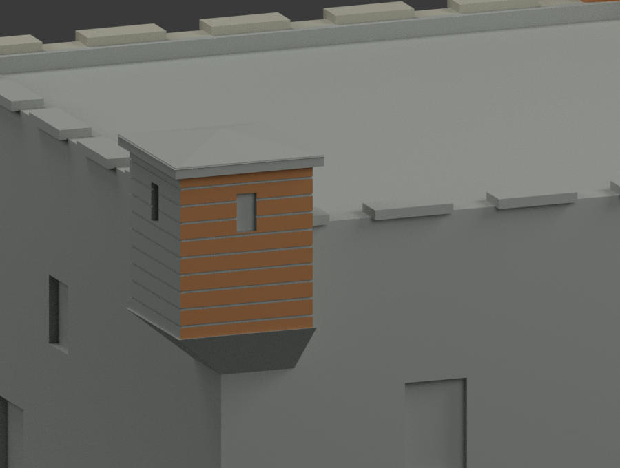

# 淡水紅毛城主堡｜東北角樓北向補色



[彩色 3MF](northeast-turret.3mf) · [彩色 Blender](northeast-turret.blend) · [驗證資料](verification.json) · [檔案校驗碼](SHA256SUMS)

這是同一座主堡的單面材色補充，不是新增模型。僅把東北角樓北向 30 個既有完整外露磚面三角形由中性轉為原暖褐清水磚色族 `#B78354`。東向立面、凹入磚縫與孔洞、壓頂、石托和主堡大牆均維持原樣。局部預覽不取代代表圖。原模型幾何、STL、代表圖與目錄不變。

[文化部國家文化資產網](https://view.boch.gov.tw/NationalHistorical/itemspage.aspx?id=38) 標示主堡東北與西南兩座角樓；[數位典藏的北立面照片](https://catalog.digitalarchives.tw/item/00/30/df/c9.html) 可見畫面左端（東）角樓外露暖色磚與灰色石托的區別。樹枝遮住部分磚面，補色只沿同一連續北向磚面，不延伸至轉角各面。照片是材質區分證據，色票為既有近似色，不是現況色度實測；不附參考原照或貼圖。未實際列印。

在此補充資料夾內以 Blender 4.3.2 執行：

```sh
blender -b ../scene.blend -t 2 --python-exit-code 1 -P build_northeast_turret.py -- ../appearance.3mf /tmp/fort-northeast-turret
```

重建會生成比對用的 PNG，只有 WebP 是這份補充公開的展示圖。
