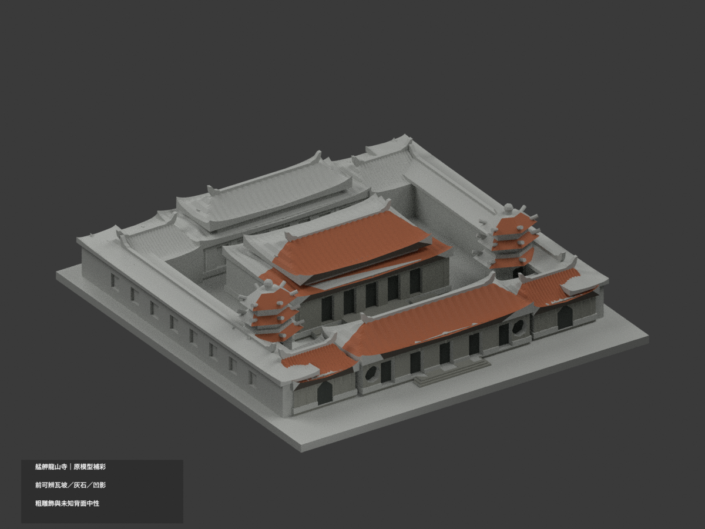
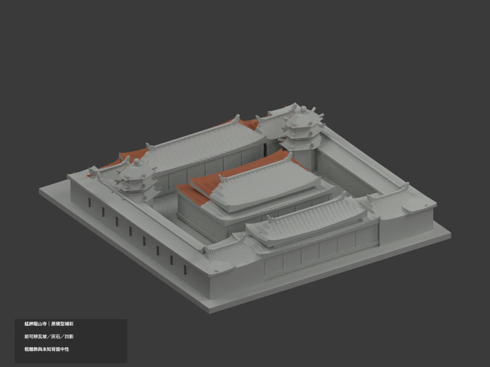
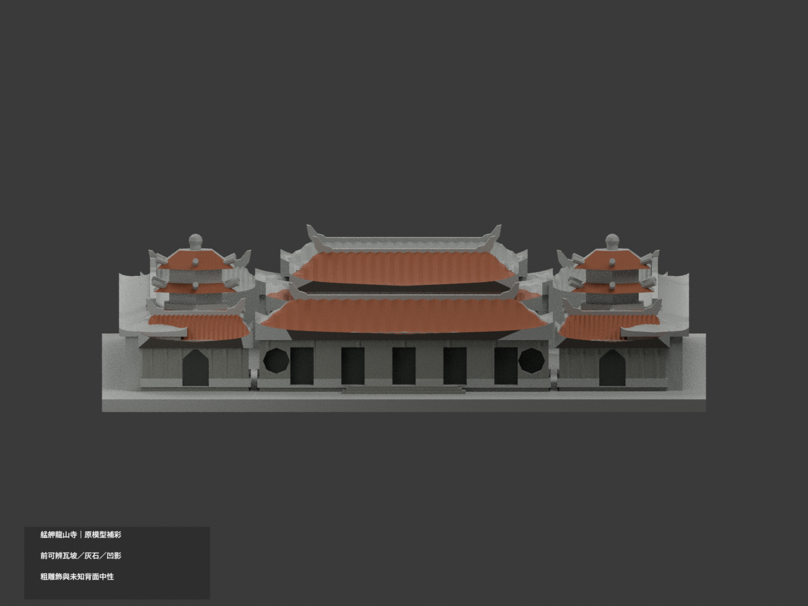
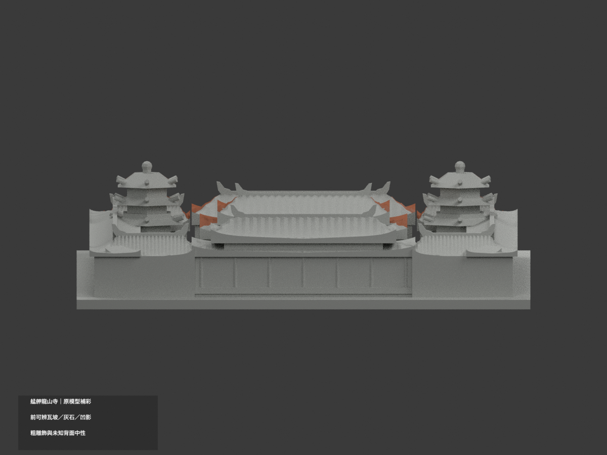
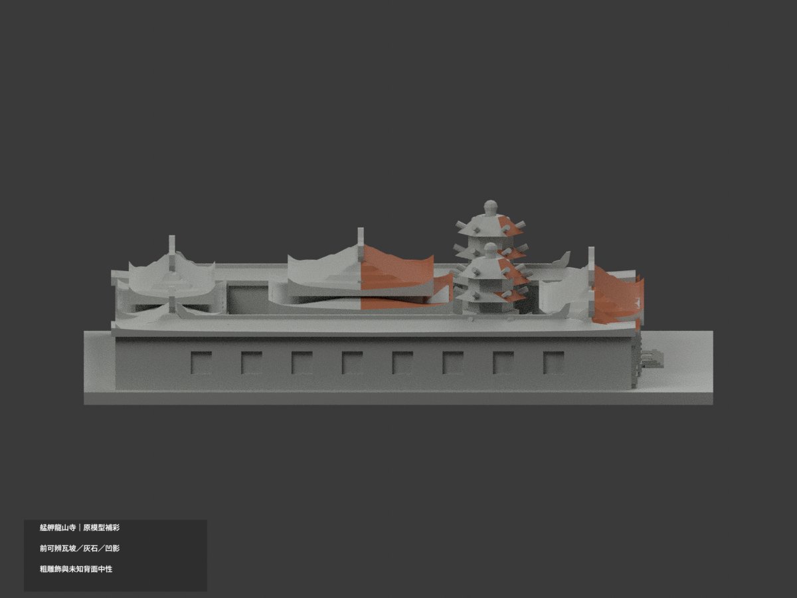
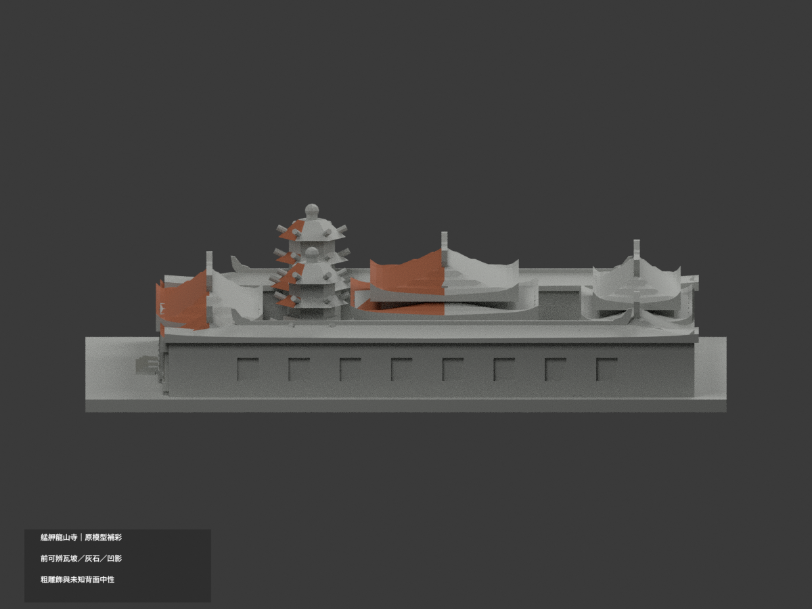
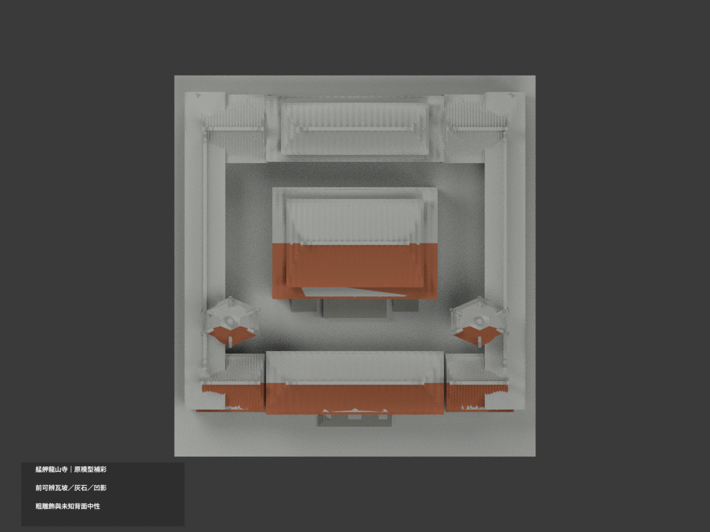
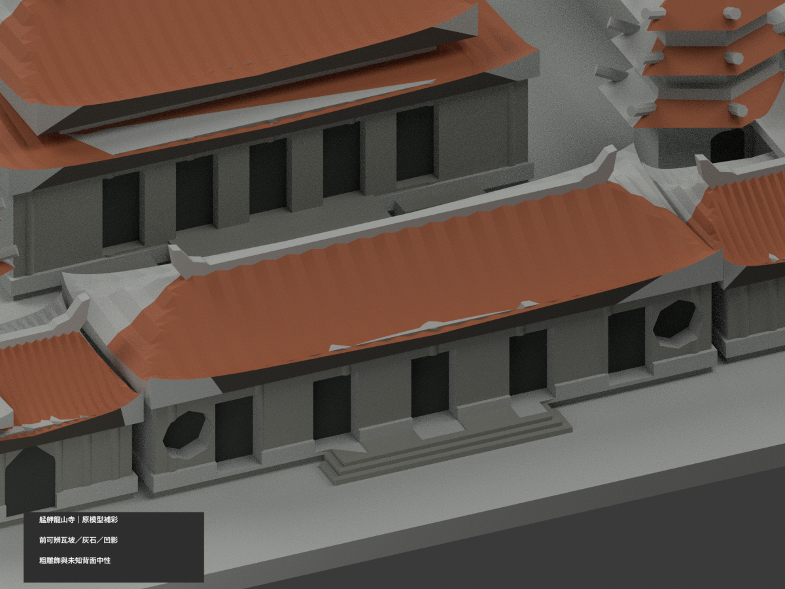
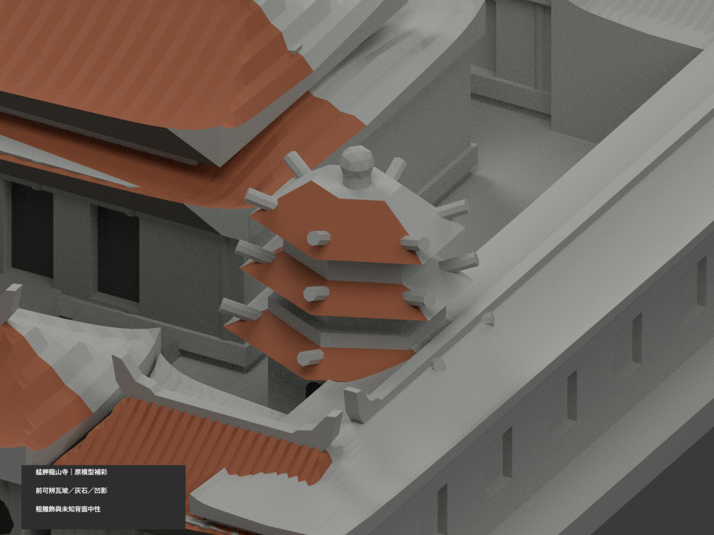
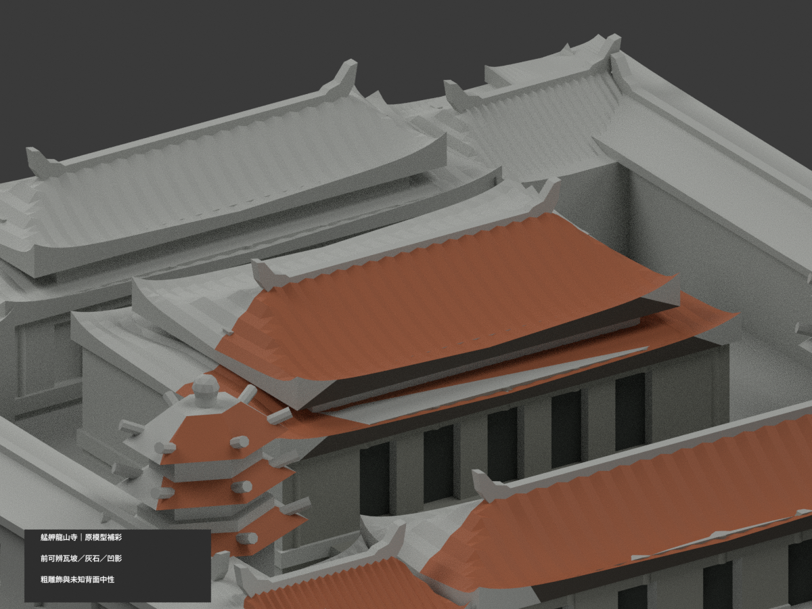

# 艋舺龍山寺｜原模型有限材色更新

| 彩色預覽 | 彩色預覽 | 彩色預覽 |
|---|---|---|
|  |  |  |
|  |  |  |
|  |  |  |
|  | | |

## 材色範圍
同一既有龍山寺縮景補彩（count_delta 0）。原 29236 三角面、頂點、STL 與 build_model.py 完全保留，不新增屋瓦、龍雕彩繪、門扇、金字、香爐、燈籠、人物或室內。原配置、屋脊粗塊、塔形與門洞皆為舊版近似，補色不等於重新驗證其精確性。

- 寺方三川殿與中殿實景支持**可見前坡的低飽和橘瓦色族**。程式以原屋面網格的三頂點高度／前半域辨認瓦皮，不用整個屋頂包圍盒染色；後坡、垂直封邊、屋脊燕尾／龍雕粗塊中性。
- 原六角鐘鼓塔只採可辨前向斜坡瓦族；兩塔沿用同類色族屬明示概化，不宣每面已拍攝確證。照片中的矩形綠門窗不能套到原模型的拱凹，塔牆不整片染紅或綠。
- 原前石柱、可對位前牆、前階／中庭前平台保守灰石色，原可辨凹底深灰只表示陰影。前殿紅門不覆蓋整個粗通道底面；後殿燈光與紅門不當整棟外牆色證。
- **原融合幾何仍保留**：部分牆頂／長廊與屋面相交，前瓦皮間可見的少數中性水平片不是遺漏屋瓦色；不改幾何，也不把水平片染橘掩飾原交會。跨界或無法唯一識別的整面中性，不切新面拼色。
- 未證的側背牆、屋背、後殿大屋面、展示底座與地景中性；材色截止表示已核／未知域，而非實景換漆線。官照未註確切拍攝日，HEX 是近似色族，非校色測繪。
- 五個外觀材質標籤不是已驗證的四色耗材切片方案；**未實際列印**，不保證免支撐。STL 不帶色，本次未改原列印幾何。

## 檔案與重建
[彩色 3MF](appearance.3mf) · [彩色 Blender](scene.blend) · [原 STL](model.stl)

build_model.py 保留原幾何；colorize_model.py 只指定完整原三角面，原屋面插值僅供辨識，不產新幾何；export_appearance.py 輸出基本材料 3MF；render_color.py 生成十圖與 scene.blend。validate_color.py 驗原 bytes、三角座標、格式與隔離重建，verify_color_scene.py 重開 shader／索引／構圖。沿用 numpy／trimesh／manifold3d／Pillow 及 Blender 4.3.2；隔離重建私人保留、不自動刪除。

## 來源與權利
寺方官網三川殿、中殿、後殿及鐘鼓塔照片，網址／雜湊／範圍見 COLOR-SOURCE-REGISTER.json。配置圖不取色；後殿燈照不作日光精色。原照私人保存，不隨模型公開、不貼圖、不重製人物或宗教儀式內部；公開可讀不等於 CC 或任意再授權，不保證商用。

## QA 與保留歷程
本次 COLOR-FORMAT-GEOMETRY-QA、SCENE-QA、FRAMING-QA、DELIVERY-QA 及獨立材域／視覺審核綁定新色版。舊 previews、舊報告與 ORIGINAL-MONOCHROME-README.md 原樣保留，非本次色版入口；上方十圖與 scene.blend 為更新入口。原件與歷史私人保留，不刪檔、同項不增加套數。
