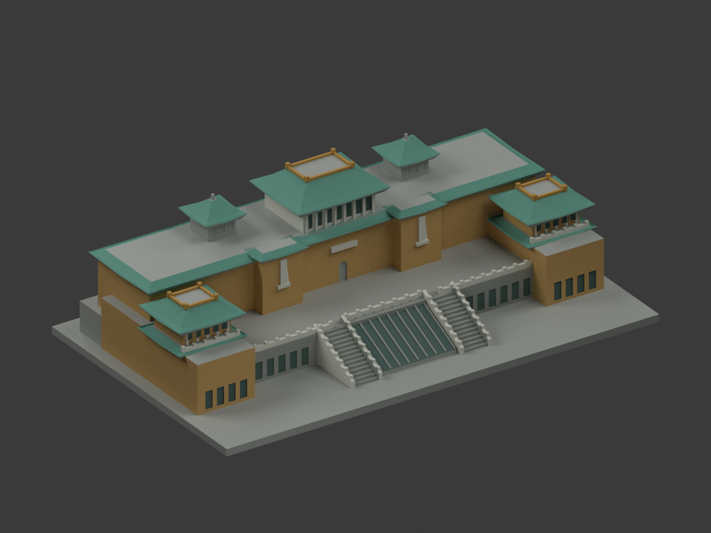
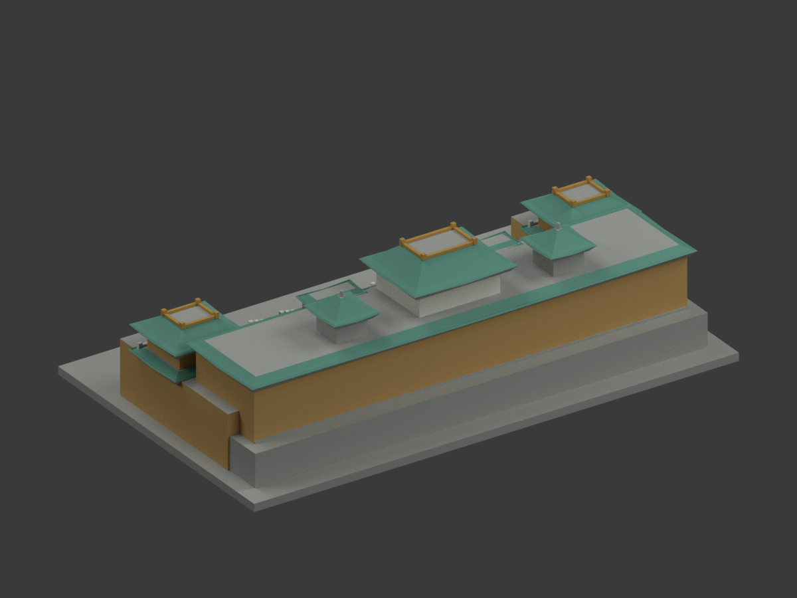
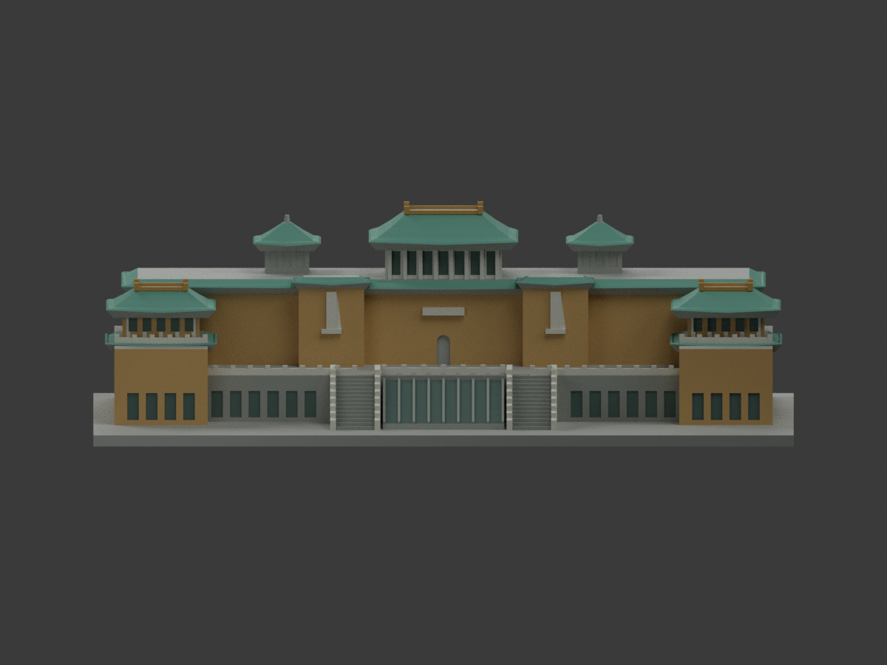
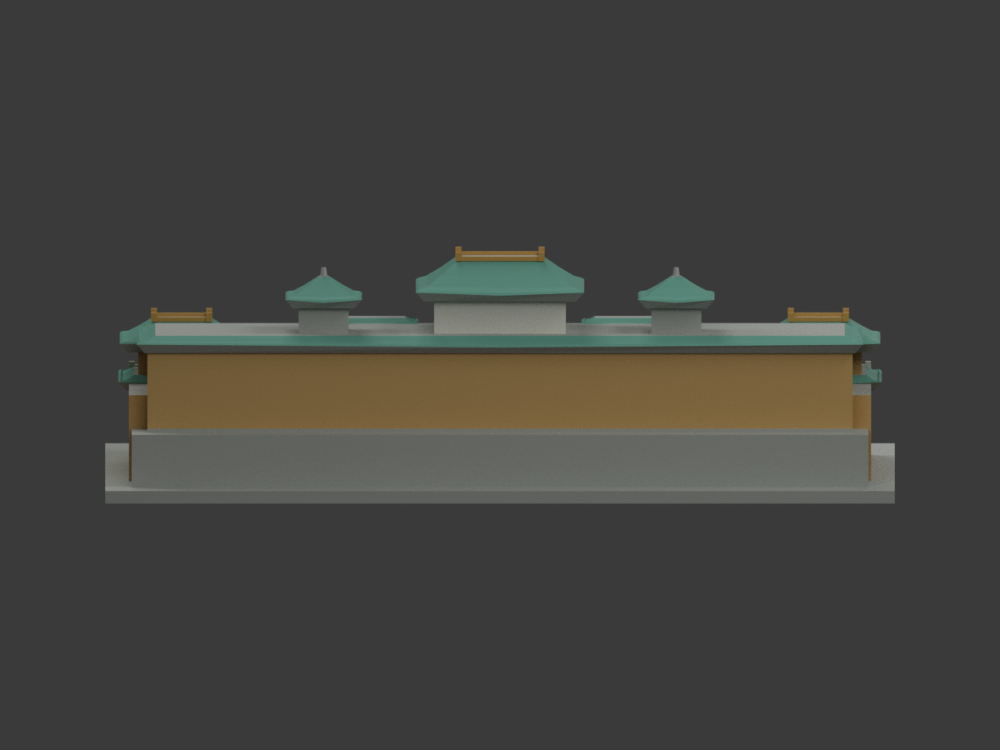
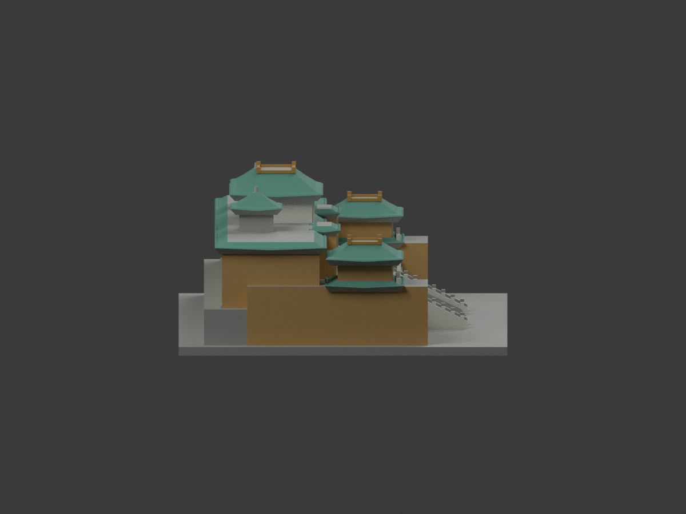
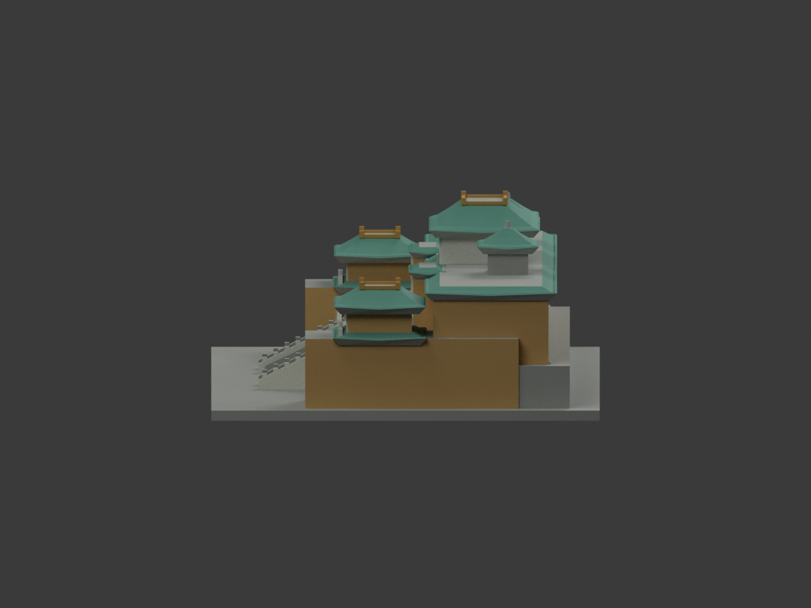
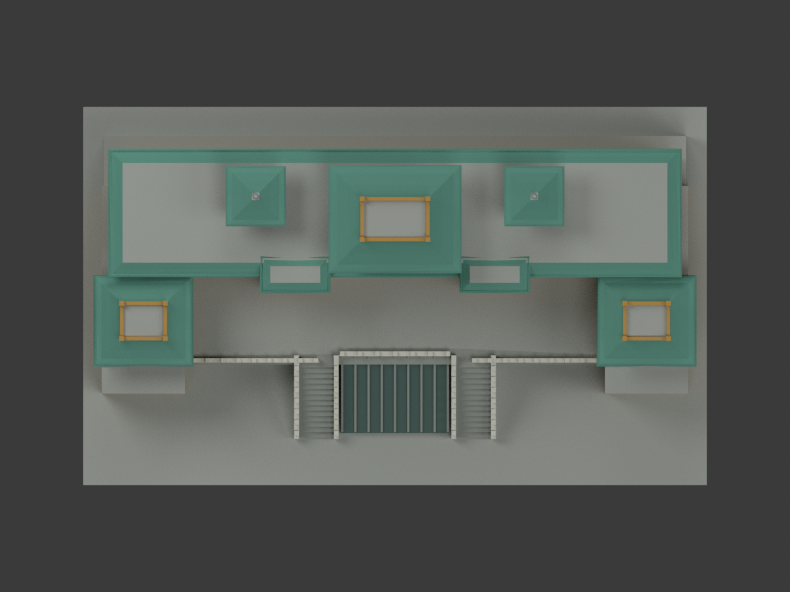
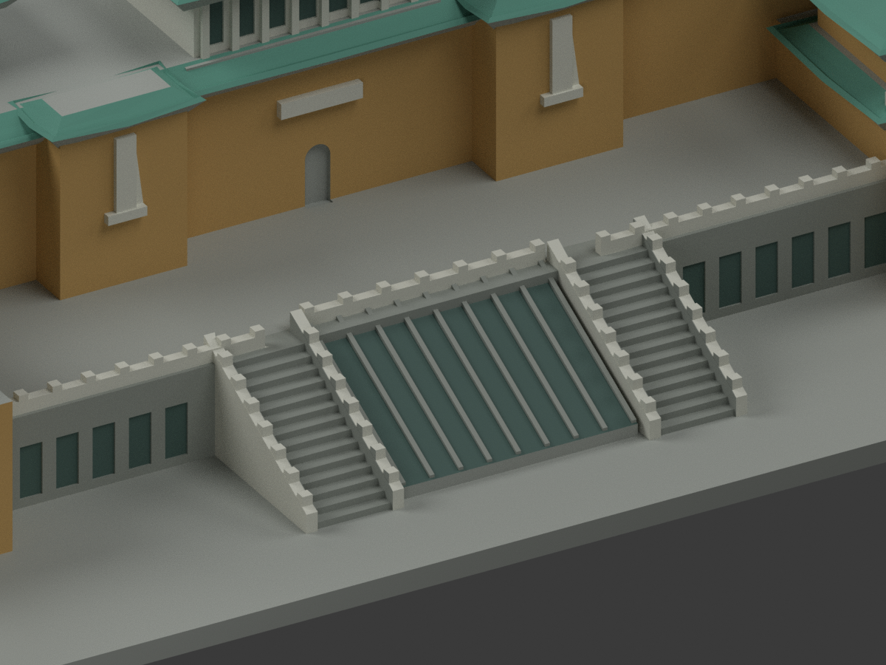
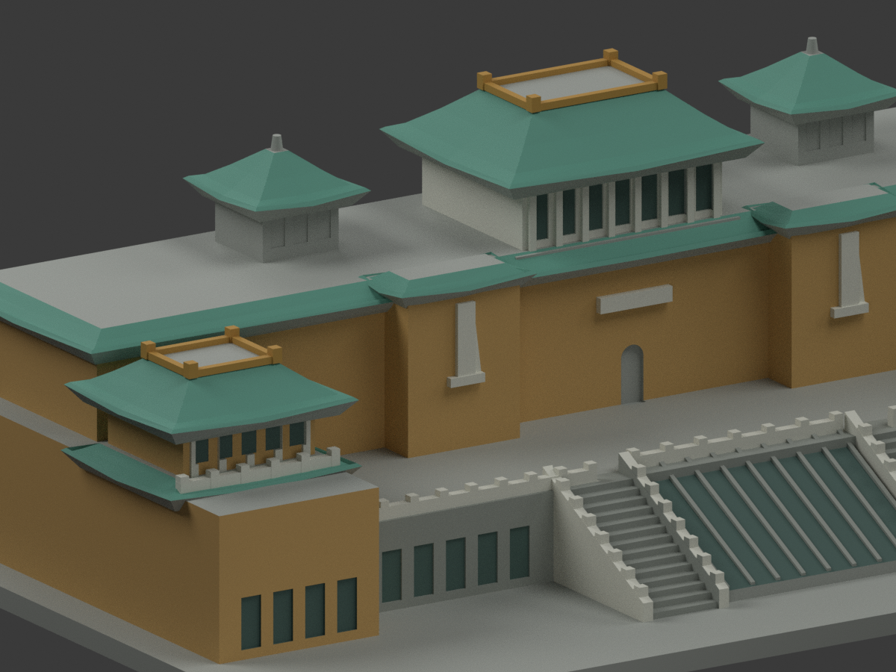
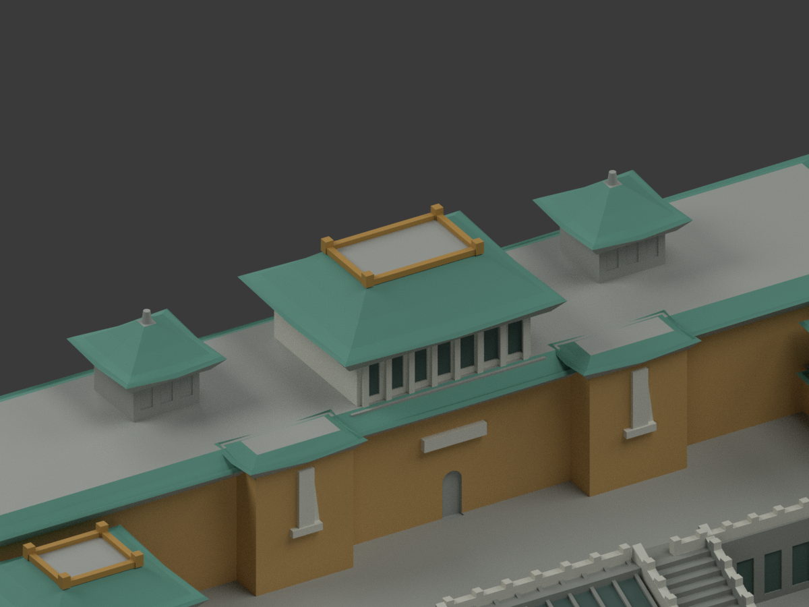

# 故宮博物院北部院區正館｜側背材色延伸修補

| 彩色預覽 | 彩色預覽 | 彩色預覽 |
|---|---|---|
|  |  |  |
|  |  |  |
|  |  |  |
|  | | |

## 本版範圍

這是同一件北院正館模型的材色修補，不是新建築、南院或精確測繪。建築數及模型套件數不增加。**目前為本機審核包，未發布 GitHub。**

本版接續已完成但尚未發布的去字版，保留無文字預覽。原始 2,781 頂點、5,558 三角面、150 × 91 × 45.799999 mm 外形、物件變換與原 STL 均不變。原已著色的 3,294 面、七個材料槽位、RGBA 與粗糙度均保留；只改原中性材料的 993 個完整三角面。

- 631 面：原有同構斜屋坡延伸既有玉綠色。
- 252 面：原有獨立屋脊框與角端延伸既有黃褐色。不新增屋脊、脊獸或裝飾。
- 102 面：主館外牆、前凸體側牆與端部塔樓側背牆延伸既有黃褐牆色。
- 8 面：中央高亭的同構側背外牆延伸既有淺色。
- 其餘 1,271 面仍中性，包括水平屋頂平台、下層大台基、展示底座、未有可靠同構對應的部位與不能整面分類的混合面。

上述側背色是**同構材色延伸推估**。故宮官方照片可支持正面色族與可見轉角，但沒有逐面核實未見背面，也不保證任何年份或當前整館現況。色彩沿用原版，不是校準測色。材料槽名稱為了保留相容性仍沿用舊版，當中的 front／observed／unverified 是舊標籤，不是新增側背面的證據等級；本版證據範圍以本說明與來源表為準。原模型背部是簡化實體；本版不補窗格、不畫假門窗、不加立面細節，也不把未知整面塗成玻璃。未拆分、重三角化或移動任何面。

## 檔案與重建

[彩色 3MF](appearance.3mf) · [彩色 Blender](scene.blend) · [保留原 STL](model.stl)

1. build_model.py 重建原 STL；原檔未改。
2. colorize_model.py 由原 STL 重建既有前色，再依完整面邊界作本版有限延伸。
3. export_appearance.py 產生帶七個基本材料的 3MF。
4. Blender 4.3.2 執行 render_color.py，產生以上十個角度。採 CPU 單執行緒、Cycles 96 samples、denoise=False，無文字、浮水印或圖內標註。一般視圖沿用完整模型構圖，三張 detail 為刻意局部取景。

重建所用套件版本記於 VERIFIED-ENVIRONMENT.json。乾淨目錄重建的 STL bytes、頂點、三角面及新色索引與交付模型完全相同。NPZ、3MF 與 Blender 使用同一材色索引；3MF 的毫米單位與 build 變換保留。七材質外觀不是已驗證的七耗材或四色切片方案。**未實際列印**，支撐、細節厚度及設備相容性仍須切片檢查；STL 不含色彩。

## 來源與限制

已實看 [故宮官方「國立故宮博物院正館」](https://theme.npm.edu.tw/npmArchitecture/ch/page-4.html) 的三張公開照片，以及原版使用的臺北市政府兩張官方照片。確切 URL、檔案雜湊與使用界線見 FACADE-SOURCE-REGISTER.json。照片未確定精確拍攝日；頁面或歷程年份不是逐面現況證明。

官方公開照片不等於 CC 授權。來源照片只作私人參考，不作貼圖、不隨模型包提供，不據此保證商業再授權。沒有重製人物、文字、旗幟、室內或安全設施。

## 審核與相依版本

- FACADE-COLOR-CHANGESET.json：每個改色面及理由。
- COLOR-FORMAT-GEOMETRY-QA.json：原幾何、已彩面、STL／3MF與乾淨重建核對。
- SCENE-QA.json、NO-TEXT-QA.json：實際 Blender 材料、變換與無字檢查。
- FRAMING-QA.json、RENDER-CONFIG.json：相機、構圖與渲染設定。
- FACADE-VISUAL-QA.json：十角度人工檢視及同相機原新比較。
- DELIVERY-QA.json、SHA256SUMS：本版檔案及交付狀態。

遠端舊版的 COLOR-SOURCE-REGISTER.json、歷史報告或歷史圖像如仍保留，僅記錄先前版本，不代表本版逐面驗證。新整合時必須同時保留去字變更，不能以遠端有字 renderer 或舊 scene 覆蓋本版。精確待整合清單與遠端 old blob、去字基底雜湊另列於本機 manifest；不應直接盲目覆蓋已變動的遠端 HEAD。
