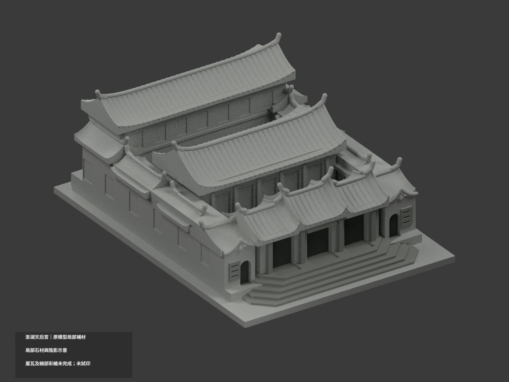
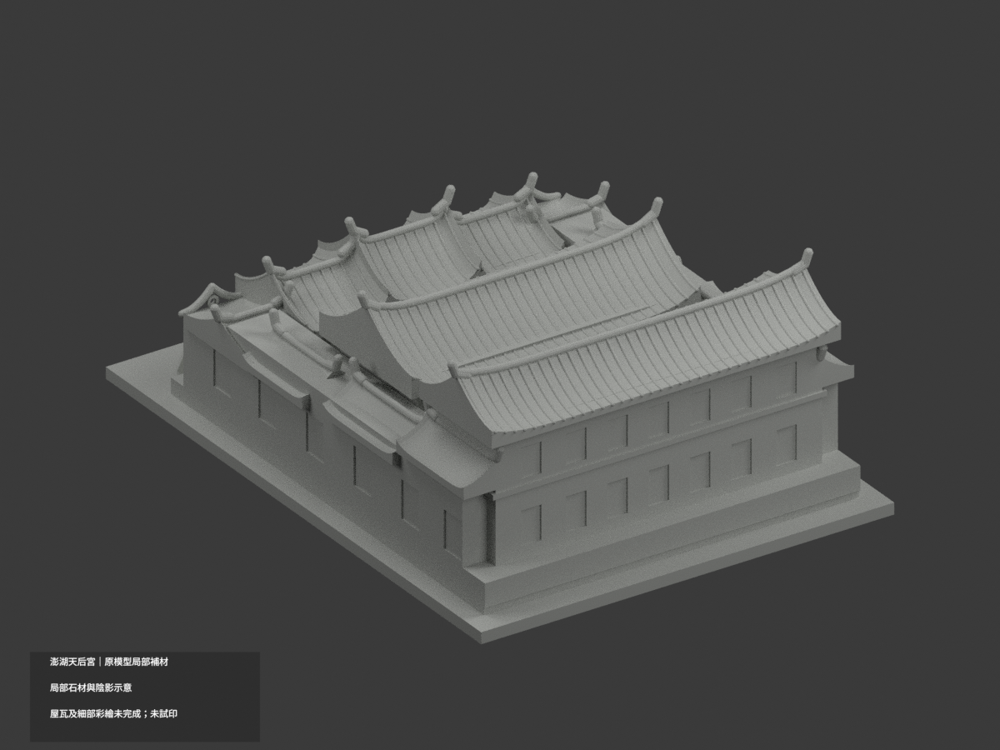
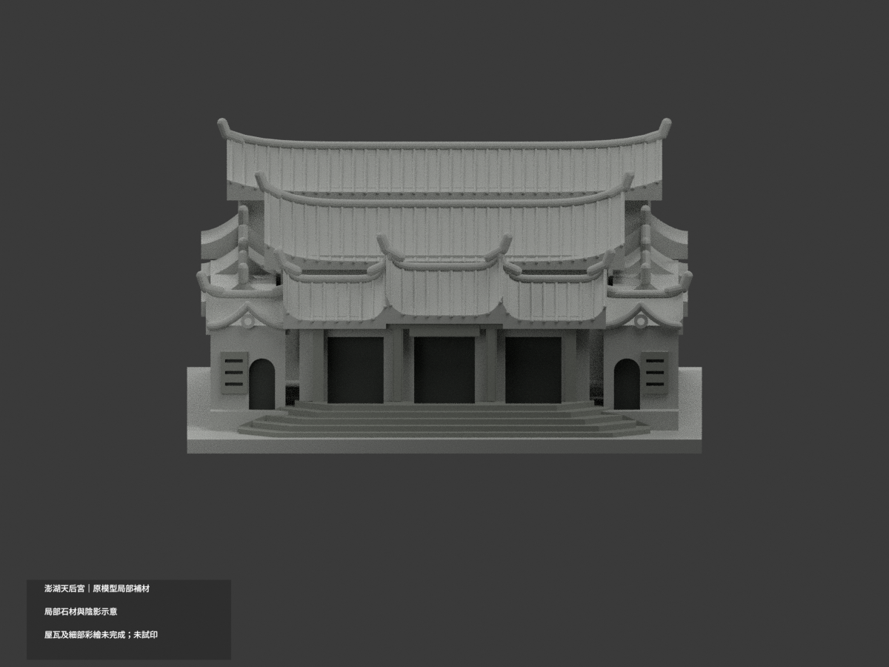
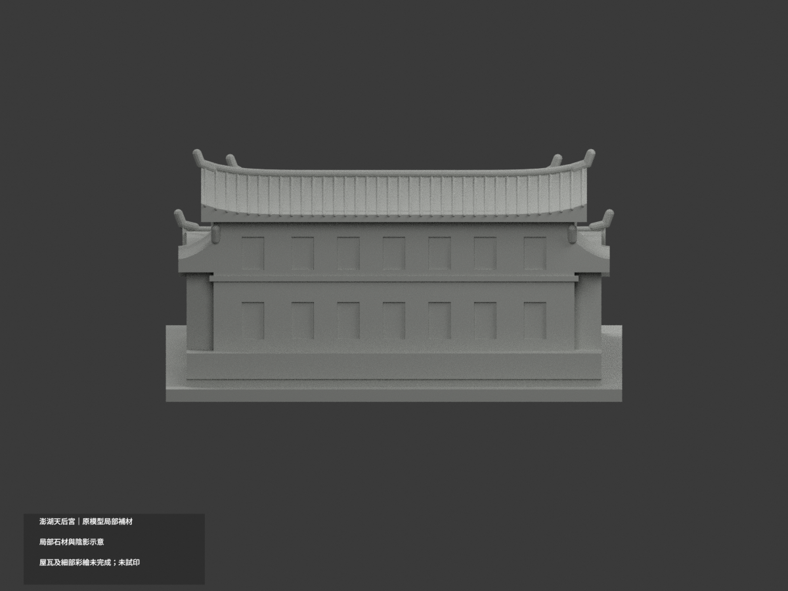
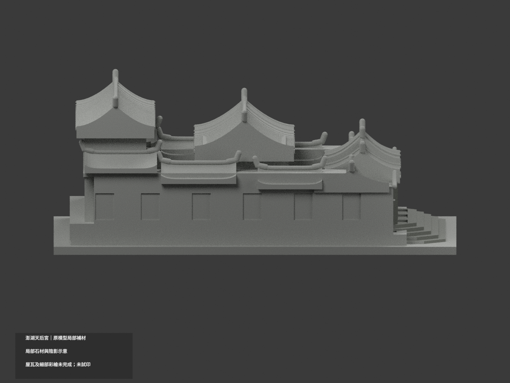
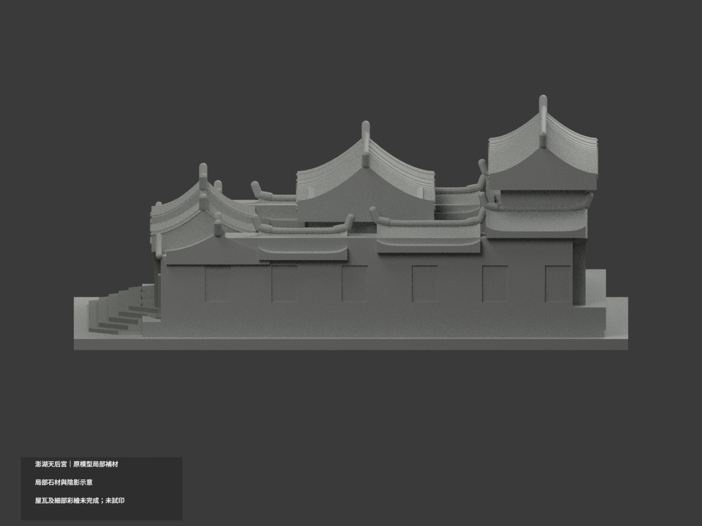
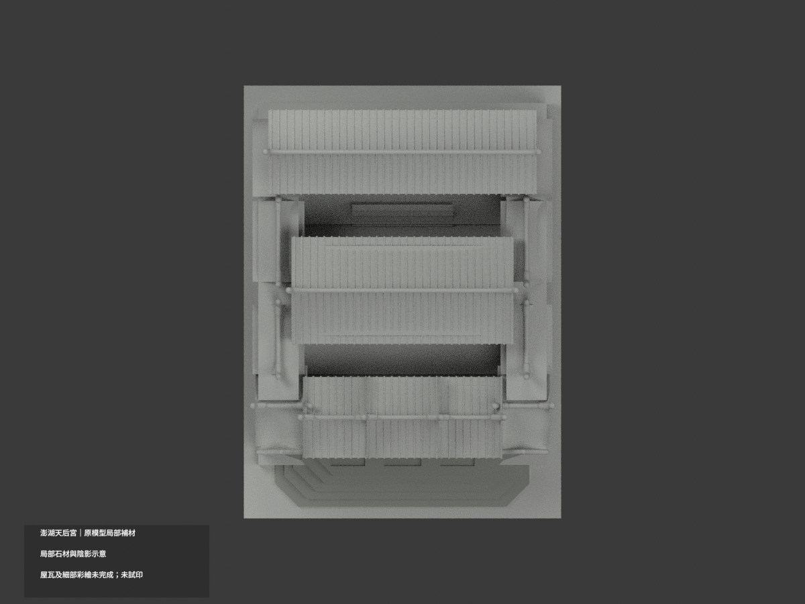
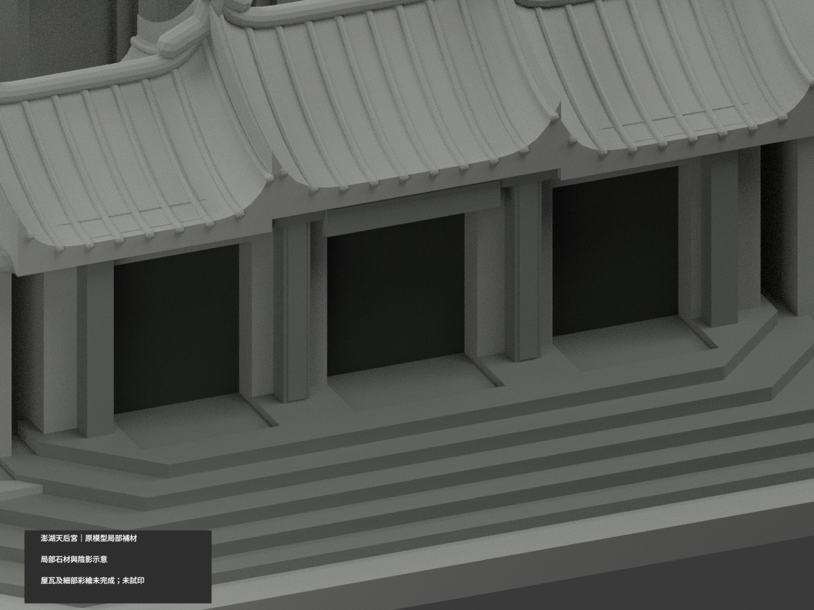
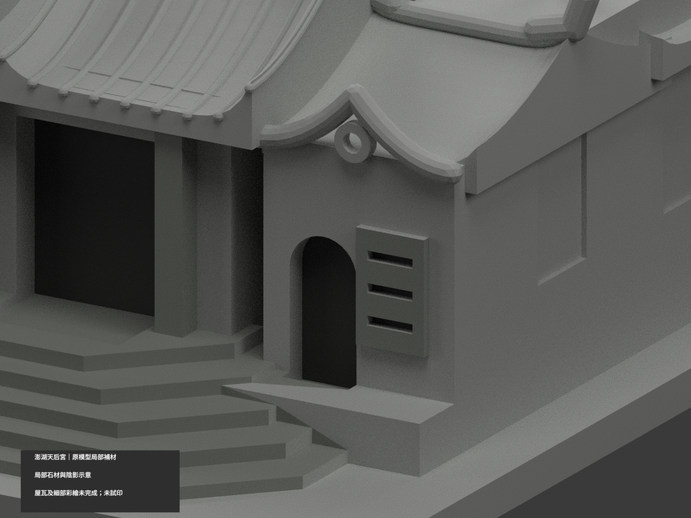
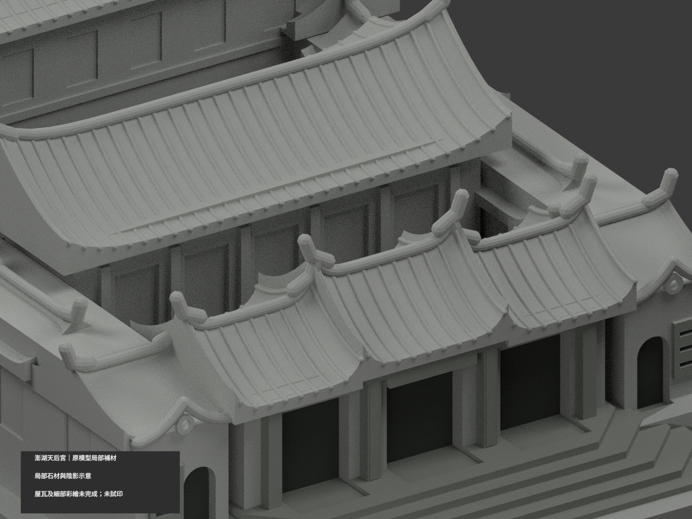

# 澎湖天后宮｜原模型局部材色更新

**局部石材與陰影示意；屋瓦及細部彩繪未完成。不是完整彩色外觀復原。**

| 局部材色預覽 | 局部材色預覽 | 局部材色預覽 |
|---|---|---|
|  |  |  |
|  |  |  |
|  |  |  |
|  | | |

## 材色範圍
同一澎湖天后宮既有模型局部補材（count_delta 0）；原 51852 三角面、頂點、STL、build_model.py 完全保留，不增刻石雕、門扇、彩繪或屋瓦細節。這次不宣稱全館補彩已完成，不以新材色替原粗化建築幾何背書。

- 兩張官方實景支持前方多邊石階、既有石柱、可分辨框件的低飽和灰石色族；只在完整既有面指定材料，不切面造出照片中不存在於原模型的細邊界。
- 深灰僅用真正入口與拱口、格柵凹底，代表陰影，不是紅門、藍玻璃或室內復原。
- 兩照片屋瓦呈現灰白與紅白／綠端等不同外觀，未釐清年代、光線或修復關係。**所有屋瓦、簡化脊飾與彩繪仍中性且未完成**，不任選橘瓦、綠龍、金飾或畫條紋。
- 可見紅色牆板在原融合大面上沒有可靠獨立邊界；保留整面中性，不將整座低翼染紅。側、背、內庭、後殿及地坪未知部分中性。
- 色域截止是來源可證與未知界線，不是實景換漆線；HEX 只是非校準展示色，不稱當前精確現況。上傳路徑日期不是拍攝日期。
- 三個外觀材質標籤不是已驗證四色耗材切片檔。**未實際列印**，不保證免支撐；STL 不存顏色，原尺寸和列印幾何未改。

## 檔案與重建
[局部材色 3MF](appearance.3mf) · [Blender 場景](scene.blend) · [原 STL](model.stl)

build_model.py 重建原幾何；colorize_model.py 只指定原面材料；export_appearance.py 輸出 3MF 基本材料；render_color.py 輸出十圖與場景。validate_color.py 驗原檔、三角座標、3MF 及隔離重建；verify_color_scene.py 重開實際 shader、面索引及構圖。依賴 numpy、trimesh、manifold3d、Pillow、Blender 4.3.2；隔離重建目錄私人保留，不刪除。

## 來源與權利
澎湖國家風景區與文化資產官方外觀照片，網址／SHA256 見 COLOR-SOURCE-REGISTER.json。未核得明示 CC 授權；公開可讀不等於自由再授權。原照片私人保存，不公開、不貼圖、不保證商用。只有建築外觀參考，不含人物或室內重建。

## QA 與原件歷程
新色版 QA 為 COLOR-FORMAT-GEOMETRY-QA、SCENE-QA、FRAMING-QA、DELIVERY-QA 與獨立視覺審核。舊 previews／驗證資料／ORIGINAL-MONOCHROME-README.md 原樣保留作歷程，不代表本次色版。上述十圖及 scene.blend 是局部材色新版。原件不刪，不增加建築套數；全屋瓦和彩繪完成狀態仍為否。
