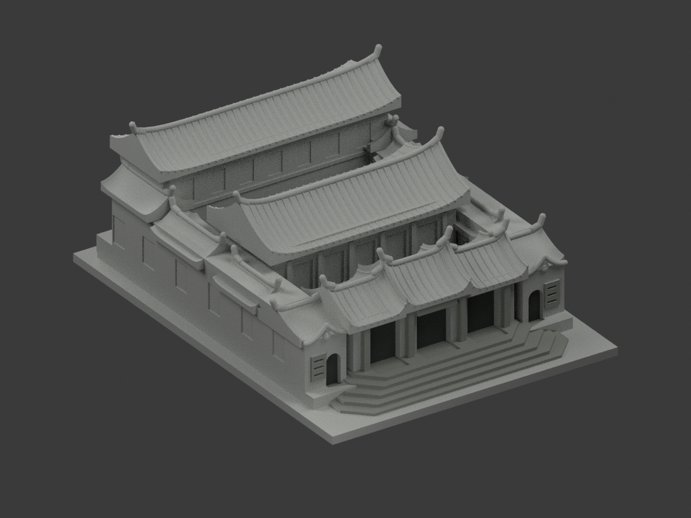
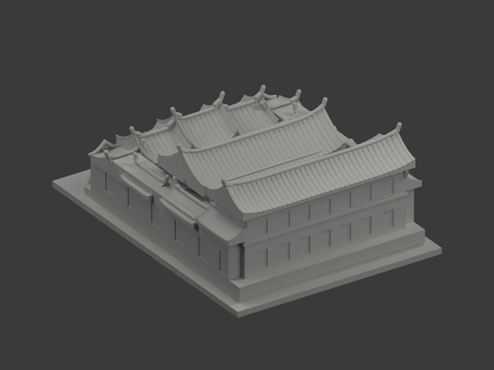
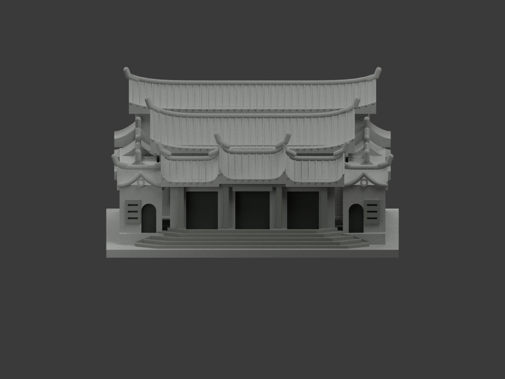
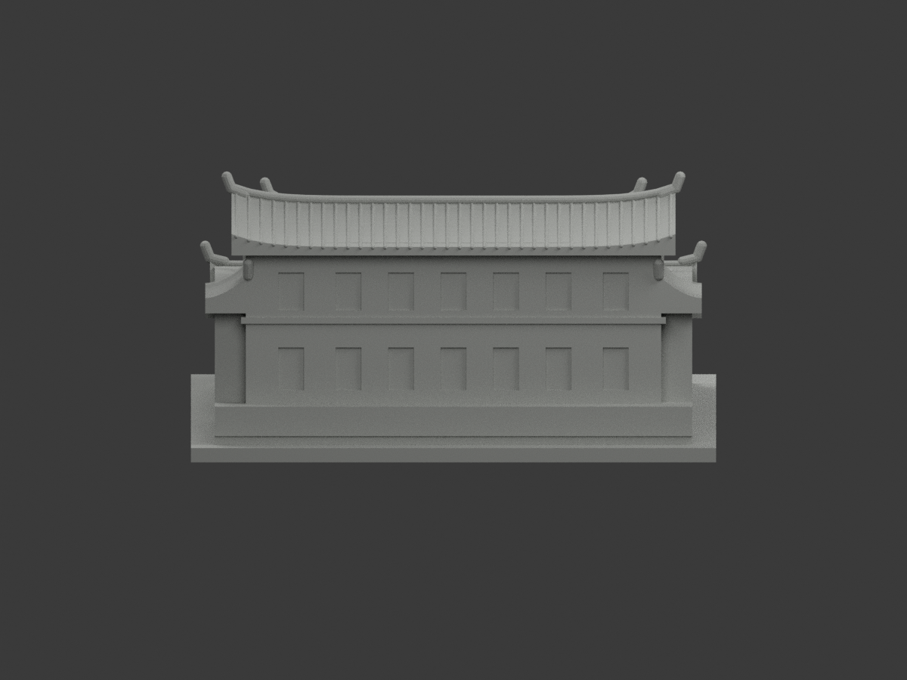
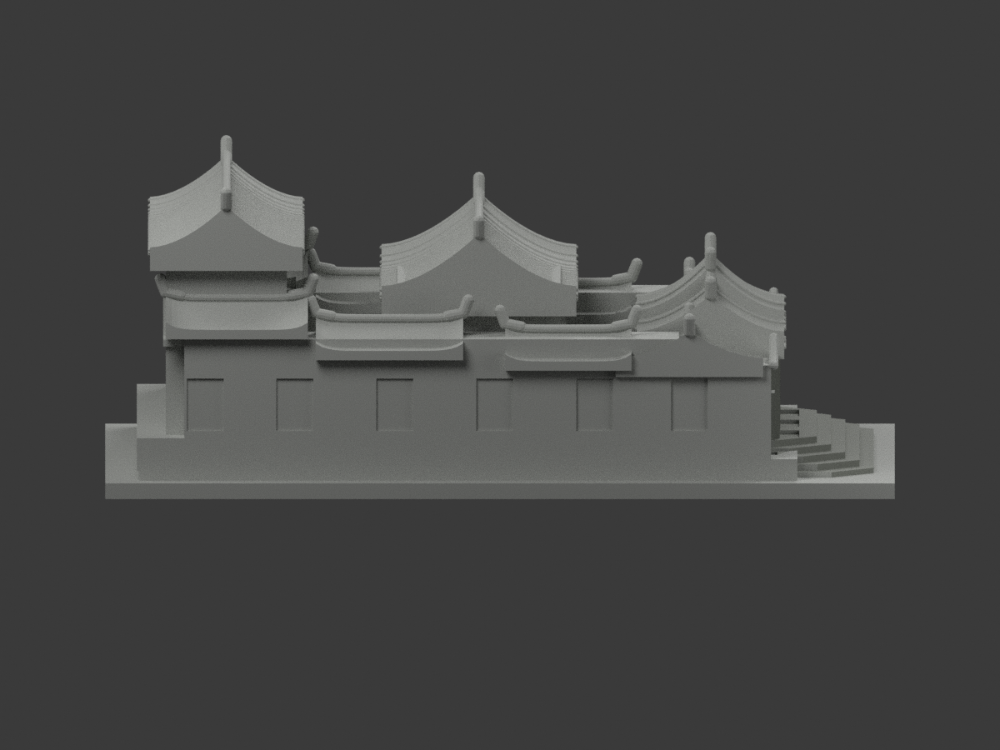
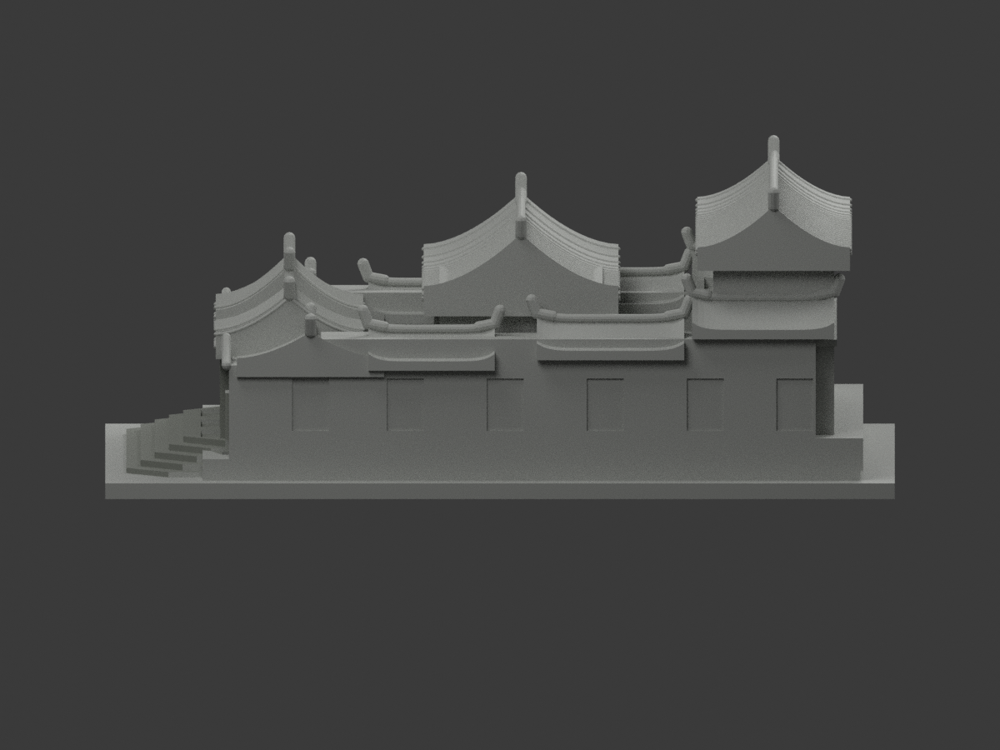
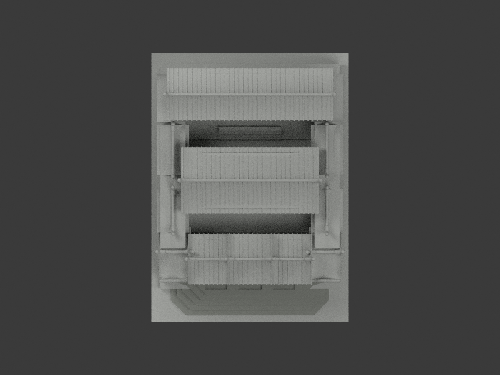
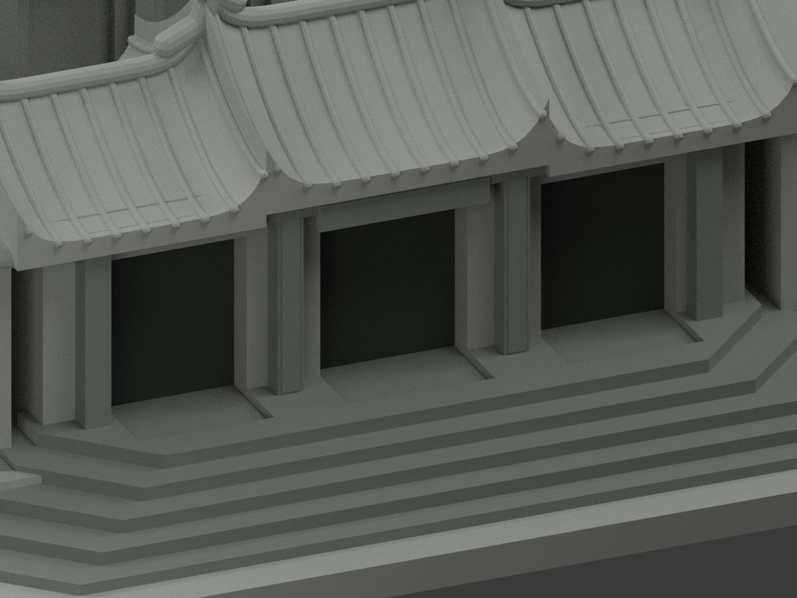
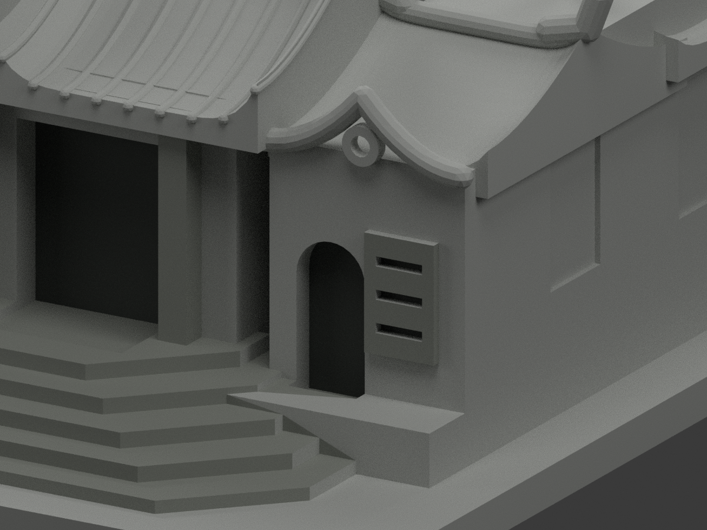
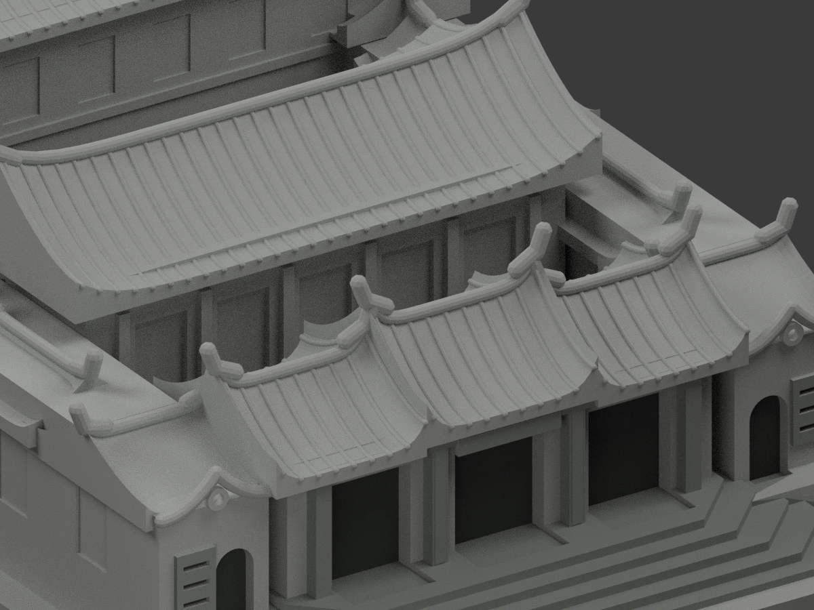

# 澎湖天后宮｜局部材色 WebP 預覽

## 模型預覽

**局部石材與陰影示意；屋瓦及細部彩繪未完成。不是完整彩色外觀復原。**

| 局部材色預覽 | 局部材色預覽 | 局部材色預覽 |
|---|---|---|
|  |  |  |
|  |  |  |
|  |  |  |
|  | | |

本頁僅替既有局部材色外觀提供 WebP；十張圖由同一既有場景依原角度重新渲染，與原 PNG 逐像素相同。屋瓦與細部彩繪仍未完成；此處不將它們視為完整外觀復原或列印驗證。

[模型、原圖與原交付說明](README.md) · [固定版本原說明](https://github.com/hplin50643/taiwan-buildings-3d/blob/cd2698cb09b3b73d7e4ce5ea46304c1f1f1d8ef6/%E8%87%BA%E7%81%A3%E5%9C%B0%E6%A8%99/penghu-tianhou-temple/README.md) · [展示校驗表](DISPLAY-SHA256SUMS) · [展示渲染紀錄](DISPLAY-RENDER-PROOF.json)

原 README、PNG、模型、重建與工程校驗檔保留。原凍結清單核對原交付內容，本頁與新 WebP 改用獨立展示校驗，不改原校驗檔。
