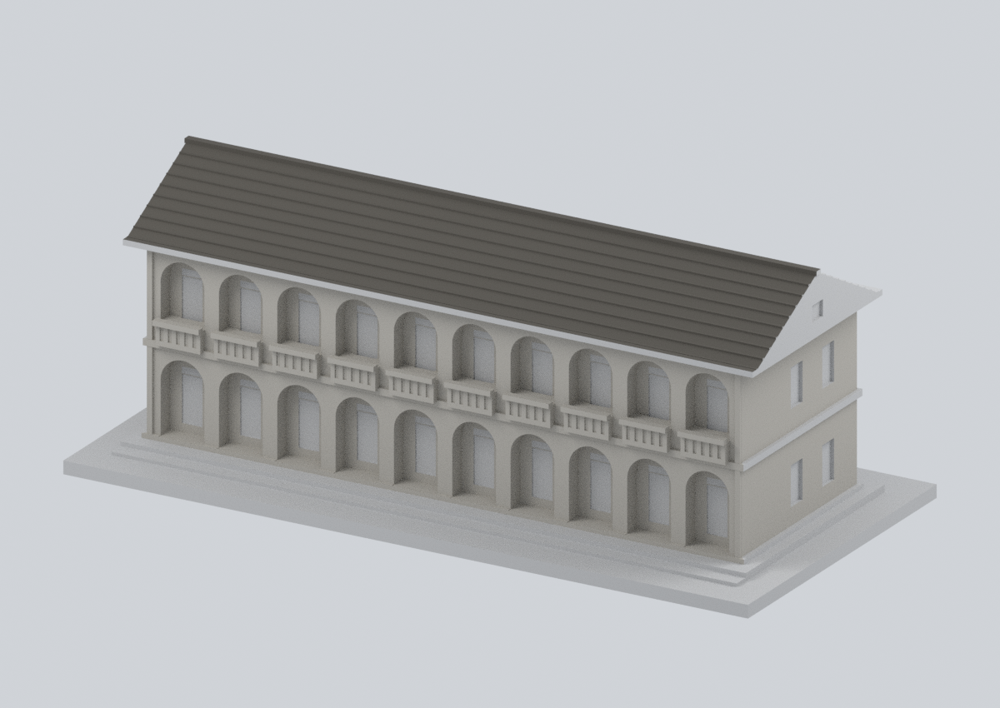
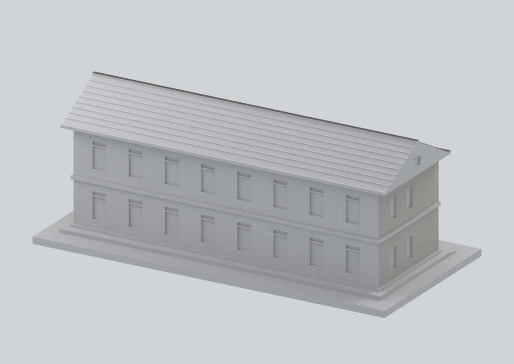
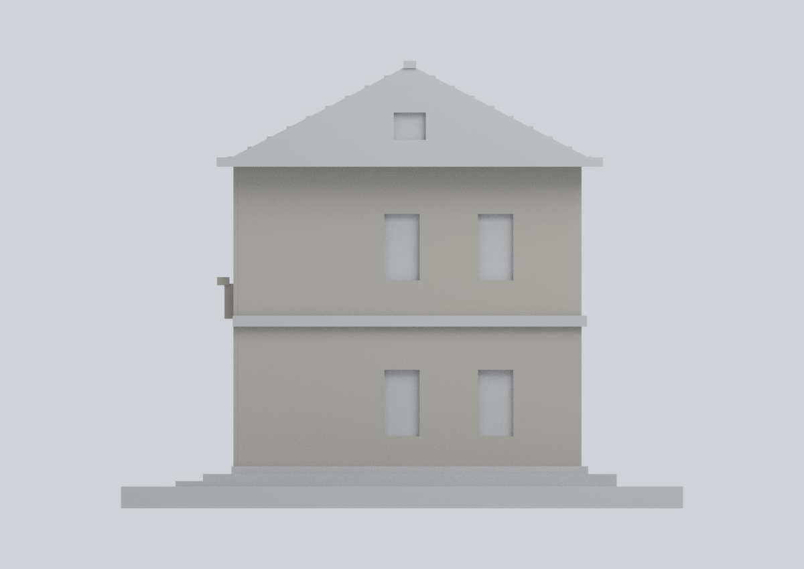
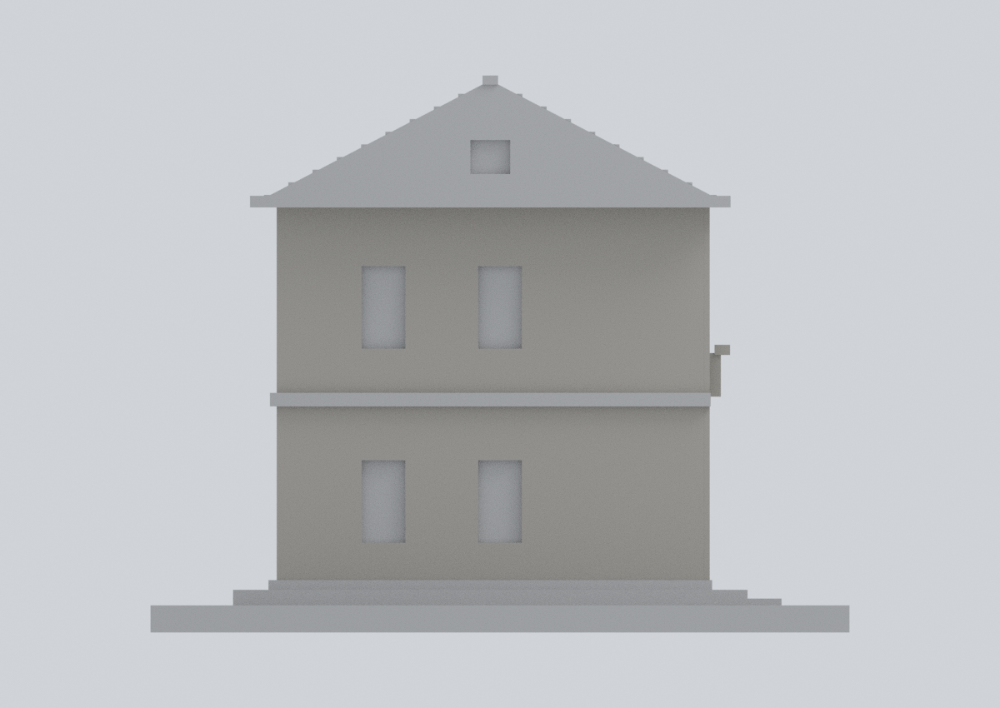
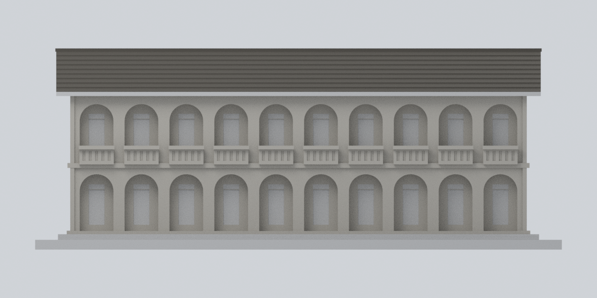
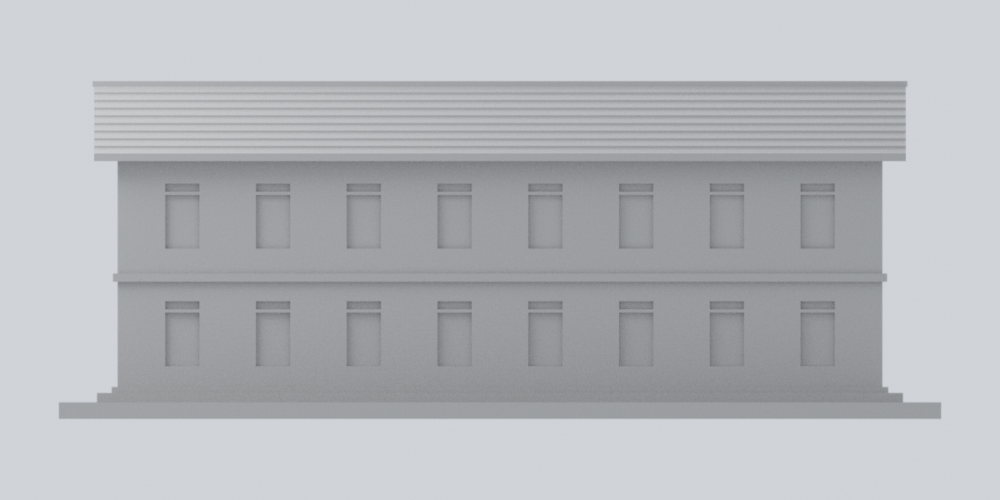
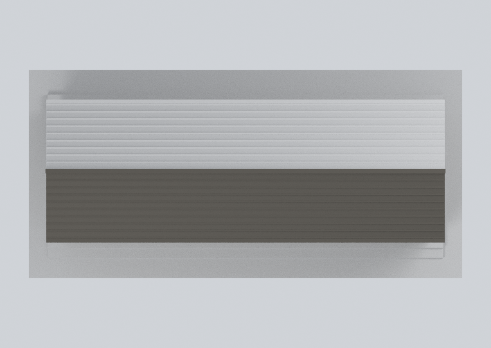

# 松園別館主棟｜既有模型兩側補色

## 模型預覽

| 模型預覽 | 模型預覽 | 模型預覽 |
| :---: | :---: | :---: |
| <br>原正面材質 | <br>背面牆與後屋坡維持中性 | <br>右側既有外牆 |
| <br>左側既有外牆 | <br>正立面 | <br>背立面 |
| <br>屋頂俯視 | | |

[原 STL](../model.stl) · [現行彩色 3MF](model.3mf) · [現行 Blender](scene.blend) · [本次面索引及渲染驗證](side-face-proof.json) · [現行逐檔 SHA256](SHA256SUMS)

## 補色邊界

依[花蓮縣政府旅遊網對主棟外牆的洗石子灰面說明](https://hualien.travel/zh-tw/attraction/12/)，將原正面已使用的暖中性灰近似延伸到兩側主牆既有平面，各 28 個完整三角面，不是照片逐面或現況測色。只套在原模型 +X／−X 外向牆面，未延伸到側窗凹槽、山牆通氣口、側檐、背牆、後屋坡、門窗或底座。正面 4,295 個砌體面和 122 個屋瓦面完全保留原材質。總共 5,874 個三角面，原 STL 完全不變，不增加模型件數。色值不是精確復原；背側簡化窗位及原尺度限制照舊，並未執行實體列印。第三方照片、樹影或貼圖皆未加入。

## 來源與重建

[原正面來源與限制](https://github.com/hplin50643/taiwan-buildings-3d/blob/1fa7d0e4c55ca0ffcd7854dead95572ca8e3a2e8/%E8%87%BA%E7%81%A3%E5%9C%B0%E6%A8%99/pine-garden/sources.md) · [封存版完整套件](https://github.com/hplin50643/taiwan-buildings-3d/tree/1fa7d0e4c55ca0ffcd7854dead95572ca8e3a2e8/%E8%87%BA%E7%81%A3%E5%9C%B0%E6%A8%99/pine-garden) · [封存版 SHA256（50 檔）](https://github.com/hplin50643/taiwan-buildings-3d/blob/1fa7d0e4c55ca0ffcd7854dead95572ca8e3a2e8/%E8%87%BA%E7%81%A3%E5%9C%B0%E6%A8%99/pine-garden/SHA256SUMS) · [權利與限制](../RIGHTS-AND-RESPONSIBILITY.md)

現行彩色 3MF、Blender 與沿用的原 STL 可分別下載使用。重建時先從上述不可變封存取同一份 model.stl、原 scene.blend、原 model.3mf 及原 face-material-map.json 到獨立工作目錄（例 /tmp/pine-side），不能用現行已上色檔充當原始輸入。以下以 Python 3.12／lib3mf 2.5.0 及 Blender 4.3.2 執行：

```sh
python side-source/derive.py /tmp/pine-side
blender -b -t 4 --python-exit-code 1 /tmp/pine-side/scene.blend -P side-source/render-proof.py -- /tmp/pine-side
python side-source/verify.py /tmp/pine-side
blender -b -t 2 --python-exit-code 1 /tmp/pine-side/current.blend -P side-source/readback.py -- /tmp/pine-side
python side-source/encode-webp.py /tmp/pine-side
```

產出 current.3mf、current.blend 與七張對應的暫存 PNG。公開影像只使用 WebP，原 PNG、前一版材質和原重建資料保留在封存版及原套件。原目錄的說明、模型、校驗與重建流程屬前一版，不是這一版的展示入口。
