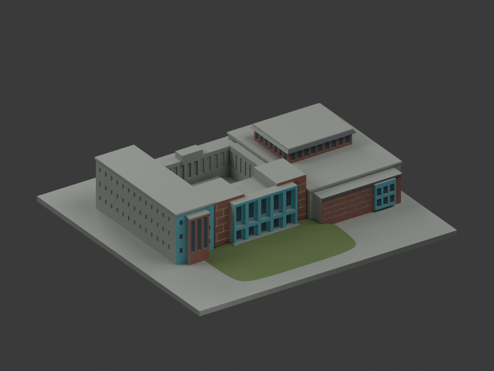
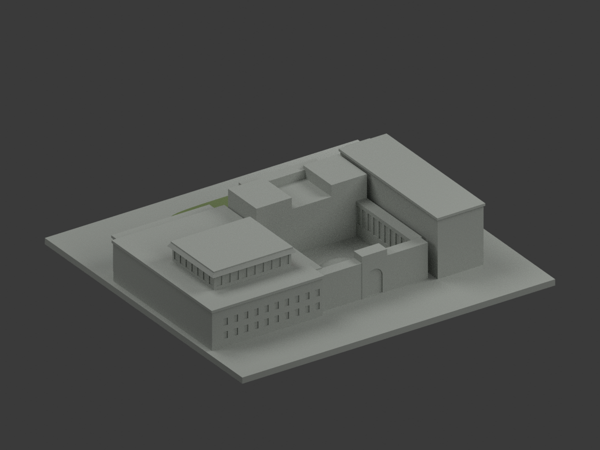
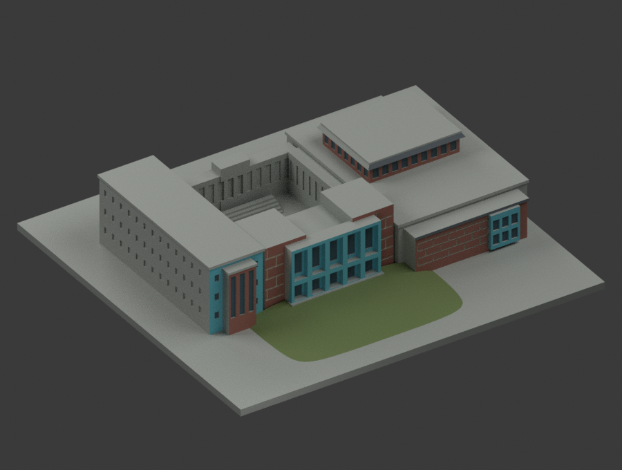

# 國立臺灣史前文化博物館康樂本館｜彩色外觀模型

## 模型預覽

| 正面斜視代表圖 | 背面斜視 | 右展館屋頂高起量體側面 |
| :---: | :---: | :---: |
|  |  |  |

[彩色 3MF](appearance.3mf) · [可編輯 Blender](scene.blend) · [STL（不含色）](model.stl) · [逐面驗證](verification.json) · [渲染來源與視角](render-proof.json) · [校驗版本](CHECKSUM-SCOPE.md)

## 最新補色範圍

只補原模型右側展館屋頂高起量體朝山之廣場的側面。44 個既有牆面三角面沿用正面灰紅褐（#98695E）；七個既有凹窗的 14 個凹底三角面沿用灰藍（#4B6069）。窗是原模型的實心簡化，沒有新增窗格、透明玻璃、可通行的開口或貼圖。原凹窗的四周返面、屋簷、屋面、對側、後牆與其他建築量體原樣保留。

[陳哲生建築師事務所改造案](https://architectures.jidipi.com/j00110233/en/reinterpretation-of-national-museum-of-prehistory) 的[竣工空拍](https://upload.jidipi.com/posts/j00110233/no01_yu_9977small-Iw4.jpg) 同時可見高起量體前面及朝中庭側面的紅褐直帶與灰藍窗列，並以藍色圓筒、山之廣場、右側屋面與高起量體的相對位置對位。顏色是原模型沿用的材色近似，不是校色。七個凹窗是原模型離散化；不宣稱實景逐窗數量或當前外觀均已核實。參考照片未隨包散布。

保留原青藍入口框、紅褐磚盒及前草坡等所有原配色。只將原中性的 58 個三角面分別改為牆面灰紅褐（44 個）與七處凹窗凹底灰藍（14 個）；其餘 6,128 面、3,095 個頂點、原七種材質、幾何與 STL 不變。整體採改造後入口外觀，未補舊水池、日晷廣場或大階梯；未確認區域維持中性，不以模型凹窗數當作實景測繪。STL 不含顏色，未試印或切片；[原幾何檢核](validation.json)是數位檢查。

## 基準來源與權利

史前館官方改造後街側與入口實景照片，原始 URL／雜湊與面域限縮見[基準色版來源紀錄](https://github.com/hplin50643/taiwan-buildings-3d/blob/1ecf103e43b3c6cb37ffe3fec7e4a30d6fbe2005/%E8%87%BA%E7%81%A3%E5%9C%B0%E6%A8%99/prehistory-museum-kangle/COLOR-SOURCE-REGISTER.json)。原照片只私人備存、不公開、不作紋理；官網可讀不等於 CC 或自由再授權，不保證商用。未採失效頁面為新證據，不製作照片人物、車輛、路燈、號誌或室內設備。


## 固定基準與重現

上方模型可直接使用。若要重建，將[歷史基準 Blender](https://github.com/hplin50643/taiwan-buildings-3d/blob/1ecf103e43b3c6cb37ffe3fec7e4a30d6fbe2005/%E8%87%BA%E7%81%A3%E5%9C%B0%E6%A8%99/prehistory-museum-kangle/scene.blend)和[歷史基準 3MF](https://github.com/hplin50643/taiwan-buildings-3d/blob/1ecf103e43b3c6cb37ffe3fec7e4a30d6fbe2005/%E8%87%BA%E7%81%A3%E5%9C%B0%E6%A8%99/prehistory-museum-kangle/appearance.3mf)下載到另一個資料夾；腳本會核對兩件原始輸入的 SHA-256。使用 Blender 4.3.2，並替換實際路徑：

```sh
blender -b /path/to/baseline/scene.blend --disable-autoexec -t 4 --python-exit-code 1   -P build_monitor_flank.py -- /path/to/baseline/appearance.3mf /tmp/kangle-current
```

請使用[當前校驗表](SHA256SUMS)。[前次外觀與原幾何說明](https://github.com/hplin50643/taiwan-buildings-3d/blob/1ecf103e43b3c6cb37ffe3fec7e4a30d6fbe2005/%E8%87%BA%E7%81%A3%E5%9C%B0%E6%A8%99/prehistory-museum-kangle/README.md)只供歷史比對。
