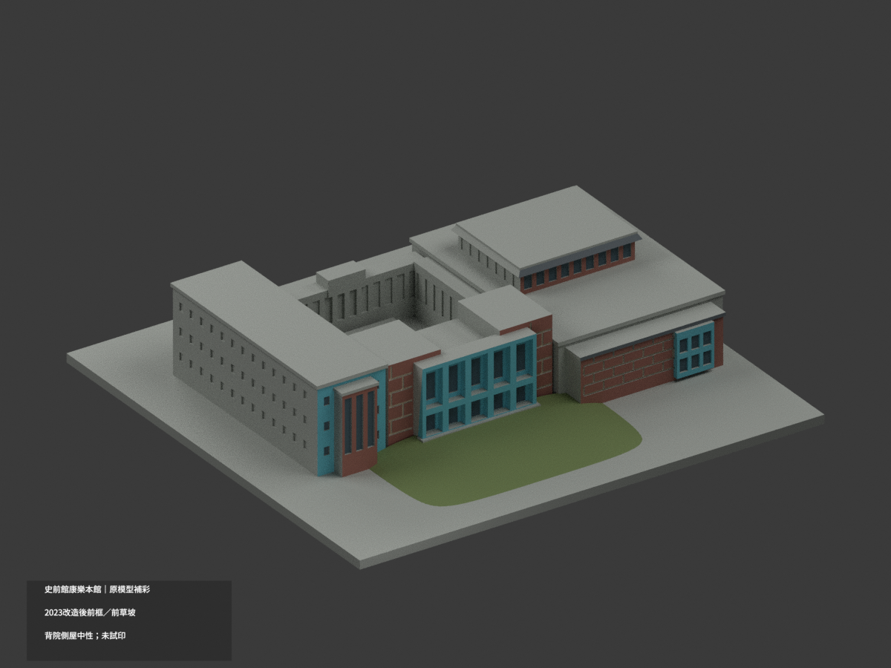
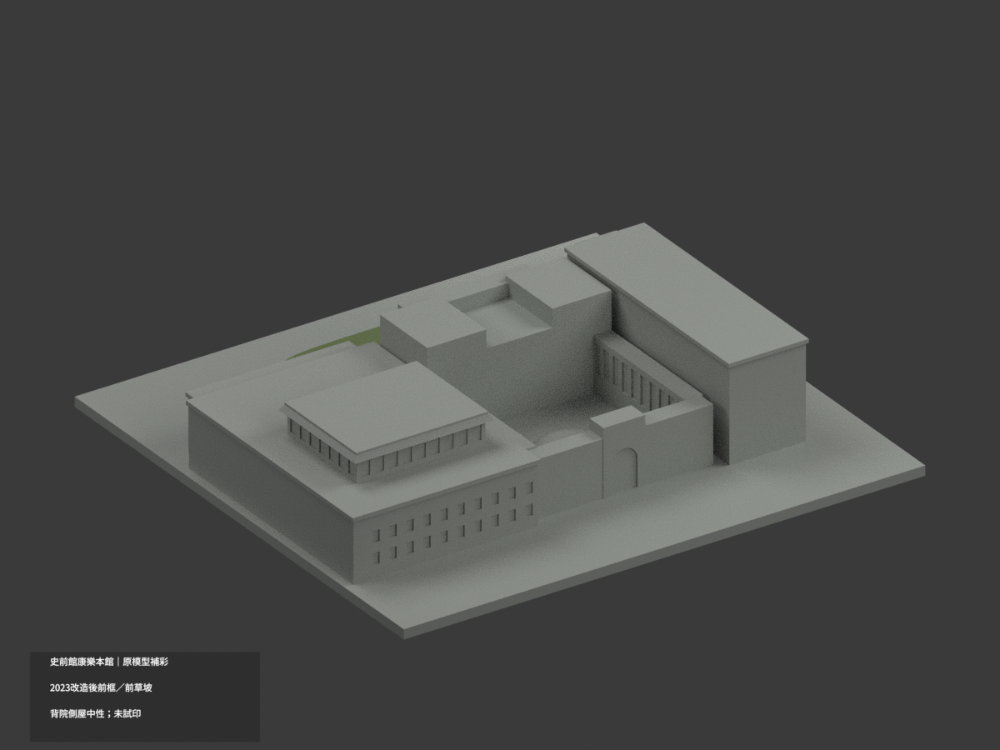
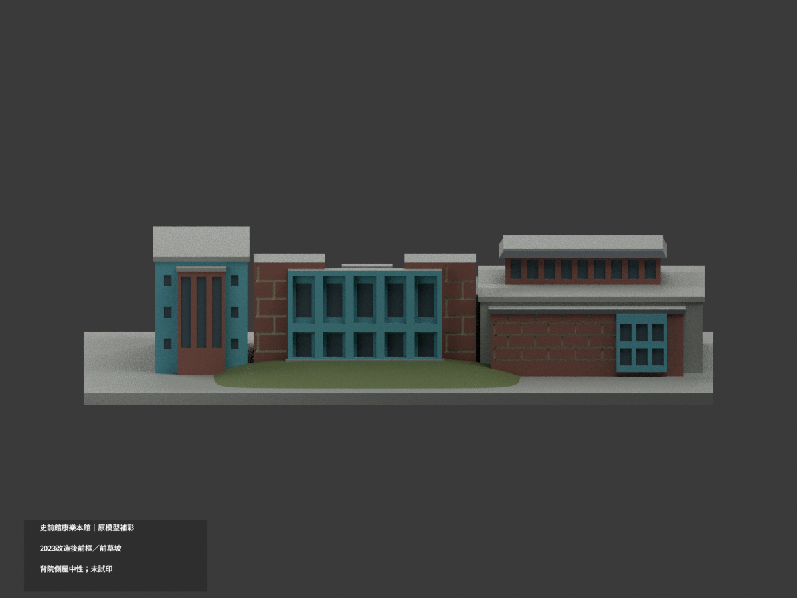
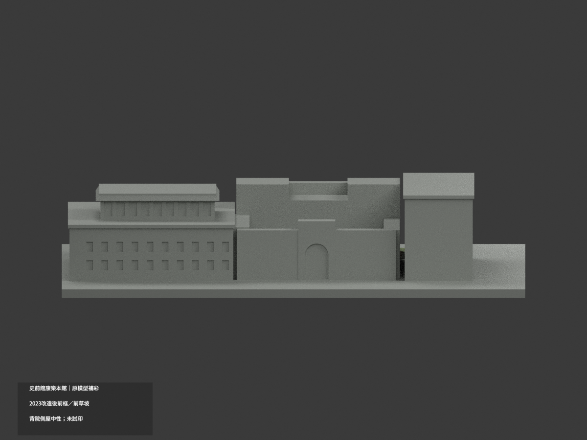
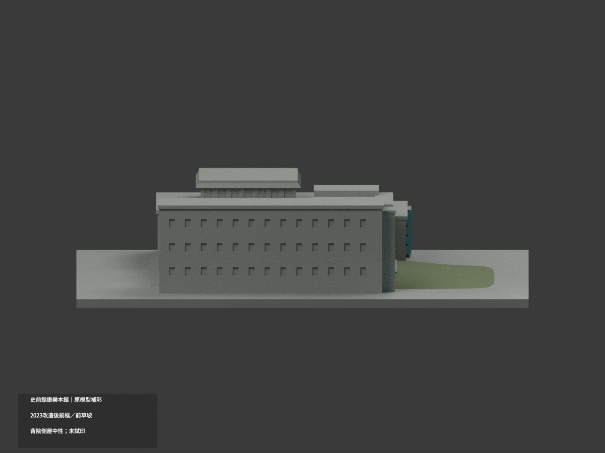
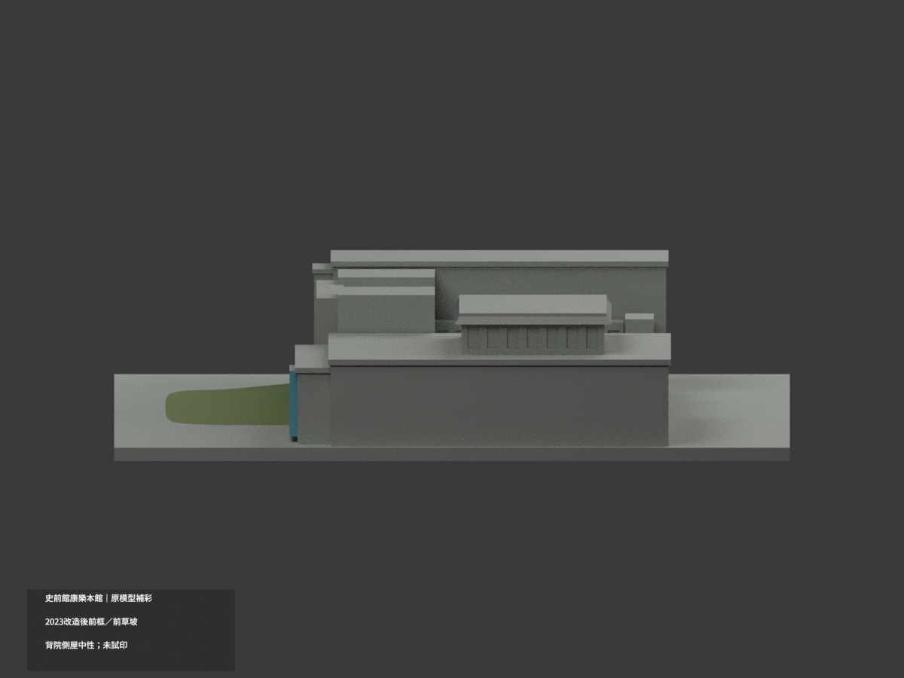
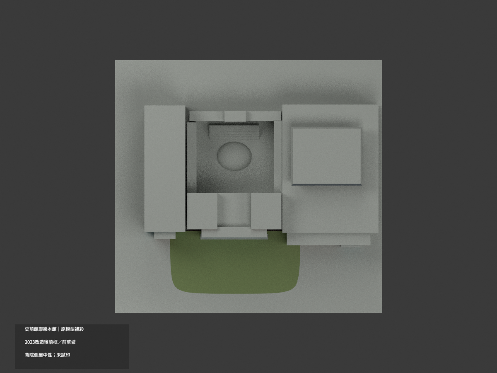
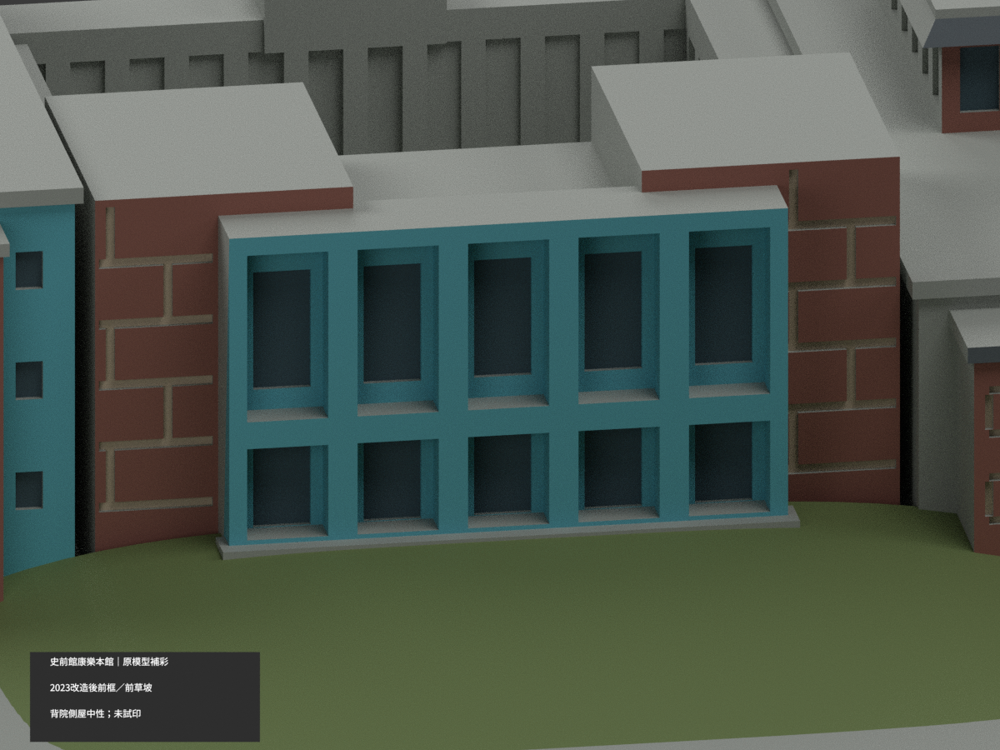
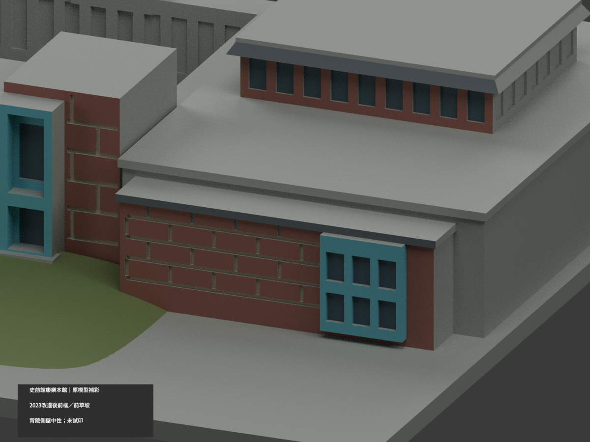
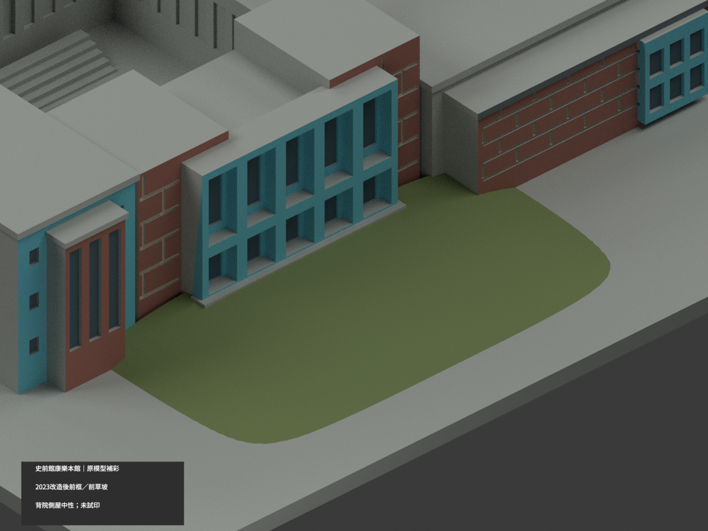

# 史前館康樂本館｜2023 改造後入口參考材色

| 彩色預覽 | 彩色預覽 | 彩色預覽 |
|---|---|---|
|  |  |  |
|  |  |  |
|  |  |  |
|  | | |

## 材色範圍
同一既有康樂本館模型補彩（count_delta 0），原 6186 三角面、頂點、STL 與 build_model.py 不變。僅採官方 2023 改造後入口照片的可辨材色，沒有把舊水池、舊日晷廣場或大階梯補回。原模型深度、屋頂、側背與院內造型仍屬概化，材色不是新的幾何測繪證明。

- 入口原五開間兩層框、可見凹返為青藍塗裝色族，背後原窗板凹面為灰藍。**primitive 包圍框只用來辨識構件，不代表整個實體同色**；框背板 y=-22.7 未證中性，不造透明室內。
- 前兩側磚盒、左前凸窗間及右低翼可辨前面為低飽和紅褐；原有粗勾縫底面暖淺灰，未新增磁磚紋理／刻縫。未證側牆、後牆與整片水平屋面保持中性。
- 右上採光帶只限可辨前面、原凹窗及前坡灰屋皮，不沿原碼複製的後／側窗延伸色證。右前小框青藍只限前面與可見凹返。
- **綠色只賦予原前草坡向上表面**；不染展示底座、坡側／底面、後方院內土丘或整片庭園。原坡的形狀和範圍未因補色而變更。
- 材色截止是來源可見／未知界線，不宣稱實景換材線；跨界大面保中性，不切新面拼色。兩官照支持色族而非校準 HEX，未確證各照片拍攝日，不冒稱今日精色。
- 七個外觀材料不是驗證過的四色或多耗材切片方案；**未實際列印**，不保證免支撐。STL 不存顏色，原列印幾何不變。

## 檔案與重建
[彩色 3MF](appearance.3mf) · [彩色 Blender](scene.blend) · [原 STL](model.stl)

build_model.py 為未改原幾何程式；colorize_model.py 只對原完整面分材；export_appearance.py 輸出基本材料 3MF；render_color.py 生成十圖與場景。validate_color.py 驗原 bytes／三角座標／3MF／隔離重建，verify_color_scene.py 重開 shader、面索引與構圖。沿用 numpy／trimesh／manifold3d／Pillow、Blender 4.3.2。重建與歷史版本私人保留，不刪檔。

## 來源與權利
史前館官方改造後街側與入口實景照片，原始 URL／雜湊與面域限縮見 COLOR-SOURCE-REGISTER.json。原照片只私人備存、不公開、不作紋理；官網可讀不等於 CC 或自由再授權，不保證商用。未採失效頁面為新證據，不製作照片人物、車輛、路燈、號誌或室內設備。

## QA 與歷程
本次 COLOR-FORMAT-GEOMETRY-QA、SCENE-QA、FRAMING-QA、DELIVERY-QA 與獨立材域視覺審核對應新色版。舊 previews、舊報告與 ORIGINAL-MONOCHROME-README.md 原樣保留，非新色版入口；本頁上方十圖與 scene.blend 為更新入口。原包與隔離重建不刪除；同項更新不增建築套數。
