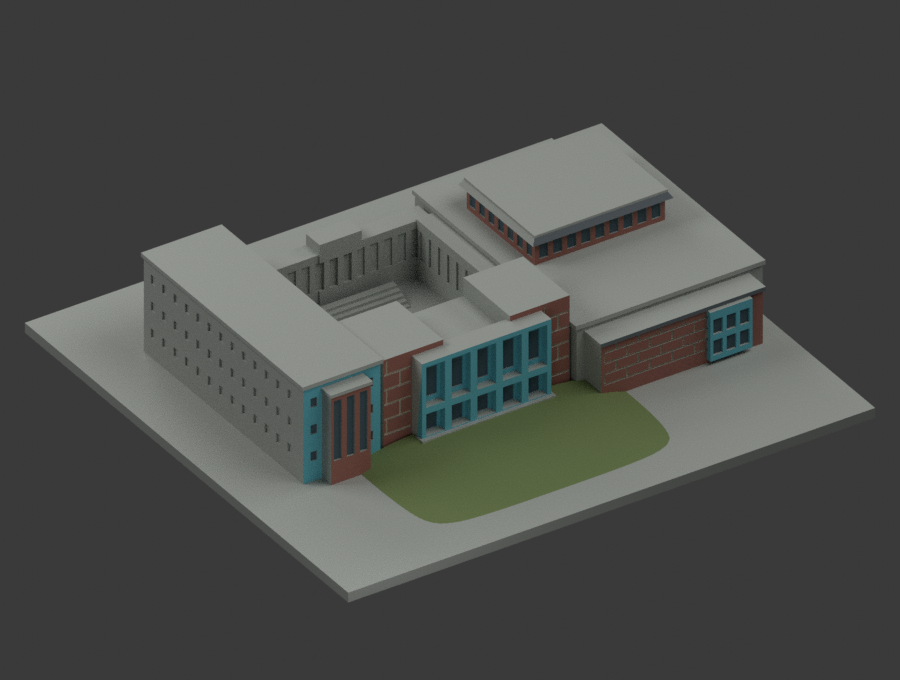

# 國立臺灣史前文化博物館康樂本館｜右展館屋頂高起量體側面



[下載彩色 3MF](monitor-flank.3mf) · [Blender 場景](monitor-flank.blend) · [原模型與代表圖](../README.md) · [逐面核對](verification.json) · [檔案校驗碼](SHA256SUMS)

只補原模型右側展館屋頂高起量體朝山之廣場的側面（模型 −X）。44 個既有牆面三角面沿用正面灰紅褐（#98695E）；七個既有凹窗的 14 個凹底三角面沿用灰藍（#4B6069）。窗是原模型的實心簡化，沒有新增窗格、透明玻璃、可通行的開口或貼圖。原凹窗的四周返面、屋簷、屋面、對側、後牆與其他建築量體原樣保留。

[陳哲生建築師事務所改造案](https://architectures.jidipi.com/j00110233/en/reinterpretation-of-national-museum-of-prehistory) 的[竣工空拍](https://upload.jidipi.com/posts/j00110233/no01_yu_9977small-Iw4.jpg) 同時可見高起量體前面及朝中庭側面的紅褐直帶與灰藍窗列，並以藍色圓筒、山之廣場、右側屋面與高起量體的相對位置對位。顏色是原模型沿用的材色近似，不是校色。七個凹窗是原模型離散化；不宣稱實景逐窗數量或當前外觀均已核實。參考照片未隨包散布。

原七種材色、其餘 6,128 個原有三角面、全體幾何、舊 STL、代表圖及冊錄套件數均不變。這不是新增建物、全館復色或測繪。未試印或作切片驗證。

重建（Blender 4.3.2；上層為兩個原始輸入，請另用獨立輸出目錄）：

```sh
blender -b ../scene.blend -t 4 --python-exit-code 1 \
  -P build_monitor_flank.py -- ../appearance.3mf ./build-output
```

程式輸出模型、逐面核對與兩張暫用 PNG。公開預覽由 `_render_qa/candidate.png` 以 Pillow `lossless=True, method=6, exact=True` 轉成無失真 WebP；不發布暫用檔。
