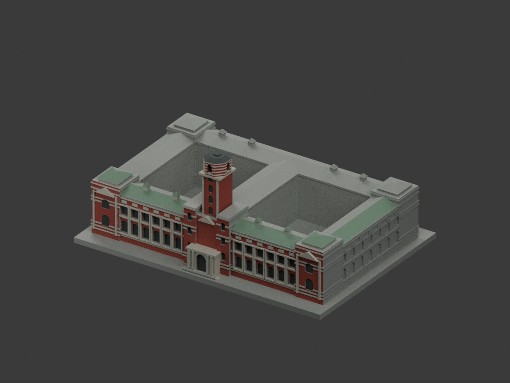
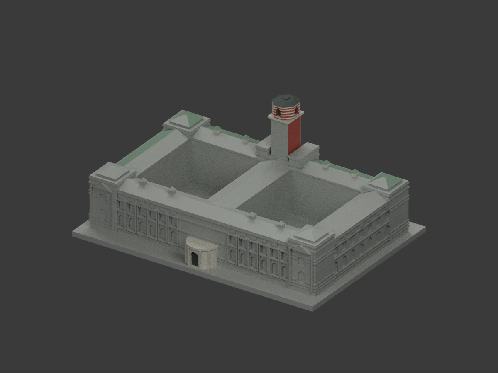
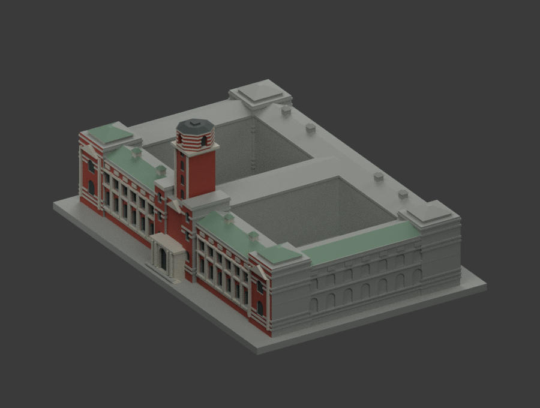

# 臺灣地標｜總統府外觀模型

## 模型預覽

| 前斜視代表圖 | 後斜視 | 右側屋面補色細部 |
| :---: | :---: | :---: |
| <br>前斜視 | <br>後斜視 | <br>補色細部 |

[彩色 3MF](appearance.3mf) · [可編輯 Blender](scene.blend) · [原幾何 STL（不含色）](model.stl) · [逐面驗證](verification.json) · [渲染來源與視角](render-proof.json) · [校驗版本](CHECKSUM-SCOPE.md)

## 最新補色及界線

由模型正面看，只補右側兩角樓之間、向外的低坡屋面（模型 +X，並非地理方位）。17 個原中性的完整三角面沿用既有屋面灰綠（#829C87）。朝庭院的另一坡、其他屋面、角樓、高塔、立面及底座均保留原樣。不新增構件、貼圖或紋理。

[2007 年外觀高角度實景照](https://commons.wikimedia.org/wiki/File:TaipeiROCPresidentialOfficeBuilding.jpg) 可依主塔、正面長翼及近側兩端角樓對位，直接顯示這段側翼外向低坡是連續的低飽和綠色。[總統府公開屋面近照](https://www.president.gov.tw/images/aboutus/4-2-3-07.jpg) 支持低坡屋面的材料色族，不用來逐段量色或推定角樓與高塔。沿用色值是視覺近似，兩張照片不證明當前外觀；參考照片未隨包公開。

全體 19,686 原三角、原尺寸、既有六種材色定義與其餘指派不變。已證前牆磚紅、原凸框淺灰、前低坡灰綠、高塔帽暗灰和後中央半圓廊局部保留。未證內院與側背大面照舊中性；不將低坡綠色外推至塔帽。沒有新增屋面、裝飾、文字、紋理或室內細節。未做測繪、切片與試印。

[總統府公開外觀來源](https://www.president.gov.tw/Page/91) 與[基準來源名冊](https://github.com/hplin50643/taiwan-buildings-3d/blob/9ba295a80690fd59d7c498e1858bdd7f16c05b9c/%E8%87%BA%E7%81%A3%E5%9C%B0%E6%A8%99/presidential-office/COLOR-SOURCE-REGISTER.json)可查原照片用途；原照不附、不貼到模型。僅外部建築近似，非官方模型或現況認證。

## 固定基準與重現

現行 STL、3MF 與 Blender 可各自使用。若要重建這次補色，將[歷史基準 Blender](https://github.com/hplin50643/taiwan-buildings-3d/blob/9ba295a80690fd59d7c498e1858bdd7f16c05b9c/%E8%87%BA%E7%81%A3%E5%9C%B0%E6%A8%99/presidential-office/scene.blend)和[歷史基準 3MF](https://github.com/hplin50643/taiwan-buildings-3d/blob/9ba295a80690fd59d7c498e1858bdd7f16c05b9c/%E8%87%BA%E7%81%A3%E5%9C%B0%E6%A8%99/presidential-office/appearance.3mf)下載至另一個資料夾；腳本會核對兩個 SHA-256。Blender 4.3.2：

```sh
blender -b --disable-autoexec /path/to/baseline/scene.blend -t 4 --python-exit-code 1 -P build_right_roof_slope.py -- /path/to/baseline/appearance.3mf /tmp/presidential-office-current
```

STL、[原幾何驗證](validation.json)與生成器未改。使用[當前校驗表](SHA256SUMS)；[前次外觀說明](https://github.com/hplin50643/taiwan-buildings-3d/blob/9ba295a80690fd59d7c498e1858bdd7f16c05b9c/%E8%87%BA%E7%81%A3%E5%9C%B0%E6%A8%99/presidential-office/README.md)及[原補色範圍和發布證據](https://github.com/hplin50643/taiwan-buildings-3d/blob/9ba295a80690fd59d7c498e1858bdd7f16c05b9c/%E8%87%BA%E7%81%A3%E5%9C%B0%E6%A8%99/presidential-office/appearance-right-roof-slope/README.md)只供歷史比較。
