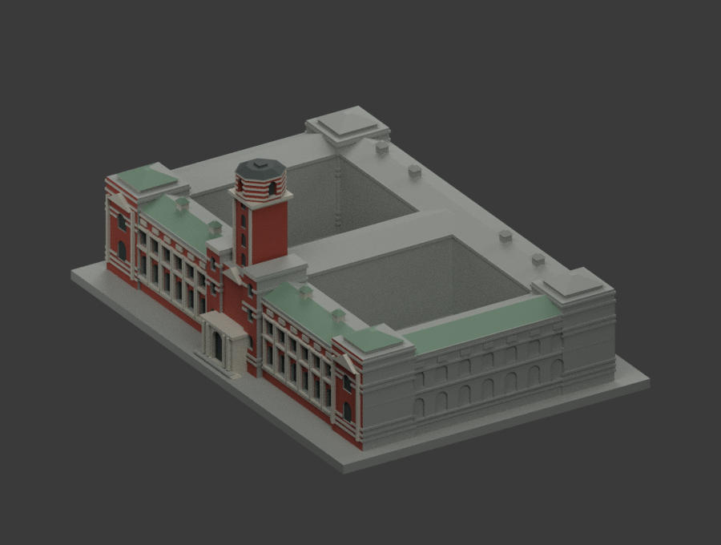

# 總統府｜右側長翼外向低坡屋面補色



[下載彩色 3MF](right-roof-slope.3mf) · [Blender 場景](right-roof-slope.blend) · [原模型與代表圖](../README.md) · [逐面核對](verification.json) · [檔案校驗碼](SHA256SUMS)

由模型正面看，只補右側兩角樓之間、向外的低坡屋面（模型 +X，並非地理方位）。17 個原中性的完整三角面沿用既有屋面灰綠（#829C87）。朝庭院的另一坡、其他屋面、角樓、高塔、立面及底座均保留原樣。不新增構件、貼圖或紋理。

[2007 年外觀高角度實景照](https://commons.wikimedia.org/wiki/File:TaipeiROCPresidentialOfficeBuilding.jpg) 可依主塔、正面長翼及近側兩端角樓對位，直接顯示這段側翼外向低坡是連續的低飽和綠色。[總統府公開屋面近照](https://www.president.gov.tw/images/aboutus/4-2-3-07.jpg) 支持低坡屋面的材料色族，不用來逐段量色或推定角樓與高塔。沿用色值是視覺近似，兩張照片不證明當前外觀；參考照片未隨包公開。

其餘 19,669 個原有面及原六種材色、全體幾何、原 STL、冊錄套件數與原代表圖均不變。這不是新增建物、全館復色、測繪或現況認證；未實體試印或作切片驗證。

重建（Blender 4.3.2；上層為兩個原始輸入，請另用獨立輸出目錄）：

```sh
blender -b ../scene.blend -t 4 --python-exit-code 1 -P build_right_roof_slope.py -- ../appearance.3mf ./build-output
```

程式輸出模型、逐面核對與兩張暫用 PNG。公開預覽以 Pillow `lossless=True, method=6, exact=True` 從候選渲染轉成無失真 WebP；不發布暫用檔。
