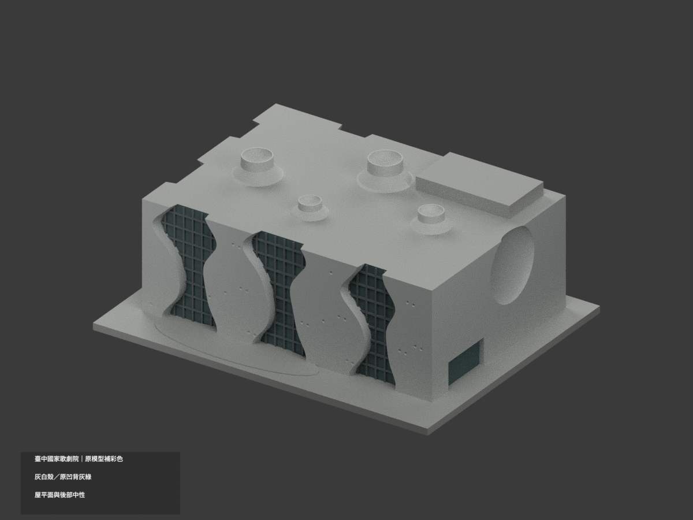
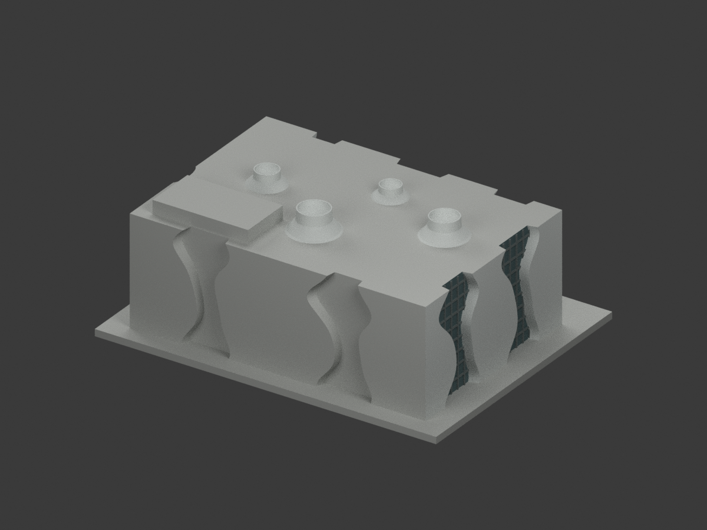
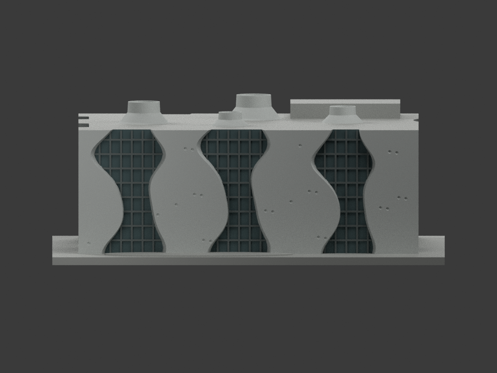
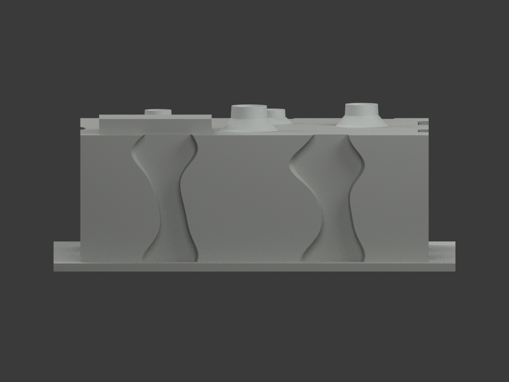
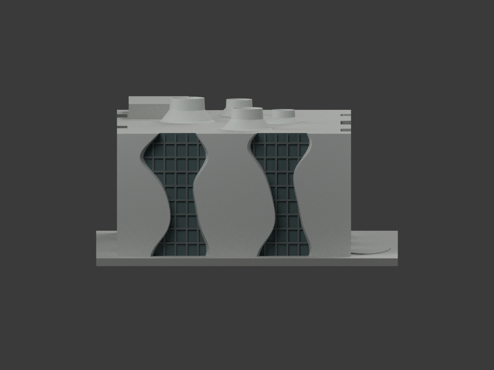
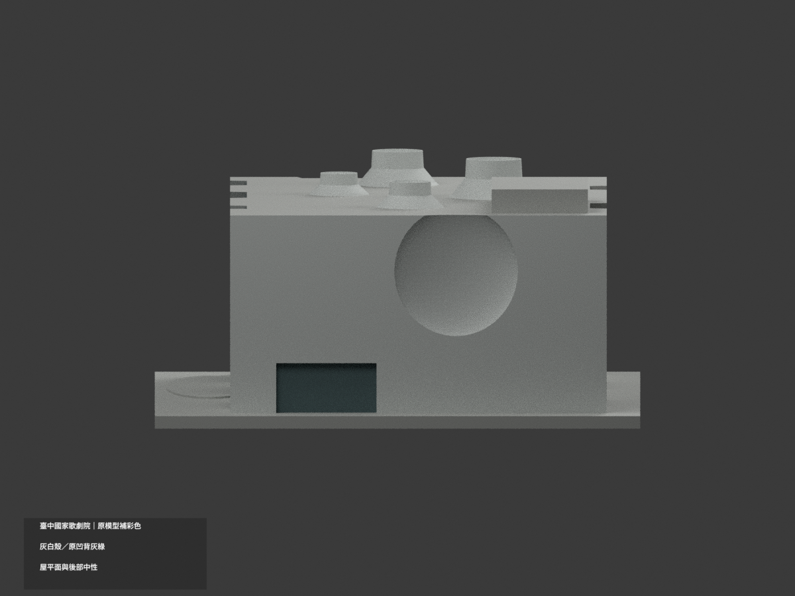
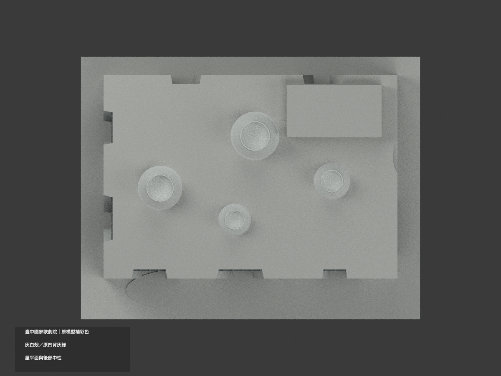
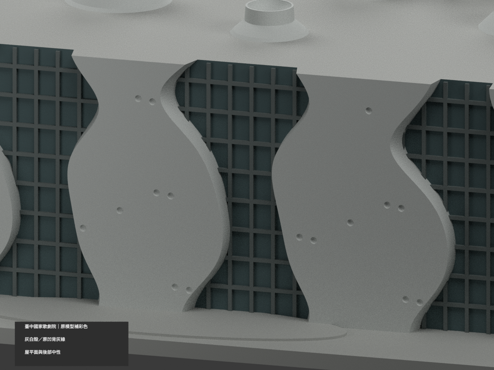
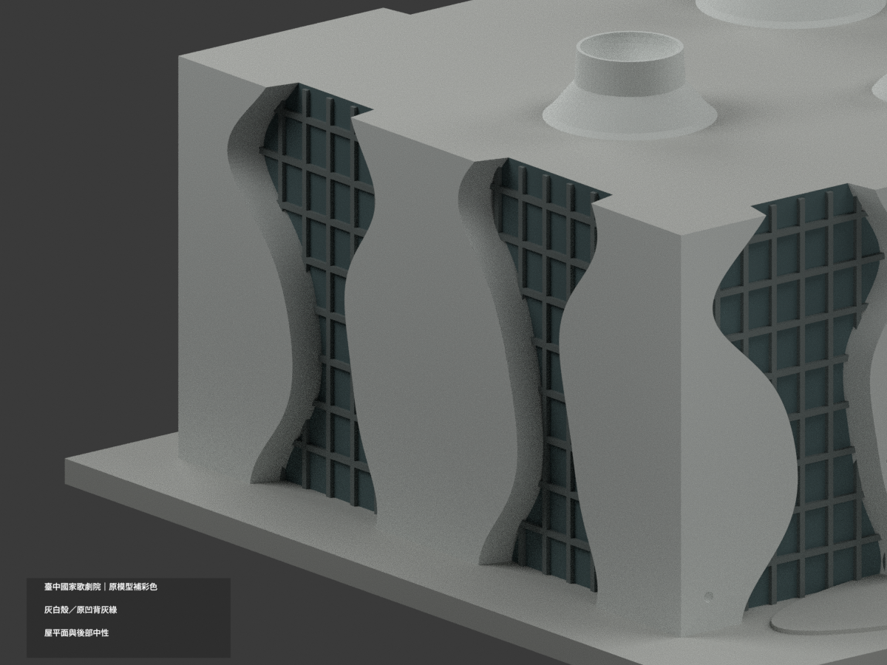
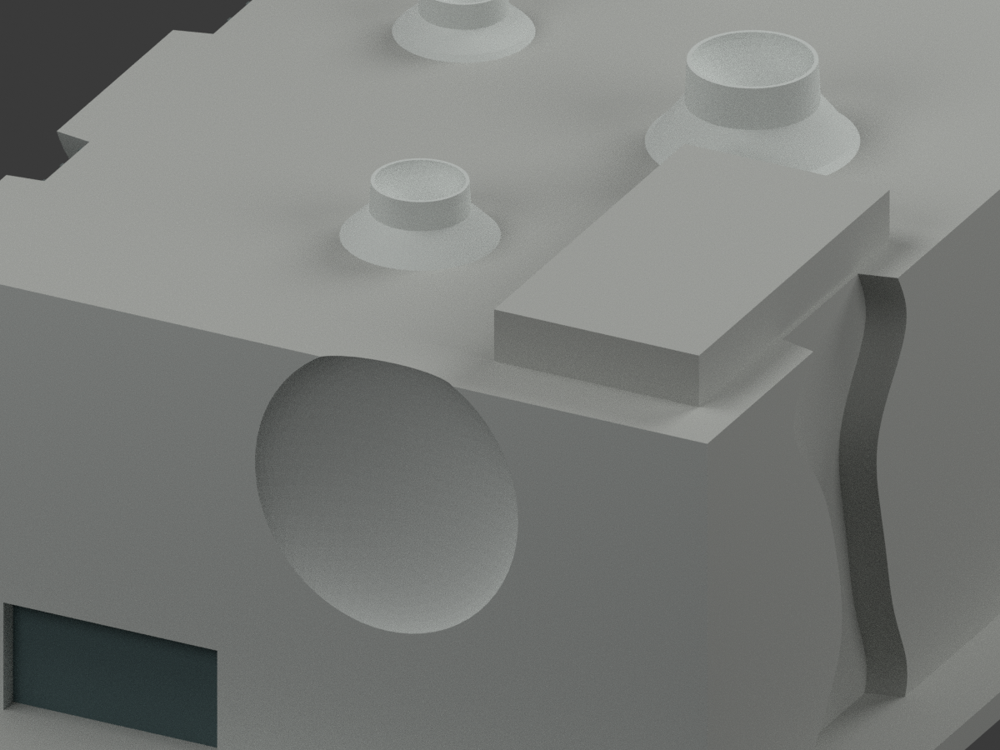

# 臺灣地標｜臺中國家歌劇院：原幾何補彩色

## 彩色模型預覽

**同項目材色更新（count_delta = 0），有證前／左／右外殼灰白、原凹背灰綠、既有梃灰。屋頂沒有草地／步道面界，整個水平屋面中性，後牆與舞台箱中性。**

| 正面斜視 | 背面斜視 | 正面 |
|---|---|---|
|  |  |  |
|  |  |  |
|  |  |  |
|  |  |  |

## 材質範圍與限制

原 26702 三角面、全部頂點、原比例與單體幾何不變。這仍是原照片分析曲線量體概化，不因色材而成為實測曲殼或精確幕牆。

- 前 y−40、左 x−65、右 x65 有證外皮及原曲面返回採灰白族；這些數字僅是原模型mm定位，不是實際尺寸標高。
- 原前凹背 y−36、左凹背 x−61 與右低入口封底採克制灰綠不透明外觀；真實玻璃反光／室內不可用此封底重建。既有梃完整原面灰色，不新增額外格子或把整片牆塗玻璃色。
- 右側原碗形凹殼灰白，原孔點亦同殼色，陰影由渲染形成，不用黑點偽造材質圖案。黃室內燈光與環境天空反射不取作牆／玻璃材料色。
- 原四個屋頂漏斗構件採完整灰白族，官照支持材質家族，但原位置、輪廓與尺寸仍近似。整片水平屋面沒有草地／步道拓撲，**不塗綠草、不畫新路徑**。後牆、後舞台箱、展示底座及未對位面中性。
- 以完整頂點、面中心與法線對原 primitive 曲面辨識，不按面重心切出假斜色。0.018mm辨識容差只協調原 simplify(.006)，不是實景精度。臨時原構件只供查面，不加入輸出、無新三角或切面。
- 官照拍攝日期未確證；名義色值未校準。未證面中性不代表現場灰漆，有色與中性邊界不必然是現場換材線。

## 格式與重建

原 `model.stl`、`build_model.py` bytes 不變，原包沒有OBJ。原單材 `scene.blend` 私人稽核副本保留；公開同名scene為本次實際shader。STL不含彩色；`appearance.3mf` 四種逐面材質、`color-mesh.npz` 保原三角座標。四種外觀標籤不是已驗證四耗材切片工程；未實際列印、未執行切片器驗證。

```sh
python -m pip install -r color-requirements.txt
python build_model.py
python colorize_model.py
python export_appearance.py
python validate_color.py
blender -b -t 3 --python render_color.py
blender -b --python-exit-code 1 --python verify_color_scene.py
```

沿原requirements與Blender4.3.2，表面辨識另需rtree。隔離重建保留不刪。新QA為COLOR-FORMAT-GEOMETRY-QA、SCENE-QA、DELIVERY-QA、SOURCE-VISUAL-QA；七全景與三刻意局部細景。舊validation／rebuild_check／scene_check／previews及原程式保留歷程，不當本次補彩QA或入口。

## 來源與權利

- [交通部觀光署前外觀](https://www.taiwan.net.tw/att/1/big_scenic_spots/pic_A12-00235.jpg)
- [歌劇院官方屋頂花園](https://www.npac-ntt.org/dispUploadBox/PJ-/Ckeditor/20200303150605451.jpg)
- [歌劇院官方側向曲殼](https://www.npac-ntt.org/images/img-build-new-03.jpg)

來源hash與角色見COLOR-SOURCE-REGISTER.json。官網公開不等於CC或商用再授權；原照私人保留、不公開、不貼圖、不以儲存庫license再授權，不保證商用權利已清。僅建築外觀。

## 原始模型說明與限制

原文保留如下，新補色與重建入口段落優先，舊單色圖不是新成果。

# 臺中國家歌劇院｜150 mm 外觀列印模型

本模型以官方外觀照片重新建立幾何，是桌上型外觀詮釋，非實測、工程模型或館方授權複製品。單一封閉連通實體，沒有室內空腔；門窗以外露淺凹表現。所有尺寸以毫米為單位。

歷史單色 STL 預覽（下載）：[正面](previews/front.png) · [背面](previews/rear.png)

## 辨識重點及範圍
- 方整外邊界中保留連續曲牆、瓶口狀玻璃立面、上寬下收再外張的不等寬曲線。
- 主要玻璃凹槽深約 4 mm，有實際建入 STL 的窗格浮雕，並非僅貼圖；少量呼吸孔以淺凹點表現。
- 屋頂四組縮頸曲面、空中花園起伏及後方機能量體作概略表示。
- 含 150 × 116 × 3 mm 平底底座。整體約 150 × 116 × 59.5 mm；以 validation.json 為準。

## 照片來源與不確定性
檢視日期：2026-10-11。參考照片只用於觀察，未收入交付檔案。
1. 場館官方「建築設計」：https://www.npac-ntt.org/about/architecture/design
2. 官方側面曲牆實景：https://www.npac-ntt.org/images/img-build-new-03.jpg
3. 觀光署主外觀照片：https://www.taiwan.net.tw/att/1/big_scenic_spots/pic_A12-00235.jpg
4. 場館官方空中花園：https://www.npac-ntt.org/about/architecture/venue
5. 已檢視的屋頂照片：https://www.npac-ntt.org/dispUploadBox/PJ-/Ckeditor/20200303150605451.jpg

正面及左側以可見照片估形；其餘後、右側未有完整正投影，屬低可信度補形。屋頂曲面位置、大小、窗格數量及呼吸孔位置均為估計。未取得測繪平面圖或現場尺寸，不宣稱固定比例。內部 58 面曲牆與 29 洞窟並未重建，僅表達外牆輪廓。沒有將空間作錯誤的貫通孔洞。

## 可列印性與限制
- 建議平底朝下，PLA、0.4 mm 噴嘴、0.16–0.20 mm 層高，3 道壁；填充由切片器決定。
- 窗格寬約 0.72 mm，僅浮雕在實心背板上；深凹部上緣、屋頂口緣可能需局部支撐。呼吸孔約 1.36 mm，縮小後可能消失。
- 小於真實尺度的細節做厚化與省略。沒有細欄杆、樹木、招牌字或獨立透明片。
- 封閉網格不代表任何機器都能無支撐列印；未實際切片、試印或測試支撐移除。請先看切片逐層預覽。禁止把數位驗證視為實物列印保證。

## 檔案及重建
- model.stl：毫米制單體最終列印網格。
- scene.blend：以最終 STL 匯入的可編輯網格，附相機、燈光與非列印展示地板；另嵌入 build_model.py。
- build_model.py：參數化重建來源。安裝 requirements.txt 後執行 python build_model.py。
- render_preview.py：執行 blender -b -t 4 -P render_preview.py，直接讀取 STL 產生正、背面圖及 blend，重跑可額外生成正投影圖。
- validate_model.py：執行 python validate_model.py model.stl --output validation.json。
- validation.json、rebuild_check.json、checksums.sha256：網格與可重建性報告及交付檔案校驗碼。

網格檢查包含座標、零面積、法向一致、每條邊雙面、每點單環鏈結、連通性、正體積及底面。構造使用 Manifold 實體布林；其外表面只有一個連通元件，沒有獨立封閉內殼。驗證不獨立證明所有幾何自交，也未作列印機公差測試。

重建自檢可執行 python verify_rebuild.py；scene_check.json 另核對 blend 中的列印網格面數、尺寸，以及嵌入來源是否與交付程式一致。
