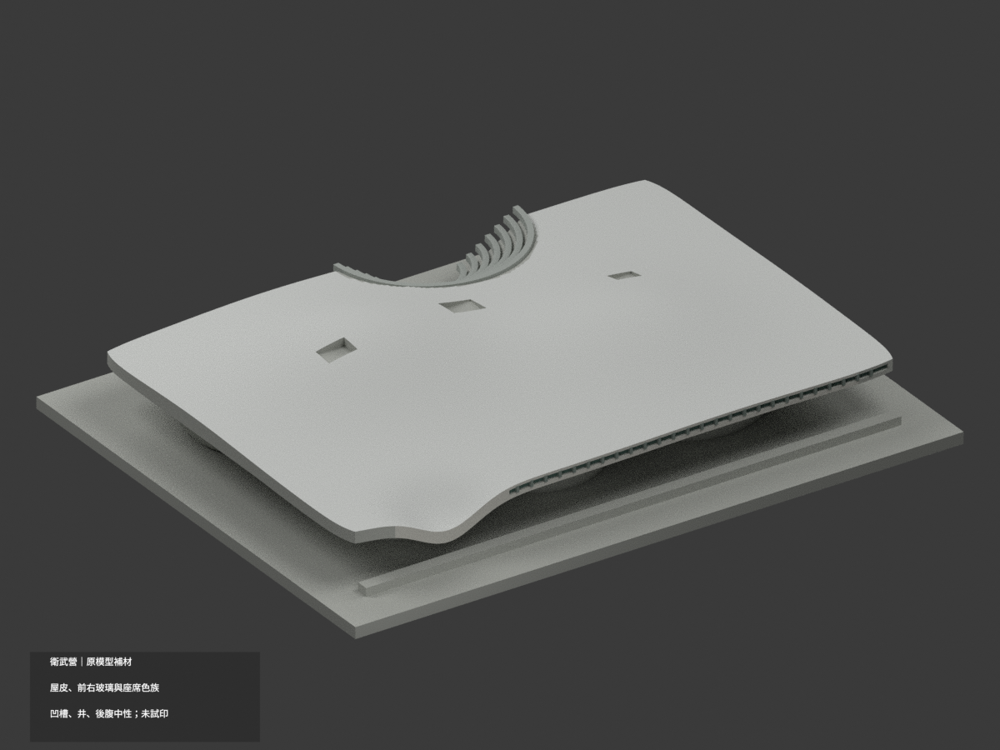
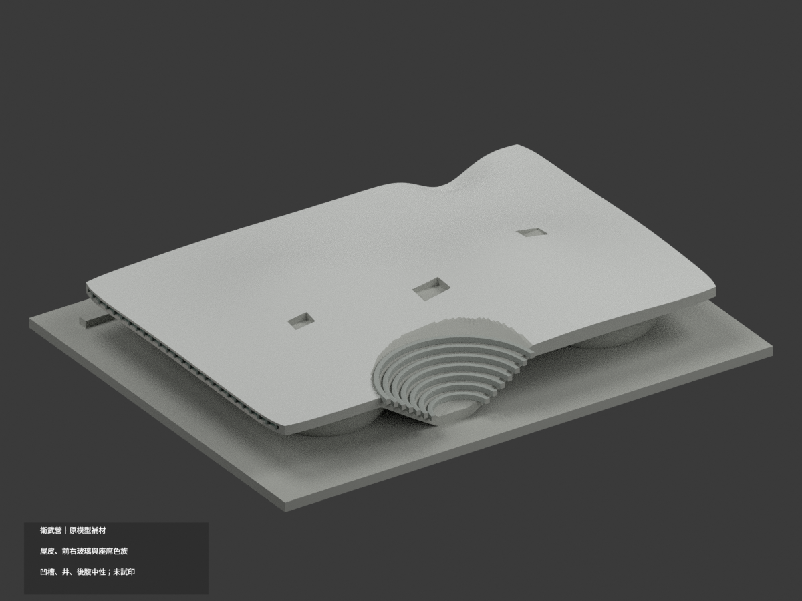
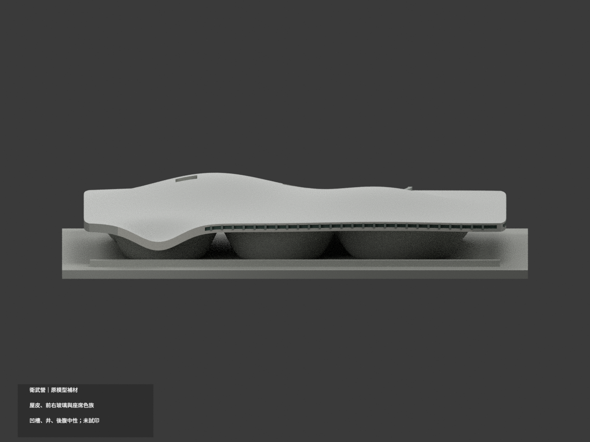
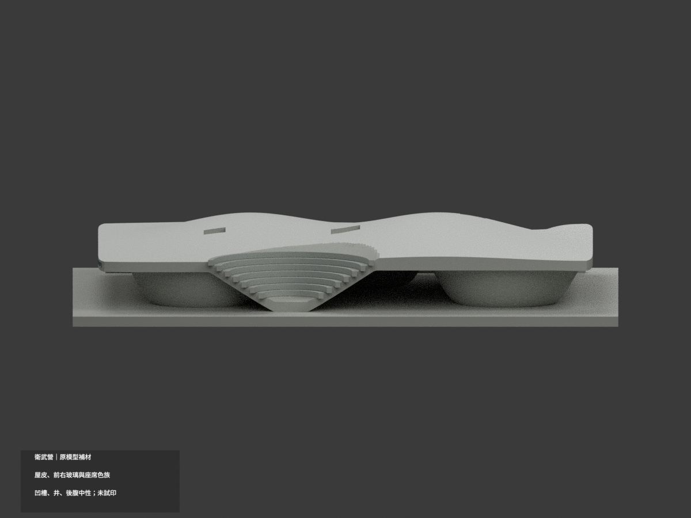
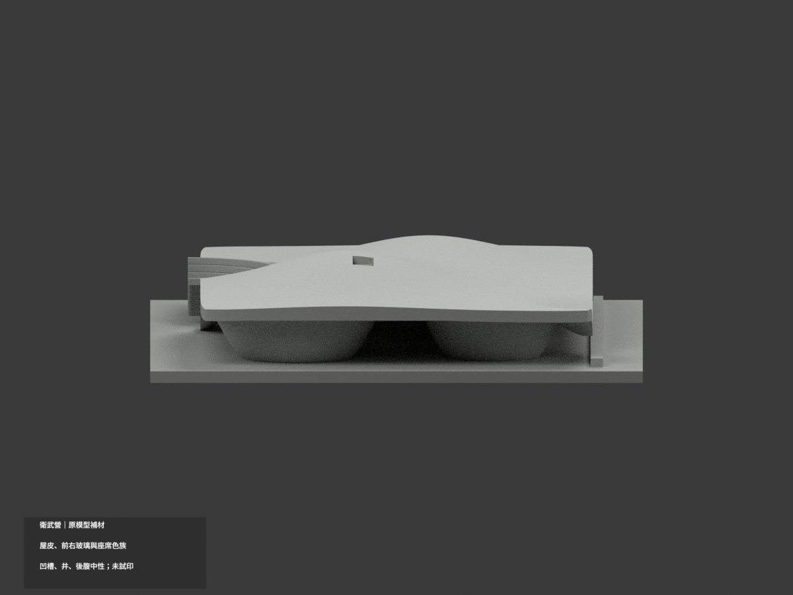
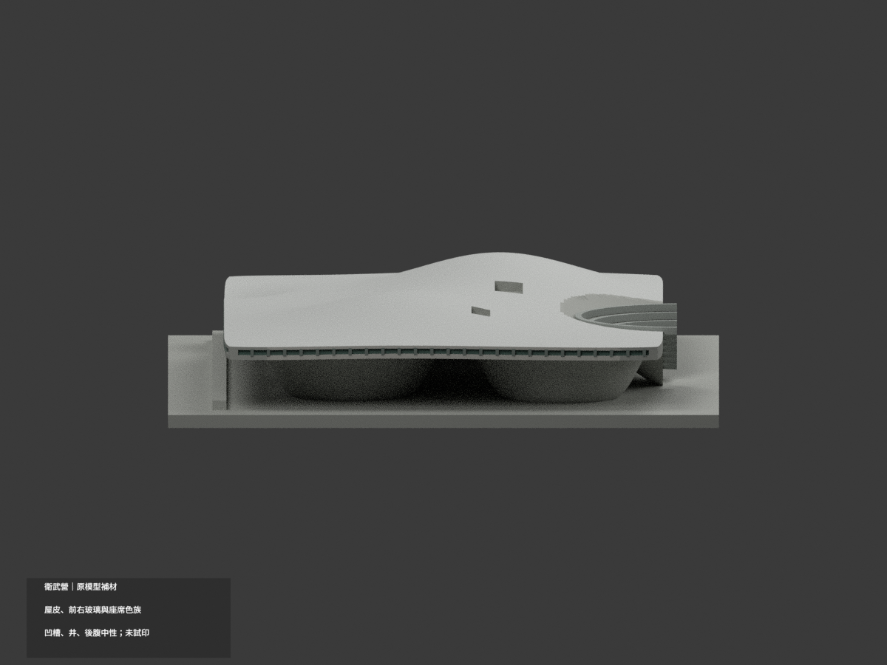
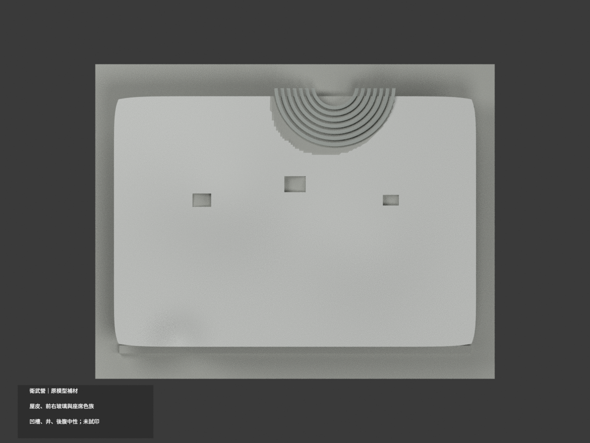
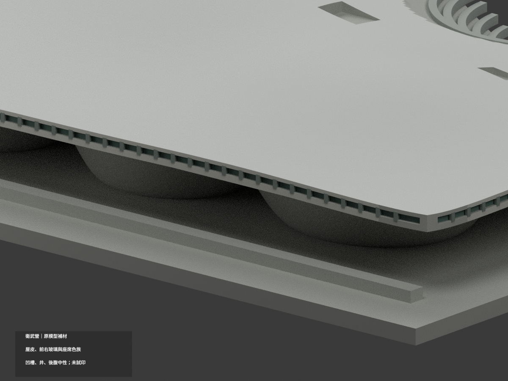
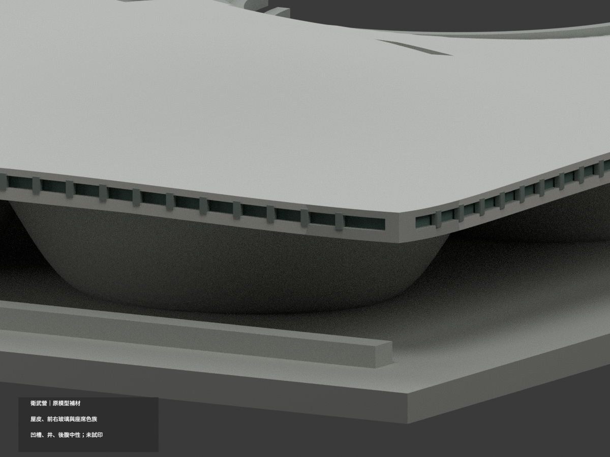
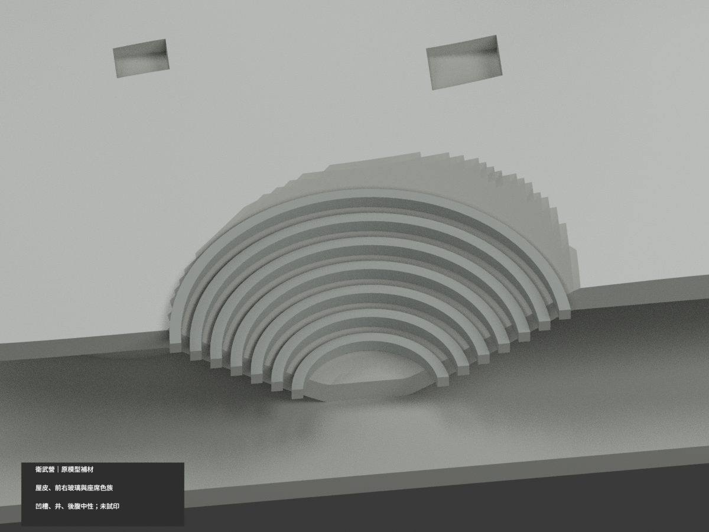

# 衛武營｜既有模型有界材色更新

有據屋皮、前右外緣與玻璃帶、原座席分色；未知劇場凹槽、採光井、後側及大部分底腹維持中性。**不是全館精確色彩/測繪復原**，不新增景觀或建築細部。

| 總覽 | 背側 | 正面 |
|---|---|---|
|  |  |  |
|  |  |  |
|  |  |  |
|  |  |  |

## 材色範圍
- 同 `weiwuying` 項目、count_delta=0；原 38690 三角面及座標不變。原 ASCII `model.stl` 與 `build_model.py` 位元組保留；原包無 OBJ，不虛稱有保留 OBJ。不新增或分割幾何。
- 淺銀白屋皮依原 `surfaces(x,y)` 解析上表面比對，不以所有朝上面一律染屋色；原劇場凹槽及採光井不冒稱同一屋面材。
- 前/右已有淺凹玻璃帶採灰綠，逐面所有頂點對原曲線 inset 背面判斷；唇口與外緣不染成玻璃。原細梃灰色，沒有增造細窗。
- 前/右可辨外緣淺暖灰；底腹整體保守中性，不把照片陰影當黑色塗料。後外緣及不明側面中性。
- 原戶外劇場座席是粗化同心環帶，只有明確原環帶表面採灰。凹槽真實含草坡、路徑、擋牆等未分域，全部未知中性，不整片塗綠。
- 屋皮與座席外緣6片原 Boolean 轉接面材質未唯一，保中性；不是跨 active bowl 的判定，不為補滿色而放寬整體上皮容差。
- 底座只是原展示平台，不宣稱精確鋪面或基地；照片中的人車、設備、草木、屋面接縫與小通風器不新增。

## 來源與權利
依 Mecanoo 設計者之主景與劇場鳥瞰照片。檔名20210506與2019新聞不等於確定拍攝日期，不主張任何年份的精確現況。兩原照已私人備份；未確認開放授權，原圖不公開、不作貼圖，沒有商用權利保證。HEX 是照片未校色的展示近似。

## 格式、比例與列印
[原 STL](model.stl) · [彩色 3MF](appearance.3mf) · [Blender](scene.blend) · [材質表](appearance-materials.json) · [原模型說明](ORIGINAL-MONOCHROME-README.md)

3MF basic materials 與 Blender 實際面材質；STL 本身不含色。六材質標籤不是已驗證六色/四色耗材切片專案。毫米單位、原底座150 mm長，非實測比例。未實際列印，未產生切片工具路徑；大挑簷、凹槽、細梃的支撐與切片風險需另檢查。

## 重建與 QA
安裝原 requirements 後依序執行 `build_model.py`、`colorize_model.py`、`export_appearance.py`、`validate_color.py`；Blender 執行 `render_color.py` 與 `verify_color_scene.py`。
`COLOR-FORMAT-GEOMETRY-QA.json` 檢查原 STL bytes、逐三角座標、閉合正體積、3MF頂點/面/材質索引與完整隔離重建；`SCENE-QA.json` 重開真正面材，`DELIVERY-QA.json` 綁十圖。程式 QA 不替代人工照片與材域核對。

原 `previews/`、`render_preview.py`、舊 validation 等保留，是原單色歷程而非新材色 QA；新十圖與 appearance 產物為本次更新，未刪原件。
