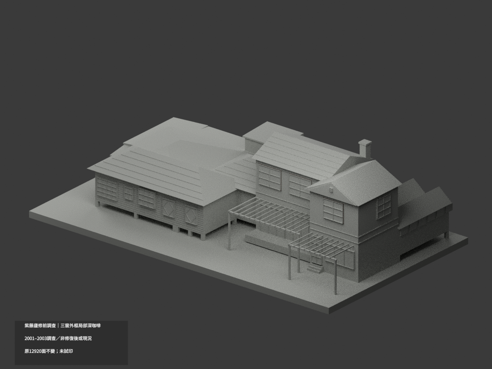
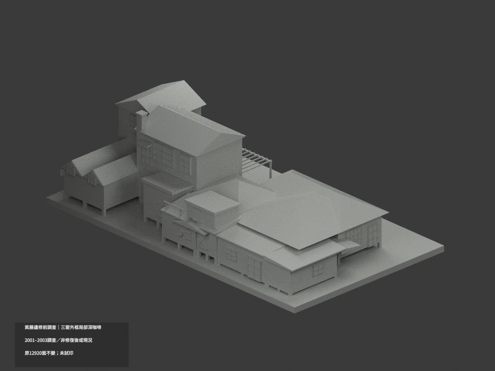
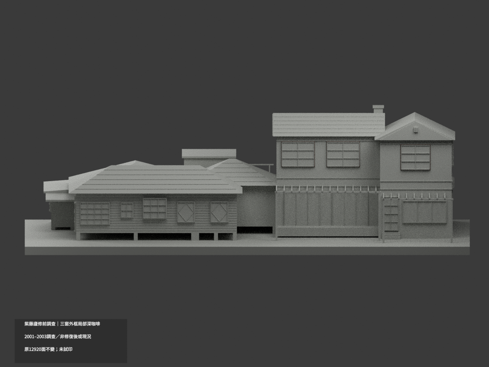
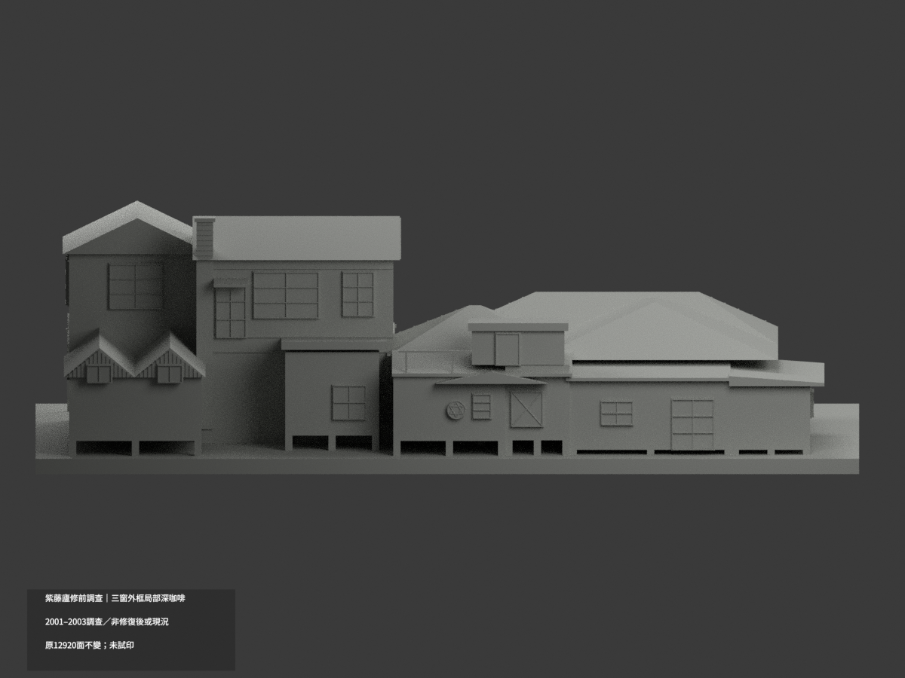
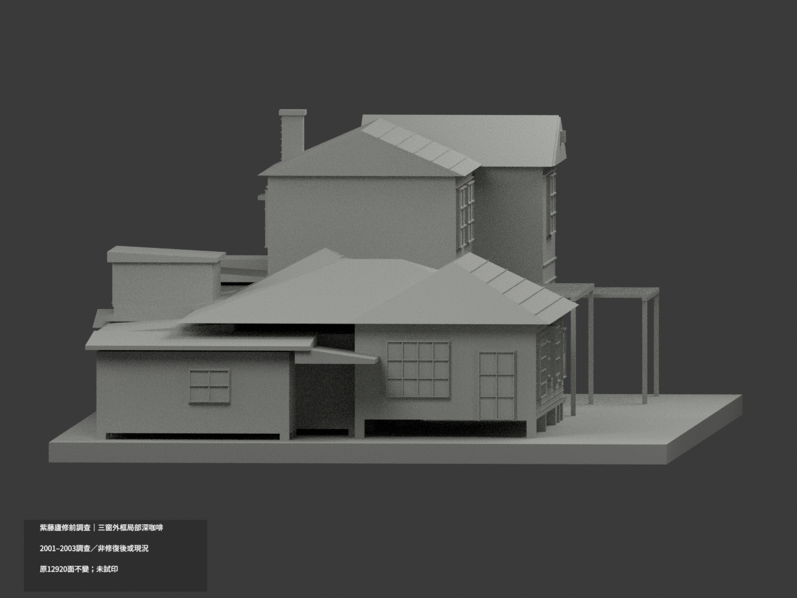
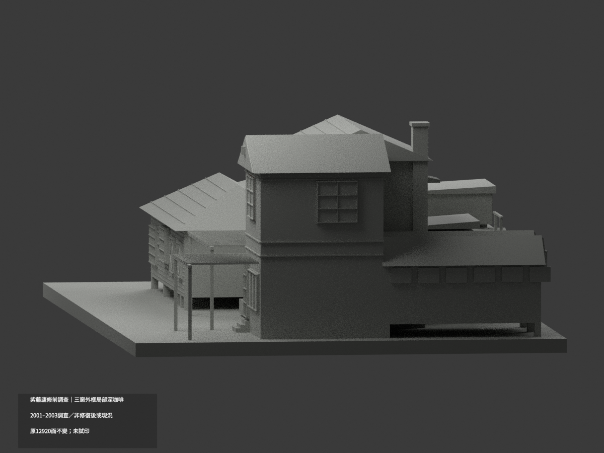
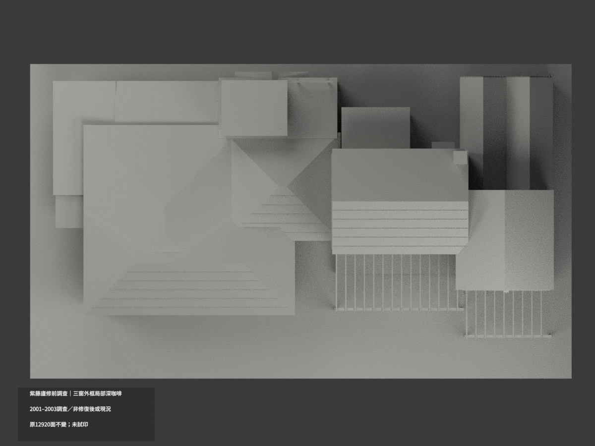
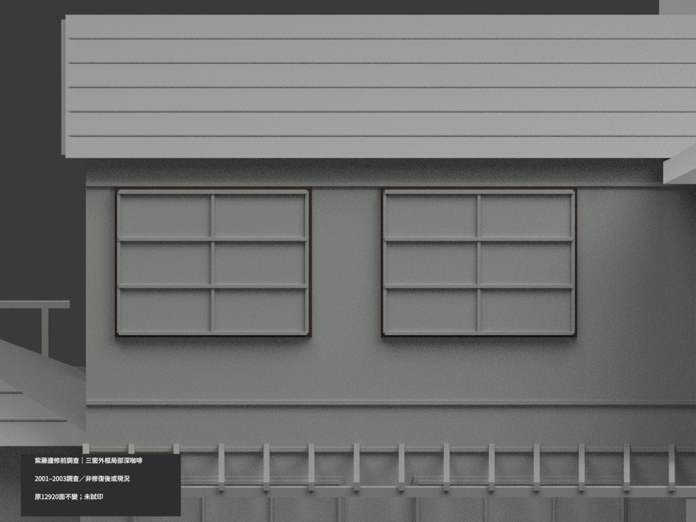
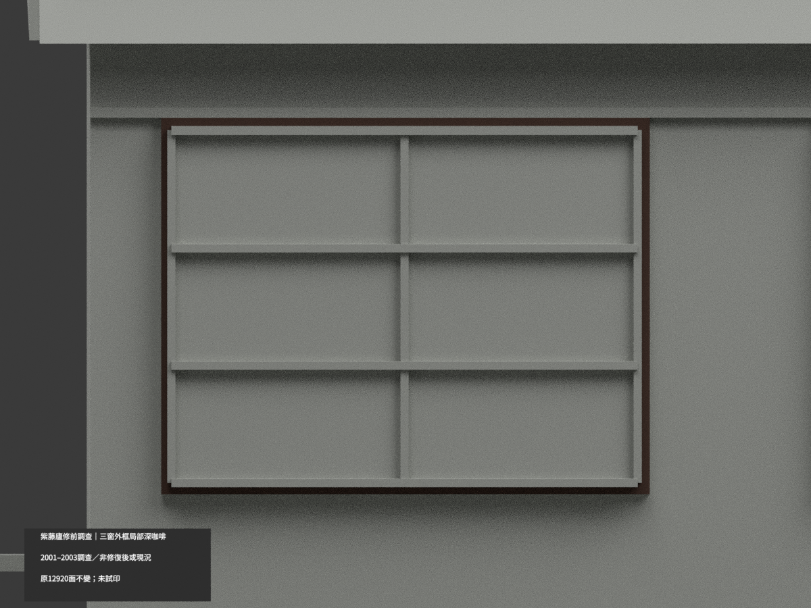
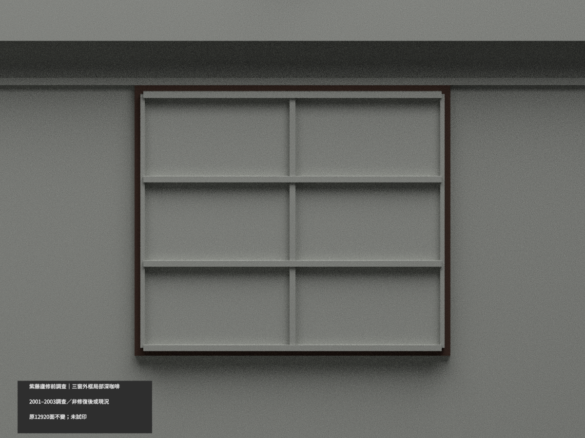

# 紫藤廬修復前調查外殼｜三窗外周框局部深咖啡

**僅2001/06、2003/03修復前調查色族，非2008年修復後或現況實色。** 三上層窗外周框正面48原面深咖啡，其餘12872面中性；其餘未知域尚未完成分色，partial_color_incomplete=true、fully_colored_exterior=false。原十材版本非單色，原白漆木板文字證據仍有效，本局部variant中性不否定它。

| 總覽 | 背側 | 正面 |
|---|---|---|
||||
||||
||||
||||

## 材色範圍
同 wisteria-house-survey-2001-2003 原群，same-item/count_delta=0，12920原三角與36原件不改，無原OBJ不新增。西側木造低翼、東側二層增築、服務/花廳低屋同一外殼研究，不含庭園、圍牆、室內家具。只原三外框前面各16完整共面連通域，兩南窗y33.9、高端窗y12.9；原round(公尺×100)再×.1與+6mm基準不變。凸窗梃、橫條、洞壁、背板不是此次深咖啡域。
調查圖第268實註「木製窗框上深咖啡色油漆」，非由黑白圖猜色；HEX僅色族非校色樣板。下層白框、紅浪板、黃綠低附屋未唯一對域，不擴染。其餘中性不表示原白漆木牆證據失效，也不將原十材全說無據。

## 原版本與限制
完整原36件及十材scene/3MF/六圖/全部原QA、palette與材料證據保於 original-classification-version/；原README/scene另有 ORIGINAL-SOURCE-GAP- 公開alias，原render_model.py bytes保留。舊QA aliases僅綁歷史子包相對路徑，不綁根目錄新增色圖。新appearance.3mf與scene.blend是本次局部版本，非替換或追認原歷史設計。
封面2002、圖2001/06與2003/03不可偽作同日拍攝；非1920年代原貌、非2008修復後、非2024後或2026現況。原掃描配準/直角簡化、共用展示高程、基腳台階、屋谷與稀疏瓦列近似均保；不透明封背玻璃、隱藏設備省略保留。原12920面水密/單連通/15項數位QA不由新色審重新追認；薄棚架、細框與支撐仍有製造風險，未試印/未全域壁厚認證。

## 來源及格式
[臺北市官方調查報告](https://data.taipei/api/frontstage/tpeod/dataset/resource.download?rid=b533b43a-7d44-466b-a90c-8c22300f5e98)原PDF私人研究，不公開貼圖；未確認可自由商用。原名義1:100，mm，不新增測量或幾何。
[原STL](model.stl) · [局部逐面3MF](appearance.3mf) · [局部Blender](scene.blend)
物件 Wisteria House Survey 2001 2003 partial color。兩材不是四色耗材切片/試印認證。build_model.py→colorize_model.py→export_appearance.py→validate_color.py，render_color.py/verify_color_scene.py；隔離原build/color精確重現僅驗本次交付。

## English scope
Bounded historical SURVEY color,not monochrome discovery:48 complete outer-surround frontfaces deepcoffee;12872neutral.Original10material presentation and white-painted timber evidence preserved,not denied.2001/06 and2003/03 drawings,not one capture date or post2008/current restoration.Original12920triangles/36files/noOBJ unchanged,sameitem/count0. Mullions/rails/reveals not recolored;no global manufacturing reapproval.
