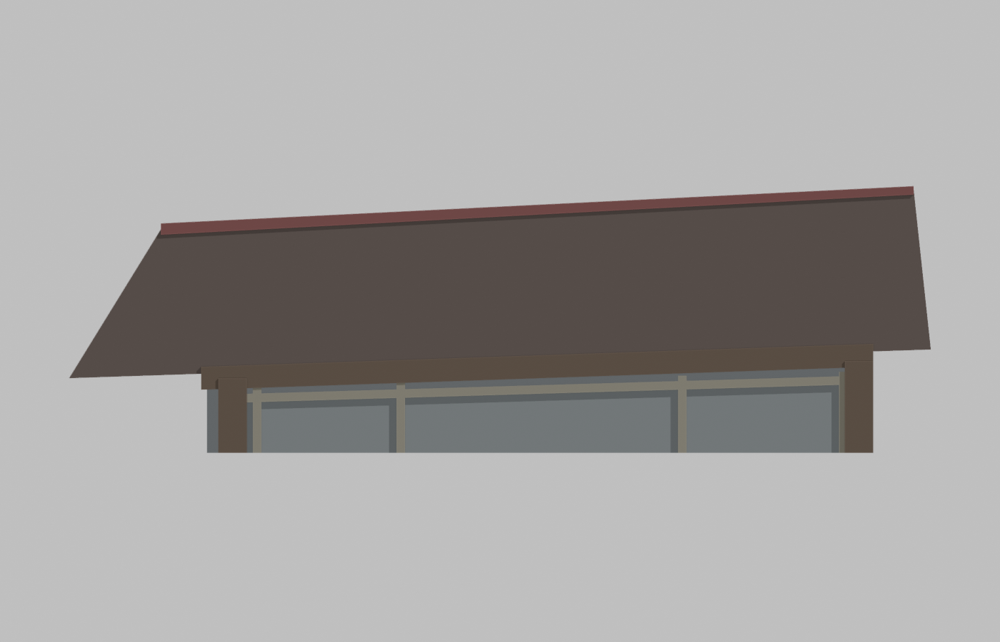
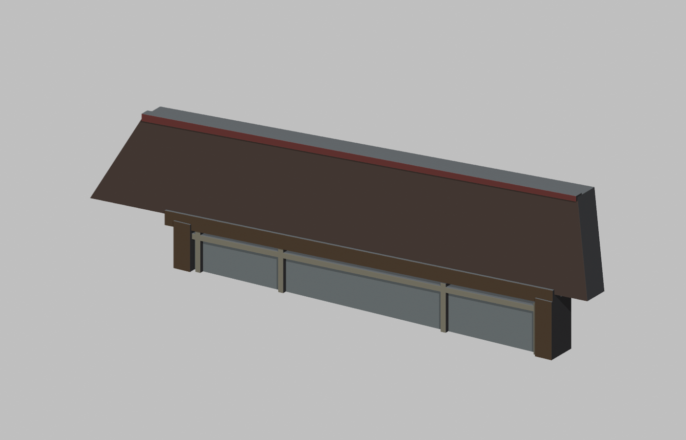
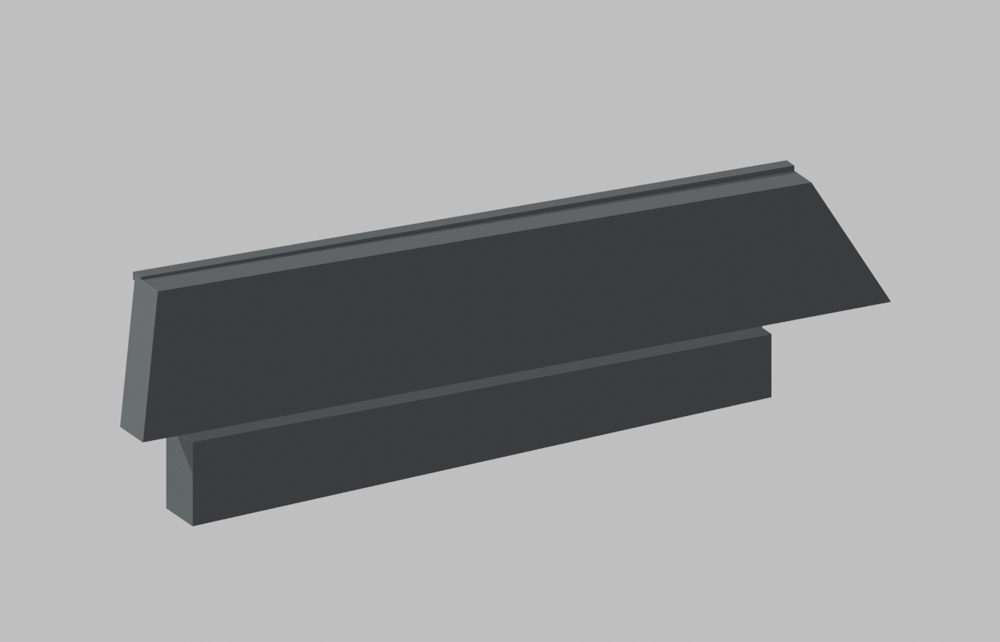

# 華梵大學百丈寮｜舊導覽正面上部有界研究截段

**這是單張歷史照片的投影形狀淺浮雕研究模型，不是完整建築、實測立面或修復後現況。** 僅正面上部範圍經來源獨審；示意色不等於實景材色認證，數位網格檢查不等於試印成功。

| 正面研究截段 | 斜視／人工厚度 | 人工背封與切界 |
| :---: | :---: | :---: |
|  |  |  |

[二進位 STL](model.stl) · [毫米單位 3MF](model.3mf) · [Blender 場景](scene.blend) · [檢查結果](validation.json) · [來源與限制](sources.md)

## 可見範圍與人工代理

只保留舊導覽影像中的前屋坡投影輪廓、脊檐、上梁、兩外柱上段和三個上部玻璃域。這是保留單照片透視的圖形近似，不能從本模型推回真實屋坡角度、深度、開間尺寸或對稱結構。未製作柱腳、階臺、側背牆、後屋坡、室內塑像、家具、樹影、左側告示棚或背景建築。屋面未雕刻未量測的瓦數／波紋。

模型設計尺寸為 **150 × 9.3 × 46.5 mm**。9.3 mm厚度、灰色側背封面及底部水平截界是人工支承和研究邊界，並非實際建築接縫或深度。玻璃為灰色不透明代理；棕屋、紅脊、木色及框色僅區分構件的名義示意，不宣稱精確色票、木種或實景顏色。3MF有這些示意材質，STL不含色彩或單位，匯入時選mm。

## 歷史時相

以華梵舊官方導覽的百丈寮照片為唯一幾何影像。EXIF Original/Digitized記2006-12-07 08:28:19，未獨立認證；2007-08-06修改時間不是拍攝日。2024修復報導不能證明此模型反映修復後或今日外觀。不要與雲山亭或雲山禪茶藝文空間混為一棟。

## 可重現與檢驗

以Blender 4.3.2執行：

`blender -b --python-exit-code 1 -P build_model.py`

此命令在本目錄重建model.stl、model.3mf、scene.blend及三張預覽。沒有原照片貼圖，預覽沒有額外建築幾何。相機不是列印模型。請在工作副本執行，避免覆寫想保留的結果。

獨立標準Python檢驗：

`python validate_model.py model.stl --output validation-rechecked.json`

392三角面、198頂點、單連通；有限座標、無退化面、每邊兩面、繞序一致、頂點環單一與正體積檢查通過。這些檢查未證明所有幾何自交不存在，未完成最小厚度、切片或實體試印。切片前檢查細框、懸伸、人工切面朝向與支撐；不要把試作當成可直接量產或任意縮放的成品。

rebuild-check.json記隔離重建STL雜湊相同。3MF/Blender檔可能帶容器或場景序列化差異，僅比較網格內容，不宣稱重建檔案每一位元組都相同。SHA256SUMS只核列出的交付檔，不包含校驗表自身。

## 公開檔案中繼資料衛生

建模腳本使用相對預覽路徑；保存後依Blender內嵌SDNA定位路徑fixed buffer，清除整個尾端緩衝，只保相對路徑。PNG文字中繼資料已移除，影像像素不變。metadata-hygiene.json與path-buffer-verification.json記處理範圍，semantic-reopen-check.json實際重開比對幾何、材質及相機不變。這不是單靠搜尋字串的驗證。

TRIAL-QA.json記數位建構檢查，不表示目前發布是否批准；發布狀態應依repository交付紀錄判斷。
