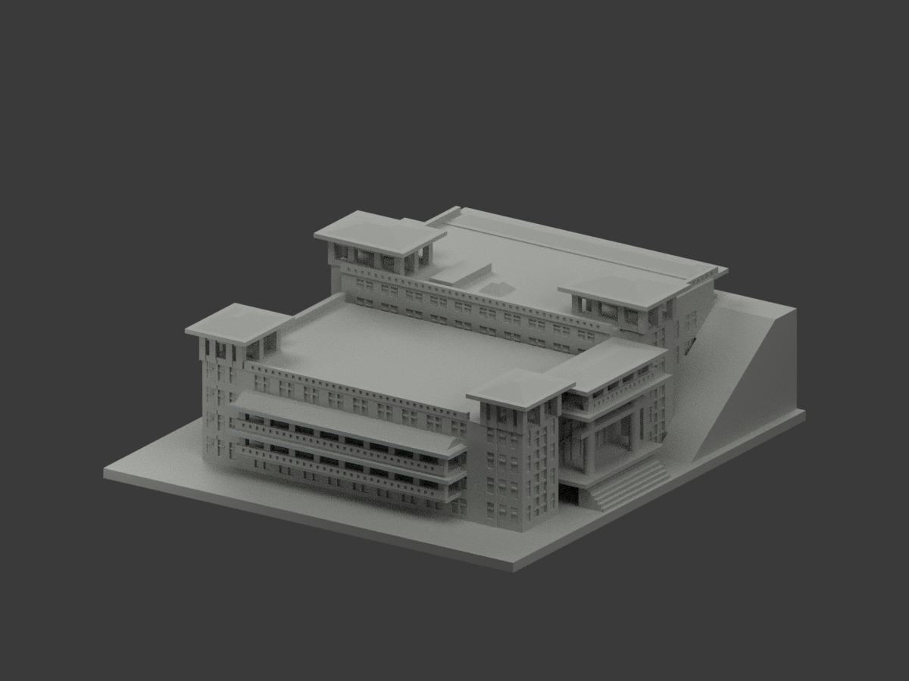
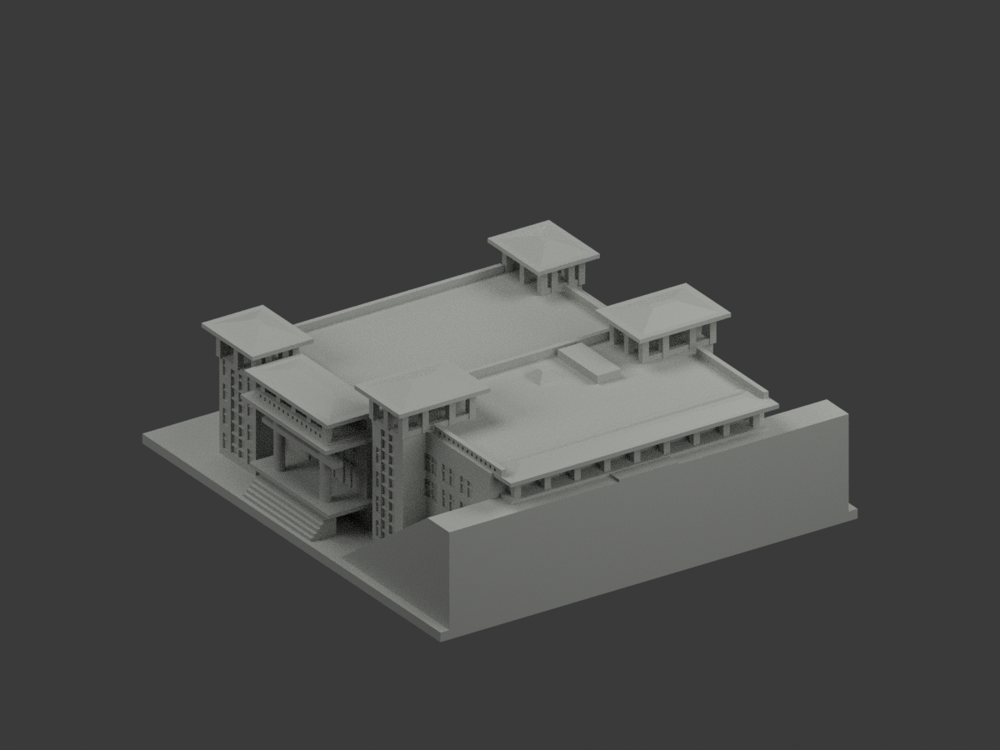
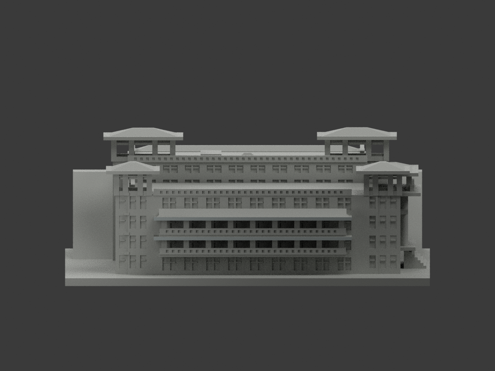
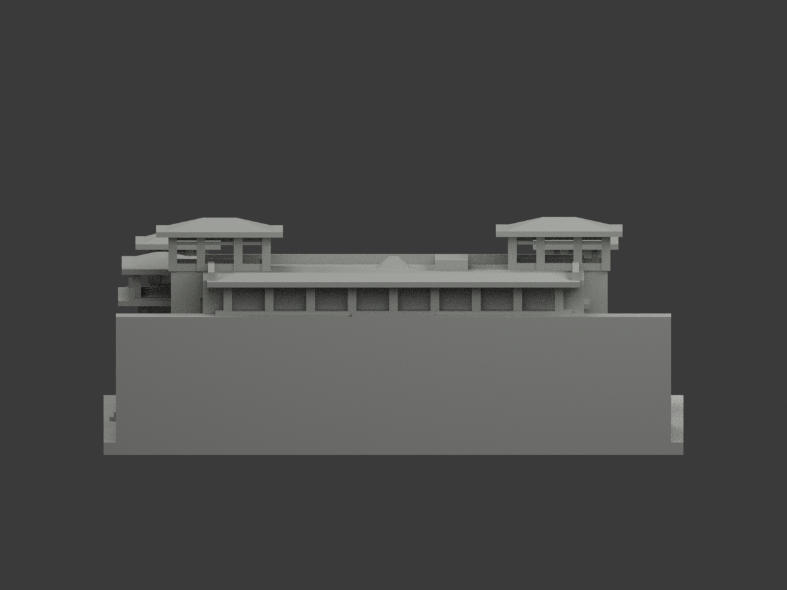
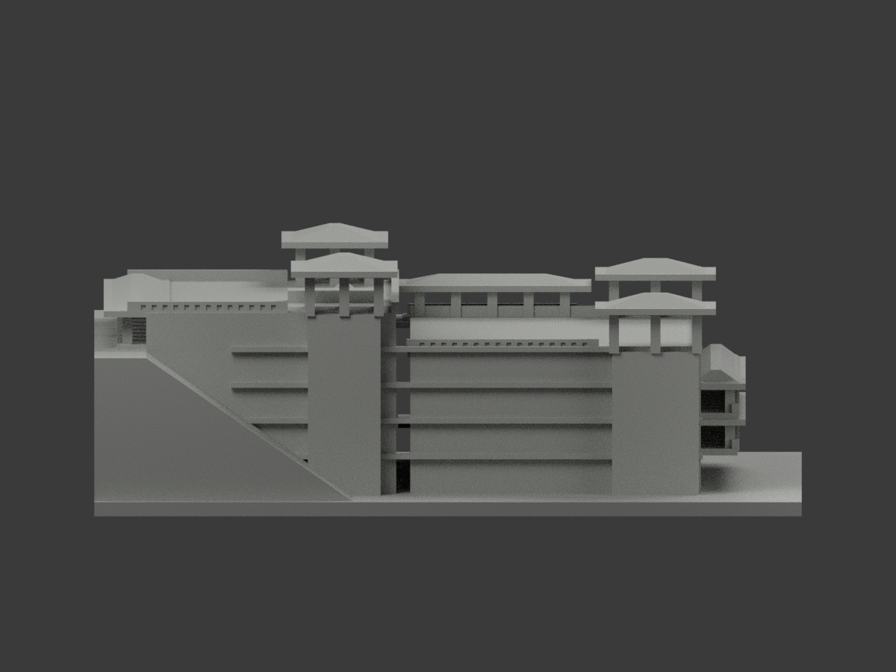
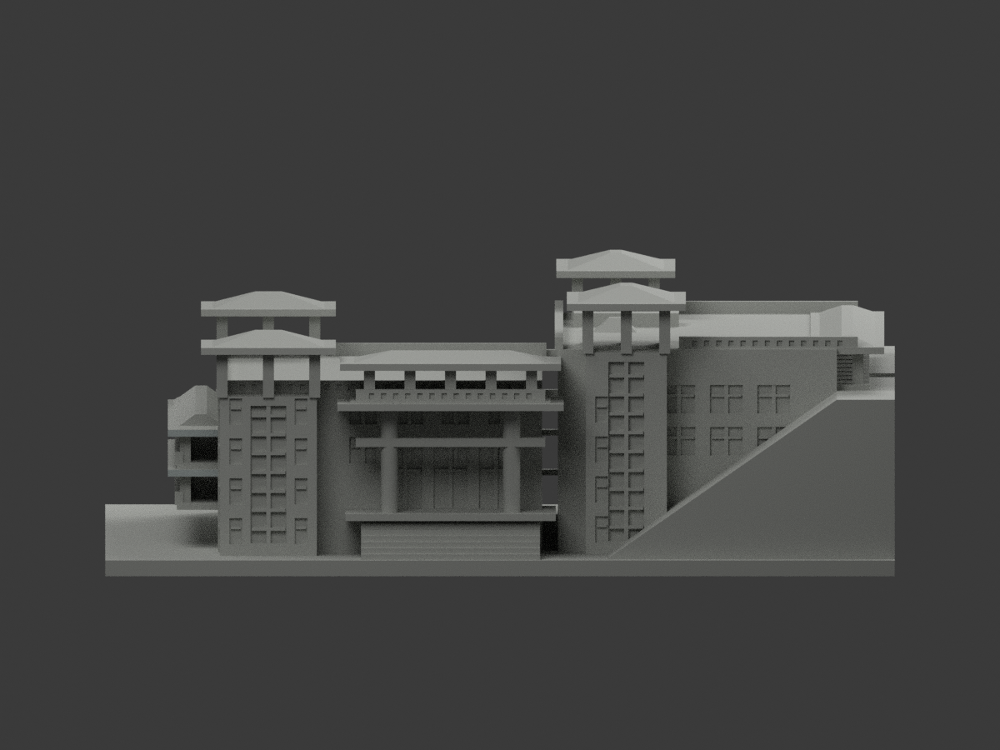
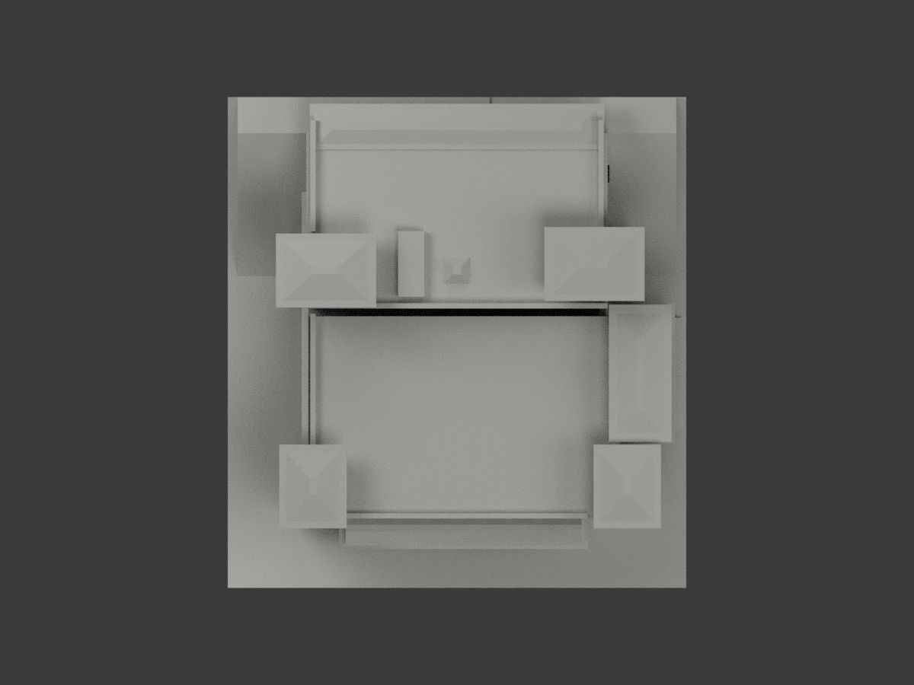
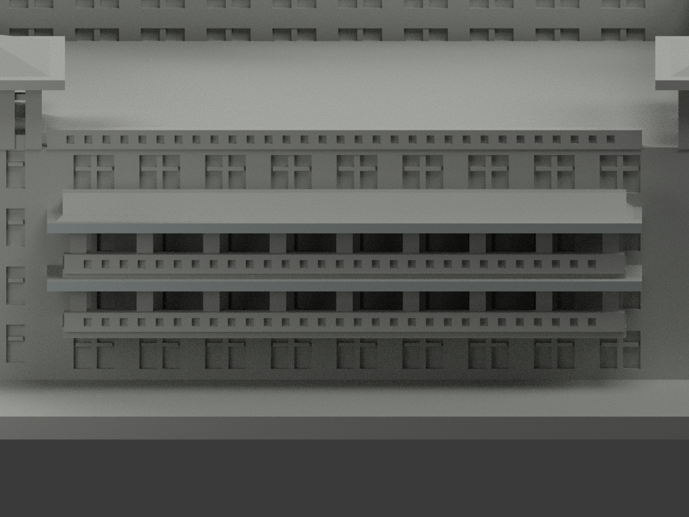
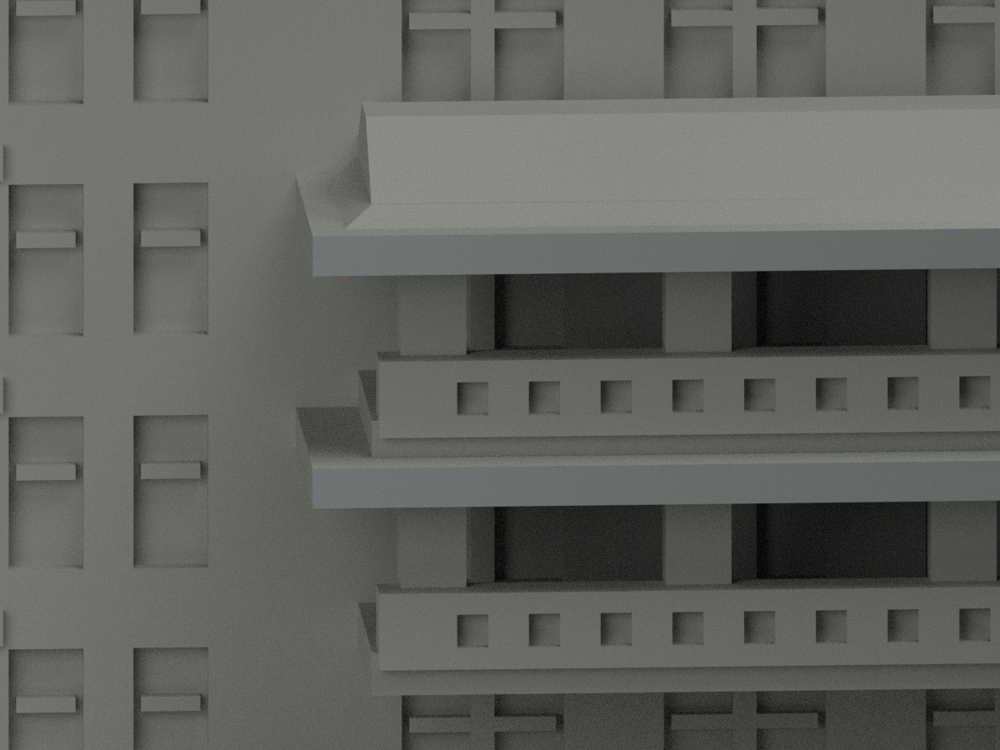
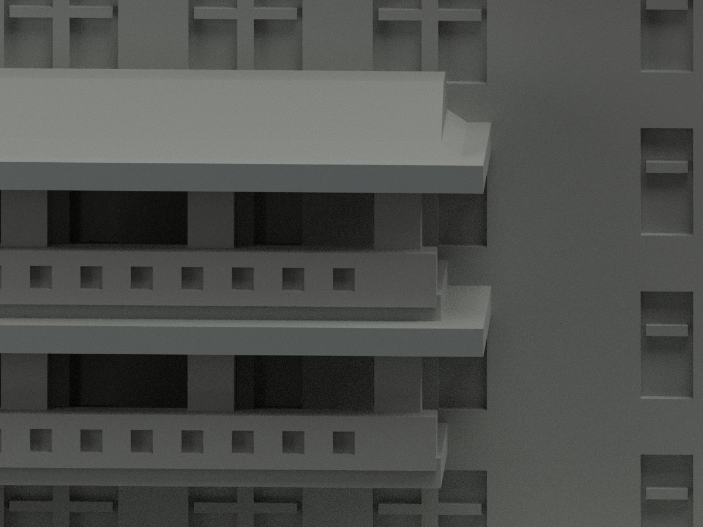

# 華梵圖書資訊大樓2009｜南兩長簷右返面局部補灰

局部補色未完成。原4前簷灰面完全保留，新增右側4原三角，共8配色、15094未知中性、15102原三角。沿用原名義灰#B4BCBB及原中性色票，不改任何幾何。兩完整共面域：x40、y[-63.1,-53.6]、z16.7..18及24.3..25.6。不得把左右、頂底或全屋一起推色。

本次是既有官方3072px南照原像素再審，非新照片。照片可辨兩條灰簷緣在右角轉向鄰塔；不取紅瓦、白斜脊飾或陰影底腹。接塔端與模型厚度/深度仍屬簡化近似，只支持同構件灰族，非校準HEX。塔近照僅情境旁證。原南照EXIF2008早於2009啟用的日期限制完整保留，不宣稱現況或竣工後驗證。

原四亭與廣欽圖書館仍同棟，67原件完整私存；原展示aliases、PREVIEW-TRANSITION、previews及所有原工程檢核JSON不變。歷史色化QA保存於qa/eave-return-previous；EAVE-RETURN-SOURCE-QA固定來源階段pending快照，最終模型獨審另檔，不回寫。本次COLOR-ASSIGNMENT、COLOR-FORMAT-GEOMETRY、SCENE、EAVE-RETURN-SCENE-QA對應本次材色；舊凍結及舊獨審不代表本次。尚未發布、無實體試印或工程再認證。

## 原版本說明與所有限制（歷史原文，以下4面/15098等統計只指前版）

# 華梵圖書資訊大樓｜南面兩長簷前緣局部灰

**局部補色未完成：僅南面兩長簷完整4原三角名義灰，其餘面尚未分色。原有限 QA 例外保留，色審不追認全域列印安全或全幾何 QA。** partial_color_incomplete=true、fully_colored_exterior=false；同項 hfu-library-2009/count_delta=0。身份 HFU Library 2009 partial color。四亭與廣欽紀念圖書館屬同建築，不拆套；原厚化/地形近似不變。

| 前斜視 | 後斜視 | 正面 |
|---|---|---|
|  |  |  |
|  |  |  |
|  |  |  |
|  | | |

## 唯一材色域與原件

先枚舉whole y−63.1無限平面全部4面，exact shared-edge BFS為兩完整2三角矩形，再核x−36..40/z16.7..18及24.3..25.6原界。4名義灰#B4BCBB，其餘15098未知中性#B8BAB5；3821共面域一致。STL已含scale2/z+3，不再變換，不裁面/補面。資料覆蓋邊界不是真材色接縫，中性不是現場灰。

只紅瓦下真正前垂直簷緣；不擴紅瓦坡/端白飾、亭屋、牆灰暖磚混面、玻璃反光實板、厚實欄代理、背/右裁切/坡地/頂底側。原外觀/材質精度不由本次補色追認。

33 immutable原件無OBJ，全原包私存；原scene、renderer、README另以ORIGINAL-PREVIEW別名保留，原previews/全部QA不變。舊Warm stone、Recess contrast、Base contrast三種展示材並非實景色源結果；本次source-gap有界變體不是把已有彩色包冒稱單色。PREVIEW-TRANSITION.md保版本說明。

## 日期與原 QA 例外

南照原EXIF2008:05:18 11:18:44、塔照2009:11:10 14:33:10，無時區/獨立時鐘驗證。前者早於2009-10-30啟用紀錄，不宣已證竣工後照、不當2026現況。2017/2024正射與其他年份資料不拼作同日測繪。

原268抽層2804多邊形；2053跨層loss紀錄=1936矩形+117非矩形，**不是2053根柱**。實體77方柱段=南18+北9+東上10+四亭40，另2圓柱。25全層>1%，全層最大3.157475829520%；原分量最大3.251605705027986%、保留96.74839429497201%，非矩形最大2.2491238349787%，原WKT結果不以理想矩形取代。

原0.41mm vertex遮罩之外最大0.0030853459156mm²；真角外0.00319574819093mm²/0.07246599662%，在原0.005mm邊允差內，非零。非矩形6.9944162e−17為數值殘差，不宣絕對零。77柱法向最低2.0999984mm、3634非矩形probe最低1.0999985mm、5凹背最低1.1599998mm、3716指定起點inside，只有限指定probe，不是全mesh全方向壁厚證明。無實際切片/試印、無support-free/強度認證，不任縮比例。

原build+color精確隔離重建、byte/triangle identity、3MF、reopen、共面及10圖格式核與上述原printability有限例外分開。STL無色，2材未試多料列印。來源原照私存不公開。

HFU Library 2009 partial color. Only four original triangles on two complete south vertical eave fascias receive nominal gray;15098remain unknownneutral. Whole y=-63.1plane exactly equals two connected original rectangles. Original15102triangles and all33assets retained,noOBJ. Originalthreepresentationmaterials preserved in aliases/privatehistory; this is a source-gap variant,count0,not a newlymonochromebuilding.

Original77squarepostsegments plus2roundcolumns are not the2053cross-layerlossrecords. Originalnonzerooutside-corner residuals,lossfractions andfiniteprobe limitations remain. Samegeometry identity and colorformat PASS do not certify globalprintability,physicalprint,strength or unrestrictedscale. Southphoto rawEXIF2008 predates2009opening; metadata unverified/nozone,not current2026. Fouropenpavilions remain oneboundedbuilding; roofs/glass/railproxies/mixedwalls/unknownback neutral. Sources private.
