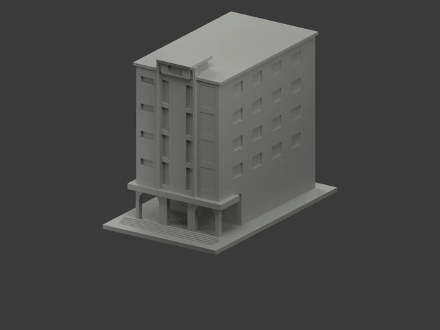
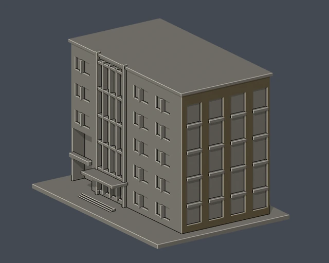
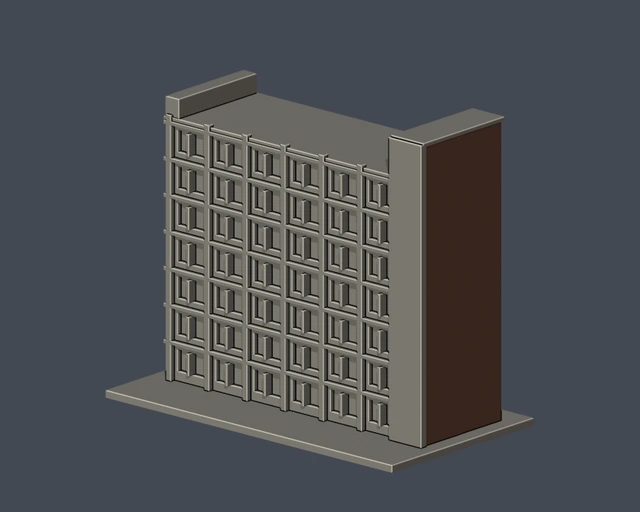
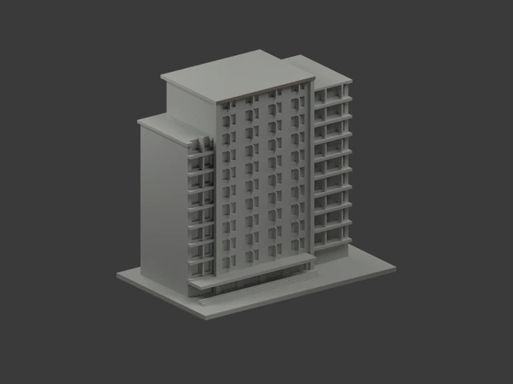
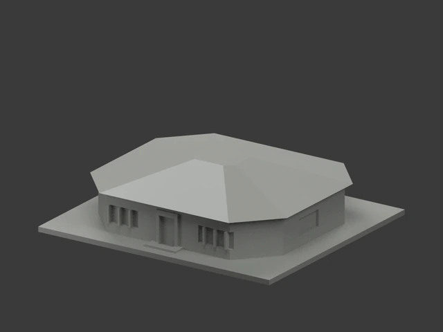
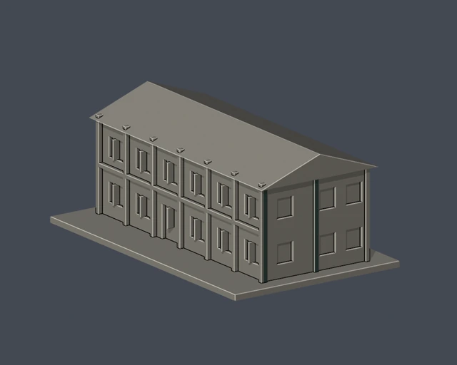
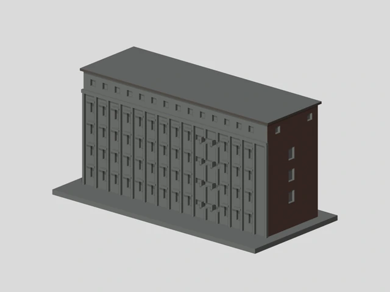

# 萬能科技大學校園建築模型

本輪7件逐棟外觀研究模型，最長150mm（含底板、每件獨立比例）。附可重建Python、STL、可編輯Blender、實際STL正背預覽與檢查。不是全校完成，也非測繪級復原。

[覆蓋與缺口](研究盤點/README.md)｜[機器可讀清單](model-manifest.json)

## 每列三座不同建築

| 建築模型 | 建築模型 | 建築模型 |
| :---: | :---: | :---: |
|  **[弘道館（E）／詳頁](校本部/buildings/vnu-hongdao-e/README.md)** 弘道館（E） [局部材色3MF](校本部/buildings/vnu-hongdao-e/appearance.3mf) · [範圍與限制](校本部/buildings/vnu-hongdao-e/README.md) |  **[管理大樓（G）／詳頁](校本部/buildings/vnu-management-g/README.md)** 管理大樓（G） |  **[育才樓（L）／詳頁](校本部/buildings/vnu-yucai-l/README.md)** 育才樓（L） |
|  **[萬芳樓（V）／詳頁](校本部/buildings/vnu-wanfang-v/README.md)** 萬芳樓（V） [局部材色3MF](校本部/buildings/vnu-wanfang-v/appearance.3mf) · [範圍與限制](校本部/buildings/vnu-wanfang-v/README.md) |  **[體適能中心（PH）／詳頁](校本部/buildings/vnu-fitness-ph/README.md)** 體適能中心（PH） [局部材色3MF](校本部/buildings/vnu-fitness-ph/appearance.3mf) · [範圍與限制](校本部/buildings/vnu-fitness-ph/README.md) |  **[萬強館（舊圖碼PH008）／詳頁](校本部/buildings/vnu-wanqiang-ph008/README.md)** 萬強館（舊圖碼PH008） |
|  **[仁愛樓（RHB）／詳頁](校本部/buildings/vnu-renai-rhb/README.md)** 仁愛樓（RHB） [局部材色3MF](校本部/buildings/vnu-renai-rhb/side-color-20261120/appearance.3mf) · [範圍與限制](校本部/buildings/vnu-renai-rhb/README.md) |  |  |

## 證據與列印限制

- 六件主要來源為官方190×143px校景實拍；仁愛樓另有學務處751×441px照片。未將示意校圖冒充照片。
- 未見後側、深度、遮擋與窗格數均在各詳頁明示。萬強館PH008為歷史圖碼；圖碼資料年不是照片拍攝年。
- 原STL法向、边/頂點流形、正體積、單一外表面、無分離内腔殼、重建SHA及Blend/STL一致均通過。
- 0.2mm截面每個閉環及組合Polygon均有效；0.8mm XY開運算是薄特徵篩查，不是正式切片或實體試印。請自行複查支撐、材料與橋接；支撐不能彌補噴嘴解析度。
- 新信義樓RHE已找到115招生簡章實拍，留待下輪建模；舊RHC照片不可當新樓。其他完整棟界或外觀不足者列為缺口。
- 公開包不重製第三方原照或PDF，僅提供來源URL。

[校本部頁](校本部/README.md)

## 檔案校驗與歷史

現行模型校驗：[弘道館](校本部/buildings/vnu-hongdao-e/SHA256SUMS) · [萬芳樓](校本部/buildings/vnu-wanfang-v/SHA256SUMS) · [體適能中心](校本部/buildings/vnu-fitness-ph/SHA256SUMS) · [仁愛樓](校本部/buildings/vnu-renai-rhb/SHA256SUMS)。各清單以當前模型目錄為準。

原始學校交付的[完整 SHA256 清單](https://github.com/hplin50643/taiwan-buildings-3d/blob/6ecd8f1b5019a226b02d7dd8502d47af00889ae1/%E8%90%AC%E8%83%BD%E7%A7%91%E6%8A%80%E5%A4%A7%E5%AD%B8/hash-manifest.json)與[當時的連結檢查](https://github.com/hplin50643/taiwan-buildings-3d/blob/6ecd8f1b5019a226b02d7dd8502d47af00889ae1/%E8%90%AC%E8%83%BD%E7%A7%91%E6%8A%80%E5%A4%A7%E5%AD%B8/link-validation.json)，請以連結所指的固定提交核對。局部彩色版的歷史交付與驗證：[弘道館](https://github.com/hplin50643/taiwan-buildings-3d/tree/60b578e3f012f92e119dec509276c8040a0831c8/%E8%90%AC%E8%83%BD%E7%A7%91%E6%8A%80%E5%A4%A7%E5%AD%B8/%E6%A0%A1%E6%9C%AC%E9%83%A8/buildings/vnu-hongdao-e) · [萬芳樓](https://github.com/hplin50643/taiwan-buildings-3d/tree/60b578e3f012f92e119dec509276c8040a0831c8/%E8%90%AC%E8%83%BD%E7%A7%91%E6%8A%80%E5%A4%A7%E5%AD%B8/%E6%A0%A1%E6%9C%AC%E9%83%A8/buildings/vnu-wanfang-v) · [體適能中心](https://github.com/hplin50643/taiwan-buildings-3d/tree/60b578e3f012f92e119dec509276c8040a0831c8/%E8%90%AC%E8%83%BD%E7%A7%91%E6%8A%80%E5%A4%A7%E5%AD%B8/%E6%A0%A1%E6%9C%AC%E9%83%A8/buildings/vnu-fitness-ph) · [仁愛樓](https://github.com/hplin50643/taiwan-buildings-3d/tree/60b578e3f012f92e119dec509276c8040a0831c8/%E8%90%AC%E8%83%BD%E7%A7%91%E6%8A%80%E5%A4%A7%E5%AD%B8/%E6%A0%A1%E6%9C%AC%E9%83%A8/buildings/vnu-renai-rhb)。[原單色模型的校驗及檔案](https://github.com/hplin50643/taiwan-buildings-3d/tree/48588274dfb149bab982be14d5cb4d0107ed86fe/%E8%90%AC%E8%83%BD%E7%A7%91%E6%8A%80%E5%A4%A7%E5%AD%B8)亦保留於當時提交。歷史紀錄不以目前檔名核對。
