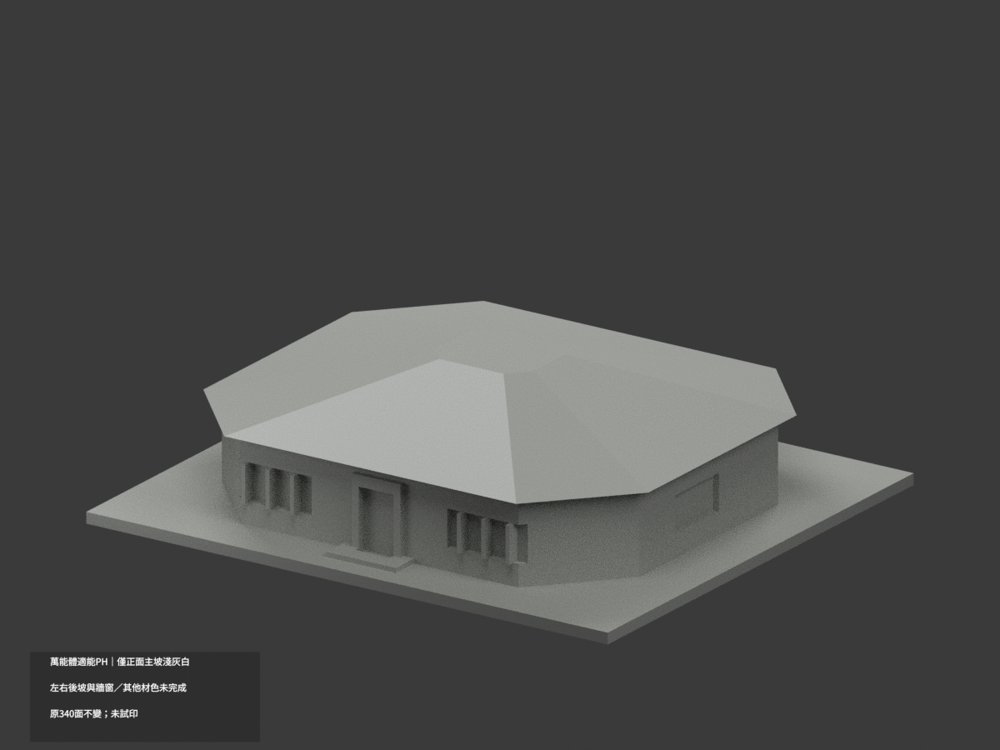
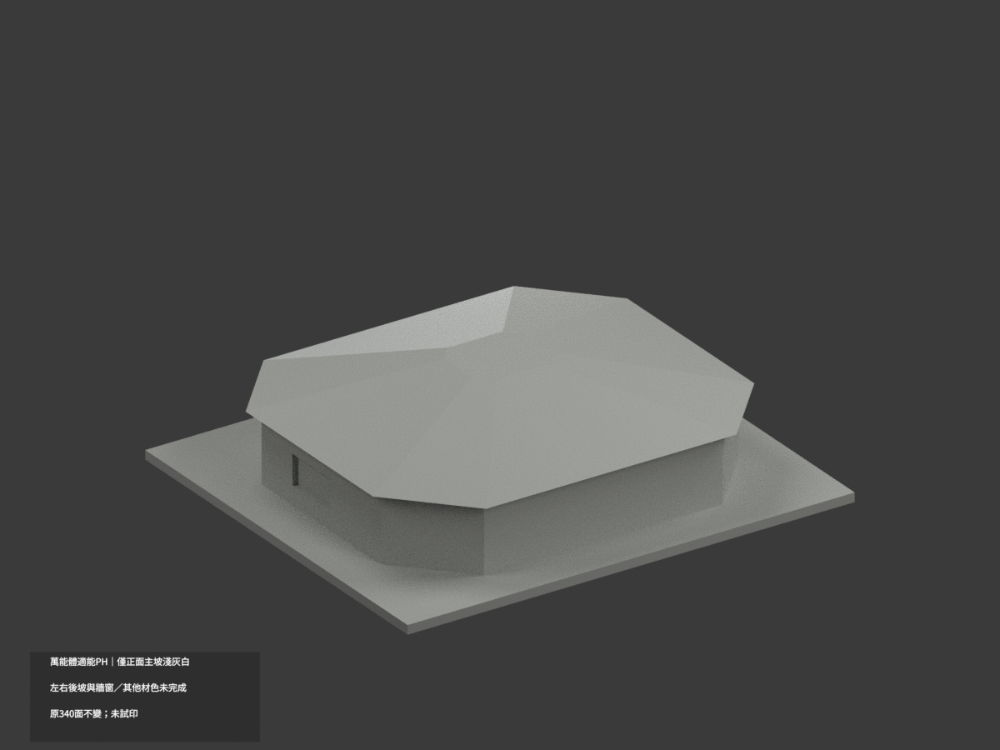
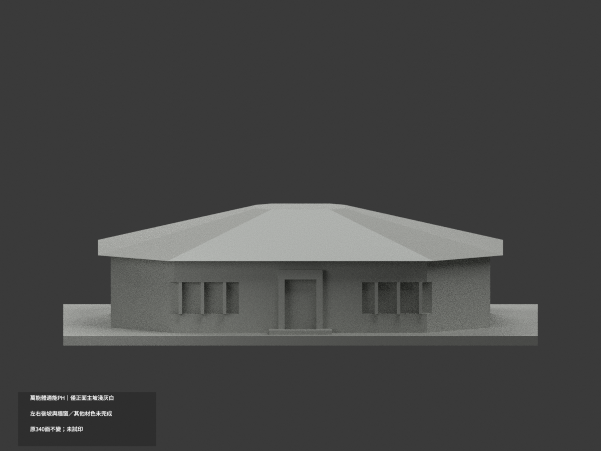
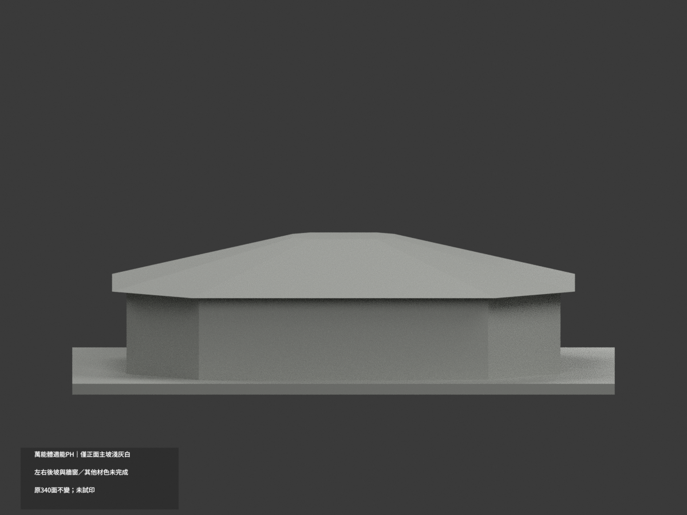
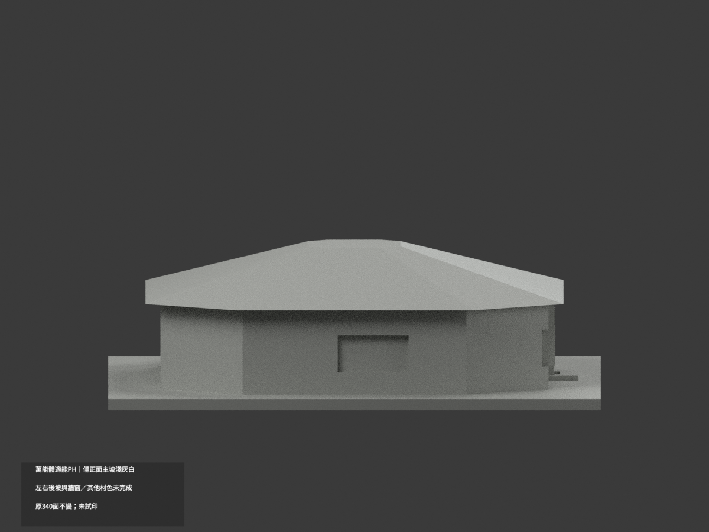
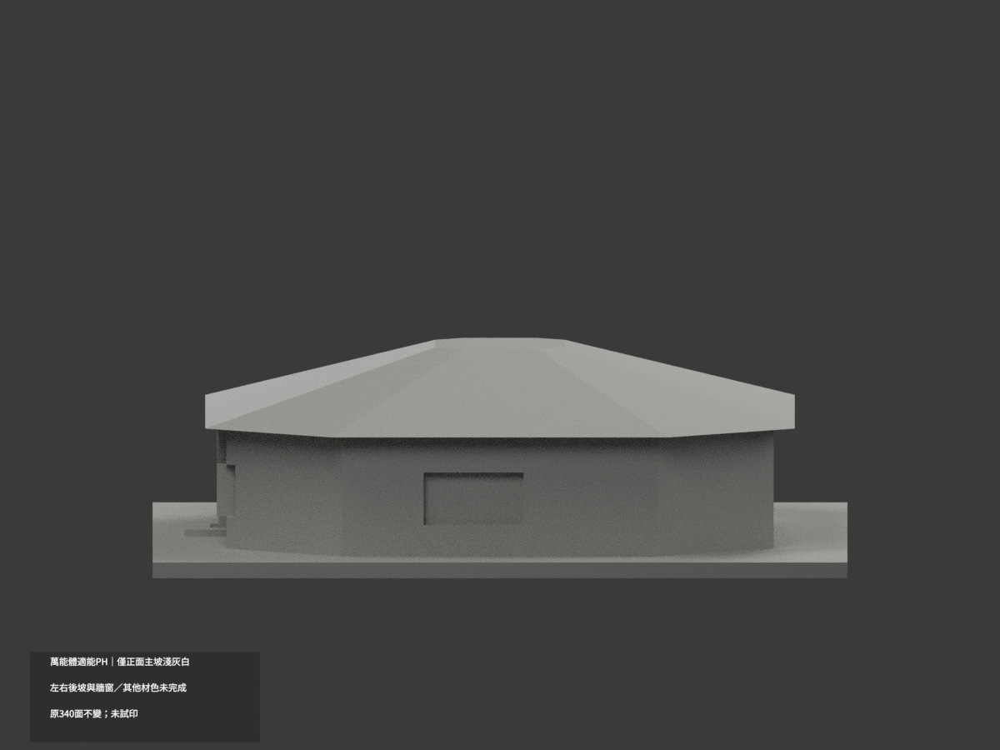
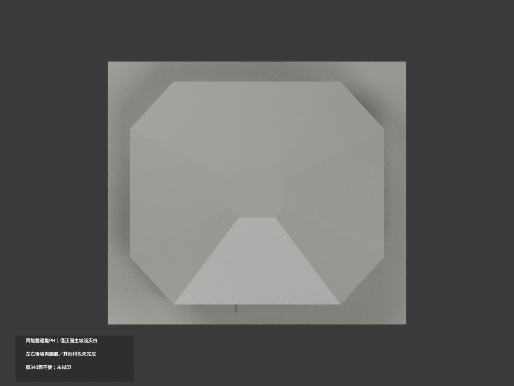
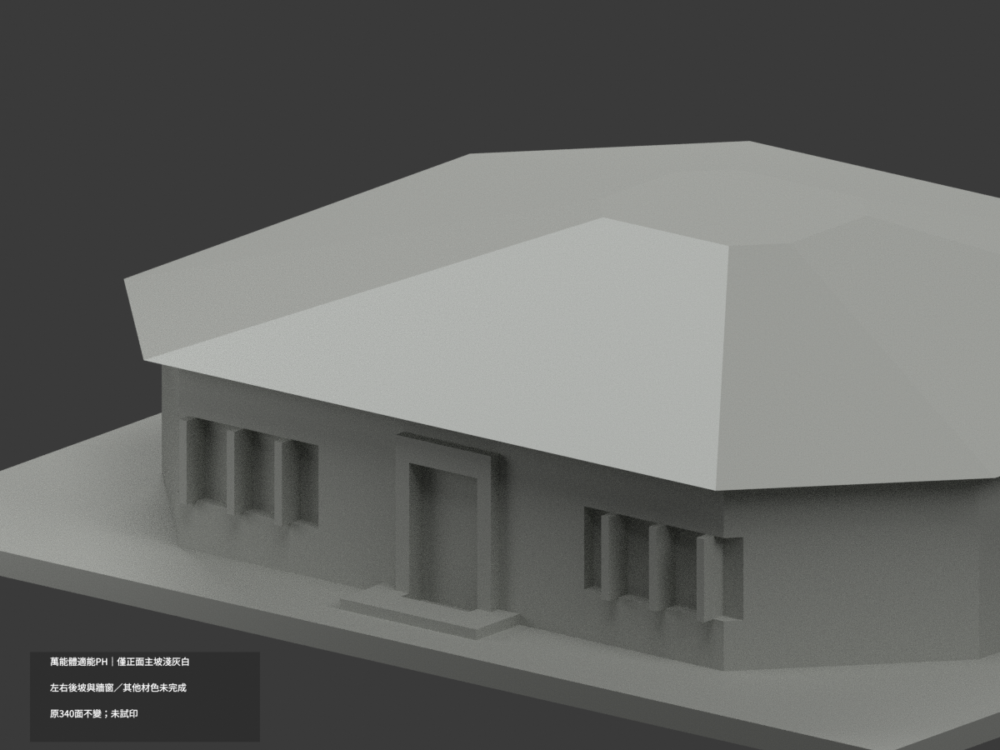
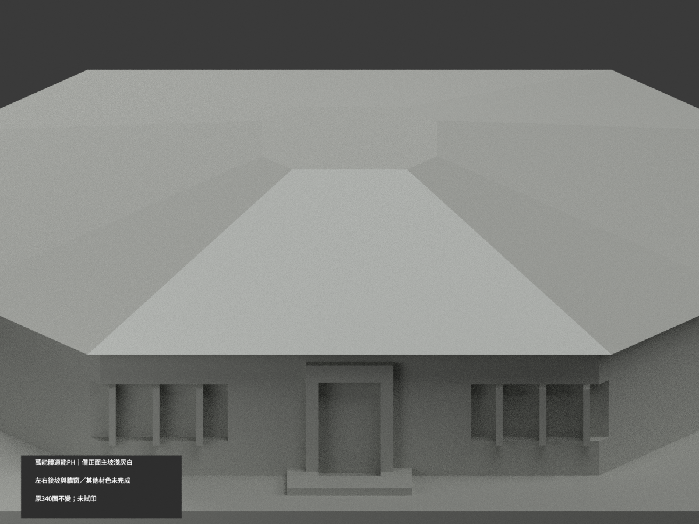
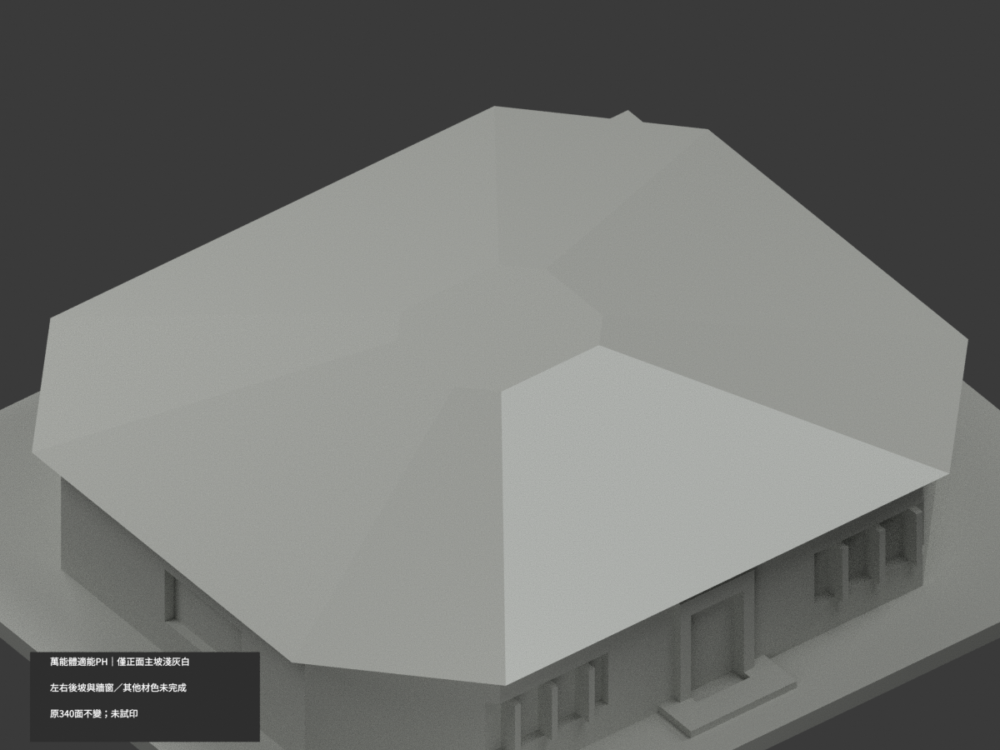

# 萬能科技大學體適能中心（PH）｜正面主坡屋皮局部淺灰白

**局部補色未完成：只正面主坡完整梯形2原三角淺灰白；左右後坡、頂平面、底面、牆窗與其他材色未完成。** partial_color_incomplete=true、fully_colored_exterior=false。同項 vnu-fitness-ph／count_delta=0，萬能科技大學校本部，英文身份 VNU Fitness PH partial color。

| 前斜視 | 後斜視 | 正面 |
|---|---|---|
|  |  |  |
|  |  |  |
|  |  |  |
|  | | |

## 材色範圍

原正坡方程13(y+56)−43.68(z−26)=0，法向距離0.0001mm內全部三頂點枚舉恰2面。沿坡u=(y+56)/43.68在0..1、全x界±(42−32.76u)有限梯形與整無限plane一致，共邊兩三角完整覆四角(±42,−56,26)至(±9.24,−12.32,39)，不靠normal/面心/原IDs硬套。不切任意半坡、不丟端角。2面名義淺灰白，338中性，104共面連通域uniform，340原三角不變。

190×143官照在正中黑字入口及成組窗上方可見淺色主坡，只支持此原完整前梯形色族。左右斜坡與所有後坡不按對稱複製；中央截平頂、屋底/薄邊/字牆/門窗反光框、側後開口及階地全部中性。中性不是實景灰，資料覆蓋界不是實際材料變色線。

## 原外觀限制與時期

原八角平面與低坡截頂是公開照/校圖視覺近似，不是實測，不改原坡度/屋面分割/開口來湊色。官方190×143照片不能支持精確紋理或色票；不放大虛造資訊，深度/側後窗與細部原簡化保持，不追認幾何復原精度。拍攝日未知，校圖標PH不證2026現況。單件最長150mm獨立比例非等比校園拼圖。原照私存，不公開貼圖或推定商用權利。

## 檔案與 QA

原STL/build與340三角字節/座標拓撲保留；immutable17件無OBJ，原builder可輸出OBJ但隔離產物只私存，不宣稱原repo有OBJ。原README.zh-TW存ORIGINAL-MONOCHROME-README.zh-TW.md，原單色圖/QA保留。appearance.3mf兩展示材及scene.blend真面材同原幾何，export/validate/render/verify與真3MF/scene明定 VNU Fitness PH partial color。精確依賴隔離原build+color、閉合正體積/3MF面材座標/Blender重開與10張1200×900檢核，重建保留不刪；未實際列印或驗多料切片，STL本身無色。

## English limitations

VNU Fitness PH partial color. Only original front hip trapezoid2triangles:plane13(y+56)-43.68(z-26)=0,completefinite taper from(+-42,-56,26)to(+-9.24,-12.32,39).Whole infiniteplane equals finite allvertex selection;338neutral,104coplanar domains uniform,original340triangles/STL/build unchanged,noimmutableOBJ,count_delta0. Adjacent/rear slopes not mirrored,topflat/underside/edges/letteredwall/windowbacks/groundneutral. Source190x143 photograph only nominal pale family,captureunknown,no2026survey;originaloctagonal approximation and slope unchanged,not geometryrecertification. No publicphoto/textures,not testprinted.
