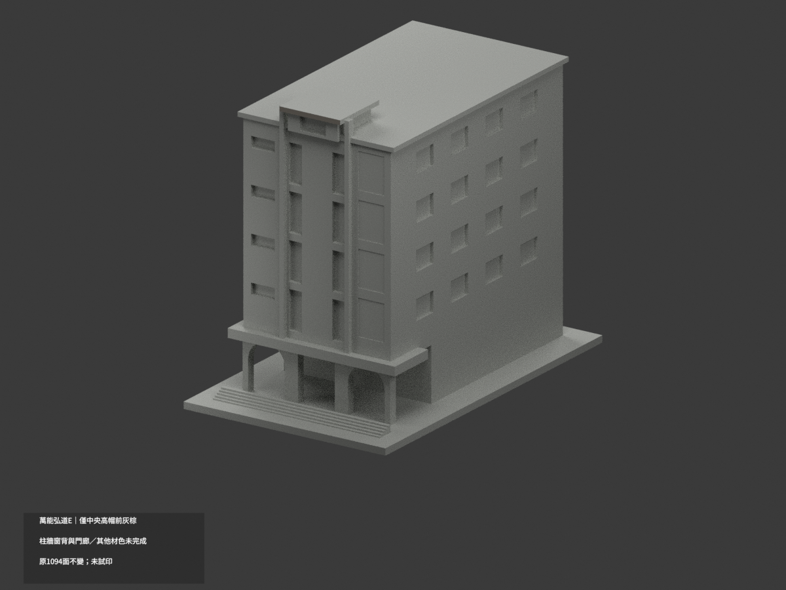
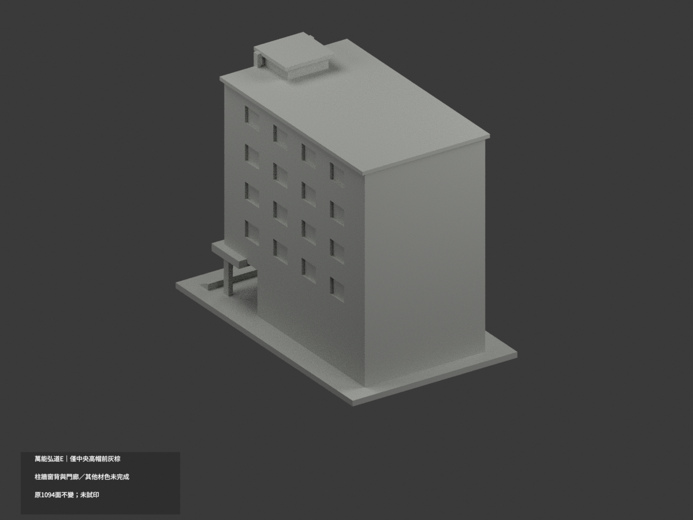
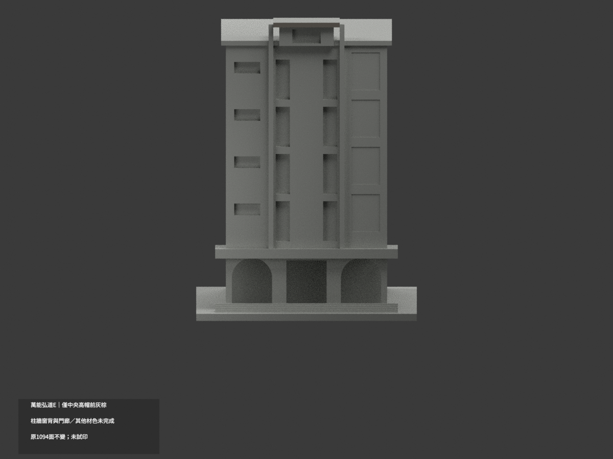
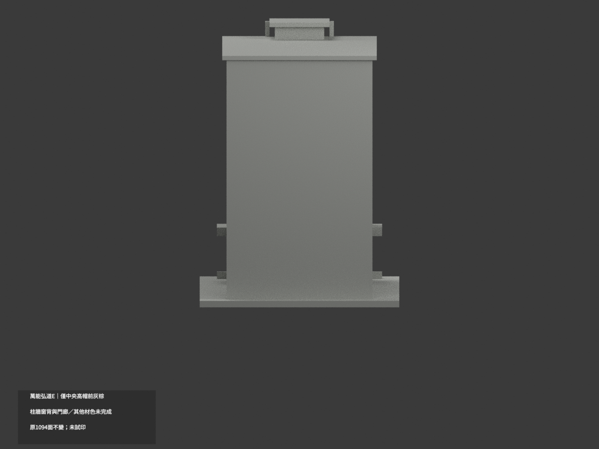
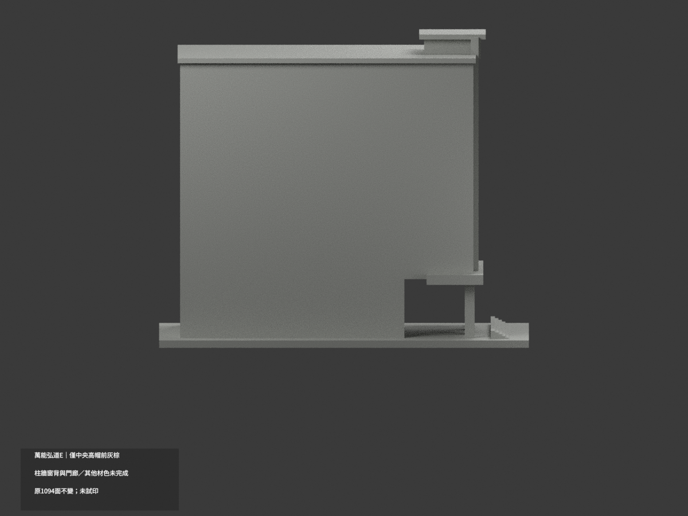
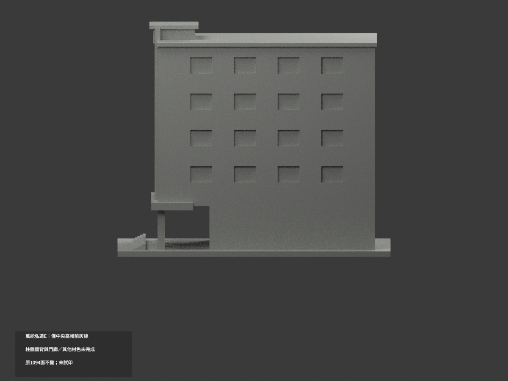
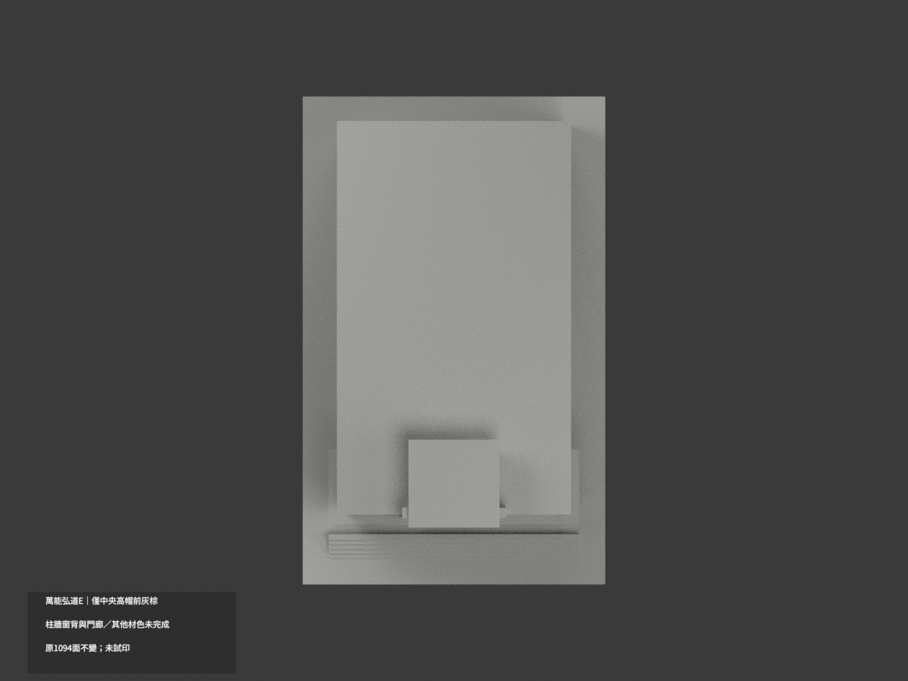
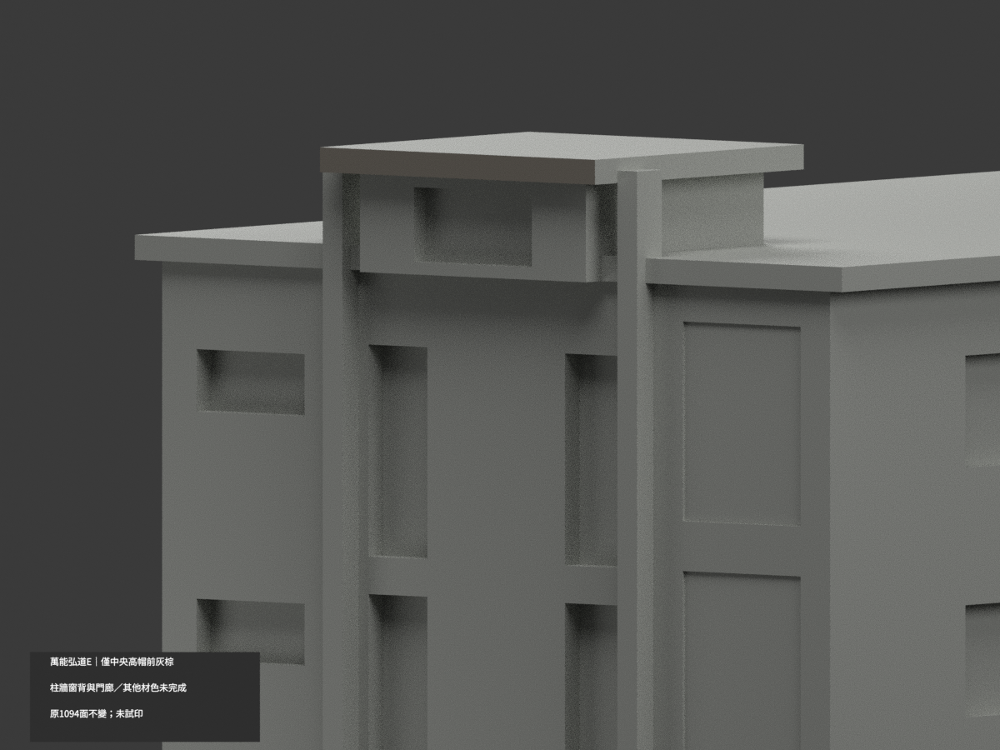
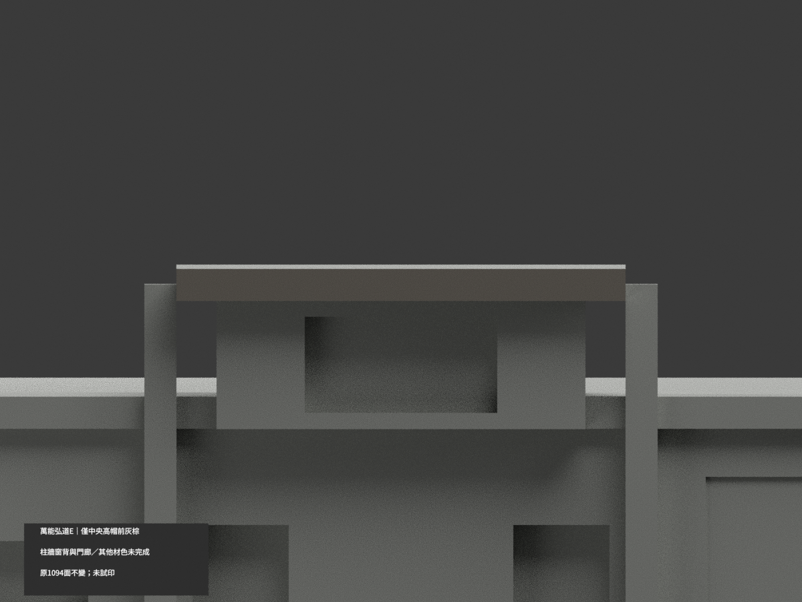
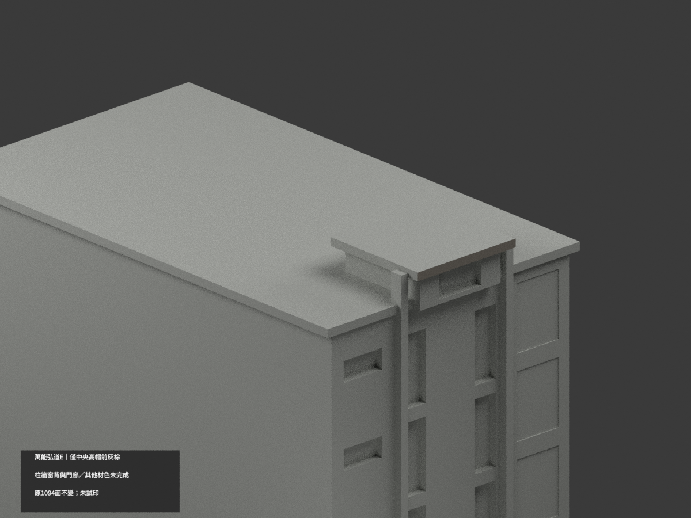

# 萬能科技大學弘道館／弘道樓（E）｜中央高帽前緣局部灰棕

**局部補色未完成：只中央高帽完整前緣2原三角名義灰棕；柱牆、窗背、門廊、屋面與其他材色未完成。** partial_color_incomplete=true、fully_colored_exterior=false。同項 vnu-hongdao-e／count_delta=0，萬能科技大學校本部。英文身份 VNU Hongdao E partial color。原README稱弘道館，來源稱弘道樓，均E同棟，不另新增模型。

| 前斜視 | 後斜視 | 正面 |
|---|---|---|
|  |  |  |
|  |  |  |
|  |  |  |
|  | | |

## 材色範圍

整原y−57.5無限plane，以三頂點0.0001mm檢核，恰2面共享完整對角線，完整x±14,z123..125矩形。finite全點域與無限plane一致，不用面心、normal或bbox剪掉面。2面名義低飽和灰棕、1092中性，291共面連通域uniform，1094原三角保持。

唯一190×143官方實照僅支持獨立高起中央小帽前沿灰棕色族，不是校準色票或石紋。其暗底、上面、兩端、主屋上都不染。全高前柱跨低位混材、入口金字額枋、主牆、玻璃反光框、階地與樹遮基座均中性。中性非實景灰；資料範圍非實際材質接縫。

## 原幾何與來源限制

沿原190×143照的主要外觀近似：狹長館體/挑空門廊/高起頂冠；側後窗數、深度與間距缺乏解析度，細框列印加厚，背側簡化，不因補色追認測繪或復原精度。不放大虛造細節；現行校圖標館不證照片年代，拍攝日未知、非2026現況。單件最長150mm獨立比例，不當同尺度校園拼圖。來源原照只私人參考，不公開貼圖或推定商用授權。

## 檔案與 QA

原STL/build與1094三角字節/座標拓撲保留，immutable17件無OBJ，原builder會產生OBJ但隔離生成只私存，不稱原repo有OBJ。原README.zh-TW存ORIGINAL-MONOCHROME-README.zh-TW.md，原單色預覽與QA保歷史。appearance.3mf兩展示材、scene.blend真面材同原三角；export/validate/render/verify及真3MF/scene明定 VNU Hongdao E partial color。精確依賴隔離原build+color、閉合正體積、3MF座標面材與Blender重開、10張1200×900檢核，重建保留不刪。未試印或驗多料切片；STL自身無色。

## English limitations

VNU Hongdao E partial color. Entire y=-57.5 plane exactly2connected triangles forming complete28x2central raised capfront,x+/-14,z123..125.2mutedgraybrown/1092neutral,291coplanar domains uniform,original1094triangles/STL/build unchanged,noimmutableOBJ,count_delta0. Official190x143 photograph supports only nominal colorfamily,no texture/calibratedcolor/current2026claim,captureunknown. Capupper/underside/returns,broadroof,tallmixedpilasters,goldletteredentry,windowbacks,walls/base remainneutral. Original publicphoto geometry is approximate,side/rear rhythm unresolved,no geometryrecertification;HongdaoHall/Building names identify same Ebuilding. No publicsourcephoto/texture,not testprinted.
