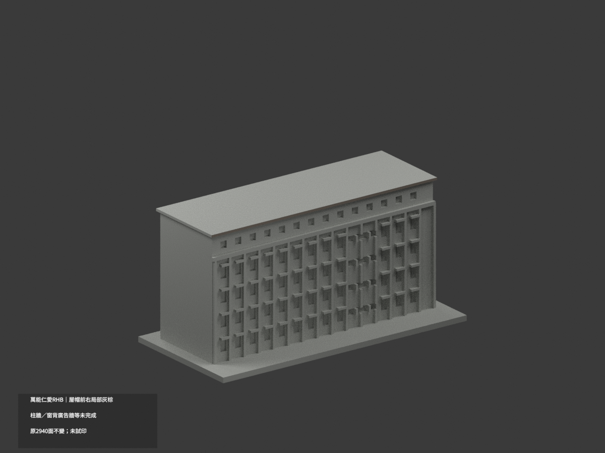
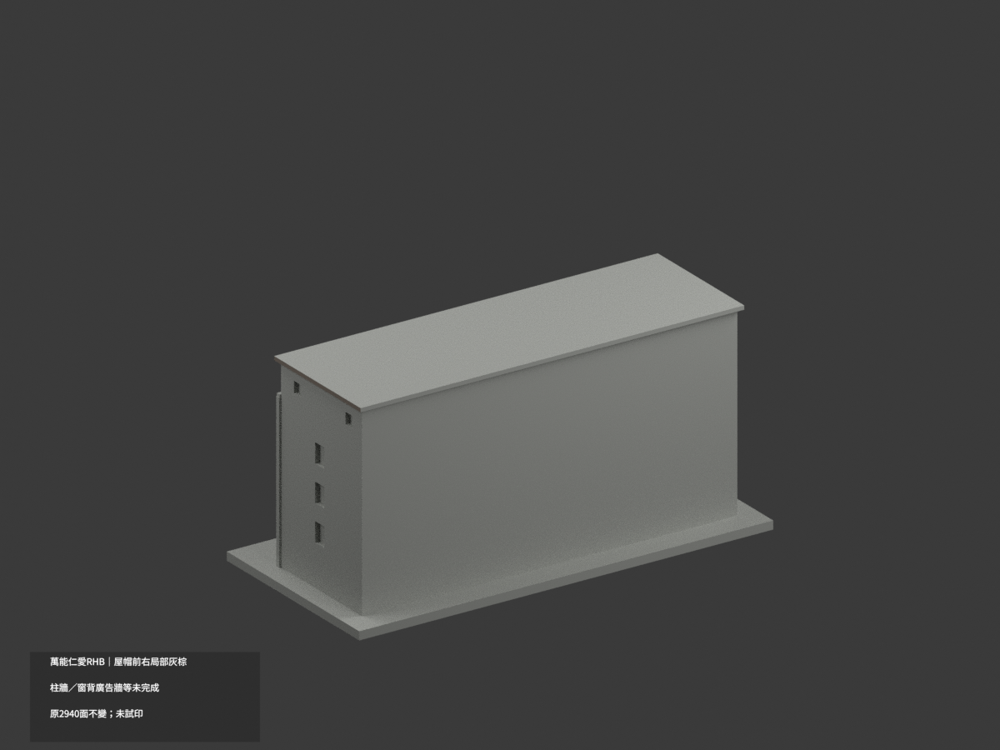
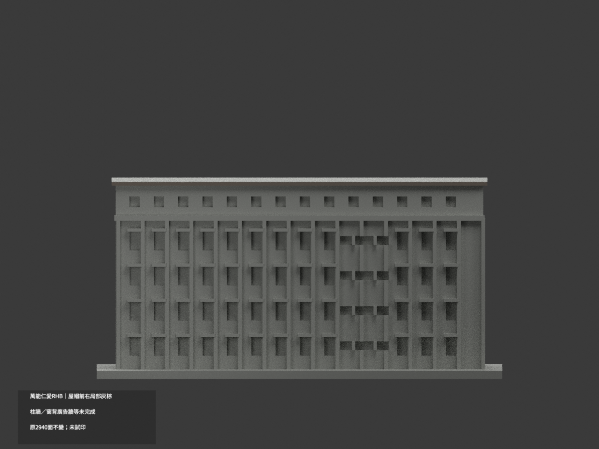
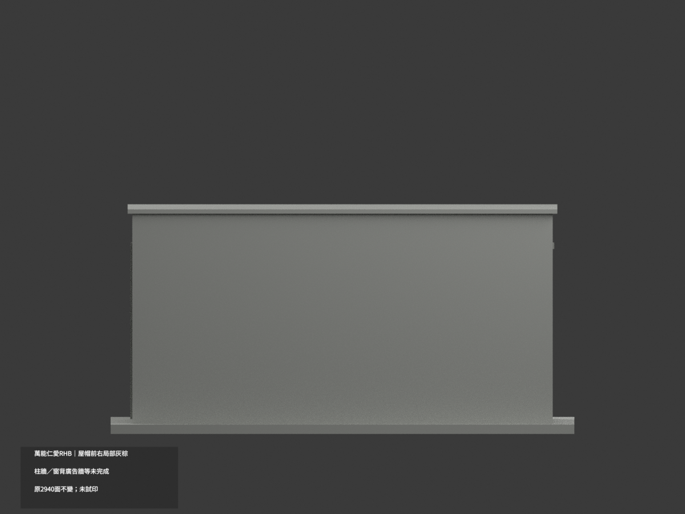
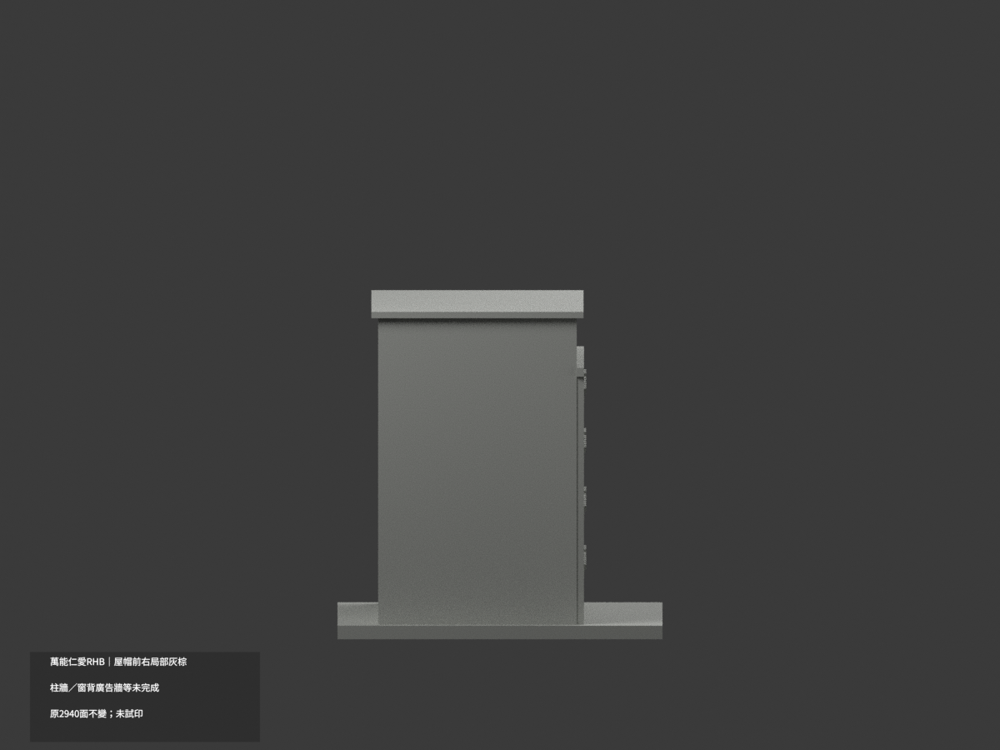
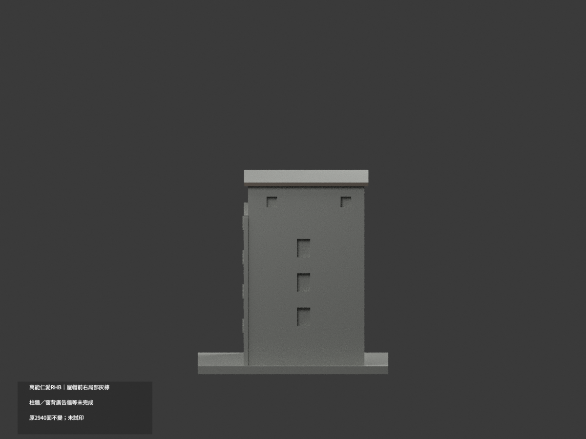
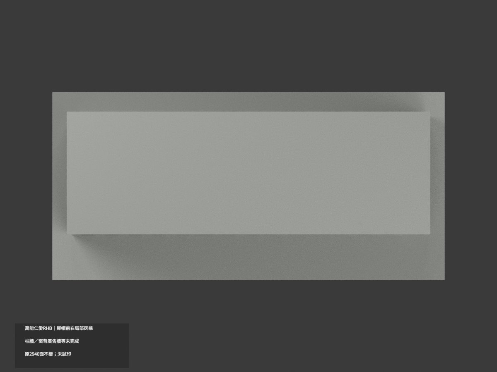
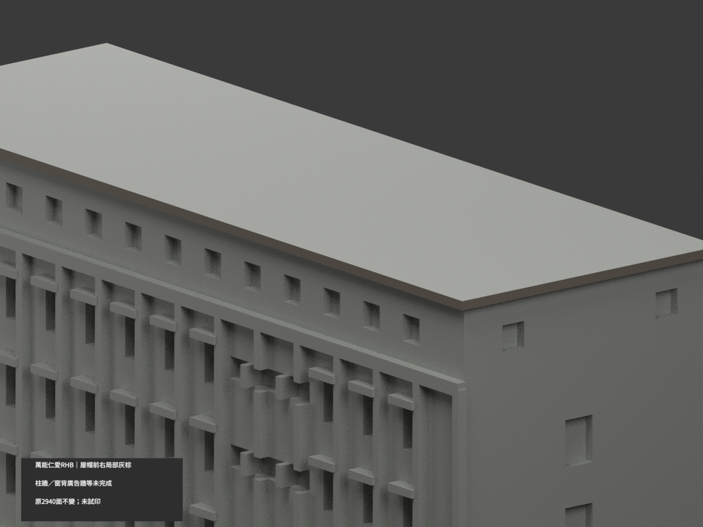
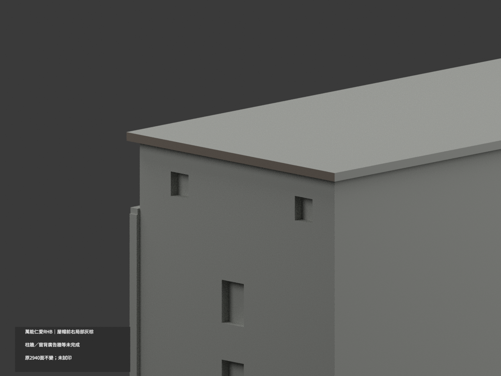
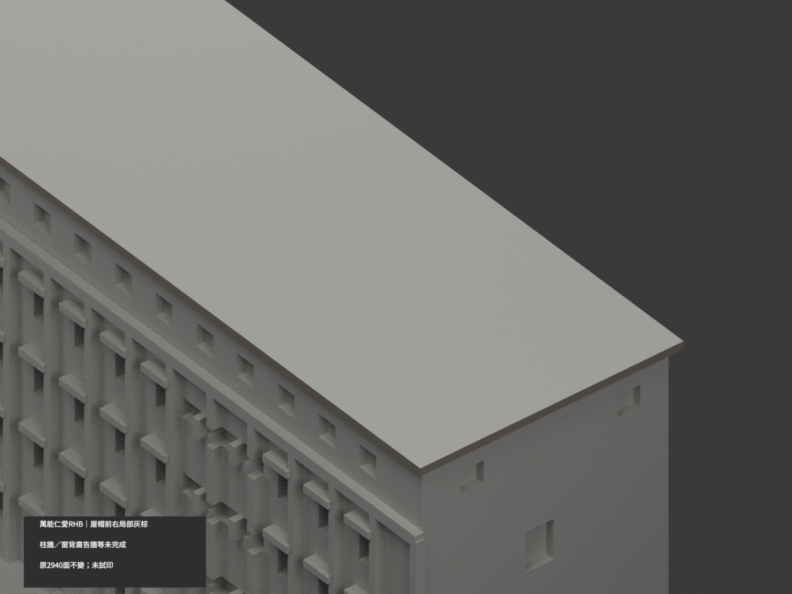

# 萬能仁愛樓 RHB｜屋帽前與右端局部灰棕

**柱牆、窗背與廣告牆等材域未完成分色。** partial_color_incomplete=true、fully_colored_exterior=false。僅兩完整屋帽外沿4面名義灰棕，非全棟完整補色。

| 總覽 | 背側 | 正面 |
|---|---|---|
||||
||||
||||
||||

## 材色範圍
同 vnu-renai-rhb 原項目，same-item、count_delta=0。萬能科技大學校本部仁愛樓單群，原2940三角與STL/build_model.py字節不變，17原件無OBJ，不造原件。
- 前y−18.5、右x69.5兩完整原plane各2面，z71..72.4。以全3頂點有限矩形核對，所有無限plane三角均全納，無片段漏選、無人工高度截色。
- 其餘2936面中性：連通的全高柱與含字橫帶不可拆染、右端廣告牆、混磚窗框反光、樹遮基座、屋上皮與底、後與左回邊。
- 原近似幾何與窗列保留，不因材色追認精度，不添加入口、廣告或文字。中性邊界是證據範圍而非真實材縫。

## 來源與日期
親看官網751×441長側與右端實照；只取原屋帽細外沿名義灰棕族，非精確材料或校準色票。照片拍攝日未知，不稱2026現況。原照片私人不公開、不作紋理，未確認CC或再散布授權，不保證商用。

## 格式與列印
[原STL](model.stl) · [逐面材色3MF](appearance.3mf) · [Blender](scene.blend)
保留原150mm底座示意比例，非測量比例。實際物件名 VNU Renai RHB partial color，獨立核對真slug與館名。STL無色，3MF及Blender逐面分材；兩材標籤非兩色或四色耗材切片驗證，未實際列印。

## 重建與 QA
原build_model.py → colorize_model.py → export_appearance.py → validate_color.py；Blender render_color.py／verify_color_scene.py。完整隔離Shapely2.1.2精確原build＋color重建，原bytes與全三角multiset、閉合正體積、3MF逐面材、scene重開、十圖1200×900及圖文hash。原README、previews、validation保留歷史，不冒充新QA，沒有刪檔。

## English scope
Partial only:4 complete original front and right roofcap exterior faces muted gray-brown;2936 neutral. Whole infinite planes equal all-three-vertex finite rectangles, no missing fragments or clipping. Original2940 triangles and17 files unchanged, no immutable OBJ. Connected lettered band and piers, banner wall, windows, obscured base, roof top and underside remain neutral. One official exterior image, unknown capture, nominal family not calibrated finish or2026 survey. Original single group count0, no geometry changes or tested filament slicing.
