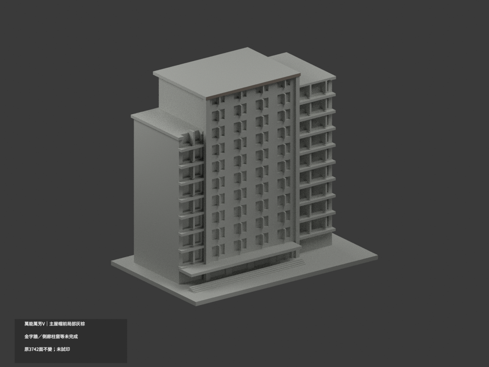
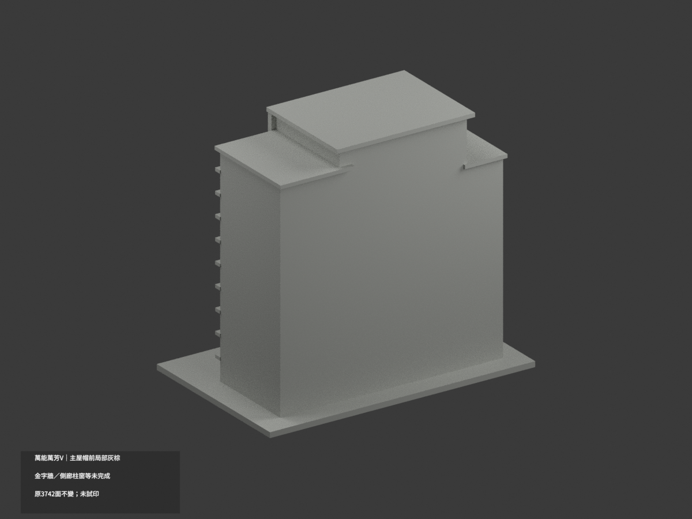
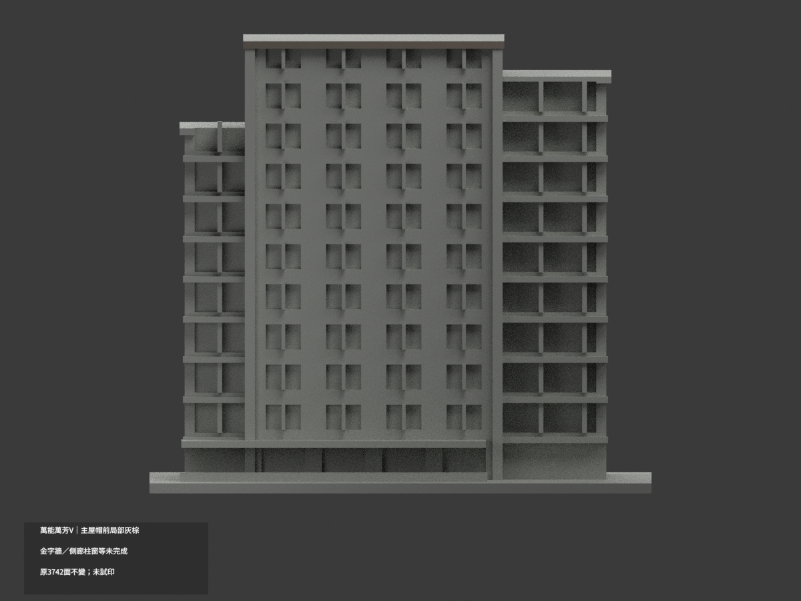
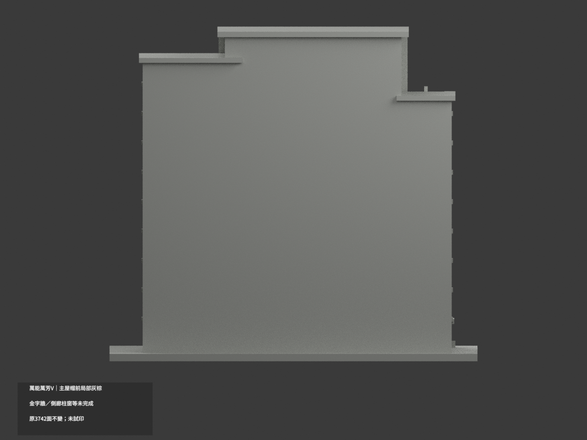
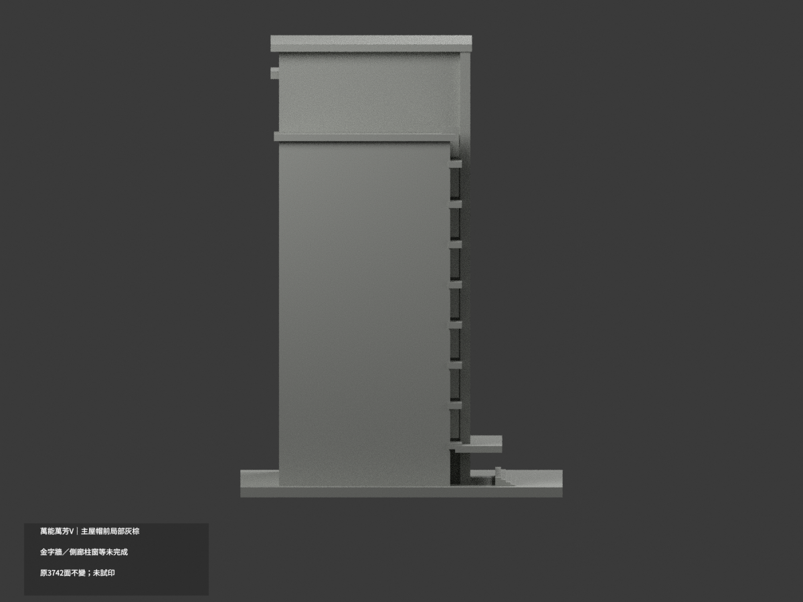
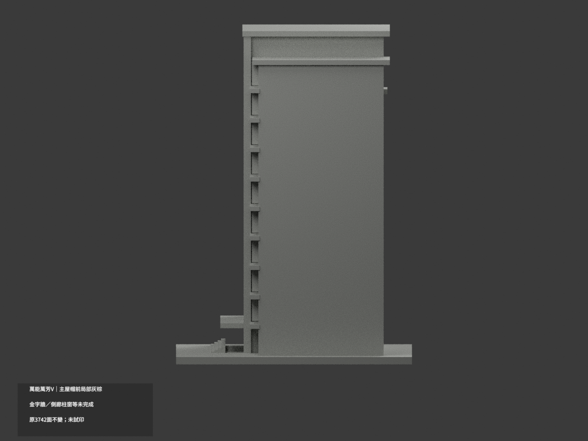
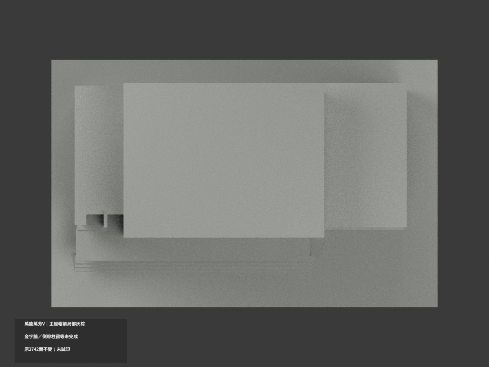
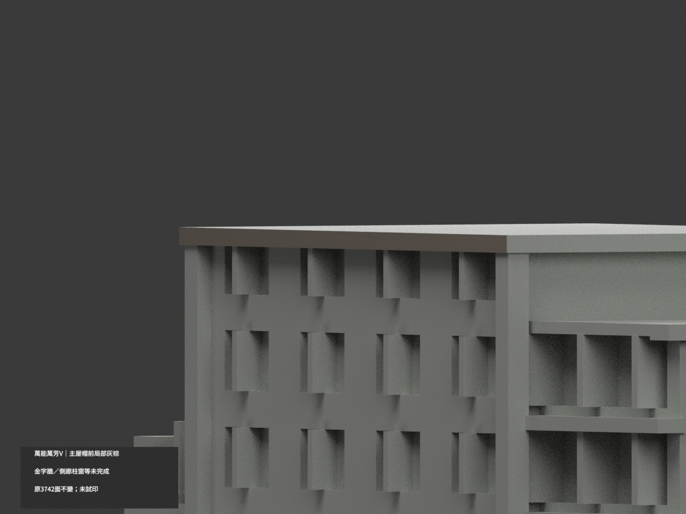
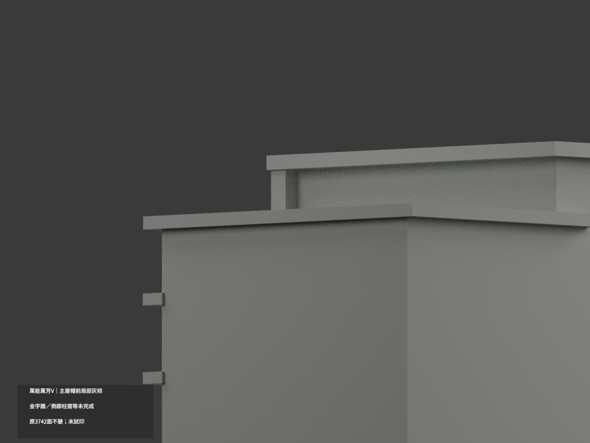
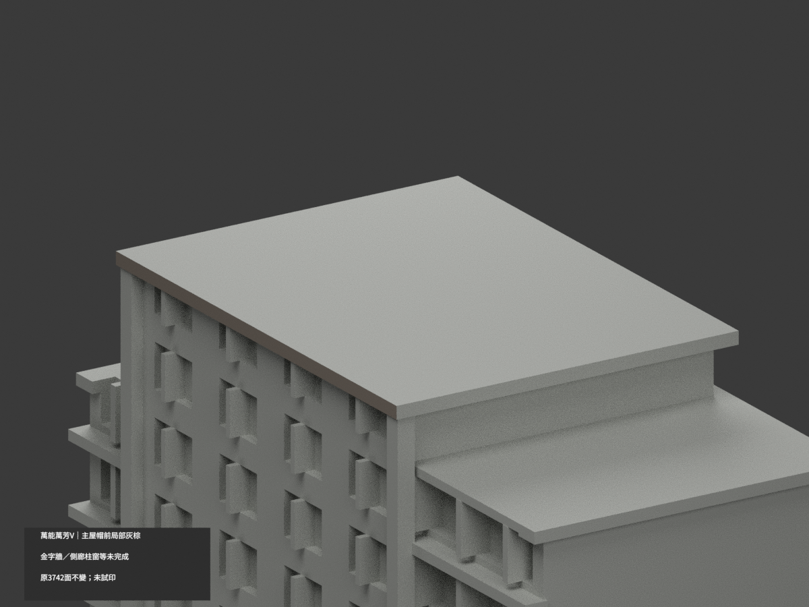

# 萬能萬芳樓 V｜主屋帽前緣局部灰棕

**金字牆、側廊與柱窗等材域未完成分色。** partial_color_incomplete=true、fully_colored_exterior=false。只主高樓屋帽前外沿完整2面名義灰棕，非全棟完整補色。

| 總覽 | 背側 | 正面 |
|---|---|---|
||||
||||
||||
||||

## 材色範圍
同 vnu-wanfang-v 原項目，same-item、count_delta=0。萬能科技大學校本部萬芳樓單群；萬能會館與迎賓用途非另棟，不增套數。3742原三角與STL/build_model.py原bytes不變，17原件無OBJ，不造原件。
- y−21整個無限plane只含2三角，完整矩形x−47..31、z132..134.2全納，未裁掉隱蔽部分，全部3頂點有限域核對，不normal或centroid漏選。
- 其餘3740面中性。右開廊屋帽10個連通三角的照片遠右終點未證，全體不染；同plane另18片凹口並非屋帽。金字主牆、全高柱跨遮蔽基座、窗框反光、左翼、入口與地面均不擴染。
- 主帽頂、底、左右回面及其他屋面未知中性。灰棕不是黑色陰影，HEX是名義族非精確材料。原近似幾何不修正或藉補色追認精度，不新增金字。中性色邊界不代表真實材縫。

## 來源與日期
親看官方190×143照片，洪志傑攝影標記保留於私有原照；只主帽前緣完整可辨。拍攝日未知，不稱2026現況或測繪。原照片私人不公開、不作紋理，未確認CC或再散布授權，不保證商用。

## 格式與列印
[原STL](model.stl) · [逐面材色3MF](appearance.3mf) · [Blender](scene.blend)
原150mm底座示意比例非測量比例。實際物件名 VNU Wanfang V partial color，真slug與館名獨立核對。STL無色；3MF、Blender逐面分材。兩材標籤非兩色或四色耗材切片驗證，未實際列印。

## 重建與 QA
原build_model.py → colorize_model.py → export_appearance.py → validate_color.py；Blender render_color.py／verify_color_scene.py。完整隔離Shapely2.1.2精確原build＋color重建、原bytes／全三角multiset、閉合正體積、3MF逐面材、scene重開、十圖1200×900與圖文hash。原README、previews及validation保留歷史不冒充新QA，沒有刪檔。

## English scope
Partial only:2 complete main tower cap front faces muted gray-brown;3740 neutral. Whole y-21 infinite-plane selection equals finite rectangle x-47..31,z132..134.2. Right loggia cap10 connected triangles remain neutral because full photographic termination is not verified. Gold-lettered walls, full-height piers, glazing, roof top/underside/returns, rear and base remain neutral. Original3742 triangles and17 immutable files unchanged,noOBJ. Wanfang hotel/reception associations are one building, not added models. Original190x143 photo nominal family only, unknown capture, not2026 survey. No tested filament slicing.
