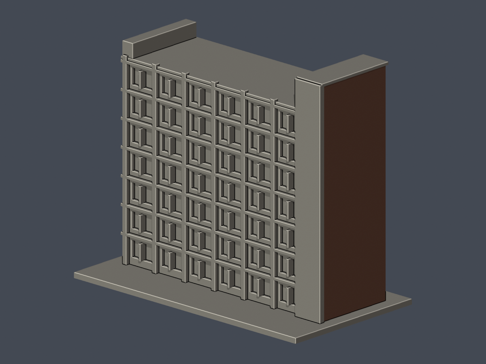
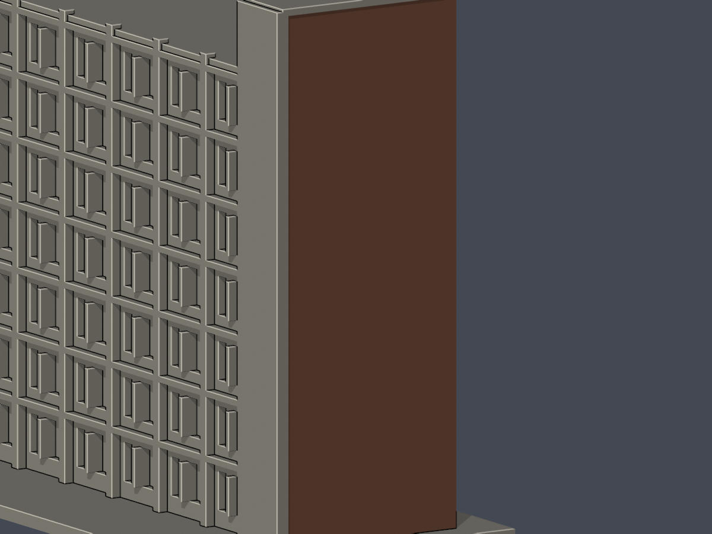

# 萬能科技大學育才樓（L）

## 右端牆局部補色

[原 STL（無色）](model.stl) · [逐面材色 3MF](side-colored.3mf) · [可編輯 Blender 場景](scene.blend)

只把模型右端塔體的一片外牆補為近似磚紅 `#AF775D`。原網格上此牆恰為 2 個三角，位於 `x=+67.5 mm`、`y=−14.5…31 mm`、`z=3…126 mm`，外法向為 +X，原面積 5,596.5 mm²。其餘 2,946 面仍是原暖石展示色，不是實物已驗證材色，亦非全棟完成分色。原 2,948 三角、STL、底板與三張預覽皆不變。

| 補色總覽 | 右端局部 |
|---|---|
|  |  |
| 完整模型含底板，無文字。 | 局部裁切，僅作材色範圍檢核。 |

校方 190×143 像素照片可辨右端磚紅大面，細淺橫條沒有獨立原面，未切網格或加紋理；整個矩形只代表主牆色族。照片未涵蓋整座牆的上下緣，延續部分為同一牆面推估。相鄰前側淺色窄面、正面、屋頂、底板及後側都不延伸補色。拍攝年月未知，顏色未校準，不代表 2026 現況，不附原照片。

- [色域](side-color-domain.json) · [材色](side-color-palette.json) · [交換格式 QA](side-color-exchange-QA.json) · [場景 QA](side-color-scene-QA.json) · [獨立面域比對](side-color-independent-QA.json)
- 3MF 及 Blender 的面材可修改；沒有實測材料、正式切片或實體試印。場景 RNA 檢查排除 UV Sculpt 及執行期欄位。
- 用原重建命令產生中性場景後，可從套件根目錄執行 `blender -b scene.blend --python source/apply_side_color.py` 重套兩面材色，不需另存公開備份。

## 原代表圖（維持原中性預覽）

| 模型預覽 | 模型預覽 | 模型預覽 |
| :---: | :---: | :---: |
|  |  |  |
| 正面 | 背面（未見處簡化） | 立面 |

依公開官方外觀實拍的微縮研究，非測繪級BIM，亦非2026即時完整外觀保證。

## 證據及近似
- 七排窗帶與粗直向立柱
- 右側突出且高於主體的封閉端牆
- 左端低屋突及平屋頂

照片下緣裁切首層、部分左端；依可見窗排近似延伸，非完整地面測繪。未取得後側及精確深度，未虛構背窗。 官方實拍只有190×143像素，沒有放大新增細節；細窗、柱、深度及間距均為視覺近似，不能作精確復原。現行總務處校圖仍標此館，未取得照片拍攝年代。側後遮擋明示簡化。省略招牌文字、空調、植栽、細欄杆。

## 比例與重建
- 含底板尺寸：150.00 × 84.00 × 127.60 mm，單件最長150mm，各件獨立比例。
- 安裝 requirements.txt；執行 python build_model.py 重建STL，再用 blender -b -t 2 -P render_preview.py 重建原中性可編輯場景與預覽；只想套上面材時用上方重套腳本，無需重新產生任何原代表圖。
- 執行 validate_model.py、check_layers.py、check_thin_features.py 複核。

## 檢查及列印限制
- 原STL法向/邊與頂點流形、正體積、單一連通外表面、無分離內腔殼、重建SHA與Blend/STL三角幾何一致：全部通過。
- 0.2mm間距非共面微偏移截面638層，每個閉環及組合Polygon有效性assert全通過，未自動修補無效形狀。
- 0.8mm XY開運算（1mm抽樣）0層超過1%面積損失，最大0.10%。未出現超過1%面積損失層；附牆窗框至少1.1mm。
- 窗頂、拱口、柱廊、雨庇可能需支撐；此篩查不是完整壁厚測量、正式切片或實體試印，支撐不能補救噴嘴解析度。請在切片器複查材料、橋接及支撐可移除性。

## 公開來源
- https://www.vnu.edu.tw/campus
- https://www.vnu.edu.tw/images/campus/map31.png
- https://www.vnu.edu.tw/school_tour.html
- https://administration.vnu.edu.tw/oga/3130
- https://resource.vnu.edu.tw/images/webmap/webmap.jpg

第三方照片及校圖不隨公開模型包重製。
